# NexusAgent-Eino 参考架构（面向 nexus-lab 重建）

> 生成日期：2026-11-03
> 参考实现：`/Users/shang/Documents/workspace/personal/go-work/NexusAgent-Eino`（分支工作区只读对照）
> 读者：`nexus-lab` 重建者。目标不是复述代码，而是回答「重建时该看什么 / 该抄什么 / 为什么要改」。
> 约束：本文所有 `文件:行号` 锚点均指向参考仓库的真实位置；所有容量与质量数字均注明来源文档与限制条件，未经验证的性能承诺一律不写。

---

## 目录

| 章节 | 内容 | 重建者主要收益 |
|---|---|---|
| 第 0 部分 | 阅读指引与全局地图 | 建立分层心智模型，避免一上来就抄文件 |
| 第 1 部分 | 系统架构（进程 / 装配 / 存储 / 前端） | 知道每个进程为什么存在 |
| 第 2 部分 | 11 条主流程时序 | 每条链路的状态语义与失败语义 |
| 第 3 部分 | 技术实现细节（代码级） | 关键不变量的具体实现位置 |
| 第 4 部分 | 横切设计（一致性 / 并发 / 安全 / 观测 / 容量 / 关停） | 系统性决策的取舍依据 |
| 第 5 部分 | nexus-lab Phase 0–10 对照清单 + 参考项目已知局限 | 直接当 Sprint 的对照表用 |

---

# 第 0 部分 · 阅读指引与全局地图

## 0.1 这份文档是什么、不是什么

**是**：一份「参考答案级」架构文档。每一节末尾给出取舍说明（看什么 / 抄什么 / 为什么改）。

**不是**：
- 不是中立说明书 —— 参考项目本身有明确的设计主张，本文档把主张连同代价一起呈现。
- 不是 Phase 分阶段教程 —— 阶段划分属于 nexus-lab 的 AISDLC 流程，见第 5 部分。
- 不是性能承诺 —— 参考项目的实测数字全部带条件，见 §4.5。

**参考实现的规模基线**（`backend/` 目录，2026-11-03 实测）：

| 指标 | 数值 | 统计方式 |
|---|---:|---|
| Go 源文件（非测试） | 191 | `find backend -name '*.go' -not -name '*_test.go'` |
| Go 代码行（非测试） | 28,964 | 上述文件 `cat` 后 `wc -l` |
| 数据库迁移 | 13 组（001–013，含 down） | `backend/migrations/` |
| 表 | 42 | `CREATE TABLE` 去重（`migrations/*.up.sql`） |
| 进程入口 | 7 | `backend/cmd/*`（server / worker / docparser / cli / migrate / loadtest / agenteval） |
| Prometheus 指标 | 11 | `backend/internal/observability/metrics.go` |

> **对照提示**：参考项目的代码行数不是目标值。它的价值在于**不变量的密度**（例如「取消 ≠ 失败」在 6 处不同代码里被重复实现）。nexus-lab 应该抄不变量，不抄行数。

## 0.2 全局分层图

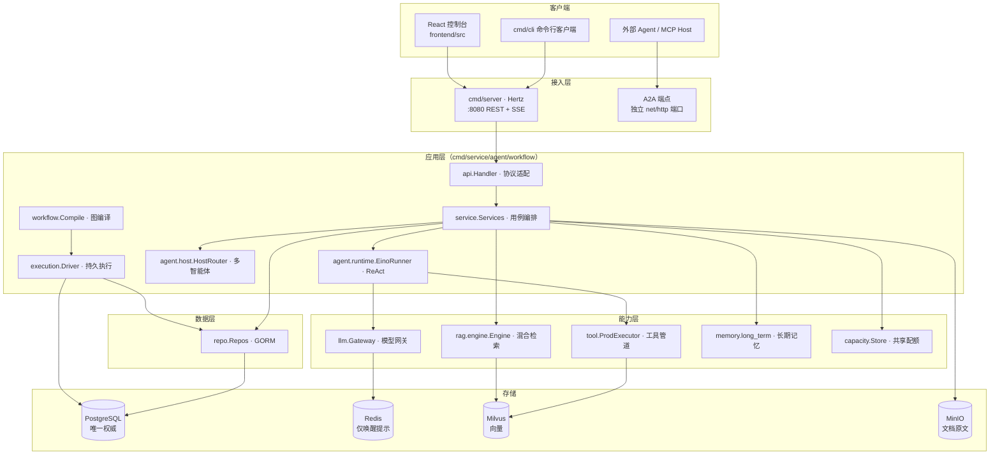

**依赖方向铁律**（参考项目 `cmd/server/main.go:1-14` 的包注释即此意）：

```
cmd（只装配） → api（只做协议适配） → service（管事务/错误码/权限） → agent / workflow（管执行语义） → repo（只做数据访问）
```

任何反向依赖（例如 `repo` 反向 import `service`、`llm` 反向查库）都被视为 bug。参考项目把这条铁律落到了具体位置：
- `llm.Gateway` **不查库**：`model_configs` → `ModelDescriptor`（含解密后的 api_key）的解析在 service 层完成（`backend/internal/llm/gateway.go:1-6`）。
- `host.HostRouter` **不直依赖 gateway**：路由调用通过 `RouterChat` 函数类型注入（`backend/internal/agent/host/host.go:45-48`）。
- `tool.Executor` **不判断权限**：权限由 service 注入的 `SetAccessCheck` 回调完成（`backend/internal/tool/executor_impl.go:55`）。

> **对照提示**：「不许反向依赖」比「不许写业务逻辑在 cmd 里」更难遵守，因为反向依赖编译期不会报错。重建时建议在 CI 里加一条 import 方向检查（用 `go list -deps` 或 depguard），而不是靠自觉。

## 0.3 目录 → 职责 → 「不该做什么」

| 目录 | 职责 | 不该做的事（参考项目里的具体反例） |
|---|---|---|
| `backend/cmd/*` | 进程入口、依赖装配、优雅关停 | 写业务逻辑。`cmd/server/main.go` 里只有装配与关停，`kbSearchFunc` 是唯一例外，且它只是回调适配（`cmd/server/main.go:285-286`） |
| `backend/internal/api` | HTTP/SSE 协议适配、鉴权与门禁中间件 | 查库拼业务。`handler_workflow.go` 全文只做参数绑定 + 调 service（`api/handler_workflow.go:1-214`） |
| `backend/internal/service` | 用例编排、事务边界、错误码转换、权限校验 | 直接写 SQL。全部数据访问经 `repo` 接口（如 `tool.Executor` 的 `ToolRepo` 接口，`tool/executor_impl.go:30`） |
| `backend/internal/agent` | Agent 执行语义（ReAct 循环、上下文预算、Host 路由） | 感知 HTTP。`agent` 包不 import `api`，也不 import `service` |
| `backend/internal/workflow` + `internal/execution` | 图编译解释 + 持久执行（租约 / fencing / 幂等 / 审批） | 直连数据库表。`execution.Store` 是唯一写 `workflow_runs` 的地方 |
| `backend/internal/llm` | 供应商接入、熔断、限流、重试、失败转移、计量 | 查 `model_configs`、解密凭据 |
| `backend/internal/tool` | 工具注册、统一执行管道、Schema 校验 | 判断「谁能用该工具」——那是 service 的事 |
| `backend/internal/rag` | 索引与检索融合、降级 | 决定「何时检索」——那是 service 的事 |
| `backend/internal/memory` | 长期记忆抽取 / 召回 / 重建 | 会话编排 |
| `backend/internal/capacity` | 共享额度、租约、公平领取 | 决定业务优先级 |
| `backend/internal/security` | JWT、AES 加密、提示注入检测、PII 脱敏、**出站 HTTP 策略** | 业务鉴权判定（归属校验在 service） |
| `backend/internal/repo` | GORM 数据访问 | 业务判断、事务边界编排（事务边界在 service / execution） |
| `backend/internal/mcp` `internal/a2a` | 外部协议适配 | 业务编排 |
| `backend/internal/observability` | OTel / Prometheus / 结构化日志 / 诊断端点 | 业务埋点决策 |
| `backend/internal/infra` | PG / Redis / Milvus / MinIO 客户端构造 | 任何业务语义 |

---

# 第 1 部分 · 系统架构

## 1.1 进程模型

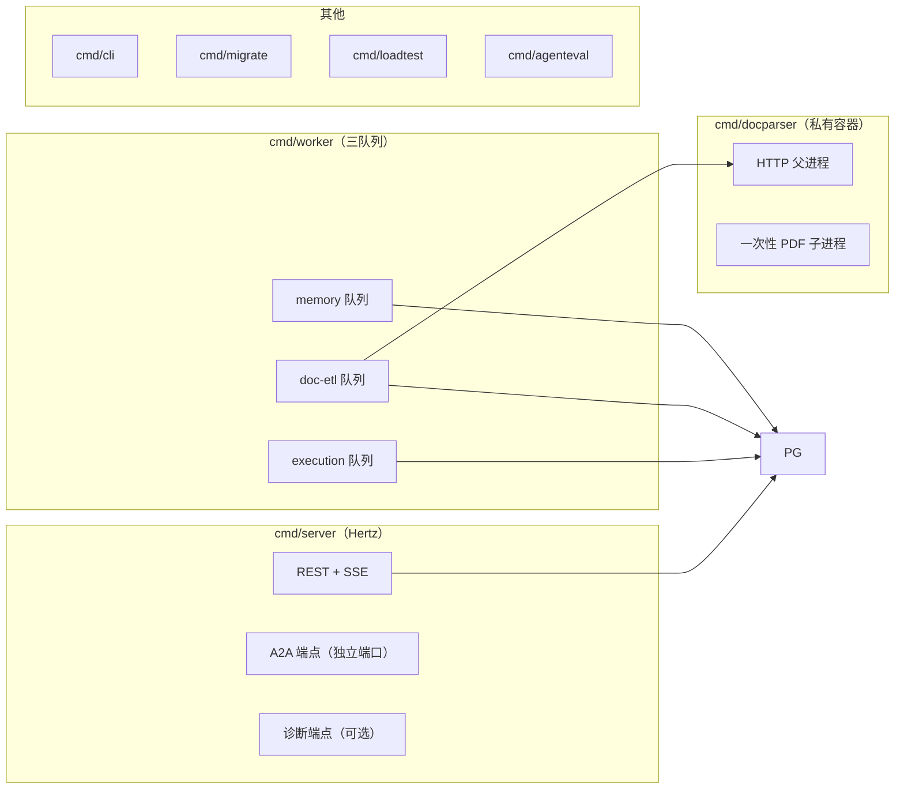

| 进程 | 入口 | 依赖 | 职责 | 关键约束 |
|---|---|---|---|---|
| API | `backend/cmd/server/main.go:49` | PG + Redis + Milvus + MinIO | 交互式对话、REST 管理接口、A2A 入站 | 写超时为 0（SSE 逐块刷新 deadline），`cmd/server/main.go:182` |
| Worker | `backend/cmd/worker/main.go:37` | 见下 | 持久执行 / 文档 ETL / 记忆抽取 | 三队列可独立选择；`execution` 只需 PostgreSQL（`cmd/worker/main.go:39`） |
| docparser | `backend/cmd/docparser/main.go:1` | 无（本地子进程） | PDF 解析 | **必须独立容器**：父进程 HTTP 监管一个一次性子进程，恶意压缩输入 OOM 只杀子进程（`docs/research/2026-10-20-p4-runtime-hardening.md`） |
| cli | `backend/cmd/cli/main.go` | API | 命令行客户端 | — |
| migrate | `backend/cmd/migrate/main.go` | PG | 迁移执行 | — |
| loadtest | `backend/cmd/loadtest/main.go` | API | 压测 | 四种 mode：`peer` / `stage` / `prepare` / `bootstrap`（`cmd/loadtest/main.go:18,32,41`） |
| agenteval | `backend/cmd/agenteval/main.go` | API + 模型 | Agent 评估 | — |

### Worker 的三队列切分

`cmd/worker/main.go:37-49` 接受 `-queues execution,doc-etl,memory`，每个队列的依赖不同：

| 队列 | 需要的存储 | Worker 实现 | 消费者 |
|---|---|---|---|
| `execution` | 仅 PostgreSQL | `execution.Worker`（`internal/execution/worker.go:71`） | `execution.Driver` |
| `doc-etl` | PG + Redis + Milvus + MinIO | `worker.Worker`（`internal/worker/worker.go:90`） | `rag.engine.IndexDocument` |
| `memory` | PG + Milvus | `long_term.Worker`（`internal/memory/long_term/worker.go:61`） | `long_term.Manager.Process` |

**权威性约定**（贯穿全项目，是参考项目最值得抄的一条）：

> **PostgreSQL 是执行状态的唯一权威。Redis 只做唤醒提示，Milvus / MinIO 只做派生数据。**

实现证据：
- Worker 即使收不到通知也持续轮询 PG：`internal/execution/worker.go:63-66`（"Notify is only an accelerator. Run keeps polling PostgreSQL without it."）。
- 通知投递是「至少一次」：outbox 表 + `published_at` 标记，崩溃后重投同一 `(run_id, seq)`，消费方按该元组去重（`internal/execution/outbox.go:28-31`）。
- doc-etl worker 的 `New` 签名里 Redis 参数被显式忽略：`_ *redis.Client`（`internal/worker/worker.go:77`）。

> **对照提示**：如果重建时把 Redis 当成队列/状态源，你会失去「Redis 挂了系统仍能跑」这个性质，并且无法解释 at-least-once 去重的必要性。这条必须抄。

### 优雅关停的进程内顺序

`cmd/server/main.go:222-245`：

```
收到 SIGINT/SIGTERM
  → cancel()                      # 通知后台 goroutine
  → svcs.Chat.Close(shutdownCtx)  # 等运行中对话的最终落库与配额释放
  → h.Shutdown(shutdownCtx)       # Hertz 停收新请求
  → closeA2A(shutdownCtx)         # A2A 端点
```

总预算 = `cfg.HTTP.ShutdownTimeout`（默认 10s，`backend/configs/config.yaml`）。`ChatService.Close` 用 `sync.WaitGroup` 等所有活跃运行结束，且**每一步都有独立的 3s 写入预算**（`internal/service/chatsvc.go:63-79`）。

> **对照提示**：关停顺序不是「随手写个 defer」。`Chat.Close` 必须在 `h.Shutdown` 之前，否则会被正在写的请求打断，产生半截消息。

## 1.2 依赖装配顺序（`cmd/server/main.go:run()` 十三步）

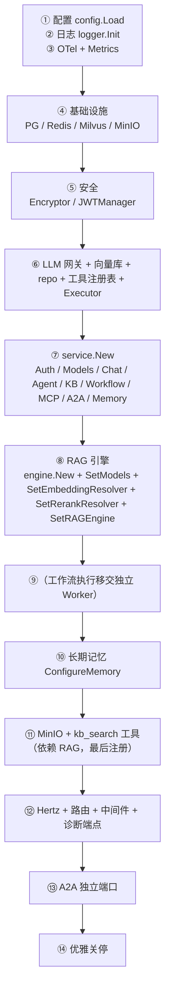

关键点与原因：

1. **`main` 是唯一知道所有具体实现的地方**。`service.Deps` 是纯数据结构（`internal/service/service.go:30-43`），所有反向注入都通过 setter 完成。
2. **RAG 引擎在 service 之后**：`engine.New` 需要 `gateway + store + repo`，而 `repo` 由 `service.New` 内部构造。参考项目用 `SetRAGEngine` 反向注入解决循环（`internal/service/service.go:177`）。
3. **模型解析全部实时化**：embedding / rerank / memory extractor 都不在启动时固化，而是每次调用时实时查库（`SetModels(svcs.DefaultEmbedding, svcs.DefaultRerank)`，`cmd/server/main.go:160`）。**改配置无需重启**是参考项目的一条产品级承诺。
4. **`kb_search` 工具最后注册**：它依赖 RAG 引擎（`cmd/server/main.go:172-174`）。
5. **工作流执行不在 API 进程内**：`cmd/server/main.go:164` 有一行注释明确说明「Workflow handlers persist submissions; the separate worker owns Eino execution.」

> **对照提示**：如果你在重建时把工作流执行放回 API 进程，你会同时失去：API 进程重启不丢运行、API 与 Worker 的容量配额分离、以及「提交接口快」这一用户体验。建议照抄这个切分。

## 1.3 能力分层：每层「能感知什么 / 不能感知什么」

| 层 | 能感知 | 不能感知（硬边界） |
|---|---|---|
| `cmd` | 全部具体实现、进程生命周期 | 业务规则 |
| `api` | HTTP 语义、身份（通过中间件注入的 `security.UserIDFromContext`） | 业务规则、事务边界 |
| `service` | 用户身份、权限、数据、模型配置、错误码 | HTTP 细节（不感知 header 以外的东西） |
| `agent` / `workflow` | 运行上下文、工具定义、预算 | 用户是谁（只有 `ctx` 里的 userID 作用域）、HTTP |
| `llm` / `tool` / `rag` | 描述符与定义 | 业务归属判断 |
| `repo` | SQL | 业务规则 |

这一分层不是文档约定，而是有代码强制的：
- `agent` 包的 `runtime.RunInput` 不含 `userID` 字段；作用域通过 `context` 传递（`internal/security/context.go:8-15`）。
- `tool.Executor.Invoke` 的错误信息被刻意模糊化：`"tool binding or authority unavailable"`（`internal/tool/executor_impl.go:180`），不泄露「是因为你不是管理员」还是「工具不存在」。

## 1.4 存储职责划分

| 存储 | 权威性 | 存什么 | 丢了会怎样 |
|---|---|---|---|
| **PostgreSQL** | 唯一权威 | 用户 / Agent / 工具 / 会话 / 消息 / 知识库 / 分块 / 工作流定义 / 运行 / 操作账本 / 审批 / 事件 / outbox / 容量策略与租约 / 记忆元数据 | 业务不可用 |
| **Redis** | 仅唤醒提示 | refresh token 白名单、Pub/Sub 通知、Stream 审计提示、session 窗口缓存 | 降级：Worker 靠轮询继续跑；登录态需要重新登录 |
| **Milvus** | 派生数据 | 文档分块向量、记忆向量 | 检索降级为 `dense_unavailable`，仍可用关键词路 |
| **MinIO** | 派生数据 | 文档原文 PDF | ETL 重试即可重建 |

四个「派生数据」的一致性策略是统一的：**删除时按版本空间删除，重建时幂等覆盖**。

- 文档向量按 `embedding_version` 分集合，删除时遍历所有版本空间（`internal/rag/engine/engine.go:288-305`）。
- 记忆向量按 `MemoryCollection(embeddingVersion)` 分集合（`internal/memory/long_term/durable_types.go:43`），迁移时清理旧空间且**不会删除当前活跃空间**（`internal/memory/long_term/processor.go:300-306`）。

## 1.5 前端控制台结构

```
frontend/src
├── api/          agent.ts chat.ts kb.ts memory.ts workflow.ts admin.ts
├── components/
│   ├── layout/   AppLayout Sidebar Topbar
│   └── ui/       primitives Modal ConfirmDialog ToastHost
├── lib/          request.ts（鉴权与 401 重放） sse.ts（字节流解析） format.ts gsap.ts
├── pages/
│   ├── chat/     ChatPage Composer MessageBubble SessionList TraceTimeline
│   ├── agents/   AgentsPage
│   ├── kbs/      KnowledgeBasesPage KBDetailPage
│   ├── memories/ MemoriesPage
│   ├── workflows/WorkflowsPage WorkflowRunsPage
│   └── admin/    ModelsAdminPage IntegrationsPage MCPToolsModal A2ATasksModal
├── stores/       auth.ts chat.ts ui.ts（zustand）
└── types/        api.ts auth.ts chat.ts agent.ts kb.ts memory.ts workflow.ts admin.ts
```

`lib/sse.ts` 是前端唯一的技术难点，值得完整抄：

```
event: <type>\n
data: <json>\n
\n            ← 空行即帧边界
```

关键坑（注释原文，`frontend/src/lib/sse.ts:12`）：TCP 分包可能把一帧劈成两半，必须缓冲半帧。因为对话是 POST + JSON body，浏览器原生 `EventSource` 不支持，所以用 `fetch` + `ReadableStream` 手动解析。

> **对照提示**：`lib/sse.ts` 是「客户端流式协议」的核心资产，比后端任何单个函数都更值得先抄。它的后半段（帧缓冲 + AbortController 中断）可以直接复用。

---

# 第 2 部分 · 核心流程文档

每条流程给出：角色时序图 → 状态与失败语义 → 代码锚点表 → 取舍说明。

---

## 2.1 流程一：一次交互式对话（Chat，SSE 全链路）

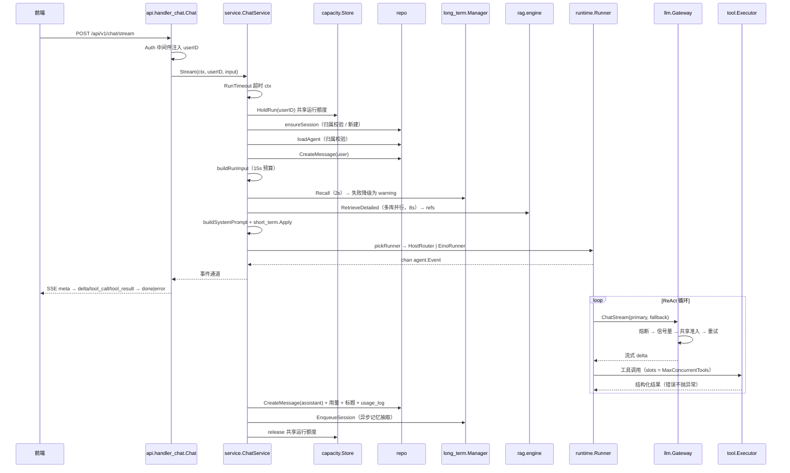

### 状态与失败语义

| 阶段 | 失败模式 | 语义 |
|---|---|---|
| 准入 | `capacity.ErrBusy` | → `ErrRateLimited`「共享运行额度已满」（`internal/service/chatsvc.go:136-142`），**不重试** |
| 上下文组装 | 长期记忆召回失败 | 降级：warning「长期记忆暂不可用」，继续回答（`chatsvc.go:275-277`） |
| 上下文组装 | RAG 检索失败 | 降级：warning「知识库检索暂不可用」，继续回答（`chatsvc.go:293-298`） |
| 上下文组装 | 模型解析失败 | **直接失败**（必须拿到模型才能回答，`chatsvc.go:250-253`） |
| 流式消费 | 客户端消费过慢 | `ErrRateLimited`「客户端消费过慢，生成已停止」（`internal/service/chat_stream.go:118-121`） |
| 流式消费 | 请求取消 | `EvtDone("canceled")`，消息状态 `stopped`，**不是失败** |
| 落库 | 消息保存失败 | 终态改写为 `ErrInternal`，事件带 `persisted=false`（`chat_stream.go:166-172`） |
| 落库 | 租约失效 | 消息标记 `failed`，事件「执行租约已失效，答案未确认成功」（`chat_stream.go:170-181`） |
| 落库 | 用量/标题统计失败 | **只记日志，不影响终态**（`chat_stream.go:183-193`） |

### 关键不变量

1. **`done` 只在助手消息落库之后发布**。文本是暂定的（`internal/service/chat_stream.go:31-32` 注释）。这是「界面显示部分内容 ≠ 请求成功」的实现基础。
2. **取消 ≠ 失败**。落库使用 `context.WithoutCancel(ctx)` + 独立 3s 预算（`chat_stream.go:162-164`），保证请求取消不会取消最终写入。
3. **终态与内容分离**。`status` 字段与 `content` 分开持久化，失败也保留已生成的部分内容。
4. **降级优先于失败**。`chatsvc.go:11-12` 包注释原文：「每一路信息源失败都降级不阻塞，保证『回答永远出得来』」。

### 代码锚点

| 环节 | 位置 |
|---|---|
| SSE 桥接（Channel ↔ SSE） | `backend/internal/api/handler_chat.go:39` |
| SSE body（取消 + span 归属 + deadline 刷新） | `backend/internal/api/handler_chat.go:125-186` |
| 根 span 接管 | `backend/internal/api/middleware.go:119` |
| 编排总入口 | `backend/internal/service/chatsvc.go:94` |
| 会话保障 / 归属校验 | `backend/internal/service/chatsvc.go:206` |
| 上下文组装（最核心） | `backend/internal/service/chatsvc.go:245` |
| 多知识库并行检索合并 | `backend/internal/service/chatsvc.go:339-340` |
| Runner 选择 | `backend/internal/service/chatsvc.go:398` |
| 危险工具集合解析 | `backend/internal/service/chatsvc.go:465` |
| 事件泵 + 助手消息落库 | `backend/internal/service/chat_stream.go:33` |
| 异步记忆抽取 | `backend/internal/service/chat_stream.go:212` |
| 前端流解析 | `frontend/src/lib/sse.ts:36`（帧解析主体 `:79`，中断 `:46`/`:131`） |

### 取舍说明

- **看什么**：SSE 事件序列（`meta → reasoning/plan/tool_call/tool_result/agent_event/refs/usage → delta* → done|error`）与终态时序。
- **该抄什么**：① `done` 在落库后才发；② 落库用 `WithoutCancel`；③ 四路上下文各自降级为 warning；④ 取消与失败严格分离。
- **为什么要改**：参考项目用 Hertz 的 `SetBodyStream` 实现流式，nexus-lab 若用标准库 `net/http` 需要自己解决「写超时」与「客户端断开感知」，但**语义（done 时序、取消语义、终态分离）必须一致**。这是最容易被简化掉、也最容易造成「界面显示成功但库里没记录」的地方。

---

## 2.2 流程二：Eino ADK ReAct 循环与 `runMiddleware` 三职责

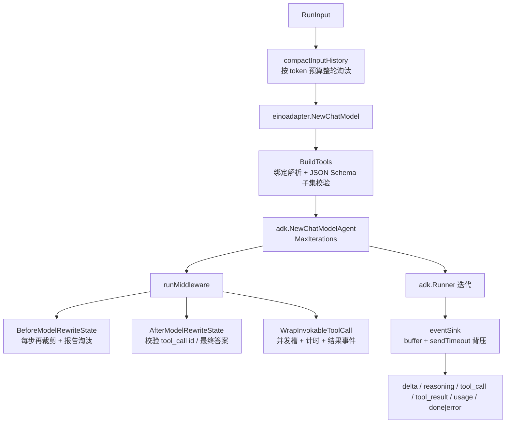

### 三职责

| 职责 | 位置 | 做什么 | 失败语义 |
|---|---|---|---|
| `BeforeModelRewriteState` | `internal/agent/runtime/eino_runner.go:261` | 每步模型调用前按 `InputTokenBudget` 重新裁剪历史；发 `progress` 事件说明淘汰了多少**完整轮次** | 裁剪后仍超预算 → `ErrBudget` |
| `AfterModelRewriteState` | `internal/agent/runtime/eino_runner.go:283` | 单步工具调用 ≤32；工具调用 ID 不缺失不重复；无工具调用时必须有非空回答 | → `ErrInvalidParam` / `ErrModelUnavail` |
| `WrapInvokableToolCall` | `internal/agent/runtime/eino_runner.go:305` | 并发槽限流、trace 计时、结果包成 `tool_result` 事件 | 识别 `error` / `timeout` / `approval_required` 三种状态 |

### 关键不变量

1. **整轮淘汰**：`compactInputHistory` 保留所有 system 消息、首个 user 之前的前缀、以及**最新一轮 user**；历史 user 轮按**整轮**删除（含该轮所有并行工具结果）。不生成摘要，不删除任何持久历史（`internal/agent/runtime/context_history.go:17-21`）。
2. **协议完整性先于裁剪**：`inputBudgetUsage` 在**丢弃任何历史之前**校验 tool_call ↔ tool_result 的配对完整性；配对断裂直接报错而不是静默裁剪（`internal/agent/runtime/limits.go:26-28` 注释 + `:29-60` 实现）。
3. **推理内容不算答案**：只有「本步没有 tool_calls 且 content 为空」才判定模型未生成有效回答（`eino_runner.go:297-302`）。
4. **背压**：消费者太慢时 `eventSink.Send` 超时 → `errBackpressure`，并 `cancel()` 整个运行（`internal/agent/runtime/eino_events.go:48-57`）。
5. **事件序号单调**：`eventSink` 分配 `Seq`，`RunID` 固定，便于前端去重与断线续传（`eino_events.go:39`）。

### 代码锚点

| 环节 | 位置 |
|---|---|
| Runner 构造与预算裁剪 | `backend/internal/agent/runtime/eino_runner.go:65` |
| 事件消费主循环 | `backend/internal/agent/runtime/eino_runner.go:114` |
| 运行时中间件 | `backend/internal/agent/runtime/eino_runner.go:250` |
| 上下文整轮淘汰 | `backend/internal/agent/runtime/context_history.go:22` |
| 预算与配对校验 | `backend/internal/agent/runtime/limits.go:13`、`:29` |
| 事件 sink 与背压 | `backend/internal/agent/runtime/eino_events.go:15`、`:28` |
| 工具绑定与 Schema 子集 | `backend/internal/agent/einoadapter/tools.go:37`、`:174` |

### 取舍说明

- **看什么**：`compactInputHistory` 的「整轮淘汰」语义。它比「按条裁剪」正确得多 —— 按条裁剪会留下孤立 tool_result，直接破坏模型协议。
- **该抄什么**：① 裁剪前先做协议完整性校验；② 保留 system + 当前 user 轮；③ 不生成摘要（摘要会引入额外模型调用与额外失败点）；④ 背压要**主动取消**而不是无限阻塞。
- **为什么要改**：`EstimateTokens` 是启发式估算（`internal/llm/tokenizer.go:11`），参考项目自己也标注「不是厂商计费或上下文保证」。重建时可以选择接真实 tokenizer，但要接受「tokenizer 与厂商不一致」这一新的不确定性来源。

---

## 2.3 流程三：Host 多智能体路由

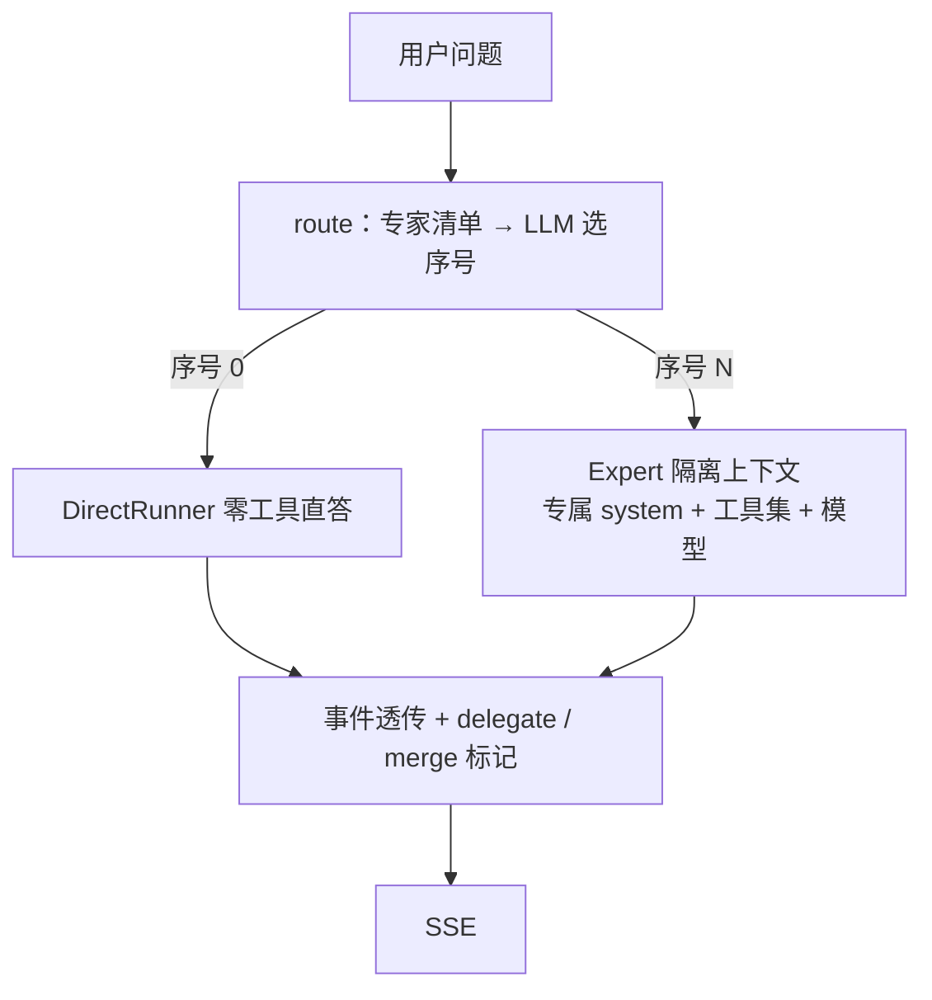

### 语义

| 环节 | 位置 | 说明 |
|---|---|---|
| 主循环 | `internal/agent/host/host.go:128` | 路由 → 委派 → 事件透传 → 合并标记 |
| 意图路由 | `internal/agent/host/host.go:223` | 一次**非流式** LLM 调用，只输出专家序号 |
| 序号解析 | `internal/agent/host/host.go:285` | 先试 JSON 数字，失败则扫描首个数字字符；超范围视为不匹配 |
| 上下文隔离 | `internal/agent/host/host.go:259` | `buildExpertMessages` 丢弃原 system，注入专家专属 system |
| 直答降级 | `internal/service/chatsvc.go:451` | `ToolsJSON="[]"`、`DangerousTools=nil` |

### 失败语义

- 路由超时 → `ErrModelTimeout`「Host 路由超时」；路由取消 → `EvtDone("canceled")`（`host.go:135-142`）。
- 专家流未发终态就关闭 → `ErrInternal`「expert stream ended without terminal」（`host.go:196-198`）。
- Expert 事件流返回 `TypeError` → 原样转发，不包装（`host.go:199-201`）。
- 合并标记只在 `finish_reason != "canceled"` 时发（`host.go:203-207`）。

### 取舍说明

- **看什么**：Host 只做**选择**不执行；每个 Expert 拥有独立上下文（system prompt + 工具集 + 模型），避免工具互相干扰。
- **该抄什么**：`RouterChat` 函数注入（`host` 不依赖 `llm.Gateway`）；序号解析的容错扫描；直答路径强制清空工具集。
- **为什么要改**：路由是一次额外的模型调用，会增加首 token 延迟与成本。参考项目没做「路由超时后直接走直答」的自动降级（只把超时作为错误上报）。重建时可以考虑：路由失败 → 降级直答，而不是整体失败。这是一个参考项目可以改进的点。

---

## 2.4 流程四：LLM 网关调用管道

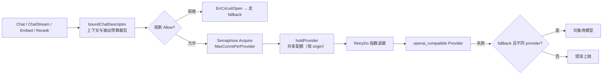

### 失败语义

| 环节 | 位置 | 语义 |
|---|---|---|
| 上下文预算 | `internal/llm/context_budget.go:14` | 请求 + 消息 + 工具 + 预留输出 > 上下文窗口 → `ErrBudget`，**不重试**（重试同样会超） |
| 熔断打开 | `internal/llm/gateway.go:84-87` | → `ErrCircuitOpen`，由上层决定是否 fallback |
| 信号量 | `internal/llm/ratelimiter.go:24` | ctx 取消即返回，不排队等死 |
| 共享准入 | `internal/service/service.go:93-104` | 按 origin 哈希分池；容量满 → `capacity.ErrBusy` |
| 重试 | `internal/llm/retry.go:24` | 指数退避；ctx 取消立即中止 |
| fallback（非流式） | `internal/llm/gateway.go:133-142` | 仅当 fallback 的 **provider 与 primary 不同**才切换；两边都失败则错误信息同时含 primary 与 fallback |
| fallback（流式） | `internal/llm/gateway.go:180-190` | **仅在首事件到达前生效**（流中失败无法重放） |
| 取消 | `internal/llm/gateway.go:346-349`、`:353-357` | 调用方取消**不计入熔断样本**，指标标记 `canceled` |

### 关键不变量

1. **网关不查库**：描述符由 service 解析。
2. **span 生命周期绑定流**：`spanOnClose` 把 span 的结束推迟到事件流关闭（`internal/llm/gateway.go:197`）。注释原文：「若放进 runWithGuard，拿到通道就返回，span 只有几毫秒，等于没测」（`gateway.go:171-174`）。
3. **同一 origin 共用一个容量池**：`sha256(origin)` 作为资源键，包括旧冻结描述符与改名后的供应商记录（`internal/service/service.go:99-102`）。

### 取舍说明

- **看什么**：`runWithGuard` 的执行顺序 —— 熔断 → 信号量 → 共享准入 → 重试 → 指标 → 熔断采样。顺序有讲究：**熔断在最外层**，避免已知故障的供应商消耗配额；**取消不计为失败**是熔断正确性的关键。
- **该抄什么**：流式 fallback 只在首事件前；`spanOnClose`；取消不计入熔断；预算裁剪在每次尝试（含 fallback）都重跑。
- **为什么要改**：参考项目的熔断是**进程内状态**（`internal/llm/fallback.go:13`，`Gateway.breakers` map）。多副本部署时每个副本各有一套熔断器，会出现「A 副本熔断、B 副本继续打」的不一致。重建时如果有多副本，需要把熔断状态外置（Redis 或 PG），或者明确接受「熔断是单副本粒度」并写进文档。**这是参考项目的已知局限，见 §5.2。**

---

## 2.5 流程五：持久化工作流（冻结定义 → 图编译 → 租约领取 → 幂等账本 → 检查点 → 审批中断 → 续跑）

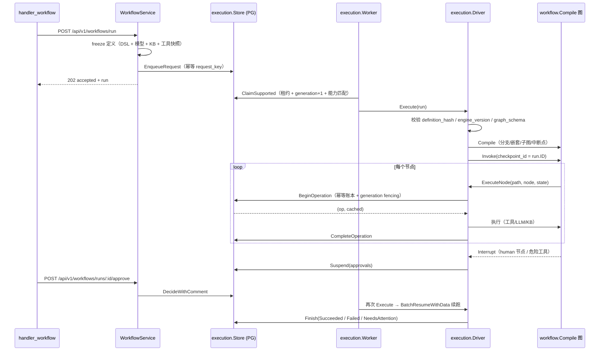

### 运行状态机

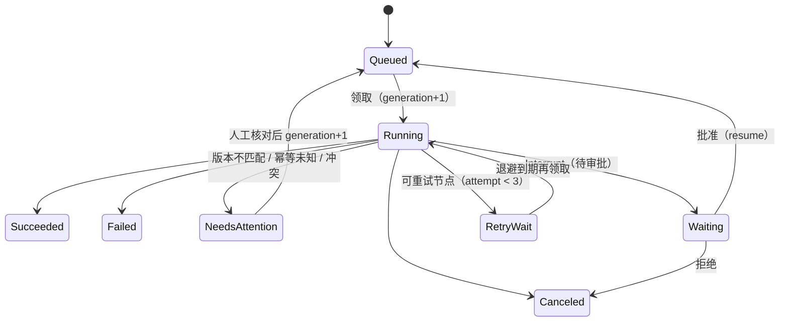

状态常量定义：`internal/execution/types.go:10-21`。

### 关键不变量

1. **定义冻结**：运行接受时冻结 DSL + 模型快照 + KB 快照 + 工具快照（含 `BindingVersion`、`Dangerous`、`ReplayPolicy`），存 `workflow_runs.definition`，并计算 `definition_hash`（`internal/service/workflow_snapshot.go:137`、`internal/execution/store.go:66`）。
2. **hash 校验**：执行时重新计算 definition 的 hash 并与 `run.definition_hash` 比对，不一致 → `NeedsAttention` + `ErrVersionMismatch`（`internal/execution/driver.go:47-50`）。
3. **generation fencing**：每次领取 `generation = generation + 1`（`internal/execution/store.go:168`）；所有后续写操作都用 `WHERE id=? AND generation=? AND lease_owner=? AND status='running' AND lease_until>now()` 限定（`internal/execution/store.go:198-200`）。
4. **检查点版本三元组**：`(definition_hash, engine_version, graph_schema)` 必须与运行一致，否则读写都返回 `ErrVersionMismatch`（`internal/execution/checkpoint.go:38-41`、`:44-46`）。
5. **公平领取**：按 `execution_owner_fairness.last_claimed_at` 排序，让等待最久的 owner 优先（`internal/execution/store.go:157`）。
6. **能力匹配**：`required_capabilities` 必须是 worker 能力集的子集（`internal/execution/store.go:146-151`），防止没有 MCP 的 worker 领取需要 MCP 的运行。

### 代码锚点

| 环节 | 位置 |
|---|---|
| 提交运行（冻结 + 幂等入队） | `backend/internal/service/workflow_execution.go:24` |
| 冻结定义 | `backend/internal/service/workflow_snapshot.go:137` |
| 幂等入队 | `backend/internal/execution/store.go:49` |
| 领取（租约 + fencing + 公平） | `backend/internal/execution/store.go:126` |
| 执行驱动 | `backend/internal/execution/driver.go:41` |
| 节点执行包装（幂等账本） | `backend/internal/execution/driver.go:78` |
| 检查点读写 | `backend/internal/execution/checkpoint.go:19`、`:43` |
| 审批挂起 / 决策 | `backend/internal/execution/store.go:261`、`:302` |
| 取消（把在途操作标 unknown） | `backend/internal/execution/store.go:378` |
| Worker 循环 | `backend/internal/execution/worker.go:71` |

### 取舍说明

- **看什么**：`fenced(tx, run)` 这一个函数（`store.go:198`）—— 它是整个 fencing 机制的中心，所有写操作都从它派生。
- **该抄什么**：① 定义冻结 + hash 校验；② generation fencing；③ 检查点版本三元组；④ 公平领取；⑤ 能力匹配。
- **为什么要改**：参考项目把 `workflow_runs` 同时用作「旧工作流模型」和「持久执行模型」（迁移 004 是加列而非重建表）。重建时应该**用两张表**（`workflow_runs` 产品侧 + `execution_runs` 引擎侧），避免历史数据迁移的复杂度。

---

## 2.6 流程六：审批（HITL）与恢复语义

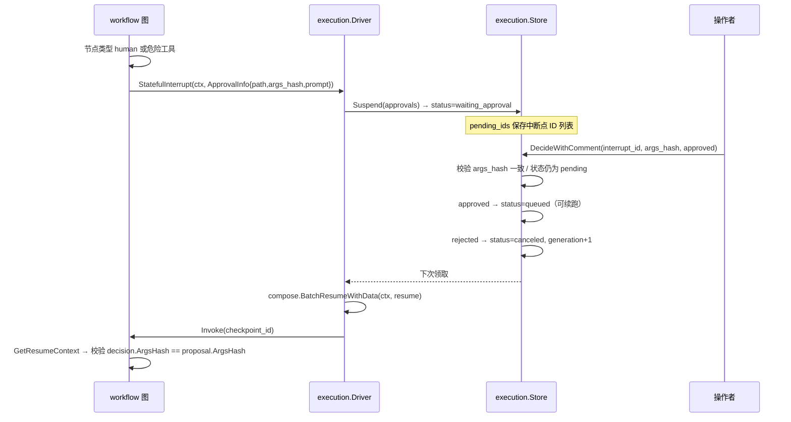

### 语义

| 场景 | 语义 | 位置 |
|---|---|---|
| 中断载荷 | `ApprovalInfo{Path, ArgsHash, Prompt}`，`ArgsHash = sha256({path,prompt,parameters})` | `internal/workflow/graph.go:20-27`、`:308` |
| 中断挂起 | `Suspend` 写 `execution_approvals`（decision=pending）+ `workflow_runs.pending_ids` | `internal/execution/store.go:261` |
| 恢复校验 | 恢复时 `decision.ArgsHash != proposal.ArgsHash` → 报错「approval rejected or arguments changed」 | `internal/workflow/graph.go:284` |
| 重复决策 | 相同决策重复提交幂等返回 nil；冲突决策 → `ErrConflict` | `internal/execution/store.go:339-344` |
| 过期 | `expires_at > clock_timestamp()` 才允许写入决策（`internal/execution/store.go:352`，影响行数不为 1 → `ErrConflict`，`:356-357`） | `internal/execution/store.go:352` |
| 参数变化 | 挂起时发现已有审批的 `ArgsHash`/`Path` 与本次不同 → `ErrVersionMismatch` | `internal/execution/store.go:284-288` |
| 审批能力传递 | 通过 `ctx` 传递 `WithToolApproval(code, argsDigest)`，**不能**来自请求头 / JSON / 模型输出 | `internal/agent/einoadapter/approval.go:15-18` |

### 取舍说明

- **看什么**：`ApprovalInfo.ArgsHash` 这条线。它把「审批的是哪次调用、哪些参数」绑定成不可变指纹，参数一变审批自动失效。
- **该抄什么**：① `ArgsHash` 绑定；② 审批能力走 `context` 而不是参数传递；③ 恢复时二次校验；④ 过期时间与运行 deadline 绑定。
- **为什么要改**：`internal/agent/einoadapter/approval.go:15-18` 的注释说明了审批能力**不来自普通 Agent 输入** —— 只有持久执行驱动在校验过 owner/interrupt/args hash 后才注入。重建时务必保持这个隔离，否则「模型自己声明已获批准」就会击穿 HITL。

---

## 2.7 流程七：工具执行管道与危险工具边界

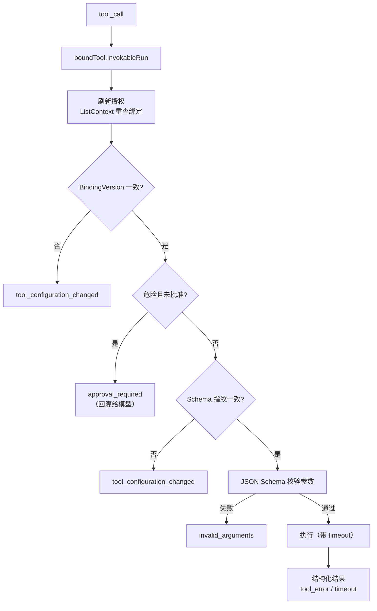

### 两层校验

| 层 | 位置 | 做什么 |
|---|---|---|
| 适配层（`boundTool`） | `internal/agent/einoadapter/tools.go:92` | 刷新授权、版本比对、危险判定、Schema 指纹、参数校验、输出截断 |
| 执行层（`ProdExecutor`） | `internal/tool/executor_impl.go:150` | 查定义、超时 ctx、panic recover、参数 JSON 校验、Schema 校验、绑定版本二次比对 |

### 危险工具策略（关键设计）

**危险工具不中断对话**，而是把 `{"error":"approval_required"}` 作为**工具观察回灌**给模型：

```go
// internal/agent/einoadapter/tools.go:112-114
if (t.dangerous || current.Dangerous) && !toolApproved(ctx, t.definition.Name, args) {
    return toolObservation("approval_required", "sensitive tool requires persistent approval"), nil
}
```

即：**模型能看到「这个操作需要审批」，然后由平台侧的持久审批状态决定后续行为**。审批能力只由持久执行驱动注入（见 §2.6）。

### 关键不变量

1. **调用前刷新授权**：长跑过程中工具被禁用或改判为危险，不能继续用启动时的元数据执行（`tools.go:93-95` 注释）。
2. **绑定版本指纹比对**：`BindingVersion` 变化 → `tool_configuration_changed`；Schema 指纹（参数 JSON 的原始串）变化 → 同上（`tools.go:108-116`）。
3. **Schema 子集白名单**：`checkSchema` 只允许固定的 JSON Schema 关键字集；`$ref` 必须是本地引用；`format` 只允许已知枚举；**禁止外部 schema 加载**（`denySchemaLoader`，`tools.go:158-162`、`:174-243`）。
4. **参数必须恰好一个 JSON 对象**：`decoder.Decode(new(any)) != io.EOF` 检查（`internal/tool/executor_impl.go:206-211`）。
5. **工具错误结构化回灌**：错误以 `{"error": ...}` 作为观察返回，而不是抛异常终止循环（`internal/tool/executor_impl.go:1-8` 包注释）。这是 Agent 自我修正能力的前提。
6. **panic recover**：handler panic 被捕获，输出 `{"error":"tool handler panicked"}`（`internal/tool/executor_impl.go:154-156`）。
7. **输出截断**：工具输出按 `MaxOutputBytes` 截断且保持 UTF-8 边界（`internal/agent/einoadapter/tools.go:152-162`）。

### 取舍说明

- **看什么**：`checkSchema` 的白名单。这是「远程 MCP 工具目录」安全性的核心 —— 不能让远端定义任意 JSON Schema。
- **该抄什么**：① 调用前刷新授权；② 版本指纹；③ Schema 子集 + 禁外部加载；④ 错误结构化回灌。
- **为什么要改**：`checkSchema` 的白名单是**字符串包含匹配**（`strings.Contains(allowed, " "+key+" ")`），可读性差且易错。重建时用 `map[string]bool` 更安全。

---

## 2.8 流程八：文档 ETL（上传 → 解析 → 有界分块 → 批量 embed → Milvus 索引版本）

```mermaid
flowchart LR
  UP["POST /kbs/:id/documents"] --> OBJ["MinIO 存原文<br/>content_hash + file_size"]
  OBJ --> JOB["document_jobs<br/>PostgreSQL 权威"]
  JOB --> WK["doc-etl Worker<br/>租约领取"]
  WK --> LOCK["LockSource 文档级互斥"]
  LOCK --> DL["从 MinIO 下载 + 完整性校验"]
  DL --> PARSE{"PDF?"}
  PARSE -->|"是"| DP["docparser 私有服务"]
  PARSE -->|"否"| LD["loader.Load"]
  DP --> CHK["splitter.SplitBounded<br/>有界分块（≤10000）"]
  LD --> CHK
  CHK --> PG["document_chunks 落库"]
  PG --> EMB["批量 Embed（batch ≤256）"]
  EMB --> MV["Milvus Upsert<br/>按 embedding_version 分集合"]
  MV --> DONE["document_jobs 完成 + 统计回填"]
```

### 语义

| 环节 | 位置 | 失败语义 |
|---|---|---|
| 上传落库 | `internal/service/kb_upload.go:24` | 原文先入 MinIO，再入 `document_jobs` |
| 领取与租约 | `internal/ingestion/store.go:140` | 租约 15s，心跳续期 |
| 文档级互斥 | `internal/ingestion/source_lock.go` | 同一文档不会被两个 worker 同时处理 |
| 完整性校验 | `internal/worker/worker.go:220-223` | hash 或 size 不符 → `Permanent`（不重试） |
| PDF 解析 | `internal/worker/worker.go:226-232` | 解析器不可用 → 可重试；解析失败 → `Permanent` |
| 有界分块 | `internal/rag/splitter/splitter.go:36` | 超过上限 → 报错，不静默截断 |
| 分块参数校验 | `internal/rag/engine/engine.go:168-171` | chunkSize 64..4096，overlap ≤ chunkSize/2 |
| 批量 embed | `internal/rag/engine/engine.go:225` | batch ≤256；数量/维度/NaN/Inf 都逐项校验 |
| 状态推进 | `internal/ingestion/lifecycle.go:30` | parsing → chunking → embedding → ready/failed |

### 取舍说明

- **看什么**：`IndexDocument` 的四段管线与每段的校验（`internal/rag/engine/engine.go:147-222`）。特别是「分块先落 PG，再 embed，再写 Milvus」——因为 Milvus 主键是 `chunk.ID`，必须先有 ID。
- **该抄什么**：① 原文与解析分离（docparser 独立容器）；② 有界分块与参数校验；③ embed 结果三重校验（数量 / 维度 / 非有限值）；④ 按 embedding_version 分集合。
- **为什么要改**：参考项目每次 embed 都同步等待（`embedChunks` 是同步循环）。文档多时 worker 吞吐低。重建时可以把 embed 改成批量异步任务，但要注意**幂等**：重试必须能覆盖同一批向量，而不是产生重复。

---

## 2.9 流程九：RAG 混合检索（先限域再 ANN → 双路召回 → RRF → rerank → 显式降级）

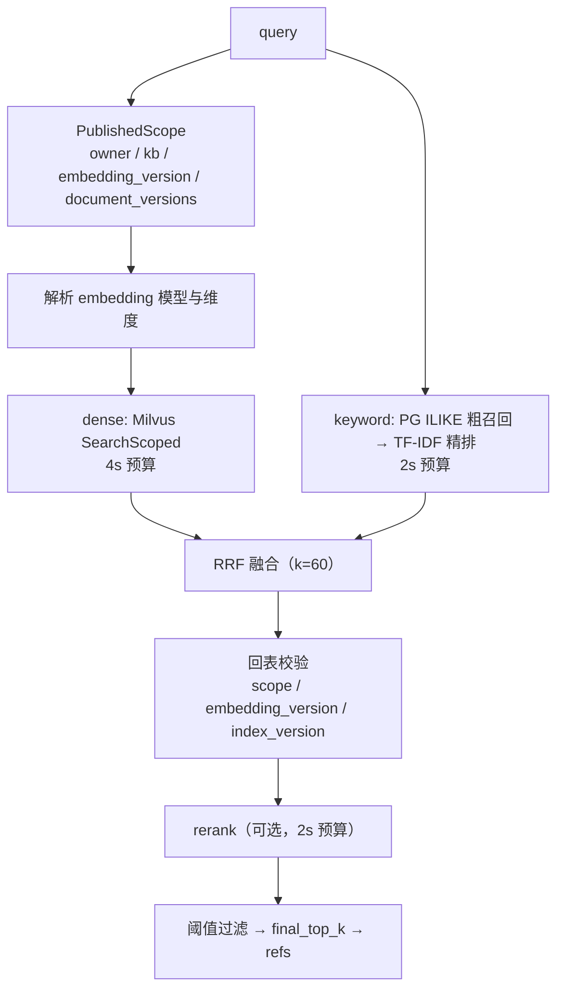

### 语义

| 环节 | 位置 | 说明 |
|---|---|---|
| 入口 | `internal/rag/engine/retrieve.go:30` | `RetrieveDetailed` |
| 限域 | `internal/rag/engine/retrieve.go:61-69` | `PublishedScope` 返回 owner/KB/embedding_version/document_versions；身份不匹配 → 报错 |
| dense | `internal/rag/engine/retrieve.go:88-111` | 4s 预算；维度不符 → 降级；`DenseScoreThreshold` 过滤 |
| keyword | `internal/rag/engine/retrieve.go:120-133` | 2s 预算；分词 ≤64 个 |
| 模式判定 | `internal/rag/engine/retrieve.go:138-145` | `hybrid` / `dense_only` / `keyword_only` |
| RRF 融合 | `internal/rag/engine/fusion.go:31` | k 默认 60 |
| 回表校验 | `internal/rag/engine/retrieve.go:155-173` | chunk 的 KB / embedding_version / content / index_version 必须与 scope 一致 |
| rerank | `internal/rag/engine/retrieve.go:176-204` | 2s 预算；失败 → `rerank_unavailable` 降级 |
| 显式降级 | `internal/rag/engine/retrieve.go:113`、`:131`、`:199` | `Degraded` 列表：`dense_unavailable` / `keyword_unavailable` / `rerank_unavailable` |
| 全路失败 | `internal/rag/engine/retrieve.go:136-138` | 两路都不可用 → 报错（不返回空结果冒充成功） |

### 取舍说明

- **看什么**：**限域发生在 ANN 之前**。`SearchScoped` 把 scope 表达式下推到 Milvus，而不是先 ANN 再过滤 —— 先过滤会导致 TopK 被越权结果占满。
- **该抄什么**：① 限域下推；② 三路独立降级 + 显式 `Degraded` 列表；③ 回表二次校验；④ 维度不符不静默截断；⑤ 全路失败要报错。
- **为什么要改 / 已知局限**：
  - **关键词路是 ILIKE + TF-IDF，不是 BM25**（`internal/repo/rag.go:166-171` 注释原文：「关键词检索（ILIKE/TF-IDF，教学自研版）」）。粗召回靠 `pg_trgm` GIN 索引加速，但打分是候选池近似的 TF-IDF，不是 BM25 的文档长度归一化与饱和项。
  - **混合检索并未优于密集召回**。参考项目自己的评估（`docs/research/p3-retrieval-evaluation.json`）显示 dense 与 hybrid 的 Recall@3 都是 1.0，MRR 都是 0.99375 —— 混合没有带来增益。而 dense 的 P95 是 418.8ms，keyword 只有 4.8ms，hybrid 是 419.6ms。也就是说**关键词路在当前配置下几乎是纯成本**。
  - 该评估用的是「受控词表特征，32 维」embedding，不是训练过的语义模型（评估文件 `evidence` 字段原文：「application ranking/isolation/citations only; no trained semantic model or answer quality claim」）。所以不能据此断言「混合检索无用」，只能断言「在受控 embedding 下混合没有增益」。重建时应当用真实 embedding 重测再决定是否保留关键词路。

---

## 2.10 流程十：长期记忆（抽取 → ADD/UPDATE/DELETE 决策 → 向量投影 → 作用域召回）

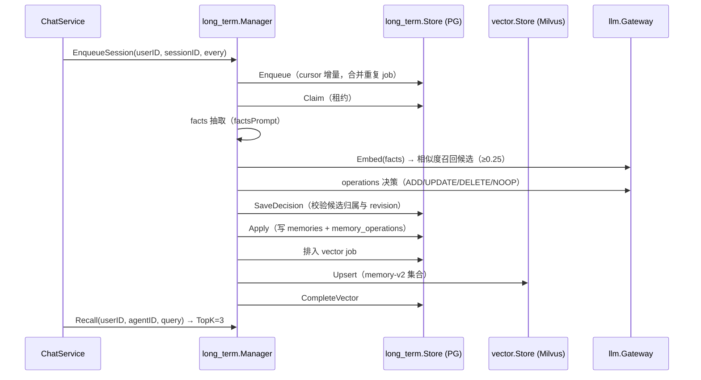

### 语义

| 环节 | 位置 | 说明 |
|---|---|---|
| 抽取引擎 | `internal/memory/long_term/processor.go:20` | `MEMORY_FACTS_V2`：只抽用户明确表达的偏好/背景/约束；不保存密码密钥；最多 16 条 |
| 决策引擎 | `internal/memory/long_term/processor.go:21` | `MEMORY_OPS_V2`：UPDATE/DELETE 只能引用已有记忆 ID；同一 ID 最多改一次；ADD 不带 id |
| 候选召回 | `internal/memory/long_term/processor.go:169` | 向量相似度 ≥ `MinimumSimilarity`（默认 0.25），Top 5/条，最多 32 条候选，总内容 ≤16KiB |
| 归属校验 | `internal/memory/long_term/processor.go:156-160` | 模型引用了不在候选里的 ID → `PermanentMemory`（不重试） |
| 应用 | `internal/memory/long_term/operations.go:99` | 写 `memories`（带 `revision`）+ `memory_operations` |
| 向量投影 | `internal/memory/long_term/processor.go:273` | 按 `embedding_version` 分集合；迁移时清理旧空间但不动当前活跃空间 |
| 作用域召回 | `internal/memory/long_term/long_term.go:74` | 按 owner + agent + revision 过滤 |
| 租约丢失 | `internal/memory/long_term/durable_types.go:24` | `ErrMemoryLeaseLost` |
| 冲突 | `internal/memory/long_term/durable_types.go:25` | `ErrMemoryConflict`：profile 的 embedding 版本与 job 不一致 |

### 关键不变量

1. **revision 绑定**：每条记忆有 `revision`；向量投影记录 `indexed_revision`；召回时只接受 `scope.MemoryRevisions[id] == row.Revision`，即**只有已投影到向量空间的最新版本才可被召回**（`internal/memory/long_term/processor.go:257-259`）。
2. **幂等重建**：`POST /memories/rebuild` 用 `request_key` + `memory_profile_rebuilds` 保证同一请求只重建一次（`internal/memory/long_term/profile_rebuild.go:34`）。
3. **来源不可推断**：被 superseded 的 A→B 迁移仍拥有清理 A 的职责，后来的 B→C job 不能靠推断获得这个祖先关系（`internal/memory/long_term/processor.go:298-301` 注释）。
4. **抽取失败分类**：结构化输出非法 → `PermanentMemory`（不重试）；模型暂时不可用 → 可重试。

### 取舍说明

- **看什么**：**「决定做什么」与「执行」分离**。抽取/决策是 LLM 驱动的，Apply 是纯数据库操作。决策结果先 `SaveDecision` 再 `Apply`，可以在两者之间插入人工检查点。
- **该抄什么**：① revision 绑定；② 候选归属校验（模型不能引用未授权 ID）；③ 向量投影与元数据更新分离；④ 迁移清理的祖先关系规则。
- **为什么要改**：参考项目用两次 LLM 调用（facts + operations）完成抽取，成本不低。重建时可以考虑合并成一次结构化输出，或用小模型 + 规则降级。

---

## 2.11 流程十一：MCP 与 A2A 出入站集成

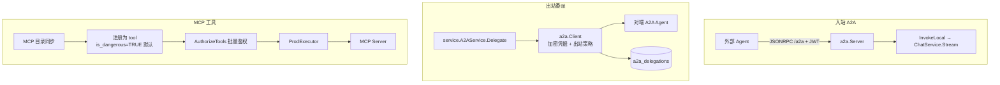

### 语义

| 环节 | 位置 | 失败语义 |
|---|---|---|
| 入站 A2A 装配 | `internal/service/a2a_inbound.go:18` | 需要 `A2A.Enabled` + JWT；生产环境必须配 `public_url` |
| 入站鉴权 | `internal/service/a2a_inbound.go:44-54` | JWT 解析 + `activeUser` 复核（禁用账号立即失效） |
| 入站调用本地对话 | `internal/service/a2a_inbound.go:61` | 走**标准对话链路**（复用 ChatService）；回答上限 64KiB；必须恰好一次 `TypeDone` 且 `finish_reason ∈ {stop, end_turn}` |
| 出站委派 | `internal/service/a2a_delegation.go:111` | 持久化到 `a2a_delegations`；支持幂等键、取消、状态查询 |
| 出站凭据 | `internal/a2a/client.go:33` | `WithCredentials(origin, headers)` —— 凭据绑定到 origin |
| MCP 目录同步 | `internal/service/mcp_sync.go:120` | 新发现的 MCP 工具**默认 `is_dangerous=TRUE, replay_policy='manual'`** |
| MCP 工具审阅 | `internal/service/mcp_policy.go:23` | 管理员审阅后才可改为 `readonly`/`idempotent`；审阅留证据 `replay_evidence` |
| MCP 调用鉴权 | `internal/service/mcp_runtime.go:30` | 校验：服务器启用 + 用户在白名单 + `config_version` 一致 + 已审阅 + `binding_version` 一致 + 凭据已加密迁移 |
| 调试调用限制 | `internal/service/mcp_runtime.go:150` | 管理员调试只允许**已审阅的只读工具**；写操作必须走工作流审批 |
| 注册表恢复 | `internal/service/mcp_runtime.go:123` | 启动时从 DB 恢复 MCP 工具 handler；上限 10000 |

### 取舍说明

- **看什么**：MCP 工具**默认危险**这个决定（迁移 011 的 `UPDATE tools SET is_dangerous=TRUE, replay_policy='manual' WHERE type='mcp'`）。远程目录是不可信输入，默认放行等于默认不安全。
- **该抄什么**：① MCP 默认危险 + 显式审阅；② 调试接口只允许只读；③ 配置版本 / 绑定版本双重校验；④ 入站 A2A 复用标准对话链路而不是另写一套。
- **为什么要改**：A2A 入站把完整对话链路暴露给了持有 JWT 的外部 Agent，且 A2A 卡片宣称的能力只有 `chat`。参考项目没有为 A2A 入站单独做速率限制（共享 `MaxConcurrency` 是唯一闸门）。重建时应确认共享配额覆盖了入站路径。

---

# 第 3 部分 · 技术实现细节（代码级）

本部分只写「不变量在哪里、为什么这么写」。每一节末尾给出取舍说明。

---

## 3.1 LLM 网关

### 3.1.1 `boundChatDescriptor`：预算裁剪

位置：`backend/internal/llm/context_budget.go:14`

每次模型尝试（含 fallback 与后续 tool_result 轮）都会重新执行：

1. 拷贝描述符（不修改原值）。
2. 确定输出上限：`limit = desc.MaxOutputTokens`（0 则回落 `MaxTokens`）；`requested = req.MaxTokens`（0 则默认 1024，且不超过 `ContextWindow/4`）；最终 `requested = min(requested, limit)`。
3. 若 `ContextWindow > 0`：把消息与工具序列化为 OpenAI 兼容请求体，加上 framing 开销 `64 + 16*len(messages) + 32*len(tools)`。若 `requested >= ContextWindow` 或 `len(raw) > ContextWindow - requested - framing` → `errcode.ErrBudget`。

关键点：注释明确说明「使用序列化 UTF-8 字节 + framing 作为保守本地预算，而不是精确 / 厂商无关的 token 计数」（`context_budget.go:10-13`）。

**为什么重要**：预算不足在**调用前**就被拒，而不是等上游返回 400。这让预算错误可以在重试之前短路。

### 3.1.2 `RetryDo`：指数退避 + 抖动

位置：`backend/internal/llm/retry.go:24`

- 默认 3 次尝试、100ms 基础延迟、2s 上限（`retry.go:19-22`）。
- 延迟 `BaseDelay << attempt`，超过上限则截断，再加 `rand.Int63n(delay/4)` 的抖动。
- `ctx.Done()` 立即中止等待。
- 非可重试错误立即返回（`IsRetryable`）。

**为什么重要**：抖动是必需的 —— 没有抖动，多个并发请求会在同一时刻重试，形成同步风暴。

### 3.1.3 `CircuitBreaker`：预热窗口

位置：`backend/internal/llm/fallback.go:13`

- 环形缓冲保存最近 N 次调用结果（默认 N=20）。
- **预热期**：`filled < size` 时不评估错误率。注释原文：「预热期：样本不足不评估（窗口零值 false 不代表真实失败）」（`fallback.go:52-54`）。
- 达到阈值 → 打开 `openDur`（默认 60s），并**重置窗口为全 true**、`filled = 0`，冷却结束后自然进入半开试探。
- `Allow()` 只看 `time.Now().After(openUntil)`。

**已知局限**：熔断状态**仅在本进程内维护**（`fallback.go:4-5` 注释明确写出）。多副本部署时每个副本各有一套。

### 3.1.4 `spanOnClose`：流式 span 生命周期

位置：`backend/internal/llm/gateway.go:197`

- 若 span 无效（追踪未启用，no-op span），直接 `span.End()` 并原样返回源通道，**零额外开销**。
- 否则起一个转发协程：容量与源一致（不改变背压特性）；转发事件时记录 `ev.Err` 与 `ev.Usage`；源关闭或 ctx 取消时结束 span。

**为什么重要**：流式调用的真实耗时在消费阶段。若 span 在 `runWithGuard` 里结束，只会覆盖几毫秒。

### 3.1.5 流式 fallback 的边界

位置：`backend/internal/llm/gateway.go:170-190`

`ChatStream` 的 fallback 只在 `guardStream` **返回错误**时触发 —— 也就是流还没建立起来（连接失败、首字节超时等）。一旦拿到流，流中失败无法重放（已经吐出的 token 无法撤回）。

**流式准入中断的特殊处理**（`gateway.go:285-303`）：当共享配额租约在流中途被回收（`admittedDone` 触发），实现会**尽力保留一个终态错误事件**：

```go
select {
case out <- failure:
default:
    // An interrupted answer is incomplete. Reserve visibility for its
    // terminal error even when the consumer stopped reading partials.
    ...
}
```

即：宁可丢一个增量事件，也要让消费者看到「这次被中断了」。

### 3.1.6 取舍说明

- **看什么**：`runWithGuard` 的顺序与 `finishStream` 的取消处理。
- **该抄什么**：预算在每次尝试前重跑；重试带抖动；熔断有预热期；取消不计入熔断样本；流式 span 绑定流。
- **为什么要改**：熔断进程内化在多副本下不一致 —— 重建时若多副本，考虑外置或明确写进文档。

---

## 3.2 Agent 运行时

### 3.2.1 `compactInputHistory`：整轮淘汰

位置：`backend/internal/agent/runtime/context_history.go:22`

```
1. inputBudgetUsage(messages, tools) → 总量（先做协议完整性校验）
2. 总量 ≤ budget → 原样返回
3. 找出所有 user 消息位置 starts[]
4. 从最早的 user 轮开始，逐轮删除（直到下一个 user 轮为止的所有消息，
   但跳过 system 消息），直到总量 ≤ budget
5. 仍然超预算 → ErrBudget
6. validateInputBudget(retained) 复核
```

保留：所有 system 消息、首个 user 之前的前缀、最新一轮 user。

**不生成摘要**，**不删除任何持久历史**。函数注释原文（`context_history.go:17-21`）：

> It preserves all system messages, the prefix before the first user, and the latest user turn. Each old user turn is removed as a unit, including every parallel tool result. No summary is generated, and no persistent history/checkpoint is deleted.

### 3.2.2 `inputBudgetUsage`：tool_call ↔ tool_result 配对校验

位置：`backend/internal/agent/runtime/limits.go:29`

逐条消息维护 `pending` 集合：

- `Role == Tool`：必须有对应的 pending ID，否则 `unpaired tool result`。
- 非 Tool 消息：如果 `pending` 非空 → `missing tool results before next message`。
- `ToolCalls` 非空：每个 call ID 不为空且不重复，否则 `missing or duplicate tool call ID`。
- 遍历结束：`pending` 必须为空，否则 `tool call without matching result`。

工具定义也计入预算：`EstimateTokens({name, description, parameters}) + 16`。

**为什么放在裁剪之前**：注释原文（`limits.go:26-28`）：

> Validate the entire protocol before any history can be discarded. The same accounting is used by both admission and history reduction.

即「准入」与「裁剪」用同一套算法，避免两套算法算出不同结论。

### 3.2.3 `eventSink`：背压

位置：`backend/internal/agent/runtime/eino_events.go:15`

- `Send` 在互斥锁内执行（保证 `Seq` 分配与通道写入的原子性）。
- 先检查 `closed` / `failed`，再 `select` 发送到通道 / ctx.Done / 定时器。
- 超时 → `s.failed = true` + `s.cancel()` + 返回 `errBackpressure`。
- `Close` 幂等，关闭通道。

### 3.2.4 运行结束时的错误分类

位置：`backend/internal/agent/runtime/eino_runner.go:224-247`

| 情况 | 终态事件 |
|---|---|
| `context.Canceled` | `EvtDone("canceled")` |
| `context.DeadlineExceeded` | `EvtError(ErrModelTimeout)` |
| `adk.ErrExceedMaxIterations` | `EvtError(ErrMaxIteration)` |
| 其他错误 | `EvtError(errcode.From(err))` |
| 正常 | `EvtDone(finish_reason)`，默认 `"stop"` |

**关键顺序**：先保存原始错误，再 `cancel()`。注释原文（`eino_runner.go:216-218`）：

> Preserve the original error before canceling model/tool work. A provider failure must not turn into "user canceled" because cleanup cancels ctx.

### 3.2.5 取舍说明

- **看什么**：`eino_runner.go:216-218` 的注释 —— 这就是「取消 ≠ 失败」在 Agent 层的落点。
- **该抄什么**：整轮淘汰、协议完整性先于裁剪、背压主动取消、错误分类前先固化错误。
- **为什么要改**：`EstimateTokens` 是启发式（`internal/llm/tokenizer.go:11-25`，中文字符 1 个算 1 token + 英文词数 × 1.3 + ASCII/4）。接真实 tokenizer 会更准但引入新的不确定性来源。

---

## 3.3 工具边界

### 3.3.1 `boundTool`：调用前刷新授权

位置：`backend/internal/agent/einoadapter/tools.go:92`

调用顺序（每一步都可能返回结构化观察而非错误）：

| 顺序 | 检查 | 失败观察 |
|---|---|---|
| 1 | `source.ListContext` 重查绑定 | `tool_unavailable` |
| 2 | 工具仍在绑定中 | `tool_unavailable` |
| 3 | `BindingVersion` 未变 | `tool_configuration_changed` |
| 4 | 危险工具已获批准 | `approval_required` |
| 5 | Schema 指纹未变 | `tool_configuration_changed` |
| 6 | 参数 ≤ 64KiB 且恰好一个 JSON 值 | `invalid_arguments` |
| 7 | JSON Schema 校验通过 | `invalid_arguments` |

**为什么 3 和 5 分开**：`BindingVersion` 是「管理侧改了绑定」（比如换了实现），Schema 指纹是「schema 内容变了」。两者都要求重启/重新授权，但原因不同，诊断价值不同。

### 3.3.2 `checkSchema`：JSON Schema 子集白名单

位置：`backend/internal/agent/einoadapter/tools.go:174`

允许的关键字（完整列表在 `tools.go:182`）是一段空格分隔的字符串，用 `strings.Contains(allowed, " "+key+" ")` 匹配。特殊规则：

- `$ref` / `$dynamicRef` **必须是本地引用**（`#` 开头）。
- `format` 必须是已知枚举（date-time / email / hostname / ipv4 / ipv6 / uri / uuid / json-pointer / relative-json-pointer / uri-template 等）。
- `x-mcp-header` 必须是非空字符串。
- **禁止外部 schema 加载**：`denySchemaLoader` 的 `Load` 永远返回错误（`tools.go:158-162`）。
- 只递归 schema 位置：`properties` / `patternProperties` / `dependentSchemas` / `$defs` / `definitions` / `allOf` / `anyOf` / `oneOf` / `prefixItems` / `not` / `if` / `then` / `else` / `items` / `contains` / `additionalProperties` 等。注释原文（`tools.go:174-176`）：

> Walk only schema positions: properties named "default" or literal objects in enum/default/examples are user data, not additional validation keywords.

即：`enum` 数组里的对象如果恰好含有 `type` 之类的键，不会被误判为 schema 关键字。

### 3.3.3 `ProdExecutor.Invoke`：执行层

位置：`backend/internal/tool/executor_impl.go:150`

顺序：查定义 → 找目标工具 → **绑定版本二次比对** → 拿 handler → 参数长度与 JSON 校验 → Schema 校验 → 工具级超时（`tools.timeout_ms`）→ 执行 → 状态判定。

- 超时上下文：`DefaultTimeout` 30s，再用工具表的 `timeout_ms` 收紧（`executor_impl.go:214-219`）。
- 状态：`timeout` / `error` / `ok`（`executor_impl.go:220-231`）。
- panic recover（`executor_impl.go:154-156`）。
- 错误消息模糊化（不泄露具体原因）。

### 3.3.4 危险工具的完整链路

```
tools.is_dangerous = true
  ↓
service.dangerousTools() 解析出集合 → 传入 RunInput.DangerousTools
  ↓
BuildTools 时 def.Dangerous || dangerous[def.Name] → boundTool.dangerous
  ↓
调用时：current.Dangerous 也会被检查（管理侧刚改判为危险也立即生效）
  ↓
未获批准 → 返回 {"error":"approval_required"} 作为工具观察
  ↓
模型看到需要审批；平台侧 durable workflow 通过 WithToolApproval(ctx, code, args) 注入能力
  ↓
toolApproved 校验 code 匹配 + args 摘要（sha256）匹配
```

审批能力的注入点注释（`internal/agent/einoadapter/approval.go:15-18`）：

> It is an internal control-plane capability. Only the durable driver supplies it after verifying the persisted owner/interrupt/argument hash. It is not accepted from request headers, JSON, model output or ordinary Agent input.

### 3.3.5 取舍说明

- **看什么**：Schema 子集白名单与审批能力的隔离。
- **该抄什么**：调用前刷新授权、版本 + 指纹双校验、Schema 白名单 + 禁外部加载、审批能力只走 context、错误结构化回灌。
- **为什么要改**：白名单用字符串包含匹配实现，重建时用 `map[string]bool` 更清晰也更安全。

---

## 3.4 持久执行

### 3.4.1 `BeginOperation`：三种 replay_policy

位置：`backend/internal/execution/operations.go:37`

参数：`path`（节点路径）、`kind`（节点类型）、`argsHash`（意图哈希）、`policy`。

事务内流程：

1. `lockLease(tx, run)` —— 确认持有有效租约且 generation 匹配。
2. 查 `(run_id, path)` 的既有 operation。
3. 若存在：
   - `ArgsHash` / `Kind` / `ReplayPolicy` 任一不同 → `ErrConflict`（**参数变了，不能复用旧结果**）。
   - `Status == Succeeded` → `cached = true`，直接返回旧输出（**幂等命中**）。
   - `Status == "unknown"` → 返回 `ErrUnknownOperation`（**要求人工核对**）。
   - `Status == Running && Generation == run.Generation` → `ErrConflict`（并发同节点）。
   - `ReplayPolicy == "manual"` 且上次执行者丢失 → **把该 operation 与 attempt 标为 `unknown`**，返回 `ErrUnknownOperation`，追加 `operation_unknown` 事件。
   - `Attempt >= 3` → `ErrAttemptsExhausted`。
   - 否则重置为 `Running`，`Attempt++`，`Generation = run.Generation`。
4. 若不存在：创建新 operation，`Attempt = 1`。
5. 写 `execution_attempts` 一行（status=running）。
6. 追加 `step_started` 事件。

三种策略：

| 策略 | 语义 | 失败后行为 |
|---|---|---|
| `readonly` | 无副作用 | 可自动重试（最多 3 次） |
| `idempotent` | 幂等副作用 | 可重试 |
| `manual` | 副作用未知 | 标 `unknown`，**不自动重试**，转 `needs_attention` 等人工核对 |

### 3.4.2 generation fencing

`fenced(tx, run)`（`internal/execution/store.go:198`）：

```sql
WHERE id=? AND generation=? AND lease_owner=? AND status='running'
  AND lease_until>clock_timestamp() AND deadline_at>clock_timestamp()
```

所有对 run 的写操作都经过它。`lockLease` 再叠加一层定义/版本校验（`store.go:201-211`）：`DefinitionHash` / `EngineVersion` / `GraphSchema` 任一不同 → `ErrVersionMismatch`。

**为什么需要 generation**：租约过期后另一个 worker 会领取同一个 run，`generation` 递增。旧 worker 的迟到写操作因为 generation 不匹配而被拒绝 —— 这就是 fencing。

### 3.4.3 `CheckpointStore`：版本三元组

位置：`backend/internal/execution/checkpoint.go:11`

实现 `compose.CheckPointStore`：

- `Get`：读 `execution_checkpoints` 的一行，比对 `(DefinitionHash, EngineVersion, GraphSchema)` 与当前 run **以及**当前进程常量 `EngineVersion` / `GraphSchema`。任一不同 → `ErrVersionMismatch`。
- `Set`：`INSERT ... ON CONFLICT DO UPDATE ... WHERE definition_hash=EXCLUDED... AND engine_version=EXCLUDED... AND graph_schema=EXCLUDED...`。`RowsAffected != 1` → `ErrVersionMismatch`。

**为什么要写两次版本**：既有 run 的版本（防止用新引擎读旧检查点），也有当前进程的版本（防止用旧引擎写新检查点）。

### 3.4.4 `Cancel`：把在途操作标记为 unknown

位置：`backend/internal/execution/store.go:378`

取消时先扫描 `status='running'` 的 operation：

- `ReplayPolicy == "manual"` → 标 `unknown`，并追加 `operation_unknown` 事件（reason=`canceled_in_flight`）。
- 其他 → 标 `abandoned`。

然后 run 本身 `status=canceled`、`generation+1`、清租约。

注释原文（`internal/execution/store.go:391-392`）：

> Cancel cannot undo a remote call already sent. Preserve uncertainty before fencing the executor so operators can inspect what happened.

### 3.4.5 人工核对（`ResolveOperation`）

位置：`backend/internal/execution/operations.go:161`

只有 run 处于 `needs_attention`、operation 处于 `unknown`、且 `args_hash` 匹配时才能核对。核对后 operation → `succeeded`，run → `queued` 且 `generation+1`，并追加 `operation_reconciled` 事件（含 `decided_by` 与 `evidence`）。

注释原文（`operations.go:159-160`）：

> ResolveOperation records an explicit owner's reconciliation, never a blind automatic replay. Evidence remains in the reliable audit event.

### 3.4.6 取舍说明

- **看什么**：`BeginOperation` 的分支顺序与 `manual` 策略的「unknown 化」。
- **该抄什么**：① 三种 replay_policy；② 参数哈希变化 → 冲突（不复用旧结果）；③ generation fencing；④ 检查点版本三元组；⑤ 取消时把在途 manual 操作标 unknown；⑥ 人工核对必须留证据。
- **为什么要改**：`Attempt >= 3` 是硬编码常量（`operations.go:81`），重建时应做成配置项。

---

## 3.5 工作流编译

### 3.5.1 DSL → Eino Graph

位置：`backend/internal/workflow/graph.go:46`（`Compile`）、`:61`（`build`）

- `Compose` 使用 `compose.NewGraph[map[string]any, map[string]any]`，全局状态用 `graphState{Values map[string]any}`。
- 每个图有 `__input` 与 `__output` 两个 lambda 节点。
- 节点类型：
  - `parallel` → 递归 `build` 生成子图，用 `AddGraphNode` 挂载。
  - `subflow` → 递归 `build` 生成子图（子图 DSL 来自**冻结的** `definition.Subflows`，`internal/execution/driver.go:66-72`）。
  - 其他 → `AddLambdaNode`，调用 `c.invoke`。
- 分支：`condition` 节点用 `compose.NewGraphBranch`，从 `s.Values[key]` 取布尔值决定 yes/no 目标。
- 编译参数：`compose.WithCheckPointStore(store)`、`compose.WithNodeTriggerMode(compose.AllPredecessor)`、`compose.WithGraphName("nexus_workflow_v1")`。

### 3.5.2 展开上限

| 上限 | 值 | 位置 |
|---|---|---|
| 嵌套深度 | 8 | `graph.go:62` |
| 展开节点总数 | 128 | `graph.go:141-142` |
| 并发槽 | 4 | `graph.go:37` |
| 子图递归检测 | `c.stack` map | `graph.go:161-168` |
| 状态大小 | 4 MiB | `graph.go:367-369` |
| DSL 文本 | 1 MiB | `internal/workflow/dsl.go:120-122` |

### 3.5.3 中断点与审批

`c.invoke`（`graph.go:242`）：

- `human` 节点 → `newApproval(path, RenderTemplate(n.Prompt, state), nil)`。
- `tool` 节点且工具 `Dangerous` → `newApproval(path, "调用工具 X：{args}", defs[0].Parameters)`。
- 若 `compose.GetResumeContext[ApprovalDecision]` 没有数据 → `compose.StatefulInterrupt(ctx, proposal, proposal)`。
- 若有数据但 `!decision.Approved || decision.ArgsHash != proposal.ArgsHash` → 报错。
- 批准后：`ctx = einoadapter.WithToolApproval(ctx, n.ToolCode, string(raw))` —— **审批能力在此注入**。

`newApproval` 的 `ArgsHash` = `sha256({path, prompt, parameters})`（`graph.go:308-313`）。所以**参数变化会导致审批自动失效**。

### 3.5.4 `RenderArgs`：模板求值

位置：`backend/internal/workflow/graph.go:405`

- 整个字符串是 `{{...}}` 且只出现一次 → **保留原始类型**（数字仍是数字）。
- 否则做文本插值；若插值结果仍含 `{{` → 报错「unresolved tool argument template」。
- 嵌套 map / slice 递归渲染。

### 3.5.5 取舍说明

- **看什么**：DSL 的「编排与执行分离」设计 —— YAML 说做什么，引擎决定怎么做。条件表达式用 expr-lang（与内置 calculator 同源）。
- **该抄什么**：① 展开上限（防 DSL 炸弹）；② 子图递归检测；③ 审批 ArgsHash 绑定参数；④ `RenderArgs` 保留原始类型。
- **为什么要改**：参考项目同时存在两套工作流执行器：`internal/workflow/engine.go`（解释式，`Engine.Run`/`Resume`）与 `internal/workflow/graph.go` + `internal/execution/driver.go`（编译到 Eino Graph）。持久执行只用后者，前者是历史遗留。重建时**只做一套**，否则会出现「两条路径的失败语义不一致」。

---

## 3.6 共享容量

位置：`backend/internal/capacity/capacity.go`

### 3.6.1 数据模型

迁移 013 建立三张表：

| 表 | 作用 |
|---|---|
| `execution_capacity_policies` | 每个 scope 一行策略（`run` / `provider`） |
| `execution_capacity_leases` | 活跃租约 |
| `execution_owner_fairness` | 每个 owner 的最后领取时间 |

策略字段：`active_limit` / `owner_active_limit` / `queue_limit` / `owner_queue_limit` / `lease_ms` / `version`。

默认值（迁移 013）：

```
run:     active_limit=32, owner_active_limit=4, queue_limit=1000, owner_queue_limit=100, lease_ms=15000
provider: active_limit=16, owner_active_limit=4, queue_limit=1000, owner_queue_limit=100, lease_ms=15000
```

### 3.6.2 准入算法

`acquire`（`capacity.go:119`）在单个事务内：

1. `pg_advisory_xact_lock(hashtextextended(schema||':capacity:'||scope||':'||resource, 0))` —— **事务级 advisory lock**，保证同 scope 的准入串行化（`capacity.go:49-51`）。
2. 读策略（`SHARE` 锁）。
3. **删除过期租约**（死租约不占容量）：`DELETE FROM execution_capacity_leases WHERE expires_at<=clock_timestamp()`。
4. 统计当前占用：`run` scope 统计 `execution_active_capacity` 视图；`provider` scope 统计同 `(scope, resource)` 的活跃租约。
5. 超限 → `ErrBusy`。
6. 插入租约，`expires_at = clock_timestamp() + lease_ms`。

### 3.6.3 `FenceRun`：最终写的围栏

位置：`backend/internal/capacity/capacity.go:104`

```sql
UPDATE execution_capacity_leases SET expires_at=expires_at
 WHERE id=? AND scope='run' AND expires_at>clock_timestamp()
```

`RowsAffected != 1` → `ErrLeaseLost`。

注释原文（`capacity.go:100-103`）：

> FenceRun is the last write in the answer transaction, after the message INSERT (which may wait on locks). The opaque lease identity only comes from HoldRun. A heartbeat/context check alone cannot fence a paused executor's final write.

**这是关键洞察**：心跳 + ctx 检查**不足以**围栏一个被 pause 的执行者（GC 停顿、容器挂起都可能让心跳停很久但进程还活着）。只有「在同一个事务里验证租约仍然有效」才能围栏。

### 3.6.4 与业务事务的耦合

对话落库时，助手消息 INSERT 与 `FenceRun` 在**同一个事务**里（`internal/service/chat_stream.go:162-181`）。如果租约已失效，INSERT 回滚，消息被标记为 `failed` 而不是 `done`。

### 3.6.5 取舍说明

- **看什么**：`FenceRun` 与业务写在同一事务这一点。这是「共享容量」从「限流器」升级为「执行权凭证」的关键。
- **该抄什么**：① advisory lock 做串行化；② 死租约自动清理；③ 租约 id 是不透明标识，只在 `HoldRun` 时产生；④ 围栏写与业务写同事务。
- **为什么要改**：参考项目的 `execution_capacity_leases` 是一张**全局**表，provider scope 用 `resource` 字段区分 origin。规模大时这张表会成为热点。重建时如果容量策略更复杂，可以考虑按 scope 分表。

---

## 3.7 出站安全（SSRF 防御）

位置：`backend/internal/security/outbound.go`

### 3.7.1 URL 规范化与校验

`outboundOrigin`（`outbound.go:41`）：

- 拒绝 `u.User != nil`（带凭据）、`Opaque`、`Fragment`。
- 只允许 `http` / `https`；长度 ≤ 4096。
- host 小写并去掉尾部 `.`；拒绝含 `%` `\` 零字符与空白。
- IP 字面量用 `netip.ParseAddr` 归一（`Unmap` 处理 IPv4-in-IPv6）。
- 端口默认 80 / 443，范围 1..65535。
- 输出规范化 origin：`scheme://host:port`。

### 3.7.2 IP 白名单

`outboundNever`（`outbound.go:94-100`）是永久拒绝列表：

```
0.0.0.0/8, 169.254.0.0/16, 192.0.0.0/24, 192.0.2.0/24, 198.18.0.0/15,
198.51.100.0/24, 203.0.113.0/24, 240.0.0.0/4,
100.100.100.200/32, 168.63.129.16/32,
2001:db8::/32, fd00:ec2::254/128
```

覆盖：`0.0.0.0/8`（本机）、链路本地（169.254）、云元数据（100.100.100.200 是阿里云元数据；168.63.129.16 是 Azure 平台地址）、文档保留网段、`240.0.0.0/4`（保留）。

`outboundIPAllowed`（`outbound.go:102`）：非 global unicast 一律拒绝（loopback 只有在显式授权时允许）；link-local unicast/multicast 永远拒绝；私有地址（RFC1918 + loopback + `100.64.0.0/10` CGNAT）需要显式授权。

**注释原文**（`outbound.go:24-26`）：

> Private grants are exact scheme/host/port origins, configured by the operator. They never override the metadata/link-local denial. Request-controlled URLs cannot grant themselves access to an internal origin.

### 3.7.3 Dial 时二次校验（防 DNS rebinding）

`NewOutboundClient` 的 `DialContext`（`outbound.go:245`）：

1. 拆分 host/port。
2. 解析 DNS（3s 超时），结果 0 个或 >16 个 → 拒绝。
3. 从 ctx 取 `outboundDialGrant`（由 `RoundTrip` 注入），校验 `grant.address == net.JoinHostPort(canonicalHost, port)` —— 不匹配说明 RoundTrip 与 Dial 的目标不一致，拒绝。
4. **对每一个解析出的 IP 逐个校验** `outboundIPAllowed` —— 只要有一个不允许就整体拒绝（防混合 DNS 响应）。
5. 逐个尝试连接，**用解析出的数值 IP 直连**，不再交给系统解析器。

注释原文（`outbound.go:204-205`）：

> Each dial resolves once and connects to a validated numeric address. No proxy or second resolver can turn the checked hostname into an unchecked target.

### 3.7.4 其他防御

| 防御 | 实现 | 位置 |
|---|---|---|
| 请求体上限 | `ContentLength > 1MiB` → 拒绝；实际读取也限 1MiB | `outbound.go:132-146` |
| 响应体上限 | 默认 4MiB（可配 1..8MiB）；JSON 响应整体读入检查 | `outbound.go:150-169` |
| `GetBody = nil` | 防止 net/http 在连接复用时重放 POST | `outbound.go:142-144` |
| 禁跨源重定向 | `CheckRedirect` 要求新 origin 与原始 origin 相同；最多 4 跳 | `outbound.go:290-301` |
| 私网授权粒度 | 必须精确匹配 scheme://host:port；授权项不允许带 query/path | `outbound.go:207-221` |

`GetBody = nil` 的注释原文（`outbound.go:139-142`）：

> A forwarded operation key is an identity, not proof that the peer honors idempotency. Prevent net/http from replaying a POST on a reused connection after the remote effect has happened but its response was lost.

### 3.7.5 取舍说明

- **看什么**：**Dial 时二次校验**。只在 RoundTrip 校验 URL 是不够的 —— DNS 可能在两次解析之间改变答案。
- **该抄什么**：① 元数据地址永久拒绝；② 私网授权精确到 origin；③ Dial 时逐 IP 校验 + 直连数值 IP；④ 禁跨源重定向；⑤ `GetBody = nil`。
- **为什么要改**：参考项目的 `lookup` 字段允许注入自定义 DNS 解析器（测试用），生产路径用 `net.DefaultResolver`。如果重建时需要走 DNS over TLS 或自定义 resolver，注意不要破坏「解析一次 + 直连数值 IP」的语义。

---

## 3.8 错误码体系

位置：`backend/internal/pkg/errcode/errcode.go`

### 3.8.1 码段划分

```
1xxxx 参数错误 | 2xxxx 认证鉴权 | 3xxxx Agent/会话/运行 | 4xxxx 限流
5xxxx LLM 上游 | 6xxxx RAG/存储 | 7xxxx 工具/沙箱 | 8xxxx MCP/A2A | 9xxxx 系统
```

| 码 | 名称 | HTTP | 码 | 名称 | HTTP |
|---|---|---|---|---|---|
| 10001 | ErrInvalidParam | 400 | 60002 | ErrParseFailed | 500 |
| 10002 | ErrMissingParam | 400 | 60003 | ErrKBNotFound | 404 |
| 10003 | ErrFileTooLarge | 400 | 60004 | ErrDocNotFound | 404 |
| 10004 | ErrFileType | 400 | 60005 | ErrMemoryNotFound | 404 |
| 20101 | ErrUnauthorized | 401 | 60006 | ErrStorageUnavailable | 503 |
| 20102 | ErrTokenExpired | 401 | 70001 | ErrToolNotFound | 404 |
| 20103 | ErrTokenInvalid | 401 | 70002 | ErrToolFailed | 500 |
| 20201 | ErrForbidden | 403 | 70003 | ErrToolTimeout | 504 |
| 20222 | ErrLoginFailed | 401 | 70004 | ErrSandboxTimeout | 504 |
| 20203 | ErrUserLocked | 429 | 70005 | ErrSQLForbidden | 403 |
| 20204 | ErrUserExists | 409 | 70006 | ErrDomainNotAllow | 403 |
| 30001 | ErrAgentNotFound | 404 | 80001 | ErrMCPConnFail | 502 |
| 30002 | ErrMaxIteration | 500 | 80002 | ErrMCPToolFail | 502 |
| 30003 | ErrSessionNotFnd | 404 | 80003 | ErrA2ATaskFail | 502 |
| 30004 | ErrRunNotFound | 404 | 80004 | ErrA2ACardFetch | 502 |
| 30005 | ErrWorkflowDSL | 400 | 90001 | ErrInternal | 500 |
| 30006 | ErrBudget | 500 | 90002 | ErrNotImplement | 501 |
| 30007 | ErrRunConflict | 409 | 90003 | ErrUnavailable | 503 |
| 30008 | ErrEventCursorExpired | 410 | 40001 | ErrRateLimited | 429 |
| 50001 | ErrModelUnavail | 502 | 50002 | ErrModelTimeout | 504 |
| 50003 | ErrProviderNotFound | 404 | 50004 | ErrEmbedFailed | 502 |

### 3.8.2 `Error` 结构与不可变约定

```go
type Error struct {
    HTTPStatus int
    Code       int
    Message    string
    cause      error  // 内部原因，不打给用户
}
```

- `WithCause` / `WithMsg` **返回副本**，原错误不可变（`errcode.go:36-47`）。
- `Unwrap()` 支持 `errors.Is` / `errors.As` 链路。
- `From(err)` 规范化：已是 `*Error` 则透传，否则包成 `ErrInternal`（`errcode.go:105-110`）。

### 3.8.3 限流语义

| 场景 | 错误码 | HTTP |
|---|---|---|
| 共享运行额度满 | `ErrRateLimited` 40001 | 429 |
| 共享队列满 | `ErrRateLimited` 40001 | 429 |
| 客户端消费过慢 | `ErrRateLimited` 40001 | 429 |
| 登录失败次数过多 | `ErrUserLocked` 20203 | 429 |

### 3.8.4 取舍说明

- **看什么**：**HTTP 状态与业务码分离**，以及 `cause` 不外泄。
- **该抄什么**：码段规划（便于前端按段处理）；不可变错误对象；`cause` 只进日志。
- **为什么要改**：参考项目的 `Message` 是中文面向用户的，`Code` 是稳定的机器码。nexus-lab 若要国际化，应保持 `Code` 稳定、`Message` 可本地化。

---

## 3.9 数据库模型：13 个迁移的演进路径

| 迁移 | 主题 | 关键变更 |
|---|---|---|
| 001 | 初始 schema | 基础表 |
| 002 | seed | 内置工具、管理员、示例数据 |
| 003 | agent 归属 | Agent 与创建者绑定 |
| 004 | 持久执行 | `workflow_runs` 加 11 列（owner_id / definition / definition_hash / engine_version / graph_schema / state_version / generation / lease_owner / lease_until / deadline_at / available_at / pending_ids / next_seq）；新建 `execution_checkpoints` / `execution_operations` / `execution_attempts` / `execution_approvals` / `execution_events` |
| 005 | 工具重放策略 | `tools.replay_policy` CHECK 约束（readonly/idempotent/manual）；内置只读工具置 readonly |
| 006 | 工作流产品化 | 工作流定义 / 版本 / 运行 / 步骤轨迹 |
| 007 | 文档代际 | `documents.index_version` / `embedding_version` |
| 008 | 检索审计 | 检索评估记录 |
| 009 | 持久记忆 | `memory_profiles` / `memory_profile_rebuilds` / `memory_jobs` / `memory_operations` / `memory_cursors`；`memories` 加 `revision` / `indexed_revision` / `index_status` |
| 010 | 内置工具边界 | `db_query` 改为固定报表枚举（`recent_runs` / `pending_approvals` / `usage_summary`），`additionalProperties:false`；`file_ops` 限制在授权目录 |
| 011 | MCP 权威 | `mcp_servers` 加 `enabled` / `config_version` / `encrypted_credentials` / `headers_present` / `allowed_user_ids` / `archived_at`；`tools` 加 `mcp_name` / `mcp_config_version` / `binding_version` / `policy_reviewed_by` / `policy_reviewed_at` / `replay_evidence`；**MCP 工具默认 is_dangerous=TRUE, replay_policy=manual** |
| 012 | A2A 权威 | `a2a_agents` 加 `enabled` / `config_version` / `encrypted_credentials` / `pinned_endpoint` / `card_hash` / `archived_at`；新建 `a2a_tasks` / `a2a_delegations` |
| 013 | 共享容量 | `execution_capacity_policies` / `execution_capacity_leases` / `execution_owner_fairness` + `execution_active_capacity` 视图 |

### 3.9.1 关键索引模式

```sql
-- 只索引「就绪」的行（部分索引）
CREATE INDEX idx_execution_ready ON workflow_runs(available_at, id)
  WHERE definition IS NOT NULL AND status IN ('queued','running','retry_wait');

-- 活跃 MCP 工具的部分索引
CREATE INDEX idx_mcp_active_tools ON tools(mcp_server_id, id)
  WHERE type='mcp' AND status=1;

-- 同一 owner 只允许一个活跃 profile
CREATE UNIQUE INDEX idx_memory_profile_active ON memory_profiles(user_id) WHERE active;

-- 幂等键唯一
-- EnqueueRequest 用 ON CONFLICT (owner_id, request_key) DO NOTHING
```

### 3.9.2 迁移原则

- **只向前兼容**：先加列 → 回填 → 切流 → 再删（与 nexus-lab 的 C9 约束一致）。
- **约束下沉到数据库**：CHECK 约束（`replay_policy`、`scope`、`active_limit BETWEEN 1 AND 1024`）、唯一索引、部分索引。
- **凭据不能在 SQL 里加密**：迁移 011 注释原文：「Credentials cannot be encrypted by SQL without the application's master key. Upgrade them through the explicit credential migration/admin sync action」（`migrations/011_mcp_authority.up.sql`）。

### 3.9.3 取舍说明

- **看什么**：004 与 013 两个迁移 —— 它们定义了持久执行与共享容量的数据模型。
- **该抄什么**：① 部分索引（只索引就绪行）；② 幂等键唯一约束；③ CHECK 约束下沉；④ 凭据加密走应用层迁移而非 SQL。
- **为什么要改**：参考项目 004 是**加列**（历史兼容），重建时应该**新建表**。参考项目 013 的 down 脚本保留运营政策、租约、运行与公平数据（`docs/research/2026-10-21-p4-capacity-validation.md`：「迁移 013 实际 13→12→13 保留运营政策、租约、运行和公平数据」），这个「down 不删运营数据」的取舍值得抄。

---

# 第 4 部分 · 横切设计

## 4.1 一致性

### 4.1.1 四种一致性机制

| 机制 | 位置 | 语义 |
|---|---|---|
| 事务 outbox（至少一次） | `internal/execution/outbox.go:30` | 事件与状态在**同一事务**写入 `execution_outbox`；投递后标记 `published_at`；崩溃会重投同一 `(run_id, seq)`，消费方按该元组去重 |
| 幂等键 | `internal/execution/store.go:49` | `request_key`（≤64 字符）+ `ON CONFLICT (owner_id, request_key) DO NOTHING`；重复提交返回既有 run |
| 租约 + fencing | `internal/execution/store.go:198` | generation + lease_owner + lease_until 三元组围栏 |
| 检查点版本绑定 | `internal/execution/checkpoint.go:38` | `(definition_hash, engine_version, graph_schema)` 三元组 |

### 4.1.2 outbox 的实现细节

`appendEvent`（`internal/execution/store.go:421`）在**同一个事务**里：

1. `UPDATE workflow_runs SET next_seq=next_seq+1, state_version=state_version+1 WHERE id=? RETURNING next_seq` —— 序号分配也是原子的。
2. 写 `execution_events`。
3. 写 `execution_outbox`。

`PublishOutbox`（`outbox.go:30`）用 `FOR UPDATE SKIP LOCKED` 批量领取，每条单独 2s 超时投递，投递成功后在同一事务里标记 `published_at`。

**投递语义注释原文**（`outbox.go:28-29`）：

> Delivery is at least once: a crash after the peer accepts but before the PG commit can redeliver the same (run_id,seq). Consumers must deduplicate by it.

### 4.1.3 幂等的三层

| 层 | 键 | 位置 |
|---|---|---|
| 工作流提交 | `(owner_id, request_key)` | `internal/execution/store.go:100-118` |
| 节点执行 | `(run_id, path)` + `args_hash` | `internal/execution/operations.go:52` |
| 记忆重建 | `(owner_id, request_key)` | `internal/memory/long_term/profile_rebuild.go:34` |

### 4.1.4 取舍说明

- **看什么**：`appendEvent` 把「序号分配 + 事件写入 + outbox 写入」放在一个事务里。
- **该抄什么**：至少一次 + 显式去重元组；不要承诺 exactly-once。
- **为什么要改**：参考项目只把执行事件放进 outbox，对话消息与用量统计是直接写的。如果 nexus-lab 需要「对话也可回放」，需要把对话也纳入 outbox。

---

## 4.2 并发与背压

### 4.2.1 分级信号量

| 层级 | 机制 | 位置 | 默认值 |
|---|---|---|---|
| 供应商并发 | `llm.Semaphore`（进程内） | `internal/llm/ratelimiter.go:16` | `MaxConnsPerProvider=16` |
| 供应商共享额度 | `capacity.HoldProvider`（PG 权威） | `internal/capacity/capacity.go:221` | provider scope `active_limit=16` |
| 运行额度 | `capacity.HoldRun`（PG 权威） | `internal/capacity/capacity.go:213` | run scope `active_limit=32` |
| 工具并发 | `runMiddleware.slots` | `internal/agent/runtime/eino_runner.go:256` | `MaxConcurrentTools=4` |
| 工具执行并发 | `workflow.compiler.slots` | `internal/workflow/graph.go:37` | 4 |
| SSE 缓冲 | `eventSink.events` | `internal/agent/runtime/eino_events.go:25` | `EventBuffer=128` |
| Chat 事件缓冲 | `chat_stream.go` 的 `out` | `internal/service/chat_stream.go:196` | `EventBuffer=128` |
| 知识库并行检索 | `retrieveKBs` 的 `slots` | `internal/service/chatsvc.go:359` | 4 |
| ETL 并发 | `worker.slots` | `internal/worker/worker.go:110` | `Concurrency=4`（1..16） |
| 记忆并发 | Worker 的 Concurrency | `cmd/worker/main.go:40` | 2（1..8） |
| 执行并发 | `execution.Worker.slots` | `internal/execution/worker.go:59` | 4（1..64） |
| 沙箱并发 | `Sandbox.slots` | `internal/tool/sandbox.go:51` | `PoolSize`（1..8） |

### 4.2.2 超时预算表

| 场景 | 预算 | 位置 |
|---|---|---|
| Chat 总运行 | `Agent.RunTimeout` | `internal/service/chatsvc.go:102` |
| 上下文组装 | 15s | `internal/service/chatsvc.go:246` |
| 长期记忆召回 | 2s | `internal/service/chatsvc.go:273` |
| RAG 检索（多库） | 8s | `internal/service/chatsvc.go:341` |
| RAG 单次检索 | `RAG.QueryTimeout`（默认 8s，限 1..30s） | `internal/rag/engine/retrieve.go:52-57` |
| dense 路 | 4s | `internal/rag/engine/retrieve.go:89` |
| keyword 路 | 2s | `internal/rag/engine/retrieve.go:121` |
| rerank 路 | 2s | `internal/rag/engine/retrieve.go:193` |
| 限域查询 | 2s | `internal/rag/engine/retrieve.go:60` |
| 模型单步 | `Agent.StepTimeout` | `internal/agent/runtime/eino_runner.go:24` |
| 工具执行 | 30s 默认 + 工具级 `timeout_ms` | `internal/tool/executor_impl.go:214` |
| 事件投递 | `Agent.SendTimeout`（默认 2s） | `internal/service/chat_stream.go:37` |
| 最终落库 | 3s（独立预算） | `internal/service/chat_stream.go:163` |
| 工作流节点 | 60s 默认 / `timeout_s` 覆盖 | `internal/workflow/graph.go:245` |
| 工作流运行 | `deadline_at`（提交时 24h） | `internal/service/workflow_execution.go:73` |
| 工作流提交 | 5s | `internal/service/workflow_execution.go:26` |
| 沙箱执行 | `Sandbox.Timeout`（100ms..1m） | `internal/tool/sandbox.go:57` |
| 出站请求 | 30s 默认（≤2m） | `internal/security/outbound.go:222` |
| 出站响应头 | `min(10s, Timeout)` | `internal/security/outbound.go:231` |
| 事务 | 3s（`Store.transaction`） | `internal/execution/store.go:22` |
| 租约 | 15s，心跳 1/3 | `internal/execution/worker.go:129` |

**规律**：**每一次外部交互都有一个明确的、有界的预算**，且内层预算严格小于外层（检索 8s < 上下文组装 15s < Chat 运行 5min）。

### 4.2.3 背压的三种形态

1. **有界缓冲 + 超时取消**：Agent 事件 sink、SSE 写出、Host 事件转发。消费者太慢 → 取消整个运行，而不是无限堆积。
2. **有界并发槽**：工具调用、知识库检索、工作流节点执行。
3. **有界队列 + 租约**：Worker 侧的 job 表本身就是队列；领取用 `FOR UPDATE SKIP LOCKED`。

### 4.2.4 取舍说明

- **看什么**：超时预算的**层级关系**。这是最容易被低估的设计：没有层级，上层 5 分钟的预算会被内层一个无界等待吃掉。
- **该抄什么**：每个外部交互都有界；内层 < 外层；背压主动取消。
- **为什么要改**：参考项目的部分超时是硬编码常量（如节点 60s、事务 3s）。重建时应把它们集中到配置。

---

## 4.3 安全

### 4.3.1 认证：JWT 双 Token + Redis 白名单

位置：`backend/internal/security/jwt.go`、`backend/internal/service/auth.go`

| 机制 | 实现 |
|---|---|
| 双 Token | access（15m）+ refresh（168h），`jwt.Claims` 带 `TokenID`（`jti`） |
| refresh 白名单 | Redis `nx:auth:refresh:<userID>` 集合，TTL 与 refresh_ttl 一致 |
| 轮换 | `rotateRefreshTokenScript`（Lua 原子）：`SREM 旧 + SADD 新 + PEXPIRE`；`SREM` 返回 0 → 旧 token 无效（重放攻击被拒） |
| 登出 | `DEL nx:auth:refresh:<userID>` —— 吊销该用户全部 refresh token |
| 身份复核 | `AuthService.Identity` 每次请求都查库确认账号仍有效；**数据库失败则 fail closed**（`internal/service/auth.go:139-152`） |

**为什么每次都复核**：`internal/service/auth.go:137-138` 注释原文：

> Identity rechecks current account authority; signed claims alone can outlive a role change or account disable. Database failures fail closed.

### 4.3.2 凭据加密

位置：`backend/internal/security/encryption.go`

- AES-256-GCM。主密钥来自 `NX_SECRET_KEY`，用 `sha256(masterKey)` 派生 32 字节密钥。
- 密文格式：`base64(nonce || ciphertext)`。
- 随机 nonce（`crypto/rand`）。

**弱点**：主密钥直接 sha256 派生，没有 salt / HKDF，也没有密钥版本号。轮换主密钥会导致旧密文无法解密。重建时建议加 `key_version` 前缀。

### 4.3.3 Prompt 注入防护

位置：`backend/internal/security/prompt_guard.go`

- 6 条正则规则（忽略指令、ignore previous、你现在是…、system prompt、chatml 标记、reveal/print instructions）。
- **命中不直接拦截** —— 三级响应：① 系统提示追加防护段；② 日志告警；③ 高危工具强制 HITL。
- `SanitizeUserInput` 去除零宽字符（U+200B、U+FEFF）与控制字符（保留 `\n` `\t`）。
- `DefenseSuffix` 是追加到系统提示的固定防护段。

**关键定位**（包注释原文）：

> 注：规则式防御只能覆盖常见模式，教学要点是"多层防御 + 依赖工具侧权限兜底"。

真正的兜底是工具侧的权限模型（§3.3.4），而不是提示词。

### 4.3.4 权限归属校验

| 资源 | 校验 | 位置 |
|---|---|---|
| 会话 | `session.UserID != userID` → `ErrForbidden` | `internal/service/chatsvc.go:213` |
| Agent | `GetByIDForUser` | `internal/service/chatsvc.go:237` |
| 知识库 | `GetKBForUser` | `cmd/server/main.go:292` |
| 工作流 | `creator_id=? AND status=1 AND archived_at IS NULL` | `internal/execution/store.go:89` |
| 运行 | `owner_id=?` | `internal/execution/store.go:244` |
| 记忆 | `memoryTargetScope` 按 owner 限定 | `internal/memory/long_term/store.go:369` |
| MCP 服务器 | admin 或 `allowed_user_ids` 白名单 | `internal/service/mcp_runtime.go:12` |
| 检索作用域 | `PublishedScope` + `kb.UserID` 校验 | `internal/rag/engine/retrieve.go:39-40` |

### 4.3.5 沙箱隔离

位置：`backend/internal/tool/sandbox.go`

| 隔离项 | 值 |
|---|---|
| 镜像 | 必须不可变 digest（`immutableSandboxImage`，`sandbox.go:39-48`） |
| 用户 | `65532:65532`（非 root） |
| 网络 | `NetworkMode: "none"` |
| 文件系统 | `ReadonlyRootfs: true`；`/tmp` 为 128MiB tmpfs（rw,exec,nosuid,nodev） |
| 能力 | `CapDrop: ALL` + `no-new-privileges:true` |
| 资源 | 内存 64MiB..2GiB（`MemorySwap == Memory`）、CPU 0.1..4、PidsLimit 64、nofile 256、fsize 32MiB |
| 超时 | 100ms..1m，且容器内用 `timeout --signal=KILL` 二次兜底 |
| 日志 | json-file，`max-size=256k`，`max-file=1` |
| 输出 | 每通道最多 64KiB（`boundedLog`） |
| 生产要求 | `RequireRemote` 时必须 `DOCKER_HOST=tcp://` + `DOCKER_TLS_VERIFY=1` + `DOCKER_CERT_PATH` 非空 |
| 清理 | 容器名预先确定（`nexus-code-<random>`），defer 里强制 remove；清理不完整则**返回错误**让运维检查 |

**已知局限**：沙箱并发上限 `PoolSize` 是**每进程本地**的（`sandbox.go:51` 的 `slots` channel）。多副本部署时总并发 = 副本数 × PoolSize。

### 4.3.6 敏感内容脱敏

位置：`backend/internal/security/sanitizer.go`

`MaskPII` 处理手机号（`138****1234`）、邮箱（保留首尾字符）、身份证（保留前 4 位）。

**注意**：参考项目实现了 `MaskPII`，但在服务主链路上没有强制调用点 —— 这是「有工具但未接线」的典型状态。重建时要明确：**在哪个环节脱敏**（日志？消息落库？还是模型输入？），三者语义不同。

### 4.3.7 取舍说明

- **看什么**：认证的「每次复核身份」与「失败即关闭」；工具权限作为注入防御的真正兜底；沙箱的不可变镜像 + 非 root + 无网络。
- **该抄什么**：① refresh token 轮换的 Lua 原子脚本；② 身份实时复核；③ AES-GCM；④ 沙箱全套隔离参数；⑤ 工具级权限兜底。
- **为什么要改**：① 加密缺 key_version，建议加；② `MaskPII` 未接线，建议明确接线点；③ 沙箱并发是进程本地，多副本需外部协调。

---

## 4.4 可观测性

### 4.4.1 OTel span 树

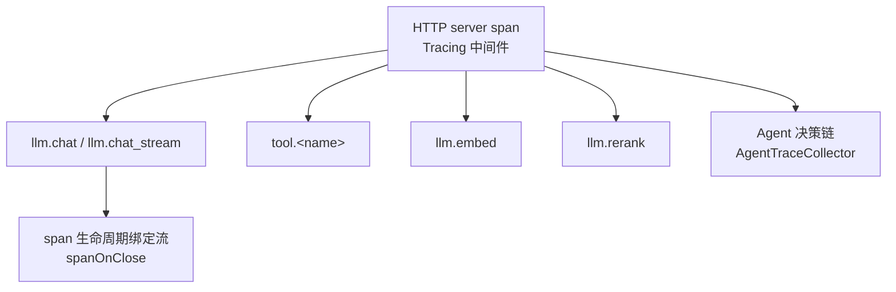

关键点：

1. **根 span 在最外层中间件**（`cmd/server/main.go:188`：`root.Use(api.Tracing(), api.Recovery(), api.CORS(), api.AccessLog())`），覆盖整条中间件链。
2. **SSE 接管根 span**：`TakeRootSpan` 让 handler 把 span 所有权移交给流，由流结束时 `End()`（`internal/api/middleware.go:119`、`internal/api/handler_chat.go:72-77`）。否则根 span 只有几毫秒而子 span 几秒。
3. **自监控端点不埋点**：`/metrics` 与 `/healthz` 跳过（`middleware.go:88-93`），否则 Jaeger 会被无意义的根 span 刷满。
4. **追踪未启用时是 no-op**：所有埋点代码无需判空（`internal/observability/otel.go:66-70` 注释）。
5. **流式 usage 拿不到**：注释指出 usage 在流的最后一帧，由调用方消费，网关层看不到（`internal/llm/gateway.go:416-419`）—— 参考项目自己标注为「课堂讨论点」。

### 4.4.2 Prometheus 指标（11 个）

| 指标 | 类型 | 标签 | 位置 |
|---|---|---|---|
| `capacity_operations_total` | Counter | `scope`, `outcome` | `metrics.go:31` |
| `chat_first_token_seconds` | Histogram | `model` | `metrics.go:35` |
| `llm_tokens_total` | Counter | `model`, `direction`(prompt/completion) | `metrics.go:39` |
| `llm_cost_total` | Counter | `model` | `metrics.go:43` |
| `llm_requests_total` | Counter | `model`, `status`(ok/error/canceled) | `metrics.go:47` |
| `llm_latency_seconds` | Histogram | `model` | `metrics.go:51` |
| `tool_calls_total` | Counter | `tool`, `status` | `metrics.go:55` |
| `tool_latency_seconds` | Histogram | `tool` | `metrics.go:59` |
| `rag_search_seconds` | Histogram | `stage`(dense/keyword_tfidf/rerank) | `metrics.go:63` |
| `agent_iterations` | Histogram | — | `metrics.go:67` |
| `stream_active_sessions` | Gauge | — | `metrics.go:71` |

**标签口径注意**：
- `llm_requests_total` 的 `status` 有三个值：`ok` / `error` / `canceled`（`internal/llm/gateway.go:350-357`）。取消单独计数，便于区分「上游故障」与「用户取消」。
- `capacity_operations_total` 的 help 文本明确写着「process-local operations, never a global-usage gauge」（`metrics.go:32`）—— 这是在防误读：进程内观测到的准入次数**不等于**全局容量使用率。
- `llm_tokens_total` 与 span 属性 `llm.tokens.*` 同源（`internal/llm/gateway.go:421-426`）。

### 4.4.3 结构化日志

`internal/observability/logger` 提供 `LogInfo` / `LogWarn` / `LogError`，输出 JSON 或 console 两种格式（`cfg.Log.Format`）。

关键日志点：
- 访问日志：`method` / `path` / `status` / `ms`（`internal/api/middleware.go:64-75`）。
- 落库失败、统计失败、记忆抽取失败等**非致命问题都记日志但不中断**（`internal/service/chat_stream.go:167`、`:184`、`:187`、`:190`、`:193`、`:220`）。

### 4.4.4 诊断端点

`observability.StartDiagnostics(ctx, cfg.Observability.DiagnosticsAddr, sqlDB)` —— **可选启用**、独立端口、有界关停生命周期（`cmd/server/main.go:194-207`）。

### 4.4.5 取舍说明

- **看什么**：SSE 根 span 的所有权移交机制。这是「长连接如何正确埋点」的完整答案。
- **该抄什么**：① 根 span 在最外层；② 长连接接管 span；③ 自监控端点不埋点；④ no-op span 让业务代码无需判空；⑤ 取消单独计数。
- **为什么要改**：参考项目有 `llm_cost_total` 但主链路上没有写入点（只有 `recordUsage` 写 token）。重建时要决定：成本是估算还是由上游返回？

---

## 4.5 容量与负载

### 4.5.1 实测基线（来源：`docs/research/2026-10-21-p4-capacity-validation.md`）

**30 分钟基准**（冻结二进制 `d8925c0`）：

| 指标 | 实测 |
|---|---:|
| 实际 wire 请求 / 每秒写出 | 18000 / 恰为 10 |
| 成功工作流 / Chat | 14400 / 3600 |
| 拒绝 / 数据库非成功 / 窗口后写出 | 0 / 0 / 0 |
| Chat 客户端 done / SSE 错误 / peer 次数差异 | 3600 / 0 / 0 |
| 查询 p95 / p99 | 12.9984 / 35.525 ms |
| 审批 p95 / p99（179 次） | 24.895 / 33.2111 ms |
| 取消 p95 / p99（179 次） | 19.1685 / 44.8255 ms |
| 工作流排队 p95 / p99 | 133.016 / 177.783 ms |
| 工作流执行 p95 / p99 | 746.749 / 929.704 ms |
| Chat 首 token p95 / p99 | 721.0305 / 939.0661 ms |
| outbox 采样峰值 / 排空后 | 50 / 0 |

**容量矩阵**（SSE 数 × 槽位 × 新请求速率）：

| SSE | 槽位 | 1 rps | 5 rps | 10 rps | 20 rps |
|---:|---:|---|---|---|---|
| 50 | 8 | 通过 | 通过 | 未达标（拒绝 3） | 未达标（拒绝 117） |
| 50 | 32 | 通过 | 通过 | 通过 | 通过 |
| 50 | 64 | 通过 | 通过 | 通过 | 通过 |
| 200 | 8 | 通过 | 通过 | 未达标（拒绝 17） | 未达标（拒绝 118） |
| 200 | 32 | 通过 | 通过 | 通过 | 通过 |
| 200 | 64 | 通过 | 通过 | 通过 | 通过 |
| 500 | 8 | 通过 | 通过 | 未达标（拒绝 12） | 未达标（拒绝 111） |
| 500 | 32 | 通过 | 通过 | 通过 | 通过 |
| 500 | 64 | 通过 | 通过 | 通过 | 通过 |

合并复测：**30/36 档通过**；共 9720 次 wire、9342 次成功、378 次显式拒绝，数据库非成功 / SSE 错误 / peer 次数差异均为 0。

### 4.5.2 限制条件（必须一起引用）

1. **负载是受控模型**：基准模型与工具包含固定等待时间，**不能据此推算真实外部服务的 token 生成速度**（原文明确声明）。
2. **全部在同一台 VM 的独立容器里**：API / Worker / peer / 基础设施都是同一 VM 的容器，不是独立物理机器；CPU 限额不是独占核。
3. **PG 无 CPU 限额**：报告原文特别指出「PG 是额外成本且没有 CPU 限额，不能只报应用 4 核而隐去数据库 CPU」。
4. **未测真实模型**：原文「真实模型尚未配置；回答质量、真实 embedding 质量、token/费用及供应商容量未验收」。
5. **有限观察不等于无泄漏**：原文「此次有限观察没有持续增长证据，不能证明无限运行无泄漏」。
6. **故障实验不算达标**：Worker-kill 实验中 5 个运行的模型/工具次数超过干净负载的 2+1，说明只读步骤按租约恢复发生了至少一次调用；报告保留 `passed=false`，不承诺外部 exactly-once。

### 4.5.3 压测工具的四个 mode

位置：`backend/cmd/loadtest/main.go:18-58`

| mode | 用途 |
|---|---|
| `peer` | 受控 peer：受控模型/工具服务，核对每次成功运行的调用次数 |
| `stage` | 开放到达率的负载阶段 |
| `prepare` | 准备隔离 fixture |
| `bootstrap` | 生成 fixture（凭据保留在私有 fixture 文件中） |

其他文件：`arrival.go`（到达率）、`stage.go`（阶段）、`stream.go`（流）、`audit.go`（审计）、`fixture.go`、`peer.go`。

### 4.5.4 取舍说明

- **看什么**：**限制条件段落**。这是参考项目最值得学的一点 —— 报告把「不能证明什么」写得和「证明了什么」一样清楚。
- **该抄什么**：① 报告必须写明硬件 / 配置 / 负载条件；② 失败档位保留原样不修饰；③ 受控负载不等于真实质量；④ 数据库成本要单独列。
- **为什么要改**：nexus-lab 的 C5 约束「诚实结论」与此完全一致，可以直接沿用这个报告结构。

---

## 4.6 优雅关停与故障语义

### 4.6.1 关停顺序

见 §1.1。补充两个细节：

1. **`ChatService.Close` 有界等待**：`sync.WaitGroup` 等活跃运行结束，超过 `ctx` 预算就返回错误（`internal/service/chatsvc.go:65-78`）。
2. **Worker 的关停也有预算**：`execution.Worker` 等 5s（`ShutdownTimeout`），超时返回错误（`internal/execution/worker.go:86-93`）；doc-etl worker 同样 5s（`internal/worker/worker.go:118-125`）。

### 4.6.2 取消与失败严格分离

| 位置 | 规则 |
|---|---|
| `internal/service/chat_stream.go:162-164` | 落库用 `context.WithoutCancel(ctx)` + 独立 3s |
| `internal/agent/runtime/eino_runner.go:216-218` | 先固化错误再 cancel |
| `internal/llm/gateway.go:346-349` | 取消不计入熔断样本 |
| `internal/llm/gateway.go:353-357` | 取消的指标状态是 `canceled` |
| `internal/execution/driver.go:118-119` | `CompleteOperation` 用 `context.WithoutCancel(ctx)` + 3s |
| `internal/execution/store.go:213` | run 状态写操作在事务内 3s 预算 |
| `internal/service/chatsvc.go:107-110` | `context.AfterFunc(s.root, cancel)` 让进程根 ctx 取消能传导到请求 ctx |

### 4.6.3 「不可知即人工核对」

这是参考项目最重要的故障语义原则：

```
外部副作用已发出但结果未知
  → operation.status = 'unknown'
  → run.status = 'needs_attention'
  → 等待人工核对（ResolveOperation，必须带 evidence）
  → 核对后 run.generation+1，重新排队
```

涉及的代码路径：
- 执行者丢失（`manual` 策略）：`internal/execution/operations.go:70-80`
- 取消时在途：`internal/execution/store.go:393-411`
- 驱动侧的分类：`internal/execution/driver.go:126-132`、`:178-185`

### 4.6.4 取舍说明

- **看什么**：**不可知 ≠ 失败** 这个第三类状态。参考项目的状态机有 8 个状态（queued / running / waiting_approval / retry_wait / succeeded / failed / canceled / needs_attention），`needs_attention` 是最容易被简化掉的一个。
- **该抄什么**：① `needs_attention` 状态；② 人工核对必须带证据；③ 核对后 generation+1；④ 取消与失败分离。
- **为什么要改**：重建时容易把 `needs_attention` 合并进 `failed`。这会丢掉「外部可能已执行」这个关键信息，导致运维无法判断是否需要人工清理。

---

# 第 5 部分 · 给 nexus-lab 重建者的对照清单

## 5.1 按 Phase 的对照清单

nexus-lab 的阶段划分（`nexus-lab/README.md` 路线表）与参考项目实现的对应关系，以及每个阶段的取舍建议。

### Phase 0 · 语法热身 + 架构地图

| 项 | 内容 |
|---|---|
| 参考项目对应 | `backend/internal/agent/event.go`（事件协议）、`backend/internal/llm/types.go`（消息/工具/用量类型） |
| 必抄的不变量 | ① 事件类型用常量（`TypeDelta` / `TypeReasoning` / `TypeToolCall` / `TypeToolResult` / `TypeUsage` / `TypeDone` / `TypeError` / `TypeAgentEvent` / `TypeRefs` / `TypeMeta`）；② 每个事件带 `RunID` / `Seq` / `At`；③ `ToolCall` 带 `ID`（工具调用 ID 是协议配对的依据） |
| 可以简化 | 事件类型可以先只做 4 个（delta / tool_call / tool_result / done） |
| 已知坑 | `Seq` 的分配必须在**单一临界区内**完成（参考项目在 `eventSink.Send` 里持锁分配），否则并发发送会乱序 |

### Phase 1 · 手写 ReAct 循环

| 项 | 内容 |
|---|---|
| 参考项目对应 | `backend/internal/agent/naive/react_loop.go`（手写版）+ `backend/internal/llm/gateway.go` |
| 必抄的不变量 | ① **工具错误结构化回灌**而不是抛异常；② 三个安全阀（最大迭代、单步超时、总超时）；③ 模型输出无工具调用且内容为空 → 明确失败 |
| 可以简化 | 手写版不需要 Eino 依赖 |
| 已知坑 | 「推理内容不算答案」这条容易漏（`eino_runner.go:297-302`） |

### Phase 2 · 流式 + 事件协议 + 取消

| 项 | 内容 |
|---|---|
| 参考项目对应 | `backend/internal/api/handler_chat.go:39`（SSE 桥接）、`backend/internal/agent/runtime/eino_events.go:15`（sink 与背压）、`frontend/src/lib/sse.ts` |
| 必抄的不变量 | ① **客户端断开必须能取消上游**；② 背压超时 → 主动取消而非无限阻塞；③ SSE 帧边界是空行，TCP 分包可能劈帧 → 必须缓冲半帧；④ 事件序号单调 |
| 可以简化 | 不用 Hertz，用标准库 `net/http` 的 `Flusher` |
| 已知坑 | ① 用 `EventSource` 做不到（只支持 GET），必须 `fetch` + `ReadableStream`；② 标准库下需要自己管理 `ResponseController.SetWriteDeadline` 才能感知慢读者；③ Windows 下 Hertz 的 connstate 不支持，心跳要缩短到 250ms（`handler_chat.go:80-86`） |

### Phase 3 · 接入 Eino

| 项 | 内容 |
|---|---|
| 参考项目对应 | `backend/internal/agent/runtime/eino_runner.go`、`backend/internal/agent/einoadapter/` |
| 必抄的不变量 | ① **保留手写版作为对照与降级路径**（参考项目 `agent/naive` 与 `agent/runtime` 并存）；② 中间件三职责分离（裁剪 / 校验 / 工具包装）；③ 整轮淘汰而非按条裁剪；④ 裁剪前先做 tool_call↔result 配对校验 |
| 可以简化 | 中间件可以先只做工具并发槽 |
| 已知坑 | ① Eino 的 `adk.ErrExceedMaxIterations` 需要单独识别；② span 生命周期在流式下要特殊处理 |

### Phase 4 · 工具边界与审批

| 项 | 内容 |
|---|---|
| 参考项目对应 | `backend/internal/agent/einoadapter/tools.go`、`backend/internal/tool/executor_impl.go`、`backend/internal/agent/einoadapter/approval.go` |
| 必抄的不变量 | ① **调用前刷新授权**；② 绑定版本 + Schema 指纹双校验；③ **JSON Schema 子集白名单 + 禁外部加载**；④ 危险工具以 `approval_required` **回灌**而非中断；⑤ 审批能力只走 `context`，不从请求头/JSON/模型输出接受 |
| 可以简化 | Schema 白名单可以先只支持 `type` / `properties` / `required` / `enum` |
| 已知坑 | ① 白名单要只递归 schema 位置，否则 `enum` 里的对象会被误判；② `denySchemaLoader` 必须保留，否则 `$ref` 可以拉外部 schema 做 SSRF |

### Phase 5 · HTTP + 真实终态

| 项 | 内容 |
|---|---|
| 参考项目对应 | `backend/internal/api/router.go`、`middleware.go`、`response.go`、`backend/internal/service/chat_stream.go` |
| 必抄的不变量 | ① **终态在内容落库之后发布**；② 取消与失败分离；③ 状态与内容分离持久化；④ 优雅关停顺序（Chat.Close → HTTP Shutdown）；⑤ SSE 根 span 所有权移交 |
| 可以简化 | 中间件可以先只做 Recovery + AccessLog |
| 已知坑 | ① 认证信息不要从 URL query 取（`middleware.go:132-134` 注释）；② 慢读者要有明确超时；③ 心跳间隔要考虑平台差异 |

### Phase 6 · 持久化 + Host/Expert

| 项 | 内容 |
|---|---|
| 参考项目对应 | `backend/internal/repo/`、`backend/internal/agent/host/host.go`、`backend/internal/service/chatsvc.go:398` |
| 必抄的不变量 | ① 事务边界在 service 不在 repo；② **归属校验在每次访问**；③ Host 只做选择不执行；④ **Expert 上下文隔离**（专属 system + 工具集 + 模型）；⑤ 路由序号解析容错 |
| 可以简化 | 迁移可以先只建核心表 |
| 已知坑 | ① 多专家时每个 Expert 独立 runner 实例，资源开销要算；② 路由是额外模型调用，会增加首 token 延迟 |

### Phase 7 · RAG + 长期记忆

| 项 | 内容 |
|---|---|
| 参考项目对应 | `backend/internal/rag/`、`backend/internal/memory/`、`backend/internal/ingestion/`、`backend/internal/vector/` |
| 必抄的不变量 | ① **先限域再 ANN**（scope 下推到向量库）；② 三路独立降级 + **显式 `Degraded` 列表**；③ 回表二次校验；④ 维度不符不静默截断；⑤ **全路失败要报错**，不返回空结果冒充成功；⑥ 记忆的 revision 绑定；⑦ 文档原文与解析分离（docparser 独立容器） |
| 可以简化 | 关键词路可以先不做（见 §5.2 关于混合检索无增益的证据） |
| 已知坑 | ① 关键词路是 ILIKE + TF-IDF 不是 BM25；② 中文分词是 2-gram（`fusion.go:112-115`）；③ 混合检索在参考项目的受控评估中没有优于密集召回 |

### Phase 8 · MCP + A2A

| 项 | 内容 |
|---|---|
| 参考项目对应 | `backend/internal/mcp/`、`backend/internal/a2a/`、`backend/internal/service/mcp_*.go`、`a2a_*.go` |
| 必抄的不变量 | ① **MCP 工具默认危险**，需管理员显式审阅；② 调试接口只允许已审阅只读工具；③ 配置版本 + 绑定版本双重校验；④ 凭据 AES 加密存储，出站凭据绑定 origin；⑤ 入站 A2A 复用标准对话链路 |
| 可以简化 | A2A 的 `a2a_tasks` 持久化可以后置 |
| 已知坑 | ① 远程 MCP 目录是不可信输入；② `checkSchema` 白名单是 SSRF 防线的一部分，不能省 |

### Phase 9 · 持久工作流 + 审批恢复

| 项 | 内容 |
|---|---|
| 参考项目对应 | `backend/internal/workflow/`、`backend/internal/execution/`、`backend/internal/capacity/` |
| 必抄的不变量 | ① **定义冻结 + hash 校验**；② **generation fencing**；③ 检查点版本三元组；④ **三种 replay_policy**；⑤ `needs_attention` 状态与人工核对（必须带 evidence）；⑥ 取消时把在途 manual 操作标 unknown；⑦ 公平领取；⑧ 能力匹配；⑨ **围栏写与业务写同事务** |
| 可以简化 | 可以先只做 `readonly` 一种 replay_policy |
| 已知坑 | ① 绝不能把 `needs_attention` 合并进 `failed`；② 参考项目同时存在两套工作流引擎，别抄两套；③ `Attempt >= 3` 是硬编码 |

### Phase 10 · 容量 + 观测 + 前端

| 项 | 内容 |
|---|---|
| 参考项目对应 | `backend/internal/observability/`、`backend/internal/capacity/`、`backend/cmd/loadtest/`、`frontend/src/` |
| 必抄的不变量 | ① 指标标签口径明确（取消单独计数；容量指标注明是进程内观测）；② **长连接 span 所有权移交**；③ 报告写明限制条件；④ 压测工具区分「受控 peer」与「开放负载」；⑤ 前端字节流帧缓冲 |
| 可以简化 | 前端可以先只做对话页 + 会话列表 |
| 已知坑 | ① 不要把「受控负载达标」写成「生产已验证」；② 熔断是进程内状态，多副本要额外说明 |

## 5.2 参考项目的已知局限（必须一并继承或显式改进）

| # | 局限 | 证据 | 重建建议 |
|---|---|---|---|
| 1 | **混合检索未优于密集召回** | `docs/research/p3-retrieval-evaluation.json`：dense 与 hybrid 的 Recall@3 都是 1.0、MRR 都是 0.99375；而 dense P95=418.8ms、keyword P95=4.8ms、hybrid P95=419.6ms | 用真实 embedding 重测；若仍无增益，考虑只保留 dense 路 + 显式关键词兜底 |
| 2 | **关键词路是 ILIKE + TF-IDF，不是 BM25** | `internal/repo/rag.go:166-171` 包注释原文「关键词检索（ILIKE/TF-IDF，教学自研版）」；TF-IDF 的 idf 基于**候选池近似**而非全语料 | 若要保留关键词路，考虑改用 PG 全文检索（`tsvector`/`ts_rank`）或专门的 BM25 实现 |
| 3 | **熔断是进程内状态** | `internal/llm/fallback.go:4-5` 注释原文「熔断状态仅在本进程内维护」 | 多副本部署需外置，或在文档中显式声明熔断是单副本粒度 |
| 4 | **沙箱并发是每进程本地上限** | `internal/tool/sandbox.go:51` 的 `slots` channel（PoolSize 1..8） | 多副本总并发 = 副本数 × PoolSize，需外部协调或前置限流 |
| 5 | **两套工作流引擎并存** | `internal/workflow/engine.go`（解释式）与 `internal/workflow/graph.go` + `internal/execution/driver.go`（编译式） | 只做编译式一套 |
| 6 | **`workflow_runs` 一表两用** | 迁移 004 是加列而非重建表；产品侧与引擎侧共用 | 重建时用两张表 |
| 7 | **主密钥无版本号** | `internal/security/encryption.go:21-28`，`sha256(masterKey)` 直接派生 | 加 `key_version` 前缀，支持轮换 |
| 8 | **`MaskPII` 未接线** | `internal/security/sanitizer.go` 实现完整，但主链路无调用点 | 明确脱敏发生在哪一层（日志 / 落库 / 模型输入） |
| 9 | **成本指标无写入点** | `llm_cost_total` 定义在 `metrics.go:43`，但 `recordUsage` 只写 token | 决定成本是估算还是上游返回 |
| 10 | **A2A 入站无独立速率限制** | `a2a_inbound.go` 只受 `MaxConcurrency` 与共享 `HoldRun` 约束 | 确认共享配额覆盖入站路径 |
| 11 | **Host 路由失败不降级** | `host.go:135-142` 把路由超时直接作为错误上报，没有降级直答 | 考虑降级直答 |
| 12 | **真实模型未验收** | 容量报告原文「真实模型尚未配置；回答质量、真实 embedding 质量、token/费用及供应商容量未验收」 | nexus-lab 的验收报告必须分开写「工程机制达标」与「回答质量达标」 |

## 5.3 建议的抄写顺序（按不变量密度排序）

若时间有限，按这个顺序抄，每一步都能独立验证：

| 顺序 | 内容 | 为什么优先 |
|---|---|---|
| 1 | 错误码体系（`errcode`） | 所有后续代码都要用；先定下来才不会返工 |
| 2 | 事件协议（`agent.Event` + `Seq`） | SSE 与持久化都依赖它 |
| 3 | 模型网关（预算 + 熔断 + 重试 + fallback + 取消语义） | 影响面最广，且是最容易做错的地方 |
| 4 | SSE 桥接 + 终态时序 | 用户可见的第一条链路 |
| 5 | 工具执行管道 + Schema 白名单 + 危险工具回灌 | 安全底座 |
| 6 | 持久执行（fencing + replay_policy + needs_attention） | 最难返工的部分 |
| 7 | 共享容量（advisory lock + 围栏写同事务） | 与持久执行强耦合 |
| 8 | 检索限域 + 显式降级 | 安全与可用性兼得 |
| 9 | 出站策略（SSRF） | 一次性做对很难，做错了是漏洞 |
| 10 | 前端字节流解析 | 有了后端再接 |

## 5.4 文档使用建议

- **读本文的顺序**：第 0 部分 → 你当前 Phase 对应的 §5.1 行 → 该 Phase 涉及的 §2 流程 → 需要深挖时看 §3 → 涉及取舍时看 §4。
- **不要通读 §3.9 的迁移表**，除非你要抄数据模型。
- **本文不替代源码**。所有锚点都指向真实位置，遇到「为什么这样写」的疑问，去看锚点附近的注释 —— 参考项目的注释密度很高，很多设计意图只写在注释里。
