# NexusAgent-Eino 参考架构 · Rust 迁移参考

> **本文档的定位已变更（2026-11-04）**
>
> 本文是 **Go → Rust 的迁移对照参考**，用于实现阶段查阅 API 映射与 Go 版行为细节。
> **它不是本项目的设计文档。**
>
> 本项目的**架构与设计**以
> [`2026-11-04-nexusagent-rust-architecture-design.md`](./2026-11-04-nexusagent-rust-architecture-design.md)
> 为准 —— 那份文档用 Rust 自身的工程思想重新设计了系统，与本文的「Go 版怎么写 → Rust 版怎么写」视角不同。
>
> **使用建议**：实现具体模块时查本文；做架构决策时读设计文档。

> 生成日期：2026-11-04
> 参考实现（Go / Eino）：`/Users/shang/Documents/workspace/personal/go-work/NexusAgent-Eino`（只读对照）
> Go 版原文：`docs/architecture/2026-11-03-nexusagent-eino-reference-architecture.md`
> 读者：`nexus-agent`（Rust）重建者。目标不是复述代码，而是回答「Go 版有哪些不变量、Rust 里该落在哪里、哪些地方必须改」。
> 约束：所有 `Go 文件:行号` 锚点指向参考仓库真实位置；所有容量与质量数字沿用 Go 版实测值并注明来源；**Rust 侧尚未实现**，本文中的 Rust 落点均为设计意图，不是既有代码。

---

## 目录

| 章节 | 内容 | Rust 重建者主要收益 |
|---|---|---|
| 第 0 部分 | 阅读指引、Go→Rust 概念映射表、全局 crate 地图、**已落地的 workspace 骨架**（§0.3.1） | 建立 Rust 心智模型，避免把 Go 结构直译成 Rust 目录 |
| 第 1 部分 | 系统架构（进程 / 装配 / 存储 / 前端） | 每个 crate 与每个进程为什么存在 |
| 第 2 部分 | 11 条主流程时序（Rust 版） | 每条链路的状态语义与失败语义 |
| 第 3 部分 | 技术实现细节（代码级） | 关键不变量的 Rust 落点 |
| 第 4 部分 | 横切设计（一致性 / 并发 / 安全 / 观测 / 容量 / 关停） | 系统性决策的取舍依据 |
| 第 5 部分 | Rust 特有陷阱清单 + Phase 0–10 对照清单 + 已知局限 | 直接当 Sprint 的对照表用 |

---

# 第 0 部分 · 阅读指引与全局地图

## 0.1 这份文档是什么、不是什么

**是**：Go 版参考架构的 **Rust 语义等价改写**。每一节末尾给出取舍说明（看什么 / 抄什么 / 为什么要改），并额外标注 Rust 特有的实现约束。

**不是**：
- 不是中立说明书 —— 参考项目有明确的设计主张，本文档把主张连同代价一起呈现。
- 不是 Phase 分阶段教程 —— 阶段划分见第 5 部分。
- 不是性能承诺 —— Go 版实测数字全部带条件（见 §4.5），Rust 移植后必须重测，本文档不迁移任何性能结论。
- 不是 Rust 社区最佳实践的泛论 —— 只写与「照抄 Go 参考实现」直接相关的部分。

**参考实现的规模基线**（Go `backend/` 目录，2026-11-03 实测，沿用 Go 版数据）：

| 指标 | 数值 | 统计方式 |
|---|---:|---|
| Go 源文件（非测试） | 191 | `find backend -name '*.go' -not -name '*_test.go'` |
| Go 代码行（非测试） | 28,964 | 上述文件 `cat` 后 `wc -l` |
| 数据库迁移 | 13 组（001–013，含 down） | `backend/migrations/` |
| 表 | 42 | `CREATE TABLE` 去重（`migrations/*.up.sql`） |
| 进程入口 | 7 | `backend/cmd/*` |
| Prometheus 指标 | 11 | `backend/internal/observability/metrics.go` |

> **对照提示**：代码行数不是目标值。价值在**不变量的密度**。Rust 版尤其要注意：Rust 的编译器会替你挡住「反向依赖」「数据竞争」「use-after-move」，但**挡不住「取消 ≠ 失败」「done 早于落库」这类时序语义错误**。后者才是移植的主要风险。

## 0.2 Go → Rust 核心概念映射表（移植前必读）

这是 Go 版文档里没有、但 Rust 重建者必须先掌握的部分。**每一条都对应本文后续章节的一个具体落点**。

| Go 概念 | Rust 等价 | 关键差异与坑 | 本文落点 |
|---|---|---|---|
| `context.Context` 取消 | `tokio_util::sync::CancellationToken` | Go 的 ctx 是**值语义 + 显式传播**；Rust 的 tokio task 是**drop 即取消**。语义不对等 | §2.1 / §4.6.2 |
| `context.WithoutCancel(ctx)` | **无等价物**。需显式新建 `CancellationToken` + `tokio::spawn` 独立任务 | Go 版「取消 ≠ 失败」的核心机制，Rust 里必须重新设计 | §2.1 / §3.2.4 |
| `context.AfterFunc(parent, f)` | `CancellationToken::child_token()` + `tokio::spawn` 监听 | 子令牌随父取消而取消 | §1.1 |
| `ctx.Value(userID)` | **无 context values**。改用显式 `RequestScope` 参数 或 `tokio::task_local!` | 建议**显式参数**（编译期可查），`task_local!` 仅用于无法显式传递的横切点 | §1.3 / §3.3.4 |
| `chan Event`（有缓冲） | `tokio::sync::mpsc::Sender<Event>`（bounded） | Go 的 `select`+timer 对应 `tokio::time::timeout` + `tokio::select!` | §2.2 |
| `sync.WaitGroup` | `tokio::task::JoinSet` 或 `Arc<Notify>` + 计数器 | WaitGroup 等待是「阻塞当前 goroutine」，Rust 里**绝不能阻塞 runtime 线程** | §1.1 |
| `sync.Mutex` | `tokio::sync::Mutex`（跨 await）/ `std::sync::Mutex`（不跨 await） | **持有 std Mutex guard 跨 await = 编译期报错**（guard 非 `Send`）。这实际上是好事 | §4.2 |
| `errgroup.Group` | `tokio::task::JoinSet` + `JoinError` | Rust 的 `JoinError` 会区分 panic 与取消 | §2.9 |
| `defer fn()` | RAII / `Drop` impl / `scopeguard` | 关停顺序需要**显式编排**，Drop 顺序不可控 | §1.1 |
| `sync.Once` | `std::sync::OnceLock` / `LazyLock`（1.80+） | | §1.2 |
| `atomic.Int64` | `std::sync::atomic::AtomicU64` | `Seq` 分配可用 `fetch_add` | §2.2 |
| `map[string]any` | `serde_json::Value` / `serde_json::Map<String, Value>` | 动态载荷统一用 `serde_json::Value`；**结构化优先用 `serde_json::json!`** | §2.2 |
| `error` 接口 + `errors.Is/As` | `thiserror` 定义的 enum + `#[from]` / `source()` | Rust 的错误是**类型化**的，不是字符串 | §3.8 |
| `errcode.Error{HTTPStatus,Code,Message,cause}` | `AppError { status: StatusCode, code: u32, message: Cow<'static,str>, source: Option<Box<dyn Error>> }` | `source` 不外泄，与 Go 版 `cause` 语义一致 | §3.8 |
| `errors.Join` | `anyhow::Error` 或自定义 `MultiError` | | §3.8 |
| `interface{}`（结构化 tag） | `#[derive(Serialize, Deserialize)]` struct + `#[serde(tag = "type")]` | **不要用 `serde_json::Value` 代替所有 DTO** | §1.3 |
| GORM `Model` + `datatypes.JSON` | `sqlx` + `#[derive(sqlx::FromRow)]` + `sqlx::types::Json<T>` | sqlx **无运行时自动迁移**，需 `sqlx::migrate!` 或 refinery | §3.9 |
| GORM `clause.Locking{Strength:"UPDATE", Options:"SKIP LOCKED"}` | 原生 SQL `FOR UPDATE SKIP LOCKED` | `sqlx::query!` 编译期宏需要 DB 在线；建议用**运行期 `query_as`** + `FromRow` | §3.4 |
| GORM 事务闭包 | `sqlx::Transaction<'_, Postgres>` + `?` 早退 | `sqlx` 无 RAII 自动回滚以外的魔法，事务边界显式 | §3.4 |
| Hertz `SetBodyStream` | `axum::response::sse::Sse` + `tokio_stream::wrappers::ReceiverStream` | axum 的 SSE 会自动加 `Cache-Control`；需自己处理写超时 | §2.1 |
| Hertz 中间件 | `tower::Layer` 栈（`axum::middleware::from_fn`） | 顺序即洋葱模型，需显式注意 | §1.2 |
| `viper` 配置 | `config` crate（分层）+ `serde` 反序列化 | 环境变量覆盖需自己写映射；YAML 解析**不要用 `serde_yaml`（已 deprecated）**，改用 `serde_yaml_ng` | §1.2 |
| `promauto` 全局指标 | `prometheus` crate + `lazy_static`/`OnceLock` registry | | §4.4 |
| OTel SDK | `opentelemetry` + `tracing-opentelemetry` | tracing span → OTel span 的映射需显式配置 | §4.4 |
| `crypto/rand` | `rand` crate | **`rand 0.10` 拆分了 `Rng` 与 `RngExt` 两个 trait**：`random()` / `random_range()` 在 `RngExt`，`fill_bytes()` 在 `Rng`，两个都要 import | §3.7、§3.1.2 |
| `crypto/sha256` | `sha2` crate | | §3.4 |
| AES-256-GCM | `aes-gcm` crate | | §4.3 |
| `golang-jwt/jwt/v5` | `jsonwebtoken` crate | | §4.3 |
| `net/http` 自定义 Transport | `reqwest` + 自定义 `resolve` / `connect` | **reqwest 没有「Dial 时逐 IP 校验」的原生钩子** → SSRF 防线需自建 | §3.7 |
| `netip.ParseAddr` | `std::net::IpAddr` + `to_ipv4_mapped` | Rust 标准库无 `Unmap`，需 `to_ipv4_mapped()` | §3.7 |
| `time.Time` | `chrono::DateTime<Utc>` 或 `time::OffsetDateTime` | 建议全库统一 `chrono` | 全文 |
| `utf8.ValidString` 检查 | **无需**（Rust `String` 恒为 UTF-8） | Go 版多处显式校验在 Rust 里消失 | §3.1.1 |
| `strings.Contains(allowed, " "+key+" ")` 白名单 | `HashSet<&'static str>` | Go 版自己标注为「可读性差且易错」，Rust 直接修掉 | §3.3.2 |
| `runtime.NumCPU()` / GOMAXPROCS | `tokio` worker 线程数配置 | tokio 默认按 cgroup 配额自动探测 | §4.2 |
| `panic recover` | `catch_unwind` 或 `tokio::spawn` 的 `JoinError::is_panic` | 工具执行需要 `catch_unwind` 才能回灌错误 | §3.3.3 |
| `os.Getenv("NX_XXX")` | `std::env::var` / `dotenvy` | | §1.2 |
| `go.mod` 依赖方向检查（靠 depguard） | **Cargo 天然禁止 crate 循环依赖** | Rust 版的依赖方向铁律是**编译期强制**的，这是最大收益 | §0.3 |
| Go `interface` 多态 | `dyn Trait` / 泛型 + `async_trait` | `async fn` in trait（AFIT）**不是 object safe**；需要 `dyn` 时必须 `#[async_trait]` | §1.3 |
| Go 的 nil 指针 | `Option<T>` / `Option<Arc<T>>` | 不用 `Arc<dyn Trait>` 表达「可能不存在」 | 全文 |

## 0.3 Rust crate 地图（依赖方向铁律）

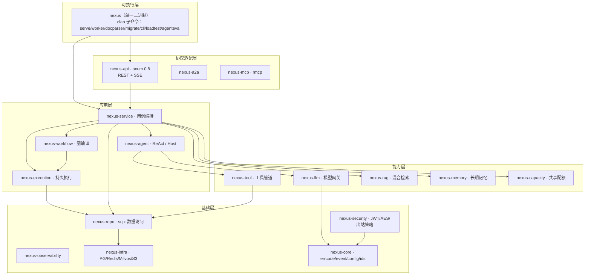

**依赖方向铁律**：

```
bin（只装配） → api（只做协议适配） → service（管事务/错误码/权限） → agent / workflow（管执行语义） → repo（只做数据访问）
```

**Rust 版的额外收益**：Cargo **在编译期禁止 crate 循环依赖**。Go 版需要用 depguard / CI 检查「反向依赖」（Go 版文档明确指出「反向依赖编译期不会报错」），Rust 版只要 workspace 的 `[workspace.dependencies]` 与各 crate 的 `Cargo.toml` 写对，这一条就自动成立。

但要注意 **Cargo 挡不住的**：
- `nexus-core` 变成垃圾桶 crate（什么都往里塞）→ 需要用 `nexus-core` 只放跨 crate 共享的**纯数据类型**。
- 通过 `Arc<dyn Any>` / `serde_json::Value` 传递业务对象绕过类型检查 → 需要 code review 约束。
- trait 依赖倒置过头（所有东西都 trait-object 化）→ 运行期开销 + 编译期检查丢失。**建议：热路径用泛型（静态分发），边界层用 `dyn`（动态分发）**。

### crate 职责表：每层「能感知什么 / 不能感知什么」

| crate | 职责 | 不该做的事（Go 版里的具体反例） |
|---|---|---|
| `nexus-cli`（bin） | 进程入口、依赖装配、优雅关停 | 写业务逻辑。Go 版 `cmd/server/main.go` 里只有装配与关停，`kbSearchFunc` 是唯一例外，且只是回调适配 |
| `nexus-api` | HTTP/SSE 协议适配、鉴权与门禁中间件 | 查库拼业务。Go 版 `api/handler_workflow.go` 全文只做参数绑定 + 调 service |
| `nexus-service` | 用例编排、事务边界、错误码转换、权限校验 | 直接写 SQL。全部数据访问经 `nexus-repo` |
| `nexus-agent` | Agent 执行语义（ReAct 循环、上下文预算、Host 路由） | 感知 HTTP。`nexus-agent` 不依赖 `nexus-api`，也不依赖 `nexus-service` |
| `nexus-workflow` + `nexus-execution` | 图编译解释 + 持久执行（租约 / fencing / 幂等 / 审批） | 直连数据库表。`execution::Store` 是唯一写 `workflow_runs` 的地方 |
| `nexus-llm` | 供应商接入、熔断、限流、重试、失败转移、计量 | 查 `model_configs`、解密凭据 |
| `nexus-tool` | 工具注册、统一执行管道、Schema 校验 | 判断「谁能用该工具」——那是 service 的事 |
| `nexus-rag` | 索引与检索融合、降级 | 决定「何时检索」——那是 service 的事 |
| `nexus-memory` | 长期记忆抽取 / 召回 / 重建 | 会话编排 |
| `nexus-capacity` | 共享额度、租约、公平领取 | 决定业务优先级 |
| `nexus-security` | JWT、AES 加密、提示注入检测、PII 脱敏、**出站 HTTP 策略** | 业务鉴权判定（归属校验在 service） |
| `nexus-repo` | sqlx 数据访问 | 业务判断、事务边界编排（事务边界在 service / execution） |
| `nexus-mcp` / `nexus-a2a` | 外部协议适配 | 业务编排 |
| `nexus-observability` | OTel / Prometheus / 结构化日志 / 诊断端点 | 业务埋点决策 |
| `nexus-infra` | PG / Redis / Milvus / S3 客户端构造 | 任何业务语义 |
| `nexus-core` | 跨 crate 共享的纯类型：`AppError`、事件类型、ID、时间、配置 schema | **不放任何有行为的逻辑**（否则会变成依赖黑洞） |

> **对照提示**：`nexus-core` 是 Rust 移植最容易走偏的地方。Go 版有 `internal/pkg/errcode`、`internal/pkg/sse`、`internal/pkg/pagination`、`internal/pkg/response`、`internal/pkg/callmeta` 五个小包；Rust 版应把这些收进 `nexus-core` 的**子模块**（`core::errcode` / `core::event` / `core::sse` / `core::response` / `core::config`），但**不要**在 `core` 里引入 sqlx / axum / tokio 之外的重量依赖。

### 0.3.1 Workspace 骨架（实现阶段记录，2026-11-04）

> **注意**：本节是**实现记录**，不是设计决策。crate 划分的**设计依据**见
> [`2026-11-04-nexusagent-rust-architecture-design.md` §4](./2026-11-04-nexusagent-rust-architecture-design.md)。
> 本节记录的 crate 数量与依赖图是**当前实现状态**，可能与最终设计有出入。

本仓库已按上述地图建立 Cargo workspace，**21 个 crate + 1 个 bin**，并全部编译通过。

```
nexus-agent/
├── Cargo.toml            # workspace 根：workspace.dependencies + workspace.lints + profile
├── Cargo.lock            # 已锁定 513 个 package
├── rust-toolchain.toml   # 固定 1.99.1
├── crates/
│   ├── nexus-core/       # 零内部依赖的根节点
│   ├── nexus-config/  nexus-model/  nexus-observability/
│   ├── nexus-infra/  nexus-security/  nexus-vector/
│   ├── nexus-llm/  nexus-tool/  nexus-rag/  nexus-ingestion/  nexus-capacity/
│   ├── nexus-workflow/  nexus-execution/  nexus-repo/  nexus-agent/
│   ├── nexus-memory/  nexus-mcp/  nexus-a2a/
│   ├── nexus-service/  nexus-api/
│   └── nexus-cli/        # bin 名 nexus，7 个子命令
├── scripts/
│   ├── scaffold.sh          # 幂等生成 crate 骨架
│   ├── add-external-deps.sh # 幂等注入外部依赖
│   ├── check-lock.sh        # 依赖锁定纪律校验
│   ├── check-deps.sh        # 依赖方向铁律校验
│   └── dev.sh               # 常用命令快捷入口
└── .github/workflows/ci.yml # fmt / clippy / test / release build
```

**三条强制纪律**（CI 全部会拦）：

| 纪律 | 落地方式 | 拦截点 |
|---|---|---|
| 依赖版本只能声明一次 | 所有成员 crate 写 `serde.workspace = true`，版本只在根 `Cargo.toml` 的 `[workspace.dependencies]` | `scripts/check-lock.sh` + `crates/nexus-core/tests/architecture.rs` |
| `Cargo.lock` 必须入库且与 manifest 同步 | CI 用 `--locked` 构建 | `scripts/check-lock.sh` 第 3 项 |
| crate 依赖方向不得成环 | Cargo 编译期拒绝环依赖；另有测试做拓扑排序断言 | `crates/nexus-core/tests/architecture.rs`（8 个测试） |

**依赖方向校验的四条规则**（`scripts/check-deps.sh` + 测试）：

1. `nexus-core` 不依赖任何内部 crate（零内部依赖的根节点）。
2. 能力层（llm / tool / rag / memory / capacity / workflow / execution / repo / agent / mcp / a2a / ingestion / vector）**不得**依赖 `nexus-service` / `nexus-api` / `nexus-cli`。
3. `sqlx` 只允许出现在 `nexus-infra` / `nexus-repo` / `nexus-execution` 三个数据访问层。
4. `nexus-infra` 只依赖底层 crate，不依赖任何上层。

> **实测记录（2026-11-04）**：注入 `nexus-llm → nexus-service` 后，**Cargo 在编译期就报 `cyclic package dependency`**（`nexus-llm → nexus-service → nexus-agent → nexus-llm`）—— 这比任何 CI 脚本都早。Go 版需要 depguard 才能挡住的东西，Rust 版是免费的。上面那 4 条规则检查的是 Cargo 挡不住的语义违规（倒置依赖、垃圾 crate、SQL 散落）。

**`nexus-cli` 的 7 个子命令**（对应 Go 版 7 个 `cmd/*`，合成单一二进制**不改变部署拓扑**）：

| Go cmd | 子命令 | 需要的存储 |
|---|---|---|
| `server` | `nexus serve` | PG + Redis + Milvus + S3 |
| `worker` | `nexus worker --queues execution,doc-etl,memory` | 按队列而定 |
| `docparser` | `nexus docparser` | 无（本地子进程，必须独立容器） |
| `migrate` | `nexus migrate` | PG |
| `cli` | `nexus cli` | API |
| `loadtest` | `nexus loadtest` | API |
| `agenteval` | `nexus agenteval` | API + 模型 |

**workspace.lints 关键项**：

- `unsafe_code = "forbid"` —— 全 workspace 禁止 unsafe。
- `clippy::await_holding_lock = "warn"` —— 跨 await 持有锁是致命错误（`std::sync::MutexGuard` 不能跨 await）。
- `release` profile 的 `panic = "unwind"` **必须保留** —— 工具执行的 panic 隔离依赖 `catch_unwind` / `JoinError::is_panic()`（§2.7、§5.1.1），改成 `abort` 会让整个进程被 panic 带走。

### 0.3.2 骨架搭建阶段新验证的 API 事实

搭建 workspace 时对依赖做了实际编译验证，补充/修正了以下事实（此前仅在 §5.1 提到）：

| crate | 实测结论 |
|---|---|
| `redis 2.0.0-rc.2` | **`redis::aio::ConnectionManager::new(client)` 已改为 `async`**（1.x 是同步构造）。必须 `features = ["tokio-comp", "connection-manager", "script"]`。Lua 脚本用 `Script::new(...)` + `prepare_invoke()` |
| `rmcp 3.8.0` | 没有 `transport-sse-server` feature（该名字不存在）。实际可用：`transport-streamable-http-server` + `transport-streamable-http-server-session` |
| `reqwest 0.13.5` | 需 `default-features = false` + `features = ["rustls", ...]`；`native-tls` 是可选 feature。默认走 rustls |
| `sqlx 0.9.0` | `tls-rustls-ring` 可用（不必依赖系统 OpenSSL） |
| `milvus-sdk-rust 3.0.3` / `bollard 0.21.1` / `object_store 0.14.2` / `pdf-extract 0.12.1` / `jsonschema 0.60.2` / `evalexpr 13.1.0` | **全部编译通过**（与 §1.4 的「生态成熟度待验证」结论相比，`milvus-sdk` / `rmcp` 的编译层面已无阻塞，运行时行为仍需 spike 验证） |

## 0.4 Go 版「不该做的事」反例 → Rust 版落点

Go 版文档 §0.3 的最后一列是本文档最有价值的部分之一。Rust 版逐条对应：

| Go 版反例 | Rust 版对应写法 | 为什么 |
|---|---|---|
| `llm.Gateway` 不查库：`model_configs` → `ModelDescriptor`（含解密 api_key）在 service 层解析（`backend/internal/llm/gateway.go:1-6`） | `nexus-llm` crate 的 `Cargo.toml` **不依赖** `nexus-repo`；`ModelDescriptor` 由 `nexus-service` 构造后传入 | Cargo 依赖图天然保证 |
| `host.HostRouter` 不直依赖 gateway：路由调用通过 `RouterChat` 函数类型注入（`backend/internal/agent/host/host.go:45-48`） | `type RouterChat = Arc<dyn Fn(...) -> BoxFuture<'_, Result<String>> + Send + Sync>` | Go 用「函数类型」注入，Rust 用 `Arc<dyn Fn>`；**不要**让 `nexus-agent::host` 依赖 `nexus-llm` 的具体 `Gateway` 类型 |
| `tool.Executor` 不判断权限：权限由 service 注入的 `SetAccessCheck` 回调完成（`backend/internal/tool/executor_impl.go:55`） | `trait AccessCheck: Send + Sync { fn check(&self, ...) -> bool }`，由 service 实现后 `Arc` 注入 | Rust 用 trait 对象表达「可替换的策略」 |
| `agent` 包不 import `api`，也不 import `service` | `nexus-agent/Cargo.toml` 中不出现 `nexus-api` / `nexus-service` | Cargo 强制 |

---

# 第 1 部分 · 系统架构

## 1.1 进程模型

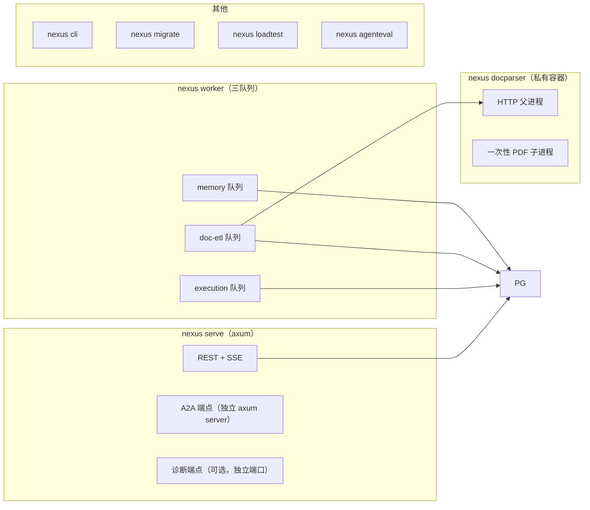

### Go 七个 cmd → Rust 单一二进制

Go 版有 7 个 `cmd/*` 独立二进制。Rust 版建议**一个 crate `nexus-cli` + 一个二进制 + clap 子命令**：

| Go `cmd/*` | Rust 子命令 | 理由 |
|---|---|---|
| `server` | `nexus serve` | — |
| `worker` | `nexus worker --queues execution,doc-etl,memory` | — |
| `docparser` | `nexus docparser` | — |
| `cli` | `nexus cli` | — |
| `migrate` | `nexus migrate` | — |
| `loadtest` | `nexus loadtest` | — |
| `agenteval` | `nexus agenteval` | — |

**取舍**：
- **好处**：编译一次全平台复用；`nexus-core` / `nexus-service` 等库代码在所有子命令间共享（Go 版本来也是共享 `internal/`，无差别）；镜像可以用同一个二进制 + 不同 entrypoint。
- **代价**：二进制体积变大（所有子命令的代码都链接进来）。若体积敏感，用 Cargo features 拆分：`--features no-loadtest` 等。
- **必须保持的性质**：Go 版 7 个进程可以**独立部署**（worker 单独扩容）。Rust 版用**同一二进制、不同命令行**启动，部署时仍按独立 Deployment / 独立副本数运行 —— 这一点不能因为「合成一个二进制」而丢失。

### 进程表

| 进程 | Rust 入口 | 依赖 | 职责 | 关键约束 |
|---|---|---|---|---|
| API | `nexus serve` | PG + Redis + Milvus + S3 | 交互式对话、REST 管理接口、A2A 入站 | SSE 无写超时；每帧刷新 deadline（§2.1） |
| Worker | `nexus worker` | 见下 | 持久执行 / 文档 ETL / 记忆抽取 | 三队列可独立选择；`execution` 只需 PostgreSQL（`cmd/worker/main.go:39`） |
| docparser | `nexus docparser` | 无（本地子进程） | PDF 解析 | **必须独立容器**：父进程 HTTP 监管一个一次性子进程，恶意压缩输入 OOM 只杀子进程（`docs/research/2026-10-20-p4-runtime-hardening.md`） |
| cli | `nexus cli` | API | 命令行客户端 | — |
| migrate | `nexus migrate` | PG | 迁移执行 | — |
| loadtest | `nexus loadtest` | API | 压测 | 四种 mode：`peer` / `stage` / `prepare` / `bootstrap`（`cmd/loadtest/main.go:18,32,41`） |
| agenteval | `nexus agenteval` | API + 模型 | Agent 评估 | — |

### Worker 的三队列切分

Go 版 `cmd/worker/main.go:37-49` 接受 `-queues execution,doc-etl,memory`，每个队列的依赖不同：

| 队列 | 需要的存储 | Worker 实现 | 消费者 |
|---|---|---|---|
| `execution` | 仅 PostgreSQL | `execution.Worker`（`internal/execution/worker.go:71`） | `execution.Driver` |
| `doc-etl` | PG + Redis + Milvus + MinIO | `worker.Worker`（`internal/worker/worker.go:90`） | `rag.engine.IndexDocument` |
| `memory` | PG + Milvus | `long_term.Worker`（`internal/memory/long_term/worker.go:61`） | `long_term.Manager.Process` |

Rust 版对应：`nexus worker --queues` 解析后按队列条件初始化 `Arc<dyn QueueWorker>`。

**权威性约定**（贯穿全项目，是参考项目最值得抄的一条）：

> **PostgreSQL 是执行状态的唯一权威。Redis 只做唤醒提示，Milvus / S3 只做派生数据。**

实现证据（Go 版）：
- Worker 即使收不到通知也持续轮询 PG：`internal/execution/worker.go:63-66`（"Notify is only an accelerator. Run keeps polling PostgreSQL without it."）。
- 通知投递是「至少一次」：outbox 表 + `published_at` 标记，崩溃后重投同一 `(run_id, seq)`，消费方按该元组去重（`internal/execution/outbox.go:28-31`）。
- doc-etl worker 的 `New` 签名里 Redis 参数被显式忽略：`_ *redis.Client`（`internal/worker/worker.go:77`）。

Rust 版落点：
- 轮询用 `tokio::time::interval` + `CancellationToken` 控制退出。
- Redis 通知用 `tokio::sync::broadcast` 或独立 task 监听；**Redis 客户端必须允许 `None`**（用 `Option<redis::aio::ConnectionManager>`），doc-etl worker 的 Redis 依赖显式 `Option::None` 传入，与 Go 版 `_ *redis.Client` 对齐。
- at-least-once 去重元组 `(run_id, seq)` 在消费侧用 `HashSet` 或直接靠 `execution_events` 主键去重。

> **实测记录（2026-11-04）**：`redis 2.0.0-rc.2` 是 **RC 版本**，API 与 1.x 不同（`redis::Script`、`redis::aio::ConnectionManager` 的路径都变了）。生产依赖前必须锁定版本并做一次 API 验证；连接池用 `deadpool-redis 0.23.1`。

> **对照提示**：如果 Rust 版把 Redis 当成队列/状态源，你会失去「Redis 挂了系统仍能跑」这个性质，并且无法解释 at-least-once 去重的必要性。这条必须抄。

### 优雅关停的进程内顺序

Go 版 `cmd/server/main.go:222-245`：

```
收到 SIGINT/SIGTERM
  → cancel()                      # 通知后台 goroutine
  → svcs.Chat.Close(shutdownCtx)  # 等运行中对话的最终落库与配额释放
  → h.Shutdown(shutdownCtx)       # Hertz 停收新请求
  → closeA2A(shutdownCtx)         # A2A 端点
```

总预算 = `cfg.HTTP.ShutdownTimeout`（默认 10s）。`ChatService.Close` 用 `sync.WaitGroup` 等所有活跃运行结束，且**每一步都有独立的 3s 写入预算**（`internal/service/chatsvc.go:63-79`）。

**Rust 版落点（关键差异）**：

```rust
// 伪代码 —— 关停顺序必须显式，不能靠 Drop
let root = CancellationToken::new();
tokio::spawn({
    let root = root.clone();
    async move {
        wait_for_signal().await;      // SIGINT / SIGTERM
        root.cancel();                 // ① 取消后台任务
    }
});

let budget = Duration::from_secs(cfg.http.shutdown_timeout);

// ② 等活跃对话结束（内部每步独立 3s 写入预算）
if let Err(e) = svcs.chat.close(budget).await {
    warn!("chat close incomplete: {e}");
}

// ③ 停收新请求
axum_srv.graceful_shutdown_with_timeout(budget).await;   // axum 0.8 提供

// ④ 关 A2A
a2a_srv.graceful_shutdown_with_timeout(budget).await;
```

> **对照提示（Rust 特有）**：Go 的 `defer` 是 LIFO，Rust 的 `Drop` 也是 LIFO，但 **Rust 的 `Drop` 不能 `await`**。所以关停顺序**必须**像上面这样显式编排成 `async fn`，而不是「靠作用域结束自动清理」。这是 Go → Rust 关停逻辑最容易出错的地方。

## 1.2 依赖装配顺序（`nexus serve`）

Go 版 `cmd/server/main.go:run()` 十三步，Rust 版对应：

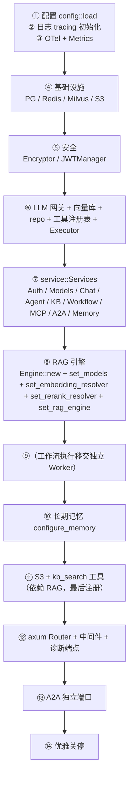

关键点与原因：

1. **`main` 是唯一知道所有具体实现的地方**。Go 版 `service.Deps` 是纯数据结构（`internal/service/service.go:30-43`），所有反向注入都通过 setter 完成。Rust 版：`nexus-service` 定义 `ServiceDeps`（纯结构体）+ `OnceCell`/`RwLock<Option<Arc<dyn RagEngine>>>` 形式的 setter 槽位。
2. **RAG 引擎在 service 之后**：`Engine::new` 需要 `gateway + store + repo`，而 `repo` 由 `service::new` 内部构造。Go 版用 `SetRAGEngine` 反向注入解决循环（`internal/service/service.go:177`）。Rust 版同理 —— 但要注意 **Rust 的循环依赖是编译错误**，所以必须走 setter，不能让 `ServiceDeps` 直接同时持有 `Arc<RagEngine>` 和 `Arc<RagEngine>` 的构造闭包。典型写法：

```rust
pub struct ServiceDeps {
    pub repo: Arc<dyn Repos>,
    pub rag: RagSlot,   // OnceLock<Arc<dyn RagEngine>>，后置注入
    ...
}
pub type RagSlot = Arc<OnceLock<Arc<dyn RagEngine>>>;
```

3. **模型解析全部实时化**：embedding / rerank / memory extractor 都不在启动时固化，而是每次调用时实时查库（`SetModels(svcs.DefaultEmbedding, svcs.DefaultRerank)`，`cmd/server/main.go:160`）。**改配置无需重启**是参考项目的一条产品级承诺。Rust 版：`DefaultEmbedding` 等是 `async fn` 解析器（每次调用查库），不是缓存的值。
4. **`kb_search` 工具最后注册**：它依赖 RAG 引擎（`cmd/server/main.go:172-174`）。Rust 版：`ToolRegistry` 用 `RwLock<Vec<Arc<dyn Tool>>>` 或 `OnceLock`，注册顺序显式。
5. **工作流执行不在 API 进程内**：`cmd/server/main.go:164` 注释明确说明「Workflow handlers persist submissions; the separate worker owns execution.」Rust 版同理。

> **对照提示**：如果 Rust 版把工作流执行放回 API 进程，你会同时失去：API 进程重启不丢运行、API 与 Worker 的容量配额分离、以及「提交接口快」这一用户体验。建议照抄这个切分。

## 1.3 能力分层：每层「能感知什么 / 不能感知什么」

| 层 | 能感知 | 不能感知（硬边界） |
|---|---|---|
| bin | 全部具体实现、进程生命周期 | 业务规则 |
| api | HTTP 语义、身份（通过 axum `Extension<UserId>` 注入） | 业务规则、事务边界 |
| service | 用户身份、权限、数据、模型配置、错误码 | HTTP 细节（不感知 header 以外的东西） |
| `agent` / `workflow` | 运行上下文、工具定义、预算 | 用户是谁（只有 `RunScope` 里的 user_id 作用域）、HTTP |
| `llm` / `tool` / `rag` | 描述符与定义 | 业务归属判断 |
| `repo` | SQL | 业务规则 |

这一分层不是文档约定，而是有代码强制的：
- Go 版 `agent` 包的 `runtime.RunInput` 不含 `userID` 字段；作用域通过 `context` 传递（`internal/security/context.go:8-15`）。
- Go 版 `tool.Executor.Invoke` 的错误信息被刻意模糊化：`"tool binding or authority unavailable"`（`internal/tool/executor_impl.go:180`），不泄露「是因为你不是管理员」还是「工具不存在」。

**Rust 版对应**：Go 的 `context` values 在 Rust 里不存在。三种可选方案：

| 方案 | 做法 | 评价 |
|---|---|---|
| A. 显式参数（**推荐**） | `RunInput { run_id, user_id: Option<i64>, .. }` 或把 `user_id` 放在 `RunScope` 结构体里传 | 编译期可查、最直观；代价是签名变长 |
| B. `tokio::task_local!` | `task_local! { static CURRENT_USER: RefCell<Option<i64>>; }` | 适合横切点（出站 HTTP 策略、审计日志）；但**隐式**，容易在 `spawn` 后丢失作用域（task_local 不跨 `tokio::spawn` 自动继承） |
| C. `Extension<T>`（axum） | 仅在 api 层 | 不能下沉到 agent 层（会引入 axum 依赖） |

**建议**：A 为主（agent / workflow / tool 层显式传 `RunScope`），B 仅用于 `nexus-security` 的出站策略与 `nexus-observability` 的审计。

## 1.4 存储职责划分

| 存储 | 权威性 | 存什么 | 丢了会怎样 |
|---|---|---|---|
| **PostgreSQL** | 唯一权威 | 用户 / Agent / 工具 / 会话 / 消息 / 知识库 / 分块 / 工作流定义 / 运行 / 操作账本 / 审批 / 事件 / outbox / 容量策略与租约 / 记忆元数据 | 业务不可用 |
| **Redis** | 仅唤醒提示 | refresh token 白名单、Pub/Sub 通知、Stream 审计提示、session 窗口缓存 | 降级：Worker 靠轮询继续跑；登录态需要重新登录 |
| **Milvus** | 派生数据 | 文档分块向量、记忆向量 | 检索降级为 `dense_unavailable`，仍可用关键词路 |
| **S3 / MinIO** | 派生数据 | 文档原文 PDF | ETL 重试即可重建 |

四个「派生数据」的一致性策略是统一的：**删除时按版本空间删除，重建时幂等覆盖**。

- 文档向量按 `embedding_version` 分集合，删除时遍历所有版本空间（`internal/rag/engine/engine.go:288-305`）。
- 记忆向量按 `MemoryCollection(embeddingVersion)` 分集合（`internal/memory/long_term/durable_types.go:43`），迁移时清理旧空间且**不会删除当前活跃空间**（`internal/memory/long_term/processor.go:300-306`）。

**Rust 版技术选型**：

| 存储 | Go 版 | Rust 版建议 | 备注 |
|---|---|---|---|
| PostgreSQL | GORM | `sqlx 0.9`（postgres + chrono + json + uuid + migrate） | 见 §3.9 关于编译期宏 vs 运行期查询的取舍 |
| Redis | `go-redis/v9` | `redis 2.0.0-rc.2`（**注意是 RC**）+ `deadpool-redis` | 或用 `fred`；rc 版本需锁定 |
| Milvus | `milvus-sdk-go/v2` | `milvus-sdk-rust 3.0.3`（官方） | 生态成熟度低于 Go 版，**需先做可行性验证** |
| 对象存储 | `minio-go/v7` | `object_store 0.14` 或 `aws-sdk-s3` | `object_store` 抽象更好，但 S3 兼容需验证 |
| 沙箱 | `docker/docker` SDK | `bollard 0.21` | 同为 Docker API |

### 依赖版本清单（2026-11-04 实测 crates.io 最新版）

| crate | 版本 | 用途 | 备注 |
|---|---|---|---|
| `tokio` | 1.54.1 | 异步运行时 | — |
| `axum` | 0.8.9 | HTTP 框架 | 0.8 提供 `graceful_shutdown_with_timeout` |
| `tower-http` | 0.7.1 | HTTP 中间件 | — |
| `sqlx` | 0.9.0 | PostgreSQL | `rust-version = 1.94`，满足本机 1.99 |
| `redis` | **2.0.0-rc.2** | Redis | ⚠️ **RC 版本**；`ConnectionManager::new` **已改 async**；需 `tokio-comp`+`connection-manager`+`script` feature |
| `deadpool-redis` | 0.23.1 | Redis 连接池 | — |
| `reqwest` | 0.13.5 | 出站 HTTP | ⚠️ 无自定义 Dial 钩子（§3.7.3） |
| `opentelemetry` | 0.33.1 | OTel SDK | — |
| `tracing-opentelemetry` | 0.34.0 | tracing → OTel | — |
| `tracing-subscriber` | 0.3.23 | 日志 | `json` feature 提供结构化输出 |
| `prometheus` | 0.14.0 | 指标 | 标签不匹配会 panic（§4.4.2） |
| `aes-gcm` | 0.11.1 | AES-GCM | ⚠️ `aead::OsRng` 已移除；`Nonce::from_slice` 已 deprecated |
| `jsonwebtoken` | 11.1.0 | JWT | — |
| `rand` | **0.10.3** | 随机数 | ⚠️ `Rng` 与 `RngExt` **两个 trait 都要 import** |
| `base64` | 0.23.1 | 编码 | — |
| `thiserror` | 2.0.21 | 错误派生 | — |
| `anyhow` | 1.0.104 | 动态错误 | 仅用于 bin 层，不进 service |
| `async-trait` | 0.1.92 | trait 对象化 | AFIT 不可 `dyn` 化时的必选项 |
| `tokio-util` | 0.7.20 | `CancellationToken` | **取消语义的核心依赖** |
| `futures` | 0.3.34 | Stream 组合 | `chunks()` 用于批量 embed |
| `async-stream` | 0.3.6 | 异步流构造 | — |
| `uuid` | 1.29.0 | ID | — |
| `clap` | 4.6.7 | CLI | 单二进制多子命令 |
| `config` | 0.15.27 | 分层配置 | — |
| `serde_yaml_ng` | 0.10.0 | YAML | ⚠️ **不要用 `serde_yaml`（已 deprecated）** |
| `serde_json` | 1.0.154 | JSON | `preserve_order` feature 可保序 |
| `validator` | 0.21.0 | 校验 | — |
| `secrecy` | 0.10.3 | 密钥包装 | 防止密钥被误打印 |
| `dashmap` | 7.0.0-rc2 | 并发 map | RC 版本，注意 |
| `refinery` | 0.10.0 | 迁移（支持 down） | 若 `sqlx::migrate!` 不够用再引入 |
| `evalexpr` | 13.1.0 | 表达式求值 | ⚠️ 语法与 Go 版 `expr-lang` 不同 |
| `bollard` | 0.21.1 | Docker API | 沙箱隔离 |
| `object_store` | 0.14.2 | 对象存储抽象 | S3 兼容需验证 |
| `aws-sdk-s3` | 1.157.0 | S3 原生 | `object_store` 的替代 |
| `milvus-sdk-rust` | 3.0.3 | Milvus 官方 SDK | 生态成熟度待验证 |
| `rmcp` | 3.8.0 | MCP 官方 SDK | 生态成熟度待验证 |
| `pdf-extract` | 0.12.1 | PDF 解析 | ⚠️ CPU 密集，必须 `spawn_blocking` |
| `jsonschema` | 0.60.2 | JSON Schema 校验 | 建议自实现子集校验器（§2.7） |

> **对照提示**：表中有 8 个 ⚠️ 标记，其中 **5 个是编译期就会咬人的 API 变更**（rand 0.10 的 trait 拆分、aes-gcm 0.11 的 OsRng 移除、serde_yaml deprecated、redis 2.0 RC + async 化的 ConnectionManager、rmcp 的 feature 名），另外 3 个是**设计约束**（reqwest 无 Dial 钩子、evalexpr 语法差异、pdf-extract 需 offload）。它们都已在本文档对应章节标注了实测过的正确写法。**建议 Phase 0 建 workspace 时就把这些版本写进 `Cargo.toml` 的 `[workspace.dependencies]` 并锁定 `Cargo.lock`**，避免中途升级打断。

> **已完成（2026-11-04）**：本项目已按此清单建立 workspace 并锁定 `Cargo.lock`（513 个 package），全部依赖组合编译通过。详见 §0.3.1。

> **Rust 版特有风险**：Milvus / MCP / A2A 三条线的 Rust 生态成熟度明显低于 Go 版。**建议 Phase 0 就做这三个 crate 的 spike**，不要等到 Phase 7/8 才发现阻塞。

## 1.5 前端控制台结构

Go 版结构（`frontend/src`）可整体照搬，Rust 后端不改变前端协议：

```
frontend/src
├── api/          agent.ts chat.ts kb.ts memory.ts workflow.ts admin.ts
├── components/
│   ├── layout/   AppLayout Sidebar Topbar
│   └── ui/       primitives Modal ConfirmDialog ToastHost
├── lib/          request.ts（鉴权与 401 重放） sse.ts（字节流解析） format.ts gsap.ts
├── pages/
│   ├── chat/     ChatPage Composer MessageBubble SessionList TraceTimeline
│   ├── agents/   AgentsPage
│   ├── kbs/      KnowledgeBasesPage KBDetailPage
│   ├── memories/ MemoriesPage
│   ├── workflows/WorkflowsPage WorkflowRunsPage
│   └── admin/    ModelsAdminPage IntegrationsPage MCPToolsModal A2ATasksModal
├── stores/       auth.ts chat.ts ui.ts（zustand）
└── types/        api.ts auth.ts chat.ts agent.ts kb.ts memory.ts workflow.ts admin.ts
```

`lib/sse.ts` 是前端唯一的技术难点，值得完整抄（协议不变，Rust 后端只需保证帧格式一致）：

```
event: <type>\n
data: <json>\n
\n            ← 空行即帧边界
```

关键坑（注释原文，`frontend/src/lib/sse.ts:12`）：TCP 分包可能把一帧劈成两半，必须缓冲半帧。因为对话是 POST + JSON body，浏览器原生 `EventSource` 不支持，所以用 `fetch` + `ReadableStream` 手动解析。

**Rust 后端必须对齐的帧格式**（`internal/pkg/sse/sse.go`）：

```
event: <event>\n
data: <json>\n
\n
```

心跳是 `: ping\n\n`（注释行）。

> **对照提示**：`lib/sse.ts` 是「客户端流式协议」的核心资产，比后端任何单个函数都更值得先抄。它的后半段（帧缓冲 + AbortController 中断）可以直接复用。Rust 后端用 axum 的 `Sse` 类型时要注意：**axum 的 `Sse` 会用 `Event::default().data()` 自动转义**，与 Go 版手写 `event: / data:` 的字节输出不完全一致。**建议 Rust 版手写 `Body::from_stream`**，保持字节级一致，避免前端兼容问题。

---

# 第 2 部分 · 核心流程文档

每条流程给出：角色时序图 → 状态与失败语义 → 代码锚点表 → 取舍说明。

---

## 2.1 流程一：一次交互式对话（Chat，SSE 全链路）

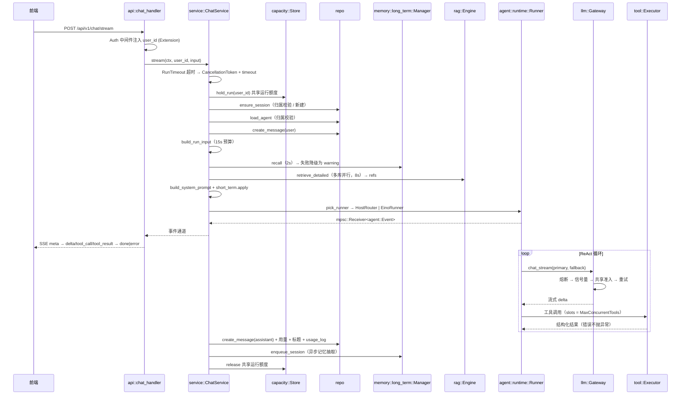

### 状态与失败语义

| 阶段 | 失败模式 | 语义 |
|---|---|---|
| 准入 | `capacity::ErrBusy` | → `ErrRateLimited`「共享运行额度已满」（`internal/service/chatsvc.go:136-142`），**不重试** |
| 上下文组装 | 长期记忆召回失败 | 降级：warning「长期记忆暂不可用」，继续回答（`chatsvc.go:275-277`） |
| 上下文组装 | RAG 检索失败 | 降级：warning「知识库检索暂不可用」，继续回答（`chatsvc.go:293-298`） |
| 上下文组装 | 模型解析失败 | **直接失败**（必须拿到模型才能回答，`chatsvc.go:250-253`） |
| 流式消费 | 客户端消费过慢 | `ErrRateLimited`「客户端消费过慢，生成已停止」（`internal/service/chat_stream.go:118-121`） |
| 流式消费 | 请求取消 | `EvtDone("canceled")`，消息状态 `stopped`，**不是失败** |
| 落库 | 消息保存失败 | 终态改写为 `ErrInternal`，事件带 `persisted=false`（`chat_stream.go:166-172`） |
| 落库 | 租约失效 | 消息标记 `failed`，事件「执行租约已失效，答案未确认成功」（`chat_stream.go:170-181`） |
| 落库 | 用量/标题统计失败 | **只记日志，不影响终态**（`chat_stream.go:183-193`） |

### 关键不变量

1. **`done` 只在助手消息落库之后发布**。文本是暂定的（`internal/service/chat_stream.go:31-32` 注释）。这是「界面显示部分内容 ≠ 请求成功」的实现基础。
2. **取消 ≠ 失败**。落库使用 `context.WithoutCancel(ctx)` + 独立 3s 预算（`chat_stream.go:162-164`），保证请求取消不会取消最终写入。
3. **终态与内容分离**。`status` 字段与 `content` 分开持久化，失败也保留已生成的部分内容。
4. **降级优先于失败**。`chatsvc.go:11-12` 包注释原文：「每一路信息源失败都降级不阻塞，保证『回答永远出得来』」。

### Rust 版落点：取消 ≠ 失败的实现

Go 版靠 `context.WithoutCancel(ctx)` + 独立 3s 预算（`internal/service/chat_stream.go:162-164`）实现「取消后仍要落库」。**Rust 没有 `WithoutCancel`**，必须显式设计。

Go 版逻辑（对照阅读）：

```go
// internal/service/chat_stream.go:162-164（Go 版）
writeCtx, cancelWrite := context.WithTimeout(context.WithoutCancel(ctx), 3*time.Second)
defer cancelWrite()
```

Rust 版等价实现（**新建独立任务 + 独立令牌 + 独立预算**）：

```rust
// Rust 版 —— 「不可取消的写入作用域」
// 关键：不能复用请求的 CancellationToken，也不能复用请求的 deadline。
pub struct DetachedScope {
    token: CancellationToken,          // 独立令牌，父取消不传播
    budget: Duration,                  // 独立写入预算（3s）
}

impl DetachedScope {
    /// 从请求作用域派生出「不可取消」的写入作用域。
    ///
    /// 关键：`CancellationToken::new()` **不继承**任何父 token。
    /// （实测：父 token cancel 后，本 scope 的 token 仍 `is_cancelled() == false`）
    /// 注意与 `child_token()` 的区别 —— `child_token()` 会随父取消，
    /// 方向与 Go 的 `context.WithoutCancel` **正好相反**。
    pub fn from_request(req: &RequestScope, budget: Duration) -> Self {
        let _ = &req.token;            // 明确：父 token 不被继承
        Self { token: CancellationToken::new(), budget }
    }

    /// 执行一次不可取消的写入。超时按失败处理（返回 Err），不影响调用方已产生的结果。
    pub async fn run<F, T>(&self, fut: F) -> Result<T, AppError>
    where
        F: std::future::Future<Output = Result<T, AppError>>,
    {
        tokio::time::timeout(self.budget, fut).await.map_err(|_| AppError::internal("detached write budget exceeded"))
    }
}
```

> **实测记录（2026-11-04）**：`CancellationToken::new()` 与 `root.child_token()` 的取消传播方向已验证 —— 前者**不**受任何父 token 影响，后者**会**。这是 Rust 版实现 Go `context.WithoutCancel` 的唯一正确方式。

**落库路径的 Rust 写法**：

```rust
// 助手消息落库：即使客户端已断开，也必须完成。
let detached = DetachedScope::from_request(&scope, Duration::from_secs(3));
let persist_result = detached.run(async {
    let mut tx = repo.begin().await?;
    // 助手消息 INSERT 与 FenceRun 在同一个事务里（§3.6.4）
    repo.insert_assistant_message(&mut tx, &msg).await?;
    capacity::fence_run(&mut tx, &lease).await?;
    tx.commit().await?;
    Ok(())
}).await;

match persist_result {
    Ok(()) => emit(EvtDone(finish_reason)),       // ✅ done 永远在落库之后
    Err(e) => {
        // 终态改写为 ErrInternal，事件带 persisted=false
        emit(EvtError(AppError::internal("persist failed").code(), e.to_string()));
    }
}
```

> **对照提示（Rust 特有）**：
> - Rust 里 `tokio::time::timeout` 超时会** drop 内部 future**。如果那个 future 持有 sqlx 事务，事务会被回滚 —— 这是期望行为，但要确保 `sqlx::Transaction` 的 drop 回滚是可靠的（sqlx 文档：未 commit 的事务在 drop 时回滚）。
> - **不要**用 `tokio::spawn` + `JoinHandle` 来模拟「不可取消」：`tokio::spawn` 的任务在 runtime shutdown 时也会被取消。落库任务应当在**当前任务内 await**，用 `timeout` 而不是 `spawn`。
> - 若必须 `spawn`（例如不想阻塞 SSE 写出），则写入任务必须持有**独立的 `CancellationToken`**，且该 token 不挂在 `root` token 下。

### 代码锚点

| 环节 | Go 位置 | Rust 落点 |
|---|---|---|
| SSE 桥接（Channel ↔ SSE） | `backend/internal/api/handler_chat.go:39` | `nexus-api::chat::sse_bridge` |
| SSE body（取消 + span 归属 + deadline 刷新） | `backend/internal/api/handler_chat.go:125-186` | `nexus-api::chat::write_sse`（手写 `Body::from_stream`） |
| 根 span 接管 | `backend/internal/api/middleware.go:119` | `nexus-api::middleware::take_root_span` |
| 编排总入口 | `backend/internal/service/chatsvc.go:94` | `nexus-service::chat::ChatService::stream` |
| 会话保障 / 归属校验 | `backend/internal/service/chatsvc.go:206` | `ensure_session` |
| 上下文组装（最核心） | `backend/internal/service/chatsvc.go:245` | `build_run_input` |
| 多知识库并行检索合并 | `backend/internal/service/chatsvc.go:339-340` | `retrieve_kbs`（`JoinSet` + slots） |
| Runner 选择 | `backend/internal/service/chatsvc.go:398` | `pick_runner` |
| 危险工具集合解析 | `backend/internal/service/chatsvc.go:465` | `dangerous_tools` |
| 事件泵 + 助手消息落库 | `backend/internal/service/chat_stream.go:33` | `pump_events` + `DetachedScope::run` |
| 异步记忆抽取 | `backend/internal/service/chat_stream.go:212` | `enqueue_session`（`tokio::spawn` + 独立 token） |
| 前端流解析 | `frontend/src/lib/sse.ts:36` | 不变 |

### 取舍说明

- **看什么**：SSE 事件序列（`meta → reasoning/plan/tool_call/tool_result/agent_event/refs/usage → delta* → done|error`）与终态时序。
- **该抄什么**：① `done` 在落库后才发；② 落库用「不可取消作用域」；③ 四路上下文各自降级为 warning；④ 取消与失败严格分离。
- **为什么要改**：Go 版用 Hertz 的 `SetBodyStream` 实现流式，Rust 版用 axum。axum 的 `Sse` 类型封装较深（自动处理 keep-alive、自动 data 转义），**建议手写 `Body::from_stream`** 以保持字节级兼容（§1.5）。但**语义（done 时序、取消语义、终态分离）必须一致**。这是最容易被简化掉、也最容易造成「界面显示成功但库里没记录」的地方。

---

## 2.2 流程二：ReAct 循环与 `run_middleware` 三职责

> **Rust 移植的最大空缺**：Go 版用 CloudWeGo **Eino** 的 `adk.ChatModelAgent` + `compose.Graph`。
> Rust 生态**没有对等物**。因此本节的核心工作不是「翻译」，而是**设计一套 Rust 原生的 ReAct 运行时与图引擎**。

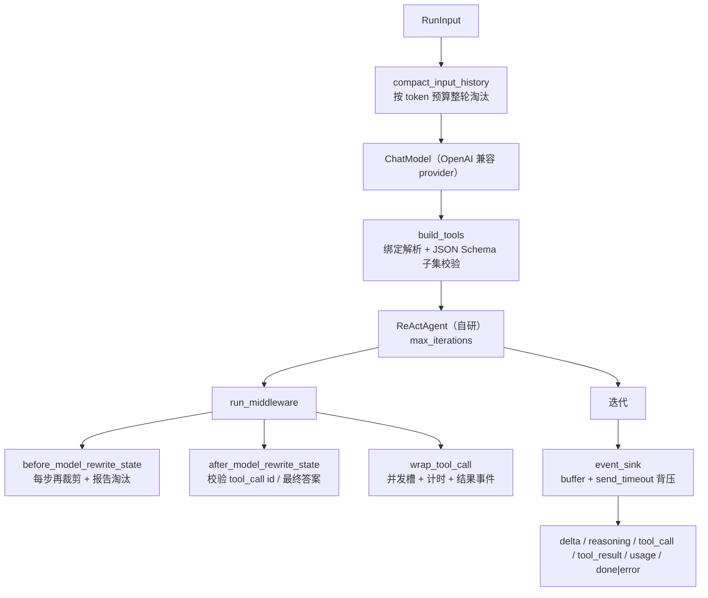

### 三职责

| 职责 | Go 位置 | 做什么 | 失败语义 |
|---|---|---|---|
| `BeforeModelRewriteState` | `internal/agent/runtime/eino_runner.go:261` | 每步模型调用前按 `InputTokenBudget` 重新裁剪历史；发 `progress` 事件说明淘汰了多少**完整轮次** | 裁剪后仍超预算 → `ErrBudget` |
| `AfterModelRewriteState` | `internal/agent/runtime/eino_runner.go:283` | 单步工具调用 ≤32；工具调用 ID 不缺失不重复；无工具调用时必须有非空回答 | → `ErrInvalidParam` / `ErrModelUnavail` |
| `WrapInvokableToolCall` | `internal/agent/runtime/eino_runner.go:305` | 并发槽限流、trace 计时、结果包成 `tool_result` 事件 | 识别 `error` / `timeout` / `approval_required` 三种状态 |

### 关键不变量

1. **整轮淘汰**：`compactInputHistory` 保留所有 system 消息、首个 user 之前的前缀、以及**最新一轮 user**；历史 user 轮按**整轮**删除（含该轮所有并行工具结果）。不生成摘要，不删除任何持久历史（`internal/agent/runtime/context_history.go:17-21`）。
2. **协议完整性先于裁剪**：`inputBudgetUsage` 在**丢弃任何历史之前**校验 tool_call ↔ tool_result 的配对完整性；配对断裂直接报错而不是静默裁剪（`internal/agent/runtime/limits.go:26-28` 注释 + `:29-60` 实现）。
3. **推理内容不算答案**：只有「本步没有 tool_calls 且 content 为空」才判定模型未生成有效回答（`eino_runner.go:297-302`）。
4. **背压**：消费者太慢时 `eventSink.Send` 超时 → `errBackpressure`，并 `cancel()` 整个运行（`internal/agent/runtime/eino_events.go:48-57`）。
5. **事件序号单调**：`eventSink` 分配 `Seq`，`RunID` 固定，便于前端去重与断线续传（`eino_events.go:39`）。

### Rust 版设计：自研 ReAct 运行时

**必须自研的原因**：Eino 的 `adk` + `compose` 组合没有 Rust 对等实现；强行移植会变成「用 Rust 重写一遍 Eino」，成本不可控。

**Rust 版建议的 trait 边界**（对应 Eino 的 `compose.Runnable` / `adk.ChatModelAgent`）：

```rust
// nexus-agent/src/react.rs

/// 模型请求/响应（对齐 OpenAI 兼容协议，与 Go 版 llm::Message 同构）
#[derive(Debug, Clone, Serialize, Deserialize)]
pub struct ChatRequest { pub messages: Vec<Message>, pub tools: Vec<ToolDef>, pub max_tokens: usize, /* ... */ }

#[derive(Debug, Clone, Serialize, Deserialize)]
pub struct ChatResponse {
    pub content: String,
    pub reasoning_content: Option<String>,
    pub tool_calls: Vec<ToolCall>,
    pub finish_reason: String,
    pub usage: Usage,
}

/// 可流式模型。trait 必须 object-safe（供 dyn 使用），故用 #[async_trait]。
#[async_trait]
pub trait ChatModel: Send + Sync {
    async fn chat(&self, req: ChatRequest) -> Result<ChatResponse, AppError>;
    /// 流式：返回事件接收器。调用方负责在丢弃接收器时 cancel。
    async fn chat_stream(&self, req: ChatRequest) -> Result<mpsc::Receiver<StreamEvent>, AppError>;
}

/// 工具：对应 Eino 的 InvokableTool
#[async_trait]
pub trait InvokableTool: Send + Sync {
    fn name(&self) -> &str;
    fn schema(&self) -> &serde_json::Value;
    /// 注意：返回 String 而不是 Result——错误必须结构化回灌给模型（见 §2.7）
    async fn invoke(&self, args: &str, scope: &ToolScope) -> String;
}
```

**自研运行时必须自己实现的 Eino 能力清单**：

| Eino 能力 | Rust 版必须自己写 | 难度 | 参考 |
|---|---|---|---|
| `compose.Graph` 的节点触发（`AllPredecessor`） | 拓扑排序 + 入度计数 + `JoinSet` 并发执行 | 中 | §2.5 |
| `compose.CheckPointStore` | `trait CheckPointStore { async fn get(&self, ckpt: &str) -> Result<Option<Checkpoint>>; async fn set(&self, ckpt: &str, cp: Checkpoint) -> Result<()>; }` | 中 | §3.4.3 |
| `compose.StatefulInterrupt` / `GetResumeContext` | 显式 `Interrupt` 枚举 + `ResumeData` 携带 | 中 | §2.6 |
| `compose.NewGraphBranch` | 条件分支求值（`evalexpr` crate） | 低 | §2.5 |
| `adk.ErrExceedMaxIterations` | 自己定义 `AppError::MaxIteration` | 低 | §2.2 |
| `adk` 的中间件链 | `trait Middleware` + 显式调用顺序 | 低 | §2.2 |
| `schema.Message` / `schema.ToolInfo` | 自有 `Message` / `ToolDef`（Go 版 `llm::types.go` 已有同构定义） | 低 | §2.2 |

**中间件的 Rust 形态**：

```rust
// nexus-agent/src/middleware.rs
#[async_trait]
pub trait ModelMiddleware: Send + Sync {
    /// 返回 None 表示不改写；返回 Some 表示改写后的消息序列。
    async fn before_model(&self, ctx: &mut RunCtx, msgs: Vec<Message>) -> Result<Option<Vec<Message>>, AppError>;
    async fn after_model(&self, ctx: &mut RunCtx, resp: &ChatResponse) -> Result<(), AppError>;
}

#[async_trait]
pub trait ToolMiddleware: Send + Sync {
    async fn wrap_tool_call(&self, ctx: &mut RunCtx, call: &ToolCall) -> Result<String, AppError>;
}
```

> **对照提示**：`#[async_trait]` 是为了让 trait 可以 `dyn`。Rust 1.75+ 的原生 `async fn in trait`（AFIT）**不是 object safe**（返回的 future 没有 `Send` 约束，无法 `dyn` 化），在需要 `Arc<dyn ChatModel>` 的场景必须用 `#[async_trait]`。
> **性能提示**：AFIT 在**不需要** `dyn` 的场景零开销（静态分发）。因此建议：**`nexus-agent` 内部用泛型 + AFIT 获得静态分发，只有在 `nexus-service` 装配层才 `dyn` 化**。这是一个重要的性能决策点。

### 事件 sink 与背压（Rust 版）

Go 版 `eventSink` 用互斥锁保证「Seq 分配 + 通道写入」的原子性（`internal/agent/runtime/eino_events.go:15-56`）。Rust 版有两种实现：

**方案 A（推荐，零锁）**：把 `Seq` 分配放进 `Sender` 之前，用 `AtomicU64` + `fetch_add`：

```rust
// nexus-agent/src/events.rs
pub struct EventSink {
    tx: mpsc::Sender<AgentEvent>,
    seq: AtomicU64,             // 单调序号，fetch_add 保证唯一
    run_id: String,
    timeout: Duration,
    failed: AtomicBool,
    cancel: CancellationToken,
}

impl EventSink {
    pub async fn send(&self, ev: AgentEvent) -> Result<(), AppError> {
        if self.failed.load(Ordering::Relaxed) { return Err(AppError::backpressure()); }
        let ev = AgentEvent { run_id: self.run_id.clone(), seq: self.seq.fetch_add(1, Ordering::SeqCst) + 1, at: Utc::now(), ..ev };
        // 背压：消费者太慢 → 超时 → 主动取消整个运行
        match tokio::time::timeout(self.timeout, self.tx.send(ev)).await {
            Ok(Ok(())) => Ok(()),
            Ok(Err(_)) => Err(AppError::sink_closed()),
            Err(_) => {
                self.failed.store(true, Ordering::Relaxed);
                self.cancel.cancel();                // 主动取消，而非无限阻塞
                Err(AppError::backpressure())
            }
        }
    }
}
```

**方案 B（严格对齐 Go 版）**：用 `tokio::sync::Mutex` 包住「分配 + 发送」，保证序号与写入原子。

> **对照提示**：方案 A 的 `fetch_add` 保证序号唯一但**不保证与通道写入的原子性** —— 事件 A 可能拿到 seq=1 但比 seq=2 更晚到达通道。Go 版持锁正是为了避免这个。**如果前端依赖严格有序，方案 A 不够**。折中方案 C：`mpsc` 发送端改为在**单一 producer task** 中扇入（所有发送者先把事件投到一个内部 mpsc，由唯一 task 分配 seq 并转发）。这是 Rust 下最干净的「单点分配」写法，**推荐 C**。
>
> 方案 C 结构：
> ```rust
> // 内部 ingress 通道：生产者只管 send
> let (ingress_tx, mut ingress_rx) = mpsc::channel::<AgentEvent>(buffer);
> let (out_tx, out_rx) = mpsc::channel::<AgentEvent>(buffer);
> // 唯一的序号分配者
> tokio::spawn(async move {
>     let mut seq = 0u64;
>     while let Some(ev) = ingress_rx.recv().await {
>         seq += 1;
>         let ev = AgentEvent { run_id, seq, at: Utc::now(), ..ev };
>         if out_tx.send(ev).await.is_err() { break; }
>     }
> });
> ```
> 这样 `Seq` 分配与写入天然原子，且**没有锁**。

### 代码锚点

| 环节 | Go 位置 | Rust 落点 |
|---|---|---|
| Runner 构造与预算裁剪 | `backend/internal/agent/runtime/eino_runner.go:65` | `nexus-agent::react::ReActRunner::new` |
| 事件消费主循环 | `backend/internal/agent/runtime/eino_runner.go:114` | `ReActRunner::run` |
| 运行时中间件 | `backend/internal/agent/runtime/eino_runner.go:250` | `nexus-agent::middleware` |
| 上下文整轮淘汰 | `backend/internal/agent/runtime/context_history.rs:22` | `compact_input_history` |
| 预算与配对校验 | `backend/internal/agent/runtime/limits.go:13`、`:29` | `input_budget_usage` / `validate_input_budget` |
| 事件 sink 与背压 | `backend/internal/agent/runtime/eino_events.go:15`、`:28` | `nexus-agent::events::EventSink` |
| 工具绑定与 Schema 子集 | `backend/internal/agent/einoadapter/tools.go:37`、`:174` | `nexus-agent::tools::BoundTool` |

### 取舍说明

- **看什么**：`compactInputHistory` 的「整轮淘汰」语义。它比「按条裁剪」正确得多 —— 按条裁剪会留下孤立 tool_result，直接破坏模型协议。
- **该抄什么**：① 裁剪前先做协议完整性校验；② 保留 system + 当前 user 轮；③ 不生成摘要（摘要会引入额外模型调用与额外失败点）；④ 背压要**主动取消**而不是无限阻塞。
- **为什么要改**：
  - `EstimateTokens` 是启发式估算（`internal/llm/tokenizer.go:11`），参考项目自己也标注「不是厂商计费或上下文保证」。Rust 版可选接真实 tokenizer，但要接受「tokenizer 与厂商不一致」这一新的不确定性来源。
  - **Eino 缺失是 Rust 版最大工作量**。建议 Phase 1 先手写 ReAct 循环（Go 版 `agent/naive/react_loop.go` 有对照），Phase 3 再决定是「自研图引擎」还是「引入某个 Rust Agent 框架」。**不要**在 Phase 0 就试图复刻 Eino。

---

## 2.3 流程三：Host 多智能体路由

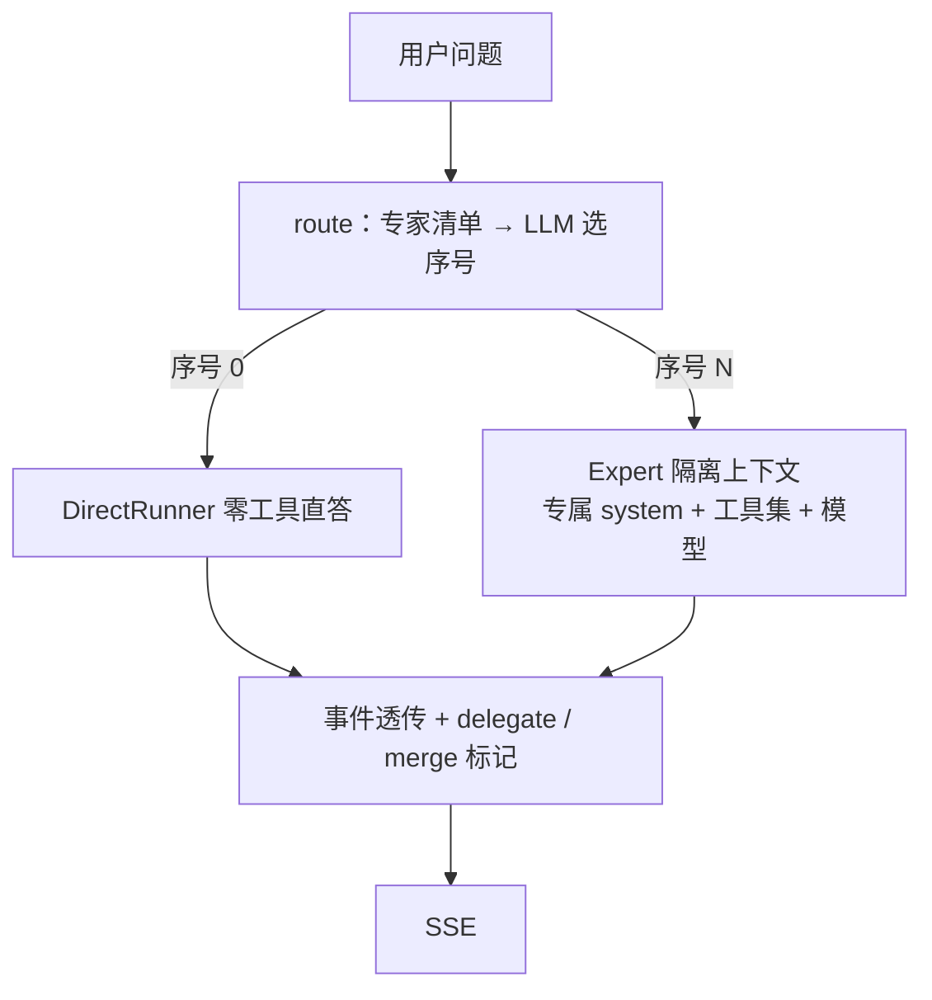

### 语义

| 环节 | Go 位置 | 说明 |
|---|---|---|
| 主循环 | `internal/agent/host/host.go:128` | 路由 → 委派 → 事件透传 → 合并标记 |
| 意图路由 | `internal/agent/host/host.go:223` | 一次**非流式** LLM 调用，只输出专家序号 |
| 序号解析 | `internal/agent/host/host.go:285` | 先试 JSON 数字，失败则扫描首个数字字符；超范围视为不匹配 |
| 上下文隔离 | `internal/agent/host/host.go:259` | `buildExpertMessages` 丢弃原 system，注入专家专属 system |
| 直答降级 | `internal/service/chatsvc.go:451` | `ToolsJSON="[]"`、`DangerousTools=nil` |

### 失败语义

- 路由超时 → `ErrModelTimeout`「Host 路由超时」；路由取消 → `EvtDone("canceled")`（`host.go:135-142`）。
- 专家流未发终态就关闭 → `ErrInternal`「expert stream ended without terminal」（`host.go:196-198`）。
- Expert 事件流返回 `TypeError` → 原样转发，不包装（`host.go:199-201`）。
- 合并标记只在 `finish_reason != "canceled"` 时发（`host.go:203-207`）。

### Rust 版落点

- `RouterChat` 注入：`type RouterChat = Arc<dyn Fn(ChatRequest) -> BoxFuture<'static, Result<String, AppError>> + Send + Sync>`。用 `BoxFuture`（来自 `futures` crate）避免生命周期问题 —— 这是 Rust 里替代 Go 函数类型注入的标准手法。
- 专家上下文隔离：`build_expert_messages(&[Message], &ExpertDef) -> Vec<Message>`，纯函数，好测。
- 专家事件流：`mpsc::Receiver<AgentEvent>`，透传时用 `while let Some(ev) = rx.recv().await`。
- **专家流的终态检查**：Go 版检查「专家流未发终态就关闭」。Rust 版需要在转发循环结束后检查是否见过 `TypeDone` / `TypeError`，用一个 `bool` 标记。

### 取舍说明

- **看什么**：Host 只做**选择**不执行；每个 Expert 拥有独立上下文（system prompt + 工具集 + 模型），避免工具互相干扰。
- **该抄什么**：`RouterChat` 函数注入（`host` 不依赖 `llm.Gateway`）；序号解析的容错扫描；直答路径强制清空工具集。
- **为什么要改**：路由是一次额外的模型调用，会增加首 token 延迟与成本。参考项目没做「路由超时后直接走直答」的自动降级（只把超时作为错误上报）。**Rust 版建议补上**：路由失败 → 降级直答，而不是整体失败。这是参考项目可以改进的点，且在 Rust 版里实现成本很低（`match router(...).await { Err(_) => direct(...) }`）。

---

## 2.4 流程四：LLM 网关调用管道

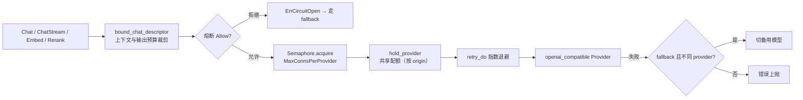

### 失败语义

| 环节 | Go 位置 | 语义 |
|---|---|---|
| 上下文预算 | `internal/llm/context_budget.go:14` | 请求 + 消息 + 工具 + 预留输出 > 上下文窗口 → `ErrBudget`，**不重试**（重试同样会超） |
| 熔断打开 | `internal/llm/gateway.go:84-87` | → `ErrCircuitOpen`，由上层决定是否 fallback |
| 信号量 | `internal/llm/ratelimiter.go:24` | ctx 取消即返回，不排队等死 |
| 共享准入 | `internal/service/service.go:93-104` | 按 origin 哈希分池；容量满 → `capacity.ErrBusy` |
| 重试 | `internal/llm/retry.go:24` | 指数退避；ctx 取消立即中止 |
| fallback（非流式） | `internal/llm/gateway.go:133-142` | 仅当 fallback 的 **provider 与 primary 不同**才切换；两边都失败则错误信息同时含 primary 与 fallback |
| fallback（流式） | `internal/llm/gateway.go:180-190` | **仅在首事件到达前生效**（流中失败无法重放） |
| 取消 | `internal/llm/gateway.go:346-349`、`:353-357` | 调用方取消**不计入熔断样本**，指标标记 `canceled` |

### 关键不变量

1. **网关不查库**：描述符由 service 解析。
2. **span 生命周期绑定流**：`spanOnClose` 把 span 的结束推迟到事件流关闭（`internal/llm/gateway.go:197`）。注释原文：「若放进 runWithGuard，拿到通道就返回，span 只有几毫秒，等于没测」（`gateway.go:171-174`）。
3. **同一 origin 共用一个容量池**：`sha256(origin)` 作为资源键，包括旧冻结描述符与改名后的供应商记录（`internal/service/service.go:99-102`）。

### Rust 版落点

| Go 机制 | Rust 机制 |
|---|---|
| `llm.Semaphore`（`internal/llm/ratelimiter.go:16`） | `tokio::sync::Semaphore`；`acquire()` 返回 `AcquireError`；用 `tokio::select!` 配合 `CancellationToken` 实现「取消即返回」 |
| `RetryDo` 指数退避 | `for attempt in 0..max { match f().await { Err(e) if retryable(e) => sleep(backoff).await, ... } }`；退避用 `tokio::time::sleep` + `CancellationToken` |
| `CircuitBreaker` 环形缓冲（`internal/llm/fallback.go:13`） | `struct Breaker { window: Mutex<VecDeque<bool>>, ... }`；`Mutex` 用 `std::sync::Mutex`（不跨 await，安全） |
| `spanOnClose` | `tracing` span 无法「延迟结束」→ 用 `Span::record` + 显式 `drop(span)`；**或在流结束时用 `span.in_scope(...)` 记录结束时间**。这是 OTel/tracing 的固有差异，需要专门设计 |
| `boundChatDescriptor` | 纯函数，同步实现 |
| `sha256(origin)` 资源键 | `sha2` crate |

**熔断的 Rust 版要注意**：`std::sync::Mutex` guard **不能跨 await**。Go 版 `breaker.Allow()` / `breaker.Record()` 都是同步方法，Rust 版保持同步（返回 bool / ()），不改成 async。这是最省心的映射。

### 取舍说明

- **看什么**：`runWithGuard` 的执行顺序 —— 熔断 → 信号量 → 共享准入 → 重试 → 指标 → 熔断采样。顺序有讲究：**熔断在最外层**，避免已知故障的供应商消耗配额；**取消不计为失败**是熔断正确性的关键。
- **该抄什么**：流式 fallback 只在首事件前；`spanOnClose` 语义；取消不计入熔断；预算裁剪在每次尝试（含 fallback）都重跑。
- **为什么要改**：参考项目的熔断是**进程内状态**（`internal/llm/fallback.go:13`，`Gateway.breakers` map）。多副本部署时每个副本各有一套熔断器，会出现「A 副本熔断、B 副本继续打」的不一致。**Rust 版如果有多副本，需要把熔断状态外置（Redis 或 PG），或者明确接受「熔断是单副本粒度」并写进文档。这是参考项目的已知局限，见 §5.3。**

---

## 2.5 流程五：持久化工作流（冻结定义 → 图编译 → 租约领取 → 幂等账本 → 检查点 → 审批中断 → 续跑）

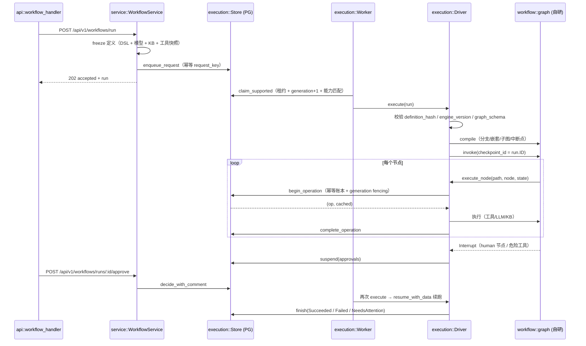

### 运行状态机

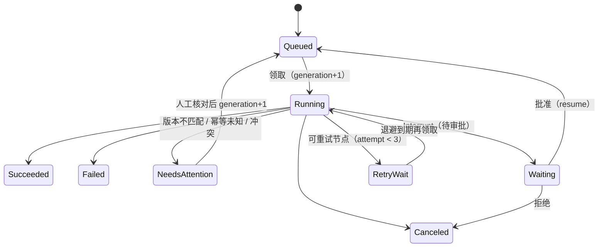

状态常量定义：`internal/execution/types.go:10-21`。Rust 版用 `#[derive(strum::Display)]` 或手写 `&'static str` 常量 + `RunStatus` enum。

### 关键不变量

1. **定义冻结**：运行接受时冻结 DSL + 模型快照 + KB 快照 + 工具快照（含 `BindingVersion`、`Dangerous`、`ReplayPolicy`），存 `workflow_runs.definition`，并计算 `definition_hash`（`internal/service/workflow_snapshot.go:137`、`internal/execution/store.go:66`）。
2. **hash 校验**：执行时重新计算 definition 的 hash 并与 `run.definition_hash` 比对，不一致 → `NeedsAttention` + `ErrVersionMismatch`（`internal/execution/driver.go:47-50`）。
3. **generation fencing**：每次领取 `generation = generation + 1`（`internal/execution/store.go:168`）；所有后续写操作都用 `WHERE id=? AND generation=? AND lease_owner=? AND status='running' AND lease_until>now()` 限定（`internal/execution/store.go:198-200`）。
4. **检查点版本三元组**：(definition_hash, engine_version, graph_schema) 必须与运行一致，否则读写都返回 `ErrVersionMismatch`（`internal/execution/checkpoint.go:38-41`、`:44-46`）。
5. **公平领取**：按 `execution_owner_fairness.last_claimed_at` 排序，让等待最久的 owner 优先（`internal/execution/store.go:157`）。
6. **能力匹配**：`required_capabilities` 必须是 worker 能力集的子集（`internal/execution/store.go:146-151`），防止没有 MCP 的 worker 领取需要 MCP 的运行。

### Rust 版落点：自研图引擎

Go 版用 Eino `compose.Graph`。Rust 版需自研，核心是**一个带中断与检查点的异步 DAG 执行器**。

```rust
// nexus-workflow/src/graph.rs

/// 节点定义（DSL 的编译产物）
pub struct CompiledNode {
    pub key: String,
    pub kind: NodeKind,          // Lambda | Branch | SubGraph | Parallel | Human | Tool
    pub depends_on: Vec<String>,
    pub invoke: Arc<dyn NodeInvoke>,   // async
    pub timeout: Duration,
}

/// 节点执行器
#[async_trait]
pub trait NodeInvoke: Send + Sync {
    /// 返回 Ok(Some(v)) 表示本节点正常产出；Ok(None) 表示「无产出但正常」。
    /// 返回 Err(Interrupt) 表示需要挂起等待审批。
    async fn invoke(&self, ctx: &mut GraphCtx, input: &NodeInput) -> Result<Option<NodeOutput>, NodeError>;
}

/// 中断表示：Go 版 compose.StatefulInterrupt
#[derive(Debug, Clone, Serialize, Deserialize)]
pub struct Interrupt {
    pub path: String,
    pub args_hash: String,
    pub prompt: String,
    pub resume_key: String,
}

/// 节点错误：区分「可重试」「不可重试」「需中断」
#[derive(Debug, thiserror::Error)]
pub enum NodeError {
    #[error("retryable: {0}")]  Retryable(String),
    #[error("permanent: {0}")]  Permanent(String),
    #[error("interrupted")]      Interrupt(Interrupt),
}
```

**执行器的触发语义**（对应 Eino 的 `AllPredecessor`）：每个节点的所有前驱都完成后才触发。

```rust
// 拓扑排序 + 入度计数
let mut indegree: HashMap<&str, usize> = ...;
let mut dependents: HashMap<&str, Vec<&str>> = ...;
// 完成一个节点 → 递减后继入度 → 归零则 spawn
```

**并发槽**：Go 版 `compiler.slots` = 4（`internal/workflow/graph.go:37`）。Rust 版用 `tokio::sync::Semaphore::new(4)`，每个节点任务 `acquire_owned()`。

**子图递归检测**：Go 版 `c.stack` map（`graph.go:161-168`）。Rust 版：`HashSet<NodeId>` 传入 `compile` 递归函数。

**展开上限**：嵌套深度 8、展开节点总数 128、状态大小 4 MiB、DSL 文本 1 MiB（`graph.go:62`、`:141-142`、`:367-369`、`internal/workflow/dsl.go:120-122`）。Rust 版照抄。

### 代码锚点

| 环节 | Go 位置 | Rust 落点 |
|---|---|---|
| 提交运行（冻结 + 幂等入队） | `backend/internal/service/workflow_execution.go:24` | `nexus-service::workflow::submit` |
| 冻结定义 | `backend/internal/service/workflow_snapshot.go:137` | `freeze_definition` |
| 幂等入队 | `backend/internal/execution/store.go:49` | `execution::store::enqueue_request` |
| 领取（租约 + fencing + 公平） | `backend/internal/execution/store.go:126` | `claim_supported` |
| 执行驱动 | `backend/internal/execution/driver.go:41` | `nexus-execution::driver::Driver::execute` |
| 节点执行包装（幂等账本） | `backend/internal/execution/driver.go:78` | `execute_node` |
| 检查点读写 | `backend/internal/execution/checkpoint.go:19`、`:43` | `nexus-execution::checkpoint` |
| 审批挂起 / 决策 | `backend/internal/execution/store.go:261`、`:302` | `suspend` / `decide_with_comment` |
| 取消（把在途操作标 unknown） | `backend/internal/execution/store.go:378` | `cancel` |
| Worker 循环 | `backend/internal/execution/worker.go:71` | `nexus-execution::worker` |

### 取舍说明

- **看什么**：`fenced(tx, run)` 这一个函数（`store.go:198`）—— 它是整个 fencing 机制的中心，所有写操作都从它派生。Rust 版照抄为一个 SQL 片段构造函数：
  ```rust
  fn fenced(run: &Run) -> impl Fn(&mut PgPool) -> ... { ... }
  // 或直接构造 WHERE 子句
  ```
- **该抄什么**：① 定义冻结 + hash 校验；② generation fencing；③ 检查点版本三元组；④ 公平领取；⑤ 能力匹配。
- **为什么要改**：参考项目把 `workflow_runs` 同时用作「旧工作流模型」和「持久执行模型」（迁移 004 是加列而非重建表）。**Rust 版应该用两张表**（`workflow_runs` 产品侧 + `execution_runs` 引擎侧），避免历史数据迁移的复杂度。

---

## 2.6 流程六：审批（HITL）与恢复语义

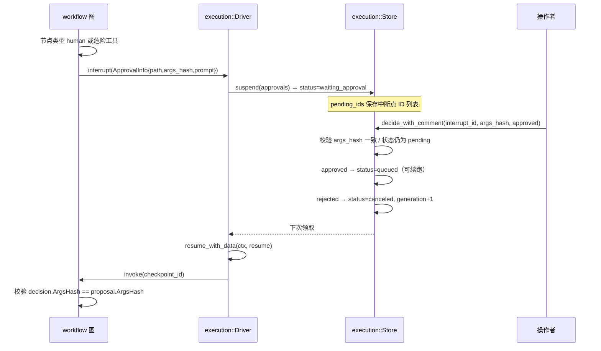

### 语义

| 场景 | 语义 | Go 位置 |
|---|---|---|
| 中断载荷 | `ApprovalInfo{Path, ArgsHash, Prompt}`，`ArgsHash = sha256({path,prompt,parameters})` | `internal/workflow/graph.go:20-27`、`:308` |
| 中断挂起 | `Suspend` 写 `execution_approvals`（decision=pending）+ `workflow_runs.pending_ids` | `internal/execution/store.go:261` |
| 恢复校验 | 恢复时 `decision.ArgsHash != proposal.ArgsHash` → 报错「approval rejected or arguments changed」 | `internal/workflow/graph.go:284` |
| 重复决策 | 相同决策重复提交幂等返回 nil；冲突决策 → `ErrConflict` | `internal/execution/store.go:339-344` |
| 过期 | `expires_at > clock_timestamp()` 才允许写入决策（`internal/execution/store.go:352`，影响行数不为 1 → `ErrConflict`，`:356-357`） | `internal/execution/store.go:352` |
| 参数变化 | 挂起时发现已有审批的 `ArgsHash`/`Path` 与本次不同 → `ErrVersionMismatch` | `internal/execution/store.go:284-288` |
| 审批能力传递 | 通过 `ctx` 传递 `WithToolApproval(code, argsDigest)`，**不能**来自请求头 / JSON / 模型输出 | `internal/agent/einoadapter/approval.go:15-18` |

### Rust 版落点：审批能力不能走 context

Go 版通过 `ctx` 传递审批能力（`context.WithValue`）。**Rust 没有 context values**，这反而是好事 —— 必须显式传递，编译器会强制你思考。

**但要小心**：如果把审批能力放进 `RunScope` 结构体并一路传下去，那么**任何能拿到 `RunScope` 的代码都能拿到审批能力** —— 这比 Go 版更宽松（Go 版需要显式 `WithToolApproval`）。

**Rust 版推荐做法**：用**类型区分**（typestate），让未授权的代码在编译期拿不到能力：

```rust
// nexus-agent/src/approval.rs

/// 未授权作用域：普通对话链路持有
#[derive(Clone)]
pub struct UntrustedScope { /* user_id, run_id, ... */ }

/// 已授权作用域：只有 durable driver 在校验 owner/interrupt/args hash 后才能构造
pub struct ApprovedScope {
    inner: UntrustedScope,
    tool_code: String,
    args_digest: String,
}

impl ApprovedScope {
    /// 私有构造函数 —— 外部 crate 无法调用（模块私有）
    fn new(inner: UntrustedScope, tool_code: String, args_digest: String) -> Self { ... }
    pub fn tool_code(&self) -> &str { &self.tool_code }
    pub fn args_digest(&self) -> &str { &self.args_digest }
}

/// 只有 execution crate 能构造 ApprovedScope —— 通过受限 trait 实现
pub trait ApprovalIssuer: Send + Sync {
    fn issue(&self, untrusted: UntrustedScope, tool_code: String, args_digest: String) -> ApprovedScope;
}
```

**关键**：`ApprovedScope::new` 是模块私有函数；只有 `nexus-execution` 通过一个**受限的 `pub(crate)` 之外不可见的工厂**能拿到它。跨 crate 时可以用 sealed trait 模式：

```rust
// 密封 trait：只有本 crate 的类型可以实现
mod sealed { pub trait Sealed {} }
pub trait ApprovalIssuer: sealed::Sealed + Send + Sync { /* ... */ }
```

> **对照提示**：这个「typestate + sealed trait」是 Rust 版比 Go 版**更安全**的地方。Go 版靠注释说明「审批能力不来自普通 Agent 输入」（`internal/agent/einoadapter/approval.go:15-18`），靠自觉；Rust 版可以让越权路径**编译不过**。这是 Rust 移植的一个真实收益，值得在 Phase 4 落实。

### 取舍说明

- **看什么**：`ApprovalInfo.ArgsHash` 这条线。它把「审批的是哪次调用、哪些参数」绑定成不可变指纹，参数一变审批自动失效。
- **该抄什么**：① `ArgsHash` 绑定；② 审批能力走**类型隔离**而不是参数传递；③ 恢复时二次校验；④ 过期时间与运行 deadline 绑定。
- **为什么要改**：Rust 版必须保持这个隔离，而且应该做得比 Go 版更强（编译期隔离 > 运行时检查）。

---

## 2.7 流程七：工具执行管道与危险工具边界

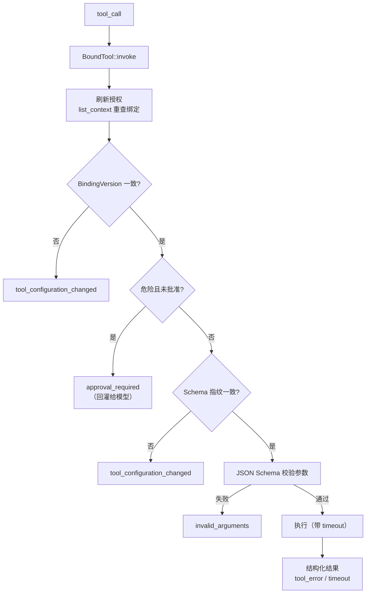

### 两层校验

| 层 | Go 位置 | 做什么 |
|---|---|---|
| 适配层（`boundTool`） | `internal/agent/einoadapter/tools.go:92` | 刷新授权、版本比对、危险判定、Schema 指纹、参数校验、输出截断 |
| 执行层（`ProdExecutor`） | `internal/tool/executor_impl.go:150` | 查定义、超时 ctx、panic recover、参数 JSON 校验、Schema 校验、绑定版本二次比对 |

### 危险工具策略（关键设计）

**危险工具不中断对话**，而是把 `{"error":"approval_required"}` 作为**工具观察回灌**给模型：

```go
// internal/agent/einoadapter/tools.go:112-114
if (t.dangerous || current.Dangerous) && !toolApproved(ctx, t.definition.Name, args) {
    return toolObservation("approval_required", "sensitive tool requires persistent approval"), nil
}
```

即：**模型能看到「这个操作需要审批」，然后由平台侧的持久审批状态决定后续行为**。

### 关键不变量

1. **调用前刷新授权**：长跑过程中工具被禁用或改判为危险，不能继续用启动时的元数据执行（`tools.go:93-95` 注释）。
2. **绑定版本指纹比对**：`BindingVersion` 变化 → `tool_configuration_changed`；Schema 指纹（参数 JSON 的原始串）变化 → 同上（`tools.go:108-116`）。
3. **Schema 子集白名单**：`checkSchema` 只允许固定的 JSON Schema 关键字集；`$ref` 必须是本地引用；`format` 只允许已知枚举；**禁止外部 schema 加载**（`denySchemaLoader`，`tools.go:158-162`、`:174-243`）。
4. **参数必须恰好一个 JSON 对象**：`decoder.Decode(new(any)) != io.EOF` 检查（`internal/tool/executor_impl.go:206-211`）。
5. **工具错误结构化回灌**：错误以 `{"error": ...}` 作为观察返回，而不是抛异常终止循环（`internal/tool/executor_impl.go:1-8` 包注释）。这是 Agent 自我修正能力的前提。
6. **panic recover**：handler panic 被捕获，输出 `{"error":"tool handler panicked"}`（`internal/tool/executor_impl.go:154-156`）。
7. **输出截断**：工具输出按 `MaxOutputBytes` 截断且保持 UTF-8 边界（`internal/agent/einoadapter/tools.go:152-162`）。

### Rust 版落点

| Go | Rust |
|---|---|
| `boundTool.InvokableRun` | `impl InvokableTool for BoundTool`（`#[async_trait]`） |
| `toolObservation(code, message)` | `fn tool_observation(code: &str, msg: &str) -> String` → `serde_json::json!({"error": code, "message": msg}).to_string()` |
| `denySchemaLoader` | `jsonschema` crate 的 `WithLoader` / 自定义 `RefResolver`；或**实现自己的子集校验器**（更安全，见下） |
| `strings.Contains(allowed, " "+key+" ")` | `const ALLOWED: HashSet<&str> = [...]`（**Rust 版直接修掉 Go 版的可读性问题**） |
| `decoder.Decode(new(any)) != io.EOF` | `serde_json::from_str::<serde_json::Value>(&args)` + 检查尾部无多余内容（`Deserializer::from_str(...).end()`） |
| `panic recover` | `std::panic::catch_unwind(AssertUnwindSafe(|| ...))`；**注意：async fn 里的 panic 不会被 `catch_unwind` 捕获**（panic 发生在 poll 时）→ 需要在**同步闭包**内包裹，或用 `tokio::spawn` + `JoinError::is_panic()` |
| UTF-8 边界截断 | `String` 恒为 UTF-8 → 直接 `&s[..floor_char_boundary(limit)]`（`str::floor_char_boundary` 是 unstable，用 `s.char_indices()` 反查） |

**panic recover 的 Rust 陷阱（重要）**：

```rust
// ❌ 错误：async fn 内的 panic 不会被这里捕获
let result = catch_unwind(AssertUnwindSafe(|| async { handler.invoke(args).await }));
// catch_unwind 只捕获闭包同步部分的 panic；真正的 panic 在 poll 时发生 → 逃逸

// ✅ 正确：把工具执行放进独立 task，用 JoinError 判 panic
let handle = tokio::spawn(async move { handler.invoke(args).await });
match handle.await {
    Ok(Ok(out)) => out,
    Ok(Err(e)) => tool_observation("tool_error", &e),
    Err(join_err) if join_err.is_panic() => tool_observation("tool_error", "tool handler panicked"),
    Err(join_err) if join_err.is_cancelled() => tool_observation("timeout", "tool execution cancelled"),
    Err(_) => tool_observation("tool_error", "tool execution failed"),
}
```

**Schema 子集白名单的 Rust 实现**：Go 版用 `jsonschema` 库 + 自定义 loader。Rust 版 `jsonschema` crate（0.60）支持自定义 `ResourceLoader`。但更安全的做法是**自实现子集校验器**（只支持 `type` / `properties` / `required` / `enum` / `items` 等固定集），因为：
- 依赖更少（避免 `jsonschema` 的完整实现带来的 `$ref` 解析复杂度）
- 行为完全可控
- 参考项目自己说「Schema 白名单可以先只支持 `type` / `properties` / `required` / `enum`」（Go 版 §5.1 Phase 4）

```rust
// nexus-agent/src/schema_subset.rs
use std::collections::HashSet;

const ALLOWED_KEYWORDS: HashSet<&str> = HashSet::from([
    "type", "properties", "required", "enum", "items", "description", "default",
    "additionalProperties", "oneOf", "anyOf", "allOf", "format",
]);
const ALLOWED_FORMATS: HashSet<&str> = HashSet::from([
    "date-time", "email", "hostname", "ipv4", "ipv6", "uri", "uuid",
    "json-pointer", "relative-json-pointer", "uri-template",
]);

pub fn check_schema(schema: &serde_json::Value) -> Result<(), String> {
    match schema {
        serde_json::Value::Object(map) => {
            for (key, value) in map {
                if !ALLOWED_KEYWORDS.contains(key.as_str()) {
                    return Err(format!("unsupported schema keyword: {key}"));
                }
                // $ref 必须是本地引用
                if key == "$ref" {
                    let r = value.as_str().unwrap_or("");
                    if !r.starts_with('#') { return Err("$ref must be a local reference".into()); }
                }
                // format 必须是已知枚举
                if key == "format" {
                    let f = value.as_str().unwrap_or("");
                    if !ALLOWED_FORMATS.contains(f) { return Err(format!("unsupported format: {f}")); }
                }
                // 只递归 schema 位置，不递归 enum/default/examples
                if matches!(key.as_str(), "properties" | "items" | "oneOf" | "anyOf" | "allOf") {
                    // 递归校验
                }
            }
            Ok(())
        }
        _ => Err("schema must be an object".into()),
    }
}
```

### 取舍说明

- **看什么**：`checkSchema` 的白名单。这是「远程 MCP 工具目录」安全性的核心 —— 不能让远端定义任意 JSON Schema。
- **该抄什么**：① 调用前刷新授权；② 版本指纹；③ Schema 子集 + 禁外部加载；④ 错误结构化回灌；⑤ panic 隔离。
- **为什么要改**：Go 版的白名单是**字符串包含匹配**（`strings.Contains(allowed, " "+key+" ")`），Go 版文档自己标注「可读性差且易错」。**Rust 版用 `HashSet` 直接修掉**，并可考虑自实现子集校验器而非依赖通用库。

---

## 2.8 流程八：文档 ETL（上传 → 解析 → 有界分块 → 批量 embed → Milvus 索引版本）


### 语义

| 环节 | Go 位置 | 失败语义 |
|---|---|---|
| 上传落库 | `internal/service/kb_upload.go:24` | 原文先入 S3，再入 `document_jobs` |
| 领取与租约 | `internal/ingestion/store.go:140` | 租约 15s，心跳续期 |
| 文档级互斥 | `internal/ingestion/source_lock.go` | 同一文档不会被两个 worker 同时处理 |
| 完整性校验 | `internal/worker/worker.go:220-223` | hash 或 size 不符 → `Permanent`（不重试） |
| PDF 解析 | `internal/worker/worker.go:226-232` | 解析器不可用 → 可重试；解析失败 → `Permanent` |
| 有界分块 | `internal/rag/splitter/splitter.go:36` | 超过上限 → 报错，不静默截断 |
| 分块参数校验 | `internal/rag/engine/engine.go:168-171` | chunkSize 64..4096，overlap ≤ chunkSize/2 |
| 批量 embed | `internal/rag/engine/engine.go:225` | batch ≤256；数量/维度/NaN/Inf 都逐项校验 |
| 状态推进 | `internal/ingestion/lifecycle.go:30` | parsing → chunking → embedding → ready/failed |

### Rust 版落点

| Go | Rust |
|---|---|
| `splitter.SplitBounded` | 纯函数，同步。`Result<Vec<Chunk>, AppError>`，超过上限报错不静默截断 |
| PDF 解析 | Go 版用 `dslipak/pdf`（同步 CPU 密集）。Rust 版 `pdf-extract 0.12` —— **必须放 `tokio::task::spawn_blocking`**，否则阻塞 runtime worker 线程 |
| 批量 embed | `futures::stream::iter(chunks).chunks(256)` 或手写批循环；`futures::StreamExt::chunks` 很合适 |
| 文档级互斥 | PG advisory lock（`pg_advisory_lock(doc_id)`）或 `document_jobs` 行锁 |
| MinIO / S3 | `object_store` crate（异步） |

**`spawn_blocking` 是 Rust 版必须新增的心智负担**（Go 版所有 CPU 密集操作天然在独立 goroutine 上）：

```rust
// ✅ PDF 解析：CPU 密集，必须 offload
let text = tokio::task::spawn_blocking(move || pdf_extract::extract_text(&bytes))
    .await
    .map_err(|e| AppError::internal("pdf task panicked"))?
    .map_err(|e| AppError::parse_failed(&e.to_string()))?;

// ❌ 直接在 async fn 里调用 —— 阻塞整个 runtime worker 线程
// let text = pdf_extract::extract_text(&bytes)?;
```

同理适用于：**hash 计算（sha256 大文件）**、**JSON Schema 校验大对象**、**加密解密大批量**、**AESGCM 批量**。

### 取舍说明

- **看什么**：`IndexDocument` 的四段管线与每段的校验（`internal/rag/engine/engine.go:147-222`）。特别是「分块先落 PG，再 embed，再写 Milvus」——因为 Milvus 主键是 `chunk.ID`，必须先有 ID。
- **该抄什么**：① 原文与解析分离（docparser 独立容器）；② 有界分块与参数校验；③ embed 结果三重校验（数量 / 维度 / 非有限值）；④ 按 embedding_version 分集合。
- **为什么要改**：参考项目每次 embed 都同步等待（`embedChunks` 是同步循环）。文档多时 worker 吞吐低。**Rust 版天然适合改成批量并发**（`JoinSet` + `Semaphore`），但要注意**幂等**：重试必须能覆盖同一批向量，而不是产生重复。用 `chunk.id` 作为 Milvus 主键 → upsert 天然幂等。

---

## 2.9 流程九：RAG 混合检索（先限域再 ANN → 双路召回 → RRF → rerank → 显式降级）

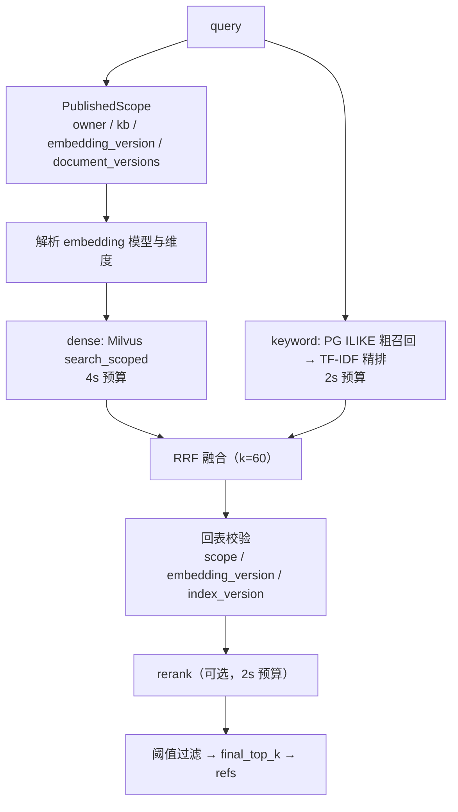

### 语义

| 环节 | Go 位置 | 说明 |
|---|---|---|
| 入口 | `internal/rag/engine/retrieve.go:30` | `RetrieveDetailed` |
| 限域 | `internal/rag/engine/retrieve.go:61-69` | `PublishedScope` 返回 owner/KB/embedding_version/document_versions；身份不匹配 → 报错 |
| dense | `internal/rag/engine/retrieve.go:88-111` | 4s 预算；维度不符 → 降级；`DenseScoreThreshold` 过滤 |
| keyword | `internal/rag/engine/retrieve.go:120-133` | 2s 预算；分词 ≤64 个 |
| 模式判定 | `internal/rag/engine/retrieve.go:138-145` | `hybrid` / `dense_only` / `keyword_only` |
| RRF 融合 | `internal/rag/engine/fusion.go:31` | k 默认 60 |
| 回表校验 | `internal/rag/engine/retrieve.go:155-173` | chunk 的 KB / embedding_version / content / index_version 必须与 scope 一致 |
| rerank | `internal/rag/engine/retrieve.go:176-204` | 2s 预算；失败 → `rerank_unavailable` 降级 |
| 显式降级 | `internal/rag/engine/retrieve.go:113`、`:131`、`:199` | `Degraded` 列表：`dense_unavailable` / `keyword_unavailable` / `rerank_unavailable` |
| 全路失败 | `internal/rag/engine/retrieve.go:136-138` | 两路都不可用 → 报错（不返回空结果冒充成功） |

### Rust 版落点

- **限域下推是硬要求**：`SearchScoped` 把 scope 表达式下推到 Milvus，而不是先 ANN 再过滤。Rust 版 `milvus-sdk-rust` 3.0 支持 filter expression，**必须在调用时传入**，不能先取 topK 再过滤。
- **三路独立降级**：用 `Vec<&'static str>` 或 `BTreeSet<DegradedKind>` 收集 `Degraded`。
- **回表二次校验**：拿到 chunk id 列表后，从 PG 回表拿完整 chunk，逐项比对 scope。Rust 版用 `sqlx::query_as::<_, ChunkRow>` + `WHERE id = ANY($1)`。
- **中文分词**：Go 版是 2-gram（`fusion.go:112-115`）。Rust 版可选 `jieba-rs` 或同样用 2-gram（保持行为一致）。

### 取舍说明

- **看什么**：**限域发生在 ANN 之前**。先过滤会导致 TopK 被越权结果占满。
- **该抄什么**：① 限域下推；② 三路独立降级 + 显式 `Degraded` 列表；③ 回表二次校验；④ 维度不符不静默截断；⑤ 全路失败要报错。
- **为什么要改 / 已知局限**（沿用 Go 版实测结论，Rust 版必须重测）：
  - **关键词路是 ILIKE + TF-IDF，不是 BM25**（`internal/repo/rag.go:166-171` 注释原文：「关键词检索（ILIKE/TF-IDF，教学自研版）」）。
  - **混合检索并未优于密集召回**。Go 版自己的评估（`docs/research/p3-retrieval-evaluation.json`）显示 dense 与 hybrid 的 Recall@3 都是 1.0，MRR 都是 0.99375；而 dense 的 P95 是 418.8ms，keyword 只有 4.8ms，hybrid 是 419.6ms。也就是说**关键词路在当前配置下几乎是纯成本**。
  - 该评估用的是「受控词表特征，32 维」embedding，不是训练过的语义模型（评估文件 `evidence` 字段原文：「application ranking/isolation/citations only; no trained semantic model or answer quality claim」）。所以不能据此断言「混合检索无用」，只能断言「在受控 embedding 下混合没有增益」。**Rust 版应当用真实 embedding 重测再决定是否保留关键词路。**

---

## 2.10 流程十：长期记忆（抽取 → ADD/UPDATE/DELETE 决策 → 向量投影 → 作用域召回）

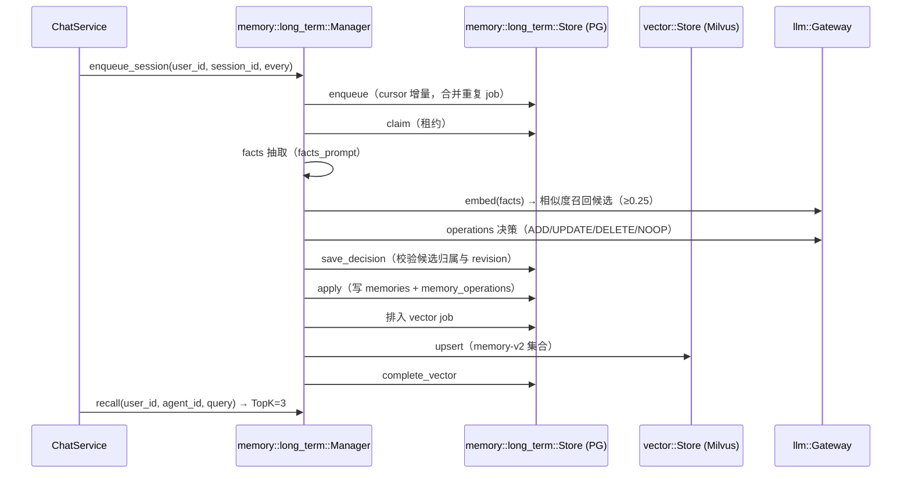

### 语义

| 环节 | Go 位置 | 说明 |
|---|---|---|
| 抽取引擎 | `internal/memory/long_term/processor.go:20` | `MEMORY_FACTS_V2`：只抽用户明确表达的偏好/背景/约束；不保存密码密钥；最多 16 条 |
| 决策引擎 | `internal/memory/long_term/processor.go:21` | `MEMORY_OPS_V2`：UPDATE/DELETE 只能引用已有记忆 ID；同一 ID 最多改一次；ADD 不带 id |
| 候选召回 | `internal/memory/long_term/processor.go:169` | 向量相似度 ≥ `MinimumSimilarity`（默认 0.25），Top 5/条，最多 32 条候选，总内容 ≤16KiB |
| 归属校验 | `internal/memory/long_term/processor.go:156-160` | 模型引用了不在候选里的 ID → `PermanentMemory`（不重试） |
| 应用 | `internal/memory/long_term/operations.go:99` | 写 `memories`（带 `revision`）+ `memory_operations` |
| 向量投影 | `internal/memory/long_term/processor.go:273` | 按 `embedding_version` 分集合；迁移时清理旧空间但不动当前活跃空间 |
| 作用域召回 | `internal/memory/long_term/long_term.go:74` | 按 owner + agent + revision 过滤 |
| 租约丢失 | `internal/memory/long_term/durable_types.go:24` | `ErrMemoryLeaseLost` |
| 冲突 | `internal/memory/long_term/durable_types.go:25` | `ErrMemoryConflict`：profile 的 embedding 版本与 job 不一致 |

### 关键不变量

1. **revision 绑定**：每条记忆有 `revision`；向量投影记录 `indexed_revision`；召回时只接受 `scope.MemoryRevisions[id] == row.Revision`，即**只有已投影到向量空间的最新版本才可被召回**（`internal/memory/long_term/processor.go:257-259`）。
2. **幂等重建**：`POST /memories/rebuild` 用 `request_key` + `memory_profile_rebuilds` 保证同一请求只重建一次（`internal/memory/long_term/profile_rebuild.go:34`）。
3. **来源不可推断**：被 superseded 的 A→B 迁移仍拥有清理 A 的职责，后来的 B→C job 不能靠推断获得这个祖先关系（`internal/memory/long_term/processor.go:298-301` 注释）。
4. **抽取失败分类**：结构化输出非法 → `PermanentMemory`（不重试）；模型暂时不可用 → 可重试。

### Rust 版落点

- **结构化输出**：`facts` 与 `operations` 两次 LLM 调用，输出用 `#[derive(Deserialize)]` 的 struct + `response_format: json_schema`（OpenAI 兼容 API 支持）。**必须做严格校验**：模型返回的 `id` 必须在候选集合内（归属校验）。
- **「决定做什么」与「执行」分离**：决策结果先 `save_decision` 再 `apply`，可以在两者之间插入人工检查点。Rust 版用两个独立的事务函数。
- **revision 绑定**：召回时 `scope.memory_revisions[id] == row.revision`。Rust 版用 `HashMap<i64, i64>`。

### 取舍说明

- **看什么**：**「决定做什么」与「执行」分离**。抽取/决策是 LLM 驱动的，Apply 是纯数据库操作。
- **该抄什么**：① revision 绑定；② 候选归属校验（模型不能引用未授权 ID）；③ 向量投影与元数据更新分离；④ 迁移清理的祖先关系规则。
- **为什么要改**：参考项目用两次 LLM 调用（facts + operations）完成抽取，成本不低。**Rust 版可以考虑合并成一次结构化输出**（`facts` + `ops` 同一个 JSON schema），或用小模型 + 规则降级。Rust 的 `serde` + `#[serde(tag="op")]` 枚举让「一次调用两个产物」的 schema 定义变得比 Go 简洁。

---

## 2.11 流程十一：MCP 与 A2A 出入站集成

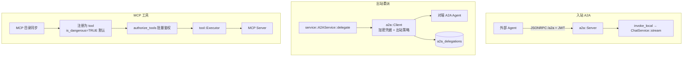

### 语义

| 环节 | Go 位置 | 失败语义 |
|---|---|---|
| 入站 A2A 装配 | `internal/service/a2a_inbound.go:18` | 需要 `A2A.Enabled` + JWT；生产环境必须配 `public_url` |
| 入站鉴权 | `internal/service/a2a_inbound.go:44-54` | JWT 解析 + `activeUser` 复核（禁用账号立即失效） |
| 入站调用本地对话 | `internal/service/a2a_inbound.go:61` | 走**标准对话链路**（复用 ChatService）；回答上限 64KiB；必须恰好一次 `TypeDone` 且 `finish_reason ∈ {stop, end_turn}` |
| 出站委派 | `internal/service/a2a_delegation.go:111` | 持久化到 `a2a_delegations`；支持幂等键、取消、状态查询 |
| 出站凭据 | `internal/a2a/client.go:33` | `WithCredentials(origin, headers)` —— 凭据绑定到 origin |
| MCP 目录同步 | `internal/service/mcp_sync.go:120` | 新发现的 MCP 工具**默认 `is_dangerous=TRUE, replay_policy='manual'`** |
| MCP 工具审阅 | `internal/service/mcp_policy.go:23` | 管理员审阅后才可改为 `readonly`/`idempotent`；审阅留证据 `replay_evidence` |
| MCP 调用鉴权 | `internal/service/mcp_runtime.go:30` | 校验：服务器启用 + 用户在白名单 + `config_version` 一致 + 已审阅 + `binding_version` 一致 + 凭据已加密迁移 |
| 调试调用限制 | `internal/service/mcp_runtime.go:150` | 管理员调试只允许**已审阅的只读工具**；写操作必须走工作流审批 |
| 注册表恢复 | `internal/service/mcp_runtime.go:123` | 启动时从 DB 恢复 MCP 工具 handler；上限 10000 |

### Rust 版落点

| Go | Rust |
|---|---|
| `github.com/modelcontextprotocol/go-sdk` | `rmcp 3.8`（官方 Rust SDK，`#[async_trait]` 风格的 handler trait） |
| `github.com/a2aproject/a2a-go/v2` | **无官方 Rust SDK** → 需要自实现 JSON-RPC 层（工作量评估见 §5.3） |
| MCP 工具 → 平台工具 | `rmcp` 的 `Tool` → 实现 `nexus-tool::InvokableTool`，包装成 `Arc<dyn InvokableTool>` |
| MCP 客户端会话管理 | `rmcp` 的 transport（stdio / http） + 一个长驻 task 管理会话；注意 **session 断线重连** |

> **Rust 版特有风险**：`rmcp 3.8` 与 `a2a-go` 的成熟度差距明显。**建议 Phase 0 做 spike**：
> 1. `rmcp` 的 client + server 双端能否在本项目里跑通（stdio + streamable-http）。
> 2. A2A 的 JSON-RPC 协议自实现成本评估（协议不复杂，但需要 agent card 格式、task 生命周期、SSE 推送 —— 估计 800~1500 行）。
> 3. 若成本过高，**Phase 8 先只做 MCP，A2A 出站委派降级为「HTTP JSON-RPC 直连」**（不做完整的 Agent Card 发现）。

### 取舍说明

- **看什么**：MCP 工具**默认危险**这个决定（迁移 011 的 `UPDATE tools SET is_dangerous=TRUE, replay_policy='manual' WHERE type='mcp'`）。远程目录是不可信输入，默认放行等于默认不安全。
- **该抄什么**：① MCP 默认危险 + 显式审阅；② 调试接口只允许只读；③ 配置版本 / 绑定版本双重校验；④ 入站 A2A 复用标准对话链路而不是另写一套。
- **为什么要改**：A2A 入站把完整对话链路暴露给了持有 JWT 的外部 Agent，且 A2A 卡片宣称的能力只有 `chat`。参考项目没有为 A2A 入站单独做速率限制（共享 `MaxConcurrency` 是唯一闸门）。**Rust 版应确认共享配额覆盖了入站路径。**

---

# 第 3 部分 · 技术实现细节（代码级）

本部分只写「不变量在哪里、为什么这么写」。每一节末尾给出取舍说明。

## 3.1 LLM 网关

### 3.1.1 `bound_chat_descriptor`：预算裁剪

Go 位置：`backend/internal/llm/context_budget.go:14`

每次模型尝试（含 fallback 与后续 tool_result 轮）都会重新执行：

1. 拷贝描述符（不修改原值）。
2. 确定输出上限：`limit = desc.MaxOutputTokens`（0 则回落 `MaxTokens`）；`requested = req.MaxTokens`（0 则默认 1024，且不超过 `ContextWindow/4`）；最终 `requested = min(requested, limit)`。
3. 若 `ContextWindow > 0`：把消息与工具序列化为 OpenAI 兼容请求体，加上 framing 开销 `64 + 16*len(messages) + 32*len(tools)`。若 `requested >= ContextWindow` 或 `len(raw) > ContextWindow - requested - framing` → `errcode.ErrBudget`。

Go 版注释明确说明「使用序列化 UTF-8 字节 + framing 作为保守本地预算，而不是精确 / 厂商无关的 token 计数」（`context_budget.go:10-13`）。

**为什么重要**：预算不足在**调用前**就被拒，而不是等上游返回 400。这让预算错误可以在重试之前短路。

**Rust 版**：纯函数，`fn bound_chat_descriptor(desc: &ModelDescriptor, req: &ChatRequest) -> Result<ModelDescriptor, AppError>`。因所有权问题，Rust 版应返回**新描述符**（而非就地修改），Go 版也是这么做的（「拷贝描述符（不修改原值）」）。

### 3.1.2 `retry_do`：指数退避 + 抖动

Go 位置：`backend/internal/llm/retry.go:24`

- 默认 3 次尝试、100ms 基础延迟、2s 上限（`retry.go:19-22`）。
- 延迟 `BaseDelay << attempt`，超过上限则截断，再加 `rand.Int63n(delay/4)` 的抖动。
- `ctx.Done()` 立即中止等待。
- 非可重试错误立即返回（`IsRetryable`）。

**为什么重要**：抖动是必需的 —— 没有抖动，多个并发请求会在同一时刻重试，形成同步风暴。

**Rust 版**：

```rust
pub async fn retry_do<F, Fut, T>(cfg: &RetryConfig, cancel: &CancellationToken, mut f: F) -> Result<T, AppError>
where
    F: FnMut() -> Fut,
    Fut: std::future::Future<Output = Result<T, AppError>>,
{
    let mut delay = cfg.base_delay;
    for attempt in 0..cfg.max {
        match tokio::select! {
            biased;
            _ = cancel.cancelled() => return Err(AppError::canceled()),
            r = f() => match r {
                Ok(v) => return Ok(v),
                Err(e) if !e.is_retryable() => return Err(e),
                Err(e) if attempt + 1 == cfg.max => return Err(e),
                Err(_) => { /* 继续重试 */ }
            },
        }
        // 抖动：sleep 期间要响应取消
        // rand 0.10：`random_range` 在 `RngExt` trait 上
        let jitter = rand::random_range(0..(delay / 4).max(1));
        tokio::select! {
            biased;
            _ = cancel.cancelled() => return Err(AppError::canceled()),
            _ = tokio::time::sleep(delay + jitter) => {}
        }
        delay = (delay * 2).min(cfg.max_delay);
    }
    unreachable!()
}
```

> **对照提示**：`tokio::select!` 的 `biased;` 很重要 —— 保证取消分支优先于业务分支被检查。否则在高负载下取消可能被饿死。

### 3.1.3 `CircuitBreaker`：预热窗口

Go 位置：`backend/internal/llm/fallback.go:13`

- 环形缓冲保存最近 N 次调用结果（默认 N=20）。
- **预热期**：`filled < size` 时不评估错误率。注释原文：「预热期：样本不足不评估（窗口零值 false 不代表真实失败）」（`fallback.go:52-54`）。
- 达到阈值 → 打开 `openDur`（默认 60s），并**重置窗口为全 true**、`filled = 0`，冷却结束后自然进入半开试探。
- `Allow()` 只看 `time.Now().After(openUntil)`。

**已知局限**：熔断状态**仅在本进程内维护**（`fallback.go:4-5` 注释明确写出）。多副本部署时每个副本各有一套。

**Rust 版**：`std::sync::Mutex<VecDeque<bool>>` + `Instant`。**必须用 `std::sync::Mutex` 而非 `tokio::sync::Mutex`** —— 熔断操作是纯同步的、不跨 await，用 `std` 版本没有 async 开销，且编译器会强制你不在持锁时 await（guard 非 `Send`）。

### 3.1.4 流式 span 生命周期

Go 位置：`backend/internal/llm/gateway.go:197`

- 若 span 无效（追踪未启用，no-op span），直接 `span.End()` 并原样返回源通道，**零额外开销**。
- 否则起一个转发协程：容量与源一致（不改变背压特性）；转发事件时记录 `ev.Err` 与 `ev.Usage`；源关闭或 ctx 取消时结束 span。

**为什么重要**：流式调用的真实耗时在消费阶段。若 span 在 `runWithGuard` 里结束，只会覆盖几毫秒。

**Rust 版**：`tracing` 的 span 是**栈式**的（`span.in_scope(|| ...)`），无法「先创建后延迟结束」。两种方案：

| 方案 | 做法 | 评价 |
|---|---|---|
| A. 显式时间戳 | span 内 `tracing::info!(latency_ms = ...)`，由下游聚合 | 简单，但丢失 span 层级与属性 |
| B. `tracing-opentelemetry` + 自定义 span 生命周期 | 用 `opentelemetry::Span` 的 `BoxedSpan` 手动持有，在流结束时 `end()` | 正确，但需绕过 `tracing` 的栈式模型 |

**建议 B**，因为 OTel 的 `Span` 本身就是显式生命周期对象（`BoxedSpan::end()`），可以移动到转发 task 里。

### 3.1.5 流式 fallback 的边界

Go 位置：`backend/internal/llm/gateway.go:170-190`

`ChatStream` 的 fallback 只在 `guardStream` **返回错误**时触发 —— 也就是流还没建立起来（连接失败、首字节超时等）。一旦拿到流，流中失败无法重放（已经吐出的 token 无法撤回）。

**流式准入中断的特殊处理**（`gateway.go:285-303`）：当共享配额租约在流中途被回收（`admittedDone` 触发），实现会**尽力保留一个终态错误事件**：

```go
select {
case out <- failure:
default:
    // An interrupted answer is incomplete. Reserve visibility for its
    // terminal error even when the consumer stopped reading partials.
    ...
}
```

即：宁可丢一个增量事件，也要让消费者看到「这次被中断了」。

**Rust 版落点**：`mpsc::Sender::try_send` 保留槽位给终态错误：

```rust
// 增量事件用 try_send（可丢），终态错误必须送达
match tx.try_send(delta) {
    Ok(()) => {}
    Err(mpsc::error::TrySendError::Full(_)) => { /* 丢弃增量 */ }
    Err(mpsc::error::TrySendError::Closed(_)) => { /* 消费者已走 */ }
}
// 终态：即使满了也要保证送达 —— 用一个保留槽
```

具体实现：通道容量 `buffer`，但**只允许 `buffer - 1` 个增量事件**，第 `buffer` 个槽永远留给终态。这是一个简洁且可靠的 Rust 实现。

```rust
// 通道容量 = buffer，但增量只能占 buffer-1 个槽
let (tx, rx) = mpsc::channel::<StreamEvent>(buffer);
let max_incremental = buffer - 1;
let mut in_flight = 0usize;

// 增量：用 try_send，满则丢弃（绝不阻塞）
if in_flight < max_incremental {
    if tx.try_send(delta).is_ok() { in_flight += 1; }
}

// 终态：必须送达 —— 此时 in_flight < buffer，槽位一定存在
let _ = tx.try_send(terminal_error);
// 收到对端的 ack（消费掉一个事件）后递减 in_flight
```

> **实测记录（2026-11-04）**：`mpsc::Sender::try_send` 在通道满时**立即返回 `Err`**（不阻塞、不挂起），满容量 `2` 时第 3 条发送确认失败 —— 上述「保留槽位」设计成立。
>
> **注意**：如果用 `send().await` 而不是 `try_send`，终态错误会**挂在 await 上等不到槽位**，消费者永远看不到「这次被中断了」—— 这正是 Go 版 `select { case out <- failure: default: ... }` 要解决的问题。

### 3.1.6 取舍说明

- **看什么**：`runWithGuard` 的顺序与 `finishStream` 的取消处理。
- **该抄什么**：预算在每次尝试前重跑；重试带抖动；熔断有预热期；取消不计入熔断样本；流式 span 绑定流。
- **为什么要改**：熔断进程内化在多副本下不一致 —— Rust 版若多副本，考虑外置或明确写进文档。

## 3.2 Agent 运行时

### 3.2.1 `compact_input_history`：整轮淘汰

Go 位置：`backend/internal/agent/runtime/context_history.go:22`

```
1. inputBudgetUsage(messages, tools) → 总量（先做协议完整性校验）
2. 总量 ≤ budget → 原样返回
3. 找出所有 user 消息位置 starts[]
4. 从最早的 user 轮开始，逐轮删除（直到下一个 user 轮为止的所有消息，
   但跳过 system 消息），直到总量 ≤ budget
5. 仍然超预算 → ErrBudget
6. validateInputBudget(retained) 复核
```

保留：所有 system 消息、首个 user 之前的前缀、最新一轮 user。

**不生成摘要**，**不删除任何持久历史**。Go 版注释原文（`context_history.go:17-21`）：

> It preserves all system messages, the prefix before the first user, and the latest user turn. Each old user turn is removed as a unit, including every parallel tool result. No summary is generated, and no persistent history/checkpoint is deleted.

**Rust 版**：`fn compact_input_history(messages: Vec<Message>, tools: &[ToolDef], budget: usize) -> Result<Vec<Message>, AppError>`。参数用**所有权**传入（Rust 版不需要 Go 版那样的 "copy" 步骤），返回新 `Vec`；若需要保留原消息，调用方 clone。

### 3.2.2 `input_budget_usage`：tool_call ↔ tool_result 配对校验

Go 位置：`backend/internal/agent/runtime/limits.go:29`

逐条消息维护 `pending` 集合：

- `Role == Tool`：必须有对应的 pending ID，否则 `unpaired tool result`。
- 非 Tool 消息：如果 `pending` 非空 → `missing tool results before next message`。
- `ToolCalls` 非空：每个 call ID 不为空且不重复，否则 `missing or duplicate tool call ID`。
- 遍历结束：`pending` 必须为空，否则 `tool call without matching result`。

工具定义也计入预算：`EstimateTokens({name, description, parameters}) + 16`。

**为什么放在裁剪之前**：注释原文（`limits.go:26-28`）：

> Validate the entire protocol before any history can be discarded. The same accounting is used by both admission and history reduction.

即「准入」与「裁剪」用同一套算法，避免两套算法算出不同结论。

**Rust 版**：`HashSet<String>` 做 pending。**注意**：Rust 的 `HashSet` 无序，但这里只做存在性判断，无序无影响。

### 3.2.3 `event_sink`：背压

见 §2.2 的 Rust 版实现。

### 3.2.4 运行结束时的错误分类

Go 位置：`backend/internal/agent/runtime/eino_runner.go:224-247`

| 情况 | 终态事件 |
|---|---|
| `context.Canceled` | `EvtDone("canceled")` |
| `context.DeadlineExceeded` | `EvtError(ErrModelTimeout)` |
| `adk.ErrExceedMaxIterations` | `EvtError(ErrMaxIteration)` |
| 其他错误 | `EvtError(errcode.From(err))` |
| 正常 | `EvtDone(finish_reason)`，默认 `"stop"` |

**关键顺序**：先保存原始错误，再 `cancel()`。注释原文（`eino_runner.go:216-218`）：

> Preserve the original error before canceling model/tool work. A provider failure must not turn into "user canceled" because cleanup cancels ctx.

**Rust 版落点**：

```rust
// 先固化错误，再取消 —— 顺序不能反
let outcome = run_loop(&mut ctx).await;
let terminal = match outcome {
    Ok(reason) => AgentEvent::done(reason.unwrap_or_else(|| "stop".into())),
    Err(AppError::Canceled) => AgentEvent::done("canceled"),
    Err(AppError::Timeout(_)) => AgentEvent::error(AppError::model_timeout()),
    Err(AppError::MaxIteration) => AgentEvent::error(AppError::max_iteration()),
    Err(e) => AgentEvent::error(e),
};
// 取消在终态事件构造之后
ctx.token.cancel();
sink.send(terminal).await.ok();
```

> **对照提示**：Rust 里 `CancellationToken::cancel()` 是**幂等**的，且 `cancel()` 后再 `send` 不会失败（除非 receiver 已 drop）。但**顺序仍然重要** —— 如果先 cancel 再判定错误，`run_loop` 的错误可能被 `cancel` 覆盖。Rust 版还多一个坑：**`tokio::select!` 里如果 cancel 分支先完成，`run_loop` 的返回值可能是 `Err(Canceled)` 而不是真实错误**。这与 Go 版是同一个问题，固化错误的写法相同。

### 3.2.5 取舍说明

- **看什么**：`eino_runner.go:216-218` 的注释 —— 这就是「取消 ≠ 失败」在 Agent 层的落点。
- **该抄什么**：整轮淘汰、协议完整性先于裁剪、背压主动取消、错误分类前先固化错误。
- **为什么要改**：`EstimateTokens` 是启发式（`internal/llm/tokenizer.go:11-25`，中文字符 1 个算 1 token + 英文词数 × 1.3 + ASCII/4）。接真实 tokenizer 会更准但引入新的不确定性来源。

## 3.3 工具边界

### 3.3.1 `BoundTool`：调用前刷新授权

Go 位置：`backend/internal/agent/einoadapter/tools.go:92`

调用顺序（每一步都可能返回结构化观察而非错误）：

| 顺序 | 检查 | 失败观察 |
|---|---|---|
| 1 | `source.ListContext` 重查绑定 | `tool_unavailable` |
| 2 | 工具仍在绑定中 | `tool_unavailable` |
| 3 | `BindingVersion` 未变 | `tool_configuration_changed` |
| 4 | 危险工具已获批准 | `approval_required` |
| 5 | Schema 指纹未变 | `tool_configuration_changed` |
| 6 | 参数 ≤ 64KiB 且恰好一个 JSON 值 | `invalid_arguments` |
| 7 | JSON Schema 校验通过 | `invalid_arguments` |

**为什么 3 和 5 分开**：`BindingVersion` 是「管理侧改了绑定」（比如换了实现），Schema 指纹是「schema 内容变了」。两者都要求重启/重新授权，但原因不同，诊断价值不同。

**Rust 版**：`BoundTool` 持有 `Arc<dyn ToolSource>`（提供 `list_context` 与 `invoke`），每次 `invoke` 都重新 `list_context`。

### 3.3.2 `check_schema`：JSON Schema 子集白名单

见 §2.7 的 Rust 实现。

### 3.3.3 `Executor::invoke`：执行层

Go 位置：`backend/internal/tool/executor_impl.go:150`

顺序：查定义 → 找目标工具 → **绑定版本二次比对** → 拿 handler → 参数长度与 JSON 校验 → Schema 校验 → 工具级超时（`tools.timeout_ms`）→ 执行 → 状态判定。

- 超时上下文：`DefaultTimeout` 30s，再用工具表的 `timeout_ms` 收紧（`executor_impl.go:214-219`）。
- 状态：`timeout` / `error` / `ok`（`executor_impl.go:220-231`）。
- panic recover（`executor_impl.go:154-156`）。
- 错误消息模糊化（不泄露具体原因）。

**Rust 版落点**：

| Go | Rust |
|---|---|
| `context.WithTimeout(ctx, timeout)` | `tokio::time::timeout(timeout, fut)` |
| panic recover | `tokio::spawn` + `JoinError::is_panic()`（见 §2.7） |
| 错误模糊化 | `AppError` 的 `message` 是泛化文案，`source` 保留细节只进日志 |
| `timeout` / `error` / `ok` 状态 | `enum ToolStatus { Ok, Error, Timeout }` |

### 3.3.4 危险工具的完整链路

```
tools.is_dangerous = true
  ↓
service.dangerousTools() 解析出集合 → 传入 RunInput.DangerousTools
  ↓
BuildTools 时 def.Dangerous || dangerous[def.Name] → boundTool.dangerous
  ↓
调用时：current.Dangerous 也会被检查（管理侧刚改判为危险也立即生效）
  ↓
未获批准 → 返回 {"error":"approval_required"} 作为工具观察
  ↓
模型看到需要审批；平台侧 durable workflow 通过 ApprovedScope 注入能力
  ↓
toolApproved 校验 code 匹配 + args 摘要（sha256）匹配
```

审批能力的注入点注释（`internal/agent/einoadapter/approval.go:15-18`）：

> It is an internal control-plane capability. Only the durable driver supplies it after verifying the persisted owner/interrupt/argument hash. It is not accepted from request headers, JSON, model output or ordinary Agent input.

**Rust 版**：用 §2.6 的 `ApprovedScope` + sealed trait 实现**编译期**隔离。

### 3.3.5 取舍说明

- **看什么**：Schema 子集白名单与审批能力的隔离。
- **该抄什么**：调用前刷新授权、版本 + 指纹双校验、Schema 白名单 + 禁外部加载、审批能力只走受控类型、错误结构化回灌。
- **为什么要改**：白名单用字符串包含匹配实现 → **Rust 版用 `HashSet` 直接修掉**；审批能力用 context values → **Rust 版用 typestate + sealed trait 让越权路径编译不过**。

## 3.4 持久执行

### 3.4.1 `begin_operation`：三种 replay_policy

Go 位置：`backend/internal/execution/operations.go:37`

参数：`path`（节点路径）、`kind`（节点类型）、`argsHash`（意图哈希）、`policy`。

事务内流程：

1. `lockLease(tx, run)` —— 确认持有有效租约且 generation 匹配。
2. 查 `(run_id, path)` 的既有 operation。
3. 若存在：
   - `ArgsHash` / `Kind` / `ReplayPolicy` 任一不同 → `ErrConflict`（**参数变了，不能复用旧结果**）。
   - `Status == Succeeded` → `cached = true`，直接返回旧输出（**幂等命中**）。
   - `Status == "unknown"` → 返回 `ErrUnknownOperation`（**要求人工核对**）。
   - `Status == Running && Generation == run.Generation` → `ErrConflict`（并发同节点）。
   - `ReplayPolicy == "manual"` 且上次执行者丢失 → **把该 operation 与 attempt 标为 `unknown`**，返回 `ErrUnknownOperation`，追加 `operation_unknown` 事件。
   - `Attempt >= 3` → `ErrAttemptsExhausted`。
   - 否则重置为 `Running`，`Attempt++`，`Generation = run.Generation`。
4. 若不存在：创建新 operation，`Attempt = 1`。
5. 写 `execution_attempts` 一行（status=running）。
6. 追加 `step_started` 事件。

三种策略：

| 策略 | 语义 | 失败后行为 |
|---|---|---|
| `readonly` | 无副作用 | 可自动重试（最多 3 次） |
| `idempotent` | 幂等副作用 | 可重试 |
| `manual` | 副作用未知 | 标 `unknown`，**不自动重试**，转 `needs_attention` 等人工核对 |

**Rust 版**：`enum ReplayPolicy { ReadOnly, Idempotent, Manual }`。**序列化到 DB 时用 `&'static str`**（`'readonly' | 'idempotent' | 'manual'`），与 Go 版 CHECK 约束一致。

### 3.4.2 generation fencing

Go 版 `fenced(tx, run)`（`internal/execution/store.go:198`）：

```sql
WHERE id=? AND generation=? AND lease_owner=? AND status='running'
  AND lease_until>clock_timestamp() AND deadline_at>clock_timestamp()
```

所有对 run 的写操作都经过它。`lockLease` 再叠加一层定义/版本校验（`store.go:201-211`）：`DefinitionHash` / `EngineVersion` / `GraphSchema` 任一不同 → `ErrVersionMismatch`。

**为什么需要 generation**：租约过期后另一个 worker 会领取同一个 run，`generation` 递增。旧 worker 的迟到写操作因为 generation 不匹配而被拒绝 —— 这就是 fencing。

**Rust 版**：`sqlx` 没有 GORM 的链式 `Where` 复用机制。**建议**：把 fencing 条件封装成一个常量片段或结构体：

```rust
#[derive(Clone, Debug)]
pub struct Fence {
    pub id: i64,
    pub generation: i64,
    pub lease_owner: String,
}

impl Fence {
    /// 统一的围栏条件。返回影响行数，!= 1 → ErrLeaseLost
    pub async fn apply(&self, sql: &str, args: &mut PgArgs) -> Result<u64, AppError> { ... }
}
```

或者用 `sqlx::query_as` + `WHERE` 子句常量拼接（**注意 SQL 注入 —— 用常量片段，不要拼用户输入**）。

### 3.4.3 `CheckpointStore`：版本三元组

Go 位置：`backend/internal/execution/checkpoint.go:11`

- `Get`：读 `execution_checkpoints` 的一行，比对 `(DefinitionHash, EngineVersion, GraphSchema)` 与当前 run **以及**当前进程常量 `EngineVersion` / `GraphSchema`。任一不同 → `ErrVersionMismatch`。
- `Set`：`INSERT ... ON CONFLICT DO UPDATE ... WHERE definition_hash=EXCLUDED... AND engine_version=EXCLUDED... AND graph_schema=EXCLUDED...`。`RowsAffected != 1` → `ErrVersionMismatch`。

**为什么要写两次版本**：既有 run 的版本（防止用新引擎读旧检查点），也有当前进程的版本（防止用旧引擎写新检查点）。

**Rust 版**：`trait CheckPointStore: Send + Sync` + `async fn get/set`（`#[async_trait]`）。

### 3.4.4 `cancel`：把在途操作标记为 unknown

Go 位置：`backend/internal/execution/store.go:378`

取消时先扫描 `status='running'` 的 operation：

- `ReplayPolicy == "manual"` → 标 `unknown`，并追加 `operation_unknown` 事件（reason=`canceled_in_flight`）。
- 其他 → 标 `abandoned`。

然后 run 本身 `status=canceled`、`generation+1`、清租约。

Go 版注释原文（`internal/execution/store.go:391-392`）：

> Cancel cannot undo a remote call already sent. Preserve uncertainty before fencing the executor so operators can inspect what happened.

**Rust 版**：完全照抄。事务内先扫描 + 更新 in-flight operation，再更新 run。注意**顺序**（先保留不确定性，再 fence 执行者）。

### 3.4.5 人工核对（`resolve_operation`）

Go 位置：`backend/internal/execution/operations.go:161`

只有 run 处于 `needs_attention`、operation 处于 `unknown`、且 `args_hash` 匹配时才能核对。核对后 operation → `succeeded`，run → `queued` 且 `generation+1`，并追加 `operation_reconciled` 事件（含 `decided_by` 与 `evidence`）。

Go 版注释原文（`operations.go:159-160`）：

> ResolveOperation records an explicit owner's reconciliation, never a blind automatic replay. Evidence remains in the reliable audit event.

### 3.4.6 取舍说明

- **看什么**：`BeginOperation` 的分支顺序与 `manual` 策略的「unknown 化」。
- **该抄什么**：① 三种 replay_policy；② 参数哈希变化 → 冲突（不复用旧结果）；③ generation fencing；④ 检查点版本三元组；⑤ 取消时把在途 manual 操作标 unknown；⑥ 人工核对必须留证据。
- **为什么要改**：`Attempt >= 3` 是硬编码常量（`operations.go:81`），**Rust 版应做成配置项**。

## 3.5 工作流编译

### 3.5.1 DSL → 图（Rust 自研）

Go 版用 `compose.NewGraph[map[string]any, map[string]any]`，全局状态用 `graphState{Values map[string]any}`。

- 每个图有 `__input` 与 `__output` 两个 lambda 节点。
- 节点类型：
  - `parallel` → 递归 `build` 生成子图，用 `AddGraphNode` 挂载。
  - `subflow` → 递归 `build` 生成子图（子图 DSL 来自**冻结的** `definition.Subflows`，`internal/execution/driver.go:66-72`）。
  - 其他 → `AddLambdaNode`，调用 `c.invoke`。
- 分支：`condition` 节点用 `compose.NewGraphBranch`，从 `s.Values[key]` 取布尔值决定 yes/no 目标。
- 编译参数：`compose.WithCheckPointStore(store)`、`compose.WithNodeTriggerMode(compose.AllPredecessor)`、`compose.WithGraphName("nexus_workflow_v1")`。

**Rust 版**：

```rust
pub struct GraphState {
    pub values: serde_json::Map<String, serde_json::Value>,
}

pub struct CompiledGraph {
    pub nodes: Vec<CompiledNode>,
    pub roots: Vec<String>,
    pub name: String,   // "nexus_workflow_v1"
}
```

- 全局状态：`serde_json::Map<String, Value>`（与 Go 版 `map[string]any` 同构）。**注意**：Rust 的 `Value` 没有 `any` 的任意性 —— `serde_json::Value` 已经是动态类型，`Map` 是有序（`serde_json` 默认用 `BTreeMap`，除非开 `preserve_order` feature 用 `IndexMap`）。**建议开 `preserve_order`**，因为工作流状态的插入顺序影响可读性与调试。
- 分支求值：Go 版用 `expr-lang/expr`；Rust 版用 `evalexpr 13.1`（注意：evalexpr 的语法与 expr-lang 不同，需要改写条件表达式 DSL，或在 DSL 层做兼容层）。

### 3.5.2 展开上限

| 上限 | 值 | Go 位置 |
|---|---|---|
| 嵌套深度 | 8 | `graph.go:62` |
| 展开节点总数 | 128 | `graph.go:141-142` |
| 并发槽 | 4 | `graph.go:37` |
| 子图递归检测 | `c.stack` map | `graph.go:161-168` |
| 状态大小 | 4 MiB | `graph.go:367-369` |
| DSL 文本 | 1 MiB | `internal/workflow/dsl.go:120-122` |

**Rust 版**：全部照抄。状态大小检查用 `serde_json::to_vec(&state).len()`。

### 3.5.3 中断点与审批

Go 版 `c.invoke`（`graph.go:242`）：

- `human` 节点 → `newApproval(path, RenderTemplate(n.Prompt, state), nil)`。
- `tool` 节点且工具 `Dangerous` → `newApproval(path, "调用工具 X：{args}", defs[0].Parameters)`。
- 若 `compose.GetResumeContext[ApprovalDecision]` 没有数据 → `compose.StatefulInterrupt(ctx, proposal, proposal)`。
- 若有数据但 `!decision.Approved || decision.ArgsHash != proposal.ArgsHash` → 报错。
- 批准后：`ctx = einoadapter.WithToolApproval(ctx, n.ToolCode, string(raw))` —— **审批能力在此注入**。

`newApproval` 的 `ArgsHash` = `sha256({path, prompt, parameters})`（`graph.go:308-313`）。所以**参数变化会导致审批自动失效**。

**Rust 版**：中断用 `NodeError::Interrupt(Interrupt)` 表达（§2.5）。恢复数据通过 `GraphCtx.resume: Option<ResumeData>` 传入。

### 3.5.4 `render_args`：模板求值

Go 位置：`backend/internal/workflow/graph.go:405`

- 整个字符串是 `{{...}}` 且只出现一次 → **保留原始类型**（数字仍是数字）。
- 否则做文本插值；若插值结果仍含 `{{` → 报错「unresolved tool argument template」。
- 嵌套 map / slice 递归渲染。

**Rust 版**：
- 保留原始类型：`serde_json::Value` 直接参与插值（`Value::Number` 保持为数字）。
- 递归渲染：`serde_json::Value` 的 `Object` / `Array` 变体递归 map。

### 3.5.5 取舍说明

- **看什么**：DSL 的「编排与执行分离」设计 —— YAML 说做什么，引擎决定怎么做。
- **该抄什么**：① 展开上限（防 DSL 炸弹）；② 子图递归检测；③ 审批 ArgsHash 绑定参数；④ `RenderArgs` 保留原始类型。
- **为什么要改**：参考项目同时存在两套工作流执行器：`internal/workflow/engine.go`（解释式，`Engine.Run`/`Resume`）与 `internal/workflow/graph.go` + `internal/execution/driver.go`（编译到 Eino Graph）。持久执行只用后者，前者是历史遗留。**Rust 版只做一套**（自研编译式），否则会出现「两条路径的失败语义不一致」。

## 3.6 共享容量

Go 位置：`backend/internal/capacity/capacity.go`

### 3.6.1 数据模型

迁移 013 建立三张表：

| 表 | 作用 |
|---|---|
| `execution_capacity_policies` | 每个 scope 一行策略（`run` / `provider`） |
| `execution_capacity_leases` | 活跃租约 |
| `execution_owner_fairness` | 每个 owner 的最后领取时间 |

策略字段：`active_limit` / `owner_active_limit` / `queue_limit` / `owner_queue_limit` / `lease_ms` / `version`。

默认值（迁移 013）：

```
run:     active_limit=32, owner_active_limit=4, queue_limit=1000, owner_queue_limit=100, lease_ms=15000
provider: active_limit=16, owner_active_limit=4, queue_limit=1000, owner_queue_limit=100, lease_ms=15000
```

### 3.6.2 准入算法

Go 版 `acquire`（`capacity.go:119`）在单个事务内：

1. `pg_advisory_xact_lock(hashtextextended(schema||':capacity:'||scope||':'||resource, 0))` —— **事务级 advisory lock**，保证同 scope 的准入串行化（`capacity.go:49-51`）。
2. 读策略（`SHARE` 锁）。
3. **删除过期租约**（死租约不占容量）：`DELETE FROM execution_capacity_leases WHERE expires_at<=clock_timestamp()`。
4. 统计当前占用：`run` scope 统计 `execution_active_capacity` 视图；`provider` scope 统计同 `(scope, resource)` 的活跃租约。
5. 超限 → `ErrBusy`。
6. 插入租约，`expires_at = clock_timestamp() + lease_ms`。

**Rust 版**：SQL 完全照抄（含 `hashtextextended`）。sqlx 事务：

```rust
let mut tx = pool.begin().await?;
sqlx::query("SELECT pg_advisory_xact_lock(hashtextextended(current_schema()||':capacity:'||$1||':'||$2,0))")
    .bind(scope).bind(resource).execute(&mut *tx).await?;
```

**注意**：`pg_advisory_xact_lock` 是**阻塞**的。Rust 版不能像 Go 版那样让它阻塞在 async 函数里 —— sqlx 的 `execute` 会 await，tokio 线程不会被阻塞（sqlx 用的是异步 IO）。但**这个 await 会挂起整个 task**。Go 版同理（goroutine 挂起）。等价。**但必须配超时**（Go 版 `capacity.go:127` 有 3s timeout）。

### 3.6.3 `FenceRun`：最终写的围栏

Go 位置：`backend/internal/capacity/capacity.go:104`

```sql
UPDATE execution_capacity_leases SET expires_at=expires_at
 WHERE id=? AND scope='run' AND expires_at>clock_timestamp()
```

`RowsAffected != 1` → `ErrLeaseLost`。

Go 版注释原文（`capacity.go:100-103`）：

> FenceRun is the last write in the answer transaction, after the message INSERT (which may wait on locks). The opaque lease identity only comes from HoldRun. A heartbeat/context check alone cannot fence a paused executor's final write.

**这是关键洞察**：心跳 + ctx 检查**不足以**围栏一个被 pause 的执行者（GC 停顿、容器挂起都可能让心跳停很久但进程还活着）。只有「在同一个事务里验证租约仍然有效」才能围栏。

**Rust 版对应**：租约 id 存在 `RunScope` 里（Rust 没有 ctx values，必须显式传）。**设计建议**：把租约 id 放在 `RunScope` 的一个私有字段里，只提供 `capacity::fence_run(&scope, &mut tx)` 访问。

### 3.6.4 与业务事务的耦合

对话落库时，助手消息 INSERT 与 `FenceRun` 在**同一个事务**里（`internal/service/chat_stream.go:162-181`）。如果租约已失效，INSERT 回滚，消息被标记为 `failed` 而不是 `done`。

**Rust 版**：sqlx 事务里两条语句，顺序与 Go 版一致。

### 3.6.5 取舍说明

- **看什么**：`FenceRun` 与业务写在同一事务这一点。这是「共享容量」从「限流器」升级为「执行权凭证」的关键。
- **该抄什么**：① advisory lock 做串行化；② 死租约自动清理；③ 租约 id 是不透明标识，只在 `HoldRun` 时产生；④ 围栏写与业务写同事务。
- **为什么要改**：参考项目的 `execution_capacity_leases` 是一张**全局**表，provider scope 用 `resource` 字段区分 origin。规模大时这张表会成为热点。Rust 版如果容量策略更复杂，可以考虑按 scope 分表。

## 3.7 出站安全（SSRF 防御）

Go 位置：`backend/internal/security/outbound.go`

### 3.7.1 URL 规范化与校验

Go 版 `outboundOrigin`（`outbound.go:41`）：

- 拒绝 `u.User != nil`（带凭据）、`Opaque`、`Fragment`。
- 只允许 `http` / `https`；长度 ≤ 4096。
- host 小写并去掉尾部 `.`；拒绝含 `%` `\` 零字符与空白。
- IP 字面量用 `netip.ParseAddr` 归一（`Unmap` 处理 IPv4-in-IPv6）。
- 端口默认 80 / 443，范围 1..65535。
- 输出规范化 origin：`scheme://host:port`。

**Rust 版**：`url` crate 的 `Url` 类型已经做了大量规范化（`url::Url::parse` 会 lower-case host、解析 IPv6 等）。但需注意：
- `Url::parse` 允许 `user:pass@host` → 要显式检查 `url.username()` / `url.password()` 为空。
- `Url::parse` 会接受 fragment → 显式拒绝。
- `url::Url` 的 `host_str()` 返回 `Option<&str>`（可能是 IPv6 字面量带方括号）。

### 3.7.2 IP 白名单

Go 版 `outboundNever`（`outbound.go:94-100`）是永久拒绝列表：

```
0.0.0.0/8, 169.254.0.0/16, 192.0.0.0/24, 192.0.2.0/24, 198.18.0.0/15,
198.51.100.0/24, 203.0.113.0/24, 240.0.0.0/4,
100.100.100.200/32, 168.63.129.16/32,
2001:db8::/32, fd00:ec2::254/128
```

覆盖：`0.0.0.0/8`（本机）、链路本地（169.254）、云元数据（100.100.100.200 是阿里云元数据；168.63.129.16 是 Azure 平台地址）、文档保留网段、`240.0.0.0/4`（保留）。

Go 版 `outboundIPAllowed`（`outbound.go:102`）：非 global unicast 一律拒绝（loopback 只有在显式授权时允许）；link-local unicast/multicast 永远拒绝；私有地址（RFC1918 + loopback + `100.64.0.0/10` CGNAT）需要显式授权。

Go 版注释原文（`outbound.go:24-26`）：

> Private grants are exact scheme/host/port origins, configured by the operator. They never override the metadata/link-local denial. Request-controlled URLs cannot grant themselves access to an internal origin.

**Rust 版**：`IpAddr` 的方法 `is_loopback()` / `is_link_local()` / `is_private()` / `is_unspecified()` / `is_multicast()` 覆盖大部分判断。**缺口**：
- `is_global()` 是 unstable → 需手写判断（拒绝 multicast / unspecified / 保留段）。
- **IPv4-in-IPv6**：`Ipv6Addr::to_ipv4_mapped()`（stable）做 unmap。
- 云元数据地址（`100.100.100.200` / `168.63.129.16`）不是 `is_private()` 覆盖的范围 → **必须硬编码列表**。

```rust
/// 永久拒绝列表 —— 云元数据 + 保留网段
fn is_never_allowed(ip: &IpAddr) -> bool {
    match ip {
        IpAddr::V4(v4) => {
            let o = v4.octets();
            o[0] == 0                                     // 0.0.0.0/8
                || o[0] == 169 && o[1] == 254              // 169.254.0.0/16
                || (o[0] == 192 && o[1] == 0 && o[2] == 0) // 192.0.0.0/24
                || (o[0] == 192 && o[1] == 0 && o[2] == 2) // 192.0.2.0/24
                || (o[0] == 198 && (o[1] == 18 || o[1] == 19)) // 198.18.0.0/15
                || (o[0] == 198 && o[1] == 51 && o[2] == 100)// 198.51.100.0/24
                || (o[0] == 203 && o[1] == 0 && o[2] == 113)// 203.0.113.0/24
                || o[0] >= 240                            // 240.0.0.0/4
                || (o[0] == 100 && o[1] == 100 && o[2] == 100 && o[3] == 200) // 阿里云元数据
                || (o[0] == 168 && o[1] == 63 && o[2] == 129 && o[3] == 16) // Azure 平台地址
        }
        IpAddr::V6(v6) => {
            let s = v6.segments();
            s[0] == 0x2001 && s[1] == 0x0db8                            // 2001:db8::/32
                || v6.to_ipv4_mapped().map(|v| is_never_allowed(&IpAddr::V4(v))).unwrap_or(false)
                || v6.segments()[0] == 0xfd00 && v6.segments()[1] == 0x0ec2 && v6.segments()[2] == 0x0025 // fd00:ec2::254
        }
    }
}
```

### 3.7.3 Dial 时二次校验（防 DNS rebinding）

Go 版 `NewOutboundClient` 的 `DialContext`（`outbound.go:245`）：

1. 拆分 host/port。
2. 解析 DNS（3s 超时），结果 0 个或 >16 个 → 拒绝。
3. 从 ctx 取 `outboundDialGrant`（由 `RoundTrip` 注入），校验 `grant.address == net.JoinHostPort(canonicalHost, port)` —— 不匹配说明 RoundTrip 与 Dial 的目标不一致，拒绝。
4. **对每一个解析出的 IP 逐个校验** `outboundIPAllowed` —— 只要有一个不允许就整体拒绝（防混合 DNS 响应）。
5. 逐个尝试连接，**用解析出的数值 IP 直连**，不再交给系统解析器。

Go 版注释原文（`outbound.go:204-205`）：

> Each dial resolves once and connects to a validated numeric address. No proxy or second resolver can turn the checked hostname into an unchecked target.

**Rust 版落点（重要难点）**：`reqwest` 没有 Go 版那种「自定义 DialContext」的公开钩子（`reqwest::ClientBuilder::resolve` 可以把域名固定解析到一个 `SocketAddr`，但**不校验每次解析结果**）。

三条可行路径：

| 方案 | 做法 | 评价 |
|---|---|---|
| A. `resolve` 钩子 + 预解析 | 在发起请求前解析并校验 IP，然后用 `ClientBuilder::resolve(host, addr)` 固定 | **不完全防 DNS rebinding**（解析与连接之间仍有窗口），但比 Go 版弱 |
| B. 自实现 `hyper` client + 自定义 `Connector` | 用 `hyper` + `hyper-util` 写一个 `Service` 实现，自己做 DNS + 校验 + 直连 | **完全等价于 Go 版**，但工作量约 300–500 行 |
| C. 独立出站服务 | 把所有出站 HTTP 收敛到一个专用服务/进程，那里用 Go 或成熟的 SSRF 库 | 架构上最干净，但引入额外组件 |

**建议**：Phase 0 选 **B**（`hyper` + 自定义 connector），因为 SSRF 防线「一次性做对很难，做错了是漏洞」（Go 版 §5.3 抄写顺序第 9 条）。如果时间紧张，先用 A 并**明确记录为已知局限**。

Rust 版的关键实现点：

```rust
// 自定义 connector 的核心
async fn connect(&self, ctx: &Context, host: &str, port: u16) -> Result<TcpStream, Error> {
    // 1. 解析一次
    let addrs: Vec<IpAddr> = tokio::net::lookup_host((host, port)).await?.collect();
    if addrs.is_empty() || addrs.len() > 16 { return Err(...); }
    // 2. 逐个校验（混合 DNS 响应防护）
    for ip in &addrs {
        if !outbound_ip_allowed(ip, &self.grants) { return Err(...); }
    }
    // 3. 直连数值 IP（不再交给系统解析器）
    for ip in addrs {
        if let Ok(s) = TcpStream::connect((ip, port)).await { return Ok(s); }
    }
    Err(...)
}
```

**Go 版用 `ctx` 传 grant（RoundTrip → DialContext）**。Rust 版**没有 ctx values** —— 替代方案：
- 用 `tokio::task_local!` 传 grant（Go 版的等价物）。这是 Rust 里唯一能模拟 ctx values 的机制。
- 或者用**自定义 `Client` 包装器**把 grant 作为方法的显式参数传给内部 client（更清晰）。

**建议后者**：定义

```rust
pub struct OutboundClient {
    inner: reqwest::Client,
    policy: OutboundPolicy,
}

impl OutboundClient {
    /// 返回一个绑定了 grant 的请求构建器 —— grant 显式传递，不用 task_local
    pub fn request(&self, url: &Url, grant: Option<PrivateGrant>) -> OutboundRequest { ... }
}
```

### 3.7.4 其他防御

| 防御 | 实现 | Go 位置 |
|---|---|---|
| 请求体上限 | `ContentLength > 1MiB` → 拒绝；实际读取也限 1MiB | `outbound.go:132-146` |
| 响应体上限 | 默认 4MiB（可配 1..8MiB）；JSON 响应整体读入检查 | `outbound.go:150-169` |
| `GetBody = nil` | 防止 net/http 在连接复用时重放 POST | `outbound.go:142-144` |
| 禁跨源重定向 | `CheckRedirect` 要求新 origin 与原始 origin 相同；最多 4 跳 | `outbound.go:290-301` |
| 私网授权粒度 | 必须精确匹配 scheme://host:port；授权项不允许带 query/path | `outbound.go:207-221` |

`GetBody = nil` 的 Go 版注释原文（`outbound.go:139-142`）：

> A forwarded operation key is an identity, not proof that the peer honors idempotency. Prevent net/http from replaying a POST on a reused connection after the remote effect has happened but its response was lost.

**Rust 版**：`reqwest` 的 `RequestBuilder::body()` 不会设置 `GetBody`，**天然等价于 `GetBody = nil`** —— 这是 Rust 版的一个免费收益。但需注意 `reqwest` 的 `Body::from(Vec<u8>)` 是可重放的（`Body` 实现了 `Clone`），重定向时 reqwest 默认**不重放 body**（因为 body 已被消费）。行为需实测确认。

### 3.7.5 取舍说明

- **看什么**：**Dial 时二次校验**。只在 RoundTrip 校验 URL 是不够的 —— DNS 可能在两次解析之间改变答案。
- **该抄什么**：① 元数据地址永久拒绝；② 私网授权精确到 origin；③ Dial 时逐 IP 校验 + 直连数值 IP；④ 禁跨源重定向；⑤ `GetBody = nil`。
- **为什么要改**：Go 版的 `lookup` 字段允许注入自定义 DNS 解析器（测试用），生产路径用 `net.DefaultResolver`。Rust 版自实现 connector 时同样要保留**可注入的 resolver**（测试用），生产路径用 `tokio::net::lookup_host`。注意不要破坏「解析一次 + 直连数值 IP」的语义。

## 3.8 错误码体系

Go 位置：`backend/internal/pkg/errcode/errcode.go`

### 3.8.1 码段划分

```
1xxxx 参数错误 | 2xxxx 认证鉴权 | 3xxxx Agent/会话/运行 | 4xxxx 限流
5xxxx LLM 上游 | 6xxxx RAG/存储 | 7xxxx 工具/沙箱 | 8xxxx MCP/A2A | 9xxxx 系统
```

| 码 | 名称 | HTTP | 码 | 名称 | HTTP |
|---|---|---|---|---|---|
| 10001 | ErrInvalidParam | 400 | 60002 | ErrParseFailed | 500 |
| 10002 | ErrMissingParam | 400 | 60003 | ErrKBNotFound | 404 |
| 10003 | ErrFileTooLarge | 400 | 60004 | ErrDocNotFound | 404 |
| 10004 | ErrFileType | 400 | 60005 | ErrMemoryNotFound | 404 |
| 20101 | ErrUnauthorized | 401 | 60006 | ErrStorageUnavailable | 503 |
| 20102 | ErrTokenExpired | 401 | 70001 | ErrToolNotFound | 404 |
| 20103 | ErrTokenInvalid | 401 | 70002 | ErrToolFailed | 500 |
| 20201 | ErrForbidden | 403 | 70003 | ErrToolTimeout | 504 |
| 20222 | ErrLoginFailed | 401 | 70004 | ErrSandboxTimeout | 504 |
| 20203 | ErrUserLocked | 429 | 70005 | ErrSQLForbidden | 403 |
| 20204 | ErrUserExists | 409 | 70006 | ErrDomainNotAllow | 403 |
| 30001 | ErrAgentNotFound | 404 | 80001 | ErrMCPConnFail | 502 |
| 30002 | ErrMaxIteration | 500 | 80002 | ErrMCPToolFail | 502 |
| 30003 | ErrSessionNotFnd | 404 | 80003 | ErrA2ATaskFail | 502 |
| 30004 | ErrRunNotFound | 404 | 80004 | ErrA2ACardFetch | 502 |
| 30005 | ErrWorkflowDSL | 400 | 90001 | ErrInternal | 500 |
| 30006 | ErrBudget | 500 | 90002 | ErrNotImplement | 501 |
| 30007 | ErrRunConflict | 409 | 90003 | ErrUnavailable | 503 |
| 30008 | ErrEventCursorExpired | 410 | 40001 | ErrRateLimited | 429 |
| 50001 | ErrModelUnavail | 502 | 50002 | ErrModelTimeout | 504 |
| 50003 | ErrProviderNotFound | 404 | 50004 | ErrEmbedFailed | 502 |

### 3.8.2 `AppError` 结构与不可变约定

Go 版：

```go
type Error struct {
    HTTPStatus int
    Code       int
    Message    string
    cause      error  // 内部原因，不打给用户
}
```

- `WithCause` / `WithMsg` **返回副本**，原错误不可变（`errcode.go:36-47`）。
- `Unwrap()` 支持 `errors.Is` / `errors.As` 链路。
- `From(err)` 规范化：已是 `*Error` 则透传，否则包成 `ErrInternal`（`errcode.go:105-110`）。

**Rust 版**：

```rust
// nexus-core/src/errcode.rs
use std::borrow::Cow;
use axum::http::StatusCode;   // ⚠️ 见下方依赖说明

/// 业务错误：HTTP 状态码 + 业务码 + 用户可读信息 + 内部原因
#[derive(Debug, Clone)]
pub struct AppError {
    pub status: StatusCode,
    pub code: u32,
    pub message: Cow<'static, str>,
    source: Option<Box<dyn std::error::Error + Send + Sync>>,
}

impl std::fmt::Display for AppError {
    fn fmt(&self, f: &mut std::fmt::Formatter<'_>) -> std::fmt::Result {
        write!(f, "[{}] {}", self.code, self.message)
    }
}

impl std::error::Error for AppError {
    fn source(&self) -> Option<&(dyn std::error::Error + 'static)> {
        self.source.as_ref().map(|e| e.as_ref() as &(dyn std::error::Error + 'static))
    }
}

impl AppError {
    /// 附加内部原因，返回新错误（原错误不可变 —— 与 Go 版一致）
    pub fn with_cause(self, src: impl Into<Box<dyn std::error::Error + Send + Sync>>) -> Self {
        Self { source: Some(src.into()), ..self }
    }
    pub fn with_msg(self, msg: impl Into<Cow<'static, str>>) -> Self {
        Self { message: msg.into(), ..self }
    }
}
```

**依赖注意**：Go 版 `errcode` 直接用 `net/http` 的 `StatusCode`。Rust 版如果 `nexus-core` 引入 `axum`，会让 `core` 依赖 web 框架 —— 不好。

**建议**：用 `u16` 存 HTTP 状态码，在 api 层再转 `axum::http::StatusCode`：

```rust
pub struct AppError {
    pub http_status: u16,     // 200/400/404/...
    pub code: u32,
    pub message: Cow<'static, str>,
    source: Option<Box<dyn std::error::Error + Send + Sync>>,
}
```

这样 `nexus-core` 零 web 依赖。

**错误类型的选择（重要取舍）**：

| 方案 | 说明 | 评价 |
|---|---|---|
| A. 单个 `AppError` 结构体（照抄 Go） | 与 Go 版完全一致 | ✅ 推荐 —— 错误码体系是跨层契约，前端按 `code` 处理 |
| B. `thiserror` enum + 转换到 `AppError` | 领域错误有类型 | 适合**领域内部**；对外仍需转 `AppError` |
| C. `anyhow::Error` 贯穿 | 无结构 | ❌ 不推荐 —— 会丢失错误码 |

**建议 A + B 组合**：`nexus-core::errcode::AppError` 是对外契约；各 crate 内部可用 `thiserror` 定义领域错误，转成 `AppError` 时映射到码段。

**`From` 规范化**（对应 Go 的 `errcode.From`）：

```rust
/// 规范化：已是 AppError 则透传，否则包成 ErrInternal
pub fn from_err(e: impl Into<Box<dyn std::error::Error + Send + Sync>>) -> AppError {
    // 需要 downcast 才能判断是否已是 AppError —— 用 AppError: Any
    AppError::internal().with_cause(e)
}
```

**Rust 版的更好做法**：让 `AppError` 的 `source` 链上**第一个** `AppError` 被识别 —— 写一个 `fn root_app_error(e: &dyn Error) -> Option<&AppError>` 沿 `source()` 链找。因为 `AppError::source()` 返回的是**内部原因**，不是自己，所以直接实现：

```rust
impl AppError {
    /// 若错误链中含 AppError，取最外层的那个
    pub fn extract(e: &(impl std::error::Error + 'static)) -> Option<&'static AppError> { ... }
}
```

实际实现建议：**让 `AppError` 本身用 `Box<dyn Error>` 存 cause，但在转换时统一走 `AppError::from` 的显式调用点**，不要依赖自动 downcast。Go 版 `errors.As` 的能力在 Rust 里对应 `downcast_ref::<AppError>()` —— 但要求错误类型是 `'static` 且 trait object 的 `source()` 链可达。

**最简做法**：定义

```rust
pub type AppResult<T> = Result<T, AppError>;
```

并**禁止**在 service 层返回 `anyhow::Error`（用 clippy lint 或 review 约束）。

### 3.8.3 限流语义

| 场景 | 错误码 | HTTP |
|---|---|---|
| 共享运行额度满 | `ErrRateLimited` 40001 | 429 |
| 共享队列满 | `ErrRateLimited` 40001 | 429 |
| 客户端消费过慢 | `ErrRateLimited` 40001 | 429 |
| 登录失败次数过多 | `ErrUserLocked` 20203 | 429 |

### 3.8.4 取舍说明

- **看什么**：**HTTP 状态与业务码分离**，以及 `cause` 不外泄。
- **该抄什么**：码段规划（便于前端按段处理）；不可变错误对象；`cause` 只进日志。
- **为什么要改**：参考项目的 `Message` 是中文面向用户的，`Code` 是稳定的机器码。Rust 版若要国际化，应保持 `Code` 稳定、`Message` 可本地化 —— Rust 版用 `Cow<'static, str>` 让 message 可以是 `&'static str`（零分配）或 `String`。

---

## 3.9 数据库模型：13 个迁移的演进路径

| 迁移 | 主题 | 关键变更 |
|---|---|---|
| 001 | 初始 schema | 基础表 |
| 002 | seed | 内置工具、管理员、示例数据 |
| 003 | agent 归属 | Agent 与创建者绑定 |
| 004 | 持久执行 | `workflow_runs` 加 11 列；新建 `execution_checkpoints` / `execution_operations` / `execution_attempts` / `execution_approvals` / `execution_events` |
| 005 | 工具重放策略 | `tools.replay_policy` CHECK 约束（readonly/idempotent/manual）；内置只读工具置 readonly |
| 006 | 工作流产品化 | 工作流定义 / 版本 / 运行 / 步骤轨迹 |
| 007 | 文档代际 | `documents.index_version` / `embedding_version` |
| 008 | 检索审计 | 检索评估记录 |
| 009 | 持久记忆 | `memory_profiles` / `memory_profile_rebuilds` / `memory_jobs` / `memory_operations` / `memory_cursors`；`memories` 加 `revision` / `indexed_revision` / `index_status` |
| 010 | 内置工具边界 | `db_query` 改为固定报表枚举；`file_ops` 限制在授权目录 |
| 011 | MCP 权威 | `mcp_servers` 加 `enabled` / `config_version` / `encrypted_credentials` / `headers_present` / `allowed_user_ids` / `archived_at`；`tools` 加 `mcp_name` / `mcp_config_version` / `binding_version` / `policy_reviewed_by` / `policy_reviewed_at` / `replay_evidence`；**MCP 工具默认 is_dangerous=TRUE, replay_policy=manual** |
| 012 | A2A 权威 | `a2a_agents` 加 `enabled` / `config_version` / `encrypted_credentials` / `pinned_endpoint` / `card_hash` / `archived_at`；新建 `a2a_tasks` / `a2a_delegations` |
| 013 | 共享容量 | `execution_capacity_policies` / `execution_capacity_leases` / `execution_owner_fairness` + `execution_active_capacity` 视图 |

### 3.9.1 关键索引模式

```sql
-- 只索引「就绪」的行（部分索引）
CREATE INDEX idx_execution_ready ON workflow_runs(available_at, id)
  WHERE definition IS NOT NULL AND status IN ('queued','running','retry_wait');

-- 活跃 MCP 工具的部分索引
CREATE INDEX idx_mcp_active_tools ON tools(mcp_server_id, id)
  WHERE type='mcp' AND status=1;

-- 同一 owner 只允许一个活跃 profile
CREATE UNIQUE INDEX idx_memory_profile_active ON memory_profiles(user_id) WHERE active;

-- 幂等键唯一
-- EnqueueRequest 用 ON CONFLICT (owner_id, request_key) DO NOTHING
```

### 3.9.2 迁移原则

- **只向前兼容**：先加列 → 回填 → 切流 → 再删。
- **约束下沉到数据库**：CHECK 约束、唯一索引、部分索引。
- **凭据不能在 SQL 里加密**：迁移 011 注释原文：「Credentials cannot be encrypted by SQL without the application's master key. Upgrade them through the explicit credential migration/admin sync action」（`migrations/011_mcp_authority.up.sql`）。

### 3.9.3 Rust 版：sqlx 的编译期查询 vs 运行期查询

这是 Rust 移植的一个**重大决策点**。

| 方案 | 优点 | 缺点 |
|---|---|---|
| A. `sqlx::query!` 编译期宏 | SQL 在编译期校验、类型安全、无运行时开销 | **需要数据库在线**（或 `.sqlx` offline 目录）；schema 变更必须重新生成；动态 SQL（`FOR UPDATE SKIP LOCKED`、`ON CONFLICT`）写起来啰嗦 |
| B. `sqlx::query_as` + `#[derive(FromRow)]` | 无需 DB 在线；schema 变更自由；动态 SQL 自然 | 运行时才知道字段不匹配（启动时或首次调用时失败） |
| C. 混合：静态查询用 A，复杂/动态用 B | 兼顾 | 需要维护 `.sqlx` 目录，CI 复杂度上升 |

**建议**：**初期选 B（`query_as` + `FromRow`）**，理由：
1. 项目处于重建期，schema 会频繁变（Go 版 13 个迁移说明迭代很快）。
2. `FOR UPDATE SKIP LOCKED` / `ON CONFLICT` / `FILTER(WHERE ...)` 这类关键 SQL 本来就要写原生语句，A 的宏对它们支持有限。
3. Go 版的 GORM 本来也是**运行期**校验（启动时不校验表结构），B 与之语义一致，风险更低。

**启动期健康检查**：B 方案的风险是「字段名写错，运行时才炸」。缓解手段：**启动时跑一次 `SELECT 1 FROM <关键表> LIMIT 1` 的 smoke check**，或用 `sqlx::migrate!` 后的 `pool` 校验。

**迁移工具**：`sqlx::migrate!`（宏嵌入 `migrations/` 目录，编译进二进制）或 `refinery 0.10`（运行时读目录）。**建议 `sqlx::migrate!`** —— 与 `sqlx` 同源，且迁移文件被打进二进制，部署时不需要额外拷贝目录。

**down 脚本**：Go 版每个迁移都有 `.down.sql`。参考架构文档 §3.9.3 曾写「`sqlx::migrate!` **只支持 up 迁移**（`sqlx migrate revert` 是 CLI 级别的）」—— **这条已过时**。

> **实测更正（2026-11-04，P2 实施时核对 `sqlx-core-0.9.0` 源码）**：
>
> | 事实 | 证据 |
> |---|---|
> | sqlx 0.9 **原生支持可逆迁移** | `migrate/migration_type.rs:19` —— `MigrationType::from_filename` 识别 `.up.sql` / `.down.sql` |
> | 命名格式 `<版本号>_<描述>.up.sql` | `migrate/source.rs:207` —— `splitn(2, '_')` + `ends_with(".sql")` |
> | **回滚是 API 能力** | `migrate/migrator.rs:314` —— `Migrator::undo(migrator, target)` |
>
> **结论**：参考实现的 `.up.sql` / `.down.sql` 命名**可以原样沿用**，
> 且 up/down 在**同一版本号**下配对 —— 比「down 脚本另存他处」更好，
> 因为回滚时 `Migrator::undo` 能直接找到配对。
>
> ⚠️ **但有一个静默失败陷阱**：文件名不符合 `<版本号>_<描述>.sql` 格式的文件
> 会被**静默忽略**（`source.rs:210` —— `parts.len() != 2` 就 `continue`）——
> 那个迁移**根本没跑**，且**不报错**。
> 必须有测试断言「预期的表都存在」，否则发现不了。
>
> 另注：Go 版 013 的 down 脚本保留运营政策、租约、运行与公平数据
> （`docs/research/2026-10-21-p4-capacity-validation.md`：「迁移 013 实际 13→12→13
> 保留运营政策、租约、运行和公平数据」），这个「down 不删运营数据」的取舍值得抄。

### 3.9.4 取舍说明

- **看什么**：004 与 013 两个迁移 —— 它们定义了持久执行与共享容量的数据模型。
- **该抄什么**：① 部分索引（只索引就绪行）；② 幂等键唯一约束；③ CHECK 约束下沉；④ 凭据加密走应用层迁移而非 SQL。
- **为什么要改**：
  - 参考项目 004 是**加列**（历史兼容），**Rust 版应该新建表**（`execution_runs` 与 `workflow_runs` 分开）。
  - 参考项目 013 的 down 脚本保留运营数据的取舍值得抄。
  - **Rust 版额外建议**：42 张表一次性建完不合理。建议**按 Phase 渐进建表**，但**核心表（users / agents / tools / sessions / messages / workflow_runs / execution_*）在 Phase 0 一次建齐**，避免后期反复改表。

---

# 第 4 部分 · 横切设计

## 4.1 一致性

### 4.1.1 四种一致性机制

| 机制 | Go 位置 | 语义 |
|---|---|---|
| 事务 outbox（至少一次） | `internal/execution/outbox.go:30` | 事件与状态在**同一事务**写入 `execution_outbox`；投递后标记 `published_at`；崩溃会重投同一 `(run_id, seq)`，消费方按该元组去重 |
| 幂等键 | `internal/execution/store.go:49` | `request_key`（≤64 字符）+ `ON CONFLICT (owner_id, request_key) DO NOTHING`；重复提交返回既有 run |
| 租约 + fencing | `internal/execution/store.go:198` | generation + lease_owner + lease_until 三元组围栏 |
| 检查点版本绑定 | `internal/execution/checkpoint.go:38` | `(definition_hash, engine_version, graph_schema)` 三元组 |

### 4.1.2 outbox 的实现细节

Go 版 `appendEvent`（`internal/execution/store.go:421`）在**同一个事务**里：

1. `UPDATE workflow_runs SET next_seq=next_seq+1, state_version=state_version+1 WHERE id=? RETURNING next_seq` —— 序号分配也是原子的。
2. 写 `execution_events`。
3. 写 `execution_outbox`。

`PublishOutbox`（`outbox.go:30`）用 `FOR UPDATE SKIP LOCKED` 批量领取，每条单独 2s 超时投递，投递成功后在同一事务里标记 `published_at`。

投递语义注释原文（`outbox.go:28-29`）：

> Delivery is at least once: a crash after the peer accepts but before the PG commit can redeliver the same (run_id,seq). Consumers must deduplicate by it.

**Rust 版**：SQL 完全照抄。`FOR UPDATE SKIP LOCKED` 在 sqlx 里用原生 SQL：

```rust
let rows = sqlx::query_as::<_, OutboxRow>(
    "SELECT ... FROM execution_outbox WHERE published_at IS NULL ORDER BY id LIMIT $1 FOR UPDATE SKIP LOCKED"
).bind(batch).fetch_all(&mut *tx).await?;
```

**投递的异步执行**：Go 版是「每条单独 2s 超时投递」在一个 goroutine 里串行。Rust 版用 `JoinSet` + `Semaphore` 并发投递，每条一个 `tokio::time::timeout(2s, ...)`。

### 4.1.3 幂等的三层

| 层 | 键 | Go 位置 |
|---|---|---|
| 工作流提交 | `(owner_id, request_key)` | `internal/execution/store.go:100-118` |
| 节点执行 | `(run_id, path)` + `args_hash` | `internal/execution/operations.go:52` |
| 记忆重建 | `(owner_id, request_key)` | `internal/memory/long_term/profile_rebuild.go:34` |

### 4.1.4 取舍说明

- **看什么**：`appendEvent` 把「序号分配 + 事件写入 + outbox 写入」放在一个事务里。
- **该抄什么**：至少一次 + 显式去重元组；不要承诺 exactly-once。
- **为什么要改**：参考项目只把执行事件放进 outbox，对话消息与用量统计是直接写的。如果 Rust 版需要「对话也可回放」，需要把对话也纳入 outbox。

## 4.2 并发与背压

### 4.2.1 分级信号量

| 层级 | 机制 | Go 位置 | 默认值 | Rust 版 |
|---|---|---|---|---|
| 供应商并发 | `llm.Semaphore`（进程内） | `internal/llm/ratelimiter.go:16` | `MaxConnsPerProvider=16` | `tokio::sync::Semaphore` |
| 供应商共享额度 | `capacity.HoldProvider`（PG 权威） | `internal/capacity/capacity.go:221` | provider scope `active_limit=16` | 同（PG 事务） |
| 运行额度 | `capacity.HoldRun`（PG 权威） | `internal/capacity/capacity.go:213` | run scope `active_limit=32` | 同 |
| 工具并发 | `runMiddleware.slots` | `internal/agent/runtime/eino_runner.go:256` | `MaxConcurrentTools=4` | `Semaphore` |
| 工具执行并发 | `workflow.compiler.slots` | `internal/workflow/graph.go:37` | 4 | `Semaphore` |
| SSE 缓冲 | `eventSink.events` | `internal/agent/runtime/eino_events.go:25` | `EventBuffer=128` | `mpsc::channel(128)` |
| Chat 事件缓冲 | `chat_stream.go` 的 `out` | `internal/service/chat_stream.go:196` | `EventBuffer=128` | `mpsc::channel(128)` |
| 知识库并行检索 | `retrieveKBs` 的 `slots` | `internal/service/chatsvc.go:359` | 4 | `Semaphore` + `JoinSet` |
| ETL 并发 | `worker.slots` | `internal/worker/worker.go:110` | `Concurrency=4` | `Semaphore` |
| 记忆并发 | Worker 的 Concurrency | `cmd/worker/main.go:40` | 2 | `Semaphore` |
| 执行并发 | `execution.Worker.slots` | `internal/execution/worker.go:59` | 4 | `Semaphore` |
| 沙箱并发 | `Sandbox.slots` | `internal/tool/sandbox.go:51` | `PoolSize` | `Semaphore` |

**Rust 版注意**：`tokio::sync::Semaphore::acquire()` 返回的 `SemaphorePermit<'_>` 持有对 `Semaphore` 的借用 → **不能 `'static`**。需要 `acquire_owned()`（要求 `Arc<Semaphore>`）：

```rust
let sem = Arc::new(Semaphore::new(4));
let permit = sem.clone().acquire_owned().await?;   // permit 是 'static
// ... 用 permit ...
drop(permit);   // 释放槽位
```

### 4.2.2 超时预算表

| 场景 | 预算 | Go 位置 | Rust 版 |
|---|---|---|---|
| Chat 总运行 | `Agent.RunTimeout` | `internal/service/chatsvc.go:102` | `tokio::time::timeout` |
| 上下文组装 | 15s | `internal/service/chatsvc.go:246` | `timeout` |
| 长期记忆召回 | 2s | `internal/service/chatsvc.go:273` | `timeout` |
| RAG 检索（多库） | 8s | `internal/service/chatsvc.go:341` | `timeout` |
| RAG 单次检索 | `RAG.QueryTimeout`（默认 8s，限 1..30s） | `internal/rag/engine/retrieve.go:52-57` | `timeout` |
| dense 路 | 4s | `internal/rag/engine/retrieve.go:89` | `timeout` |
| keyword 路 | 2s | `internal/rag/engine/retrieve.go:121` | `timeout` |
| rerank 路 | 2s | `internal/rag/engine/retrieve.go:193` | `timeout` |
| 限域查询 | 2s | `internal/rag/engine/retrieve.go:60` | `timeout` |
| 模型单步 | `Agent.StepTimeout` | `internal/agent/runtime/eino_runner.go:24` | `timeout` |
| 工具执行 | 30s 默认 + 工具级 `timeout_ms` | `internal/tool/executor_impl.go:214` | `timeout` |
| 事件投递 | `Agent.SendTimeout`（默认 2s） | `internal/service/chat_stream.go:37` | `timeout` on `send` |
| 最终落库 | 3s（独立预算） | `internal/service/chat_stream.go:163` | `DetachedScope::run` |
| 工作流节点 | 60s 默认 / `timeout_s` 覆盖 | `internal/workflow/graph.go:245` | `timeout` |
| 工作流运行 | `deadline_at`（提交时 24h） | `internal/service/workflow_execution.go:73` | DB 字段 |
| 工作流提交 | 5s | `internal/service/workflow_execution.go:26` | `timeout` |
| 沙箱执行 | `Sandbox.Timeout`（100ms..1m） | `internal/tool/sandbox.go:57` | `timeout` |
| 出站请求 | 30s 默认（≤2m） | `internal/security/outbound.go:222` | reqwest timeout |
| 出站响应头 | `min(10s, Timeout)` | `internal/security/outbound.go:231` | reqwest `read_timeout` |
| 事务 | 3s（`Store.transaction`） | `internal/execution/store.go:22` | `timeout` 包住事务 |
| 租约 | 15s，心跳 1/3 | `internal/execution/worker.go:129` | `interval` + `timeout` |

**规律**：**每一次外部交互都有一个明确的、有界的预算**，且内层预算严格小于外层（检索 8s < 上下文组装 15s < Chat 运行 5min）。

**Rust 版注意**：`tokio::time::timeout` 在**超时时会 drop 内部 future**。对 sqlx 来说这会回滚事务（正确）。但对 `reqwest` 来说，drop 会**取消 HTTP 请求**（连接被关闭）—— 正确但要注意：某些服务端会看到「客户端已断开但已执行」。这与 Go 版 `ctx` 超时的行为一致。

### 4.2.3 背压的三种形态

1. **有界缓冲 + 超时取消**：Agent 事件 sink、SSE 写出、Host 事件转发。消费者太慢 → 取消整个运行，而不是无限堆积。
2. **有界并发槽**：工具调用、知识库检索、工作流节点执行。
3. **有界队列 + 租约**：Worker 侧的 job 表本身就是队列；领取用 `FOR UPDATE SKIP LOCKED`。

### 4.2.4 取舍说明

- **看什么**：超时预算的**层级关系**。这是最容易被低估的设计：没有层级，上层 5 分钟的预算会被内层一个无界等待吃掉。
- **该抄什么**：每个外部交互都有界；内层 < 外层；背压主动取消。
- **为什么要改**：参考项目的部分超时是硬编码常量（如节点 60s、事务 3s）。**Rust 版应把它们集中到配置**。

## 4.3 安全

### 4.3.1 认证：JWT 双 Token + Redis 白名单

Go 位置：`backend/internal/security/jwt.go`、`backend/internal/service/auth.go`

| 机制 | 实现 |
|---|---|
| 双 Token | access（15m）+ refresh（168h），`jwt.Claims` 带 `TokenID`（`jti`） |
| refresh 白名单 | Redis `nx:auth:refresh:<userID>` 集合，TTL 与 refresh_ttl 一致 |
| 轮换 | `rotateRefreshTokenScript`（Lua 原子）：`SREM 旧 + SADD 新 + PEXPIRE`；`SREM` 返回 0 → 旧 token 无效（重放攻击被拒） |
| 登出 | `DEL nx:auth:refresh:<userID>` —— 吊销该用户全部 refresh token |
| 身份复核 | `AuthService.Identity` 每次请求都查库确认账号仍有效；**数据库失败则 fail closed**（`internal/service/auth.go:139-152`） |

**为什么每次都复核**：`internal/service/auth.go:137-138` 注释原文：

> Identity rechecks current account authority; signed claims alone can outlive a role change or account disable. Database failures fail closed.

**Rust 版**：
- JWT：`jsonwebtoken` crate。`Claims { sub, exp, iat, jti, role, .. }`。
- Redis Lua 脚本：`redis::Script`（`redis 2.0` 的 `Script::new(...).key(...).arg(...).invoke_async(&mut conn)`）。**Rust 版必须保持 Lua 原子性**，不能用 `SREM` + `SADD` 两条独立命令（会有竞态）。
- **fail closed**：Rust 版要特别注意 —— `AuthService::identity` 里查库失败时返回 `Err`，**不能**返回 `Ok(匿名)` 或 `Ok(默认角色)`。这在 Rust 里容易写成 `unwrap_or_default()`，**要禁止**。

```rust
// ✅ fail closed
let user = repo.find_active_user(&user_id).await?;   // 失败 → Err → 401
// ❌ fail open
let user = repo.find_active_user(&user_id).await.unwrap_or_default();
```

### 4.3.2 凭据加密

Go 位置：`backend/internal/security/encryption.go`

- AES-256-GCM。主密钥来自 `NX_SECRET_KEY`，用 `sha256(masterKey)` 派生 32 字节密钥。
- 密文格式：`base64(nonce || ciphertext)`。
- 随机 nonce（`crypto/rand`）。

**弱点**：主密钥直接 sha256 派生，没有 salt / HKDF，也没有密钥版本号。轮换主密钥会导致旧密文无法解密。

**Rust 版**：
- `aes-gcm 0.11` crate：`Aes256Gcm::new(&key.into())`、`cipher.encrypt(&nonce, plaintext)`。
- **nonce（12 字节 GCM 标准）**：`aes-gcm 0.11` 的 `Aead::generate_nonce` 需要 `rand_core` feature，且 API 已变；**实测可用写法**是手动生成再用 `Nonce::try_from`：

```rust
use aes_gcm::{Aes256Gcm, KeyInit, aead::Aead};
use rand::Rng;   // fill_bytes 在 Rng trait 上

let mut nonce_bytes = [0u8; 12];
rand::rng().fill_bytes(&mut nonce_bytes);
let nonce = aes_gcm::Nonce::try_from(nonce_bytes)?;   // 注意：不是 from_slice（已 deprecated）
let ct = cipher.encrypt(&nonce, plaintext_ref)?;
```

- 密文：`base64::engine::general_purpose::STANDARD.encode(&[nonce.as_slice(), &ct].concat())`。

> **实测记录（2026-11-04）**：`aes-gcm 0.11.1` 中 `aes_gcm::aead::OsRng` **不存在**（已移除）；`Nonce::from_slice` 已 deprecated，应改用 `TryFrom`。`rand 0.10.3` 把 `random()` / `random_range()` 放到 `RngExt` trait，`fill_bytes()` 留在 `Rng` trait —— **两个 trait 都要 `use`**，否则编译报 "trait is not in scope"。

**Rust 版建议改进**（Go 版自己标注的弱点）：
1. **加 `key_version` 前缀**：`v1:<base64>`。这样可以并存多个密钥版本，支持轮换。
2. **用 HKDF 派生**（`hkdf` crate）替代裸 sha256。

```rust
pub struct Encryptor {
    keys: HashMap<u32, [u8; 32]>,   // key_version -> key
    current: u32,
}

impl Encryptor {
    pub fn encrypt(&self, plaintext: &[u8]) -> Result<String, AppError> {
        let key = &self.keys[&self.current];
        let cipher = Aes256Gcm::new(key.into());
        let mut nonce_bytes = [0u8; 12];
        rand::rng().fill_bytes(&mut nonce_bytes);
        let nonce = aes_gcm::Nonce::try_from(nonce_bytes)?;
        let ct = cipher.encrypt(&nonce, plaintext_ref)?;
        // 密文格式：v{version}:base64(nonce || ciphertext)
        Ok(format!("v{}:{}", self.current, BASE64.encode(&[nonce.as_slice(), &ct].concat())))
    }
}
```

### 4.3.3 Prompt 注入防护

Go 位置：`backend/internal/security/prompt_guard.go`

- 6 条正则规则（忽略指令、ignore previous、你现在是…、system prompt、chatml 标记、reveal/print instructions）。
- **命中不直接拦截** —— 三级响应：① 系统提示追加防护段；② 日志告警；③ 高危工具强制 HITL。
- `SanitizeUserInput` 去除零宽字符（U+200B、U+FEFF）与控制字符（保留 `\n` `\t`）。
- `DefenseSuffix` 是追加到系统提示的固定防护段。

Go 版包注释原文：

> 注：规则式防御只能覆盖常见模式，教学要点是"多层防御 + 依赖工具侧权限兜底"。

真正的兜底是工具侧的权限模型（§2.7），而不是提示词。

**Rust 版**：`regex` crate 编译 6 条规则（用 `OnceLock<Vec<Regex>>` 预编译）。`SanitizeUserInput` 用 `char::filter` 去掉零宽与控制字符 —— Rust 的 `char` 迭代天然按 Unicode 标量值，不会像 Go 那样出现「按字节截断导致 UTF-8 断裂」的问题。

### 4.3.4 权限归属校验

| 资源 | 校验 | Go 位置 |
|---|---|---|
| 会话 | `session.UserID != userID` → `ErrForbidden` | `internal/service/chatsvc.go:213` |
| Agent | `GetByIDForUser` | `internal/service/chatsvc.go:237` |
| 知识库 | `GetKBForUser` | `cmd/server/main.go:292` |
| 工作流 | `creator_id=? AND status=1 AND archived_at IS NULL` | `internal/execution/store.go:89` |
| 运行 | `owner_id=?` | `internal/execution/store.go:244` |
| 记忆 | `memoryTargetScope` 按 owner 限定 | `internal/memory/long_term/store.go:369` |
| MCP 服务器 | admin 或 `allowed_user_ids` 白名单 | `internal/service/mcp_runtime.go:12` |
| 检索作用域 | `PublishedScope` + `kb.UserID` 校验 | `internal/rag/engine/retrieve.go:39-40` |

**Rust 版**：**归属校验下沉到 SQL WHERE 子句**（`WHERE id = $1 AND owner_id = $2`），而不是「先查出来再比较」。这样能避免「先查后比」的竞态（记录被转移归属的窗口期），并且不泄露「资源存在但无权访问」。

### 4.3.5 沙箱隔离

Go 位置：`backend/internal/tool/sandbox.go`

| 隔离项 | 值 |
|---|---|
| 镜像 | 必须不可变 digest（`immutableSandboxImage`，`sandbox.go:39-48`） |
| 用户 | `65532:65532`（非 root） |
| 网络 | `NetworkMode: "none"` |
| 文件系统 | `ReadonlyRootfs: true`；`/tmp` 为 128MiB tmpfs（rw,exec,nosuid,nodev） |
| 能力 | `CapDrop: ALL` + `no-new-privileges:true` |
| 资源 | 内存 64MiB..2GiB（`MemorySwap == Memory`）、CPU 0.1..4、PidsLimit 64、nofile 256、fsize 32MiB |
| 超时 | 100ms..1m，且容器内用 `timeout --signal=KILL` 二次兜底 |
| 日志 | json-file，`max-size=256k`，`max-file=1` |
| 输出 | 每通道最多 64KiB（`boundedLog`） |
| 生产要求 | `RequireRemote` 时必须 `DOCKER_HOST=tcp://` + `DOCKER_TLS_VERIFY=1` + `DOCKER_CERT_PATH` 非空 |
| 清理 | 容器名预先确定（`nexus-code-<random>`），defer 里强制 remove；清理不完整则**返回错误**让运维检查 |

**已知局限**：沙箱并发上限 `PoolSize` 是**每进程本地**的（`sandbox.go:51` 的 `slots` channel）。多副本部署时总并发 = 副本数 × PoolSize。

**Rust 版**：`bollard 0.21`（Docker API 的异步 Rust 客户端）。参数一一对应（`HostConfig` 的 `NetworkMode`、`ReadonlyRootfs`、`CapDrop`、`MemorySwap`、`PidsLimit` 等）。注意 `bollard` 的类型是 `String` / `Vec<String>` 而非 Go 的枚举，需要用 `Option` 精确控制「不设置」与「设置为空」的区别。

### 4.3.6 敏感内容脱敏

Go 位置：`backend/internal/security/sanitizer.go`

`MaskPII` 处理手机号（`138****1234`）、邮箱（保留首尾字符）、身份证（保留前 4 位）。

**注意**：参考项目实现了 `MaskPII`，但在服务主链路上没有强制调用点 —— 这是「有工具但未接线」的典型状态。**Rust 版要明确：在哪个环节脱敏**（日志？消息落库？还是模型输入？），三者语义不同。

**Rust 版**：`regex` crate 实现，与 Go 版一致。接线点建议：
- **日志**：所有 `tracing` 字段在写入前过 `MaskPII`。
- **模型输入**：`SanitizeUserInput` 已在用。
- **落库**：原文消息不脱敏（用户需要看到自己的内容），但**导出的 trace / 审计事件**要脱敏。

### 4.3.7 取舍说明

- **看什么**：认证的「每次复核身份」与「失败即关闭」；工具权限作为注入防御的真正兜底；沙箱的不可变镜像 + 非 root + 无网络。
- **该抄什么**：① refresh token 轮换的 Lua 原子脚本；② 身份实时复核（fail closed）；③ AES-GCM；④ 沙箱全套隔离参数；⑤ 工具级权限兜底。
- **为什么要改**：① 加密缺 key_version → **Rust 版直接加上**；② `MaskPII` 未接线 → **Rust 版明确接线点**；③ 沙箱并发是进程本地，多副本需外部协调。

## 4.4 可观测性

### 4.4.1 OTel span 树

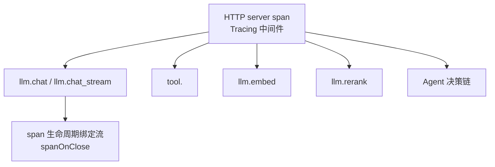

关键点：

1. **根 span 在最外层中间件**（`cmd/server/main.go:188`：`root.Use(api.Tracing(), api.Recovery(), api.CORS(), api.AccessLog())`），覆盖整条中间件链。
2. **SSE 接管根 span**：`TakeRootSpan` 让 handler 把 span 所有权移交给流，由流结束时 `End()`（`internal/api/middleware.go:119`、`internal/api/handler_chat.go:72-77`）。否则根 span 只有几毫秒而子 span 几秒。
3. **自监控端点不埋点**：`/metrics` 与 `/healthz` 跳过（`middleware.go:88-93`），否则 Jaeger 会被无意义的根 span 刷满。
4. **追踪未启用时是 no-op**：所有埋点代码无需判空（`internal/observability/otel.go:66-70` 注释）。
5. **流式 usage 拿不到**：usage 在流的最后一帧，由调用方消费，网关层看不到（`internal/llm/gateway.go:416-419`）—— 参考项目自己标注为「课堂讨论点」。

**Rust 版落点**：
- `tracing` + `tracing-opentelemetry 0.34` + `opentelemetry 0.33`。
- **根 span 接管**：axum 的 `TraceLayer` 在最外层；但 SSE handler 需要**把 span 移到流任务里**。Rust 版做法：在 handler 里 `let span = tracing::Span::current();` 拿到当前 span（tracing 的 span 是 `Clone` 的，可 `'static`），然后 `tokio::spawn(async move { ... span.in_scope(...) ... })`，或用 §3.1.4 的 `BoxedSpan` 方案。

  **注意**：Go 版是「把 span 的**所有权**移交」，Rust 的 `tracing::Span` 是**引用计数**的（clone 不会提前结束 span，span 在所有 clone 都被 drop 后才结束）→ **Rust 版天然更安全**，不需要「take」语义。span 会一直存活到所有持有者 drop。这实际上是**免费获得**的正确行为。

- **no-op span**：`tracing` 的 span 在没有 subscriber 时开销极低，天然满足。
- **`/metrics` 与 `/healthz` 不埋点**：axum 里用 `route_layer` 只给业务路由加 `TraceLayer`，而不是全局 `layer`。

### 4.4.2 Prometheus 指标（11 个）

| 指标 | 类型 | 标签 | Go 位置 |
|---|---|---|---|
| `capacity_operations_total` | Counter | `scope`, `outcome` | `metrics.go:31` |
| `chat_first_token_seconds` | Histogram | `model` | `metrics.go:35` |
| `llm_tokens_total` | Counter | `model`, `direction`(prompt/completion) | `metrics.go:39` |
| `llm_cost_total` | Counter | `model` | `metrics.go:43` |
| `llm_requests_total` | Counter | `model`, `status`(ok/error/canceled) | `metrics.go:47` |
| `llm_latency_seconds` | Histogram | `model` | `metrics.go:51` |
| `tool_calls_total` | Counter | `tool`, `status` | `metrics.go:55` |
| `tool_latency_seconds` | Histogram | `tool` | `metrics.go:59` |
| `rag_search_seconds` | Histogram | `stage`(dense/keyword_tfidf/rerank) | `metrics.go:63` |
| `agent_iterations` | Histogram | — | `metrics.go:67` |
| `stream_active_sessions` | Gauge | — | `metrics.go:71` |

**标签口径注意**：
- `llm_requests_total` 的 `status` 有三个值：`ok` / `error` / `canceled`（`internal/llm/gateway.go:350-357`）。取消单独计数，便于区分「上游故障」与「用户取消」。
- `capacity_operations_total` 的 help 文本明确写着「process-local operations, never a global-usage gauge」（`metrics.go:32`）—— 这是在防误读：进程内观测到的准入次数**不等于**全局容量使用率。
- `llm_tokens_total` 与 span 属性 `llm.tokens.*` 同源（`internal/llm/gateway.go:421-426`）。

**Rust 版**：`prometheus` crate 0.14。用 `Registry` + `CounterVec` / `HistogramVec` / `Gauge`。
- **静态注册**：`prometheus::register_counter!` 宏，或 `lazy_static` / `OnceLock` 手动构建。
- **标签**：Rust 的 `CounterVec::with_label_values(&[...])` 在标签不匹配时**panic**。建议用 `get_metric_with_label_values` 返回 `Result` 并记录错误，或用 `MetricFamily` 的 `&str` 键。
- **暴露**：`prometheus::TextEncoder` + axum handler 返回 `text/plain; version=0.0.4`。

**Go 版无对应的 Rust 坑**：`promauto` 是全局自动注册，Rust 没有 —— 必须自己管理 `Registry` 的所有权与生命周期。建议用 `OnceLock<Metrics>` 全局单例。

### 4.4.3 结构化日志

`internal/observability/logger` 提供 `LogInfo` / `LogWarn` / `LogError`，输出 JSON 或 console 两种格式（`cfg.Log.Format`）。

关键日志点：
- 访问日志：`method` / `path` / `status` / `ms`（`internal/api/middleware.go:64-75`）。
- 落库失败、统计失败、记忆抽取失败等**非致命问题都记日志但不中断**（`internal/service/chat_stream.go:167`、`:184`、`:187`、`:190`、`:193`、`:220`）。

**Rust 版**：`tracing` + `tracing-subscriber`（`fmt` layer，JSON 用 `tracing-subscriber` 的 `json` feature）。
- 结构化字段：`tracing::info!(model = %model, tokens = n, "llm usage")`。
- **Go 版「非致命问题记日志但不中断」的 Rust 表达**：`tracing::warn!(error = %e, "usage stats failed");` 然后继续。**不要**用 `?` 提前返回。这是 Rust 移植中容易被「顺手改成 `?`」破坏的不变量。

### 4.4.4 诊断端点

`observability.StartDiagnostics(ctx, cfg.Observability.DiagnosticsAddr, sqlDB)` —— **可选启用**、独立端口、有界关停生命周期（`cmd/server/main.go:194-207`）。

**Rust 版**：独立的 `axum::serve` 实例，绑定独立端口，关停时用同一个 `CancellationToken`。

### 4.4.5 取舍说明

- **看什么**：SSE 根 span 的所有权移交机制。这是「长连接如何正确埋点」的完整答案。
- **该抄什么**：① 根 span 在最外层；② 长连接接管 span；③ 自监控端点不埋点；④ no-op span 让业务代码无需判空；⑤ 取消单独计数。
- **为什么要改**：参考项目有 `llm_cost_total` 但主链路上没有写入点（只有 `recordUsage` 写 token）。**Rust 版要决定**：成本是估算还是由上游返回？
- **Rust 版的额外收益**：`tracing::Span` 的引用计数语义天然实现了「span 跟随流存活」，比 Go 版的「take ownership」更不容易写错。

## 4.5 容量与负载

### 4.5.1 Go 版实测基线（来源：`docs/research/2026-10-21-p4-capacity-validation.md`）

> ⚠️ **以下全部是 Go 实现的实测数字，Rust 版必须重新测量。本表仅作为「验收报告应该长什么样」的样例。**

**30 分钟基准**（冻结二进制 `d8925c0`）：

| 指标 | 实测 |
|---|---:|
| 实际 wire 请求 / 每秒写出 | 18000 / 恰为 10 |
| 成功工作流 / Chat | 14400 / 3600 |
| 拒绝 / 数据库非成功 / 窗口后写出 | 0 / 0 / 0 |
| Chat 客户端 done / SSE 错误 / peer 次数差异 | 3600 / 0 / 0 |
| 查询 p95 / p99 | 12.9984 / 35.525 ms |
| 审批 p95 / p99（179 次） | 24.895 / 33.2111 ms |
| 取消 p95 / p99（179 次） | 19.1685 / 44.8255 ms |
| 工作流排队 p95 / p99 | 133.016 / 177.783 ms |
| 工作流执行 p95 / p99 | 746.749 / 929.704 ms |
| Chat 首 token p95 / p99 | 721.0305 / 939.0661 ms |
| outbox 采样峰值 / 排空后 | 50 / 0 |

**容量矩阵**（SSE 数 × 槽位 × 新请求速率）：

| SSE | 槽位 | 1 rps | 5 rps | 10 rps | 20 rps |
|---:|---:|---|---|---|---|
| 50 | 8 | 通过 | 通过 | 未达标（拒绝 3） | 未达标（拒绝 117） |
| 50 | 32 | 通过 | 通过 | 通过 | 通过 |
| 50 | 64 | 通过 | 通过 | 通过 | 通过 |
| 200 | 8 | 通过 | 通过 | 未达标（拒绝 17） | 未达标（拒绝 118） |
| 200 | 32 | 通过 | 通过 | 通过 | 通过 |
| 200 | 64 | 通过 | 通过 | 通过 | 通过 |
| 500 | 8 | 通过 | 通过 | 未达标（拒绝 12） | 未达标（拒绝 111） |
| 500 | 32 | 通过 | 通过 | 通过 | 通过 |
| 500 | 64 | 通过 | 通过 | 通过 | 通过 |

合并复测：**30/36 档通过**；共 9720 次 wire、9342 次成功、378 次显式拒绝，数据库非成功 / SSE 错误 / peer 次数差异均为 0。

### 4.5.2 限制条件（必须一起引用）

1. **负载是受控模型**：基准模型与工具包含固定等待时间，**不能据此推算真实外部服务的 token 生成速度**。
2. **全部在同一台 VM 的独立容器里**：API / Worker / peer / 基础设施都是同一 VM 的容器，不是独立物理机器；CPU 限额不是独占核。
3. **PG 无 CPU 限额**：报告原文特别指出「PG 是额外成本且没有 CPU 限额，不能只报应用 4 核而隐去数据库 CPU」。
4. **未测真实模型**：原文「真实模型尚未配置；回答质量、真实 embedding 质量、token/费用及供应商容量未验收」。
5. **有限观察不等于无泄漏**：原文「此次有限观察没有持续增长证据，不能证明无限运行无泄漏」。
6. **故障实验不算达标**：Worker-kill 实验中 5 个运行的模型/工具次数超过干净负载的 2+1，说明只读步骤按租约恢复发生了至少一次调用；报告保留 `passed=false`，不承诺外部 exactly-once。

### 4.5.3 压测工具的四个 mode

Go 位置：`backend/cmd/loadtest/main.go:18-58`

| mode | 用途 |
|---|---|
| `peer` | 受控 peer：受控模型/工具服务，核对每次成功运行的调用次数 |
| `stage` | 开放到达率的负载阶段 |
| `prepare` | 准备隔离 fixture |
| `bootstrap` | 生成 fixture（凭据保留在私有 fixture 文件中） |

### 4.5.4 Rust 版特有负载风险

| 风险 | 说明 | 缓解 |
|---|---|---|
| **Tokio worker 线程数** | 默认按 cgroup CPU 配额探测；但 Go 版是「每个 goroutine 一个 OS 线程」的模型，tokio 是「少量线程 + 大量 task」 | 压测时**显式**设置 `worker_threads`，并对比不同值 |
| **`spawn_blocking` 线程池** | 默认 512 个阻塞线程；PDF 解析 / hash 会占用 | 压测时监控 `spawn_blocking` 队列深度；考虑独立 `blocking` 池上限 |
| **单次连接的内存** | tokio 的 `mpsc::channel(N)` 是**预分配**的；128 个槽 × 事件大小 × 大量并发流 → 内存放大 | 计算 `并发流数 × buffer × event_size` |
| **axum 的连接处理** | hyper 的每连接任务数与 Go 的 netpoll 不同 | 压测需覆盖「大量慢客户端」场景 |
| **`cargo build --release` 的 LTO** | 默认 release profile 无 LTO；开 LTO 能减小二进制但增加编译时间 | CI 里固定 `--profile release` 配置（`lto = "thin"`, `codegen-units = 1`） |

### 4.5.5 取舍说明

- **看什么**：**限制条件段落**。这是参考项目最值得学的一点 —— 报告把「不能证明什么」写得和「证明了什么」一样清楚。
- **该抄什么**：① 报告必须写明硬件 / 配置 / 负载条件；② 失败档位保留原样不修饰；③ 受控负载不等于真实质量；④ 数据库成本要单独列。
- **为什么要改**：Go 版的数字**不可迁移**到 Rust 版。Rust 版必须重跑全部容量矩阵，并**额外记录 tokio 线程数配置**（这是 Rust 特有的关键变量）。

## 4.6 优雅关停与故障语义

### 4.6.1 关停顺序

见 §1.1。

补充两个细节：

1. **`ChatService.Close` 有界等待**：等活跃运行结束，超过 `ctx` 预算就返回错误（`internal/service/chatsvc.go:65-78`）。
2. **Worker 的关停也有预算**：`execution.Worker` 等 5s（`ShutdownTimeout`），超时返回错误（`internal/execution/worker.go:86-93`）；doc-etl worker 同样 5s（`internal/worker/worker.go:118-125`）。

**Rust 版**：`ChatService::close` 用 `Arc<tokio::sync::Semaphore>` 或 `Arc<AtomicUsize>` 追踪活跃运行数 + `Notify` 等待：

```rust
pub async fn close(&self, budget: Duration) -> Result<(), AppError> {
    let deadline = tokio::time::Instant::now() + budget;
    loop {
        if self.active.load(Ordering::SeqCst) == 0 { return Ok(()); }
        let remaining = deadline.saturating_duration_since(tokio::time::Instant::now());
        if remaining.is_zero() { return Err(AppError::unavailable("chat shutdown budget exceeded")); }
        tokio::select! {
            _ = self.notify.notified() => {}
            _ = tokio::time::sleep(remaining) => {
                return Err(AppError::unavailable("chat shutdown budget exceeded"));
            }
        }
    }
}
```

### 4.6.2 取消与失败严格分离

| Go 位置 | 规则 | Rust 版 |
|---|---|---|
| `internal/service/chat_stream.go:162-164` | 落库用 `context.WithoutCancel(ctx)` + 独立 3s | `DetachedScope`（§2.1） |
| `internal/agent/runtime/eino_runner.go:216-218` | 先固化错误再 cancel | 同（§3.2.4） |
| `internal/llm/gateway.go:346-349` | 取消不计入熔断样本 | 同 |
| `internal/llm/gateway.go:353-357` | 取消的指标状态是 `canceled` | 同 |
| `internal/execution/driver.go:118-119` | `CompleteOperation` 用 `context.WithoutCancel(ctx)` + 3s | `DetachedScope` |
| `internal/execution/store.go:213` | run 状态写操作在事务内 3s 预算 | `timeout` 包住事务 |
| `internal/service/chatsvc.go:107-110` | `context.AfterFunc(s.root, cancel)` 让进程根 ctx 取消能传导到请求 ctx | `CancellationToken::child_token()` |

**Rust 版的 `CancellationToken` 树**：

```rust
// 进程根令牌
let root = CancellationToken::new();
// 每个请求派生子令牌
let req_token = root.child_token();
// 后台任务（记忆抽取等）也派生子令牌，但落库要用独立令牌
```

**关键区别**：Go 的 `context.WithoutCancel` 派生的是「**不带取消信号**」的 ctx；Rust 的 `CancellationToken::child_token()` 派生的是「**带取消信号**」的子令牌 —— **方向相反**。

Rust 版要实现 Go 的 `WithoutCancel` 语义，只能：
1. **新建一个不挂在 root 下的独立 token**（`CancellationToken::new()`）—— §2.1 的 `DetachedScope`。
2. 或者用 `token.child_token()` 但**不从 root 派生**（即 root 取消时它不受影响）—— 但这样 root 就无法全局关停所有东西。

**结论**：Rust 版需要**两类令牌**：
- **可取消令牌**（挂在 root 下）：请求上下文、后台任务。
- **不可取消令牌 + 独立预算**（不挂 root，但有自己的超时）：最终落库。

这就是 `DetachedScope` 的设计依据。

### 4.6.3 「不可知即人工核对」

这是参考项目最重要的故障语义原则：

```
外部副作用已发出但结果未知
  → operation.status = 'unknown'
  → run.status = 'needs_attention'
  → 等待人工核对（ResolveOperation，必须带 evidence）
  → 核对后 run.generation+1，重新排队
```

涉及的代码路径：
- 执行者丢失（`manual` 策略）：`internal/execution/operations.go:70-80`
- 取消时在途：`internal/execution/store.go:393-411`
- 驱动侧的分类：`internal/execution/driver.go:126-132`、`:178-185`

### 4.6.4 取舍说明

- **看什么**：**不可知 ≠ 失败** 这个第三类状态。参考项目的状态机有 8 个状态（queued / running / waiting_approval / retry_wait / succeeded / failed / canceled / needs_attention），`needs_attention` 是最容易被简化掉的一个。
- **该抄什么**：① `needs_attention` 状态；② 人工核对必须带证据；③ 核对后 generation+1；④ 取消与失败分离。
- **为什么要改**：重建时容易把 `needs_attention` 合并进 `failed`。这会丢掉「外部可能已执行」这个关键信息，导致运维无法判断是否需要人工清理。
- **Rust 版的额外风险**：`tokio::time::timeout` 超时会 drop future。如果 drop 的时机落在「远程副作用已发出、响应未收到」之间，就会产生 Go 版同样的 `unknown` 状态 —— **这是对的**，所以 `manual` 策略 + `unknown` 化在 Rust 版同样必要，且**更容易发生**（Rust 的 timeout drop 比 Go 的 ctx cancel 更「硬」）。**不要**因为 Rust 更「干净」就简化掉 `needs_attention`。

---

# 第 5 部分 · 给 Rust 重建者的对照清单

## 5.1 Rust 特有陷阱清单（Go 版没有的）

这一节是本文档对 Go 版的**增量**，也是 Rust 移植最容易翻车的地方。

| # | 陷阱 | 后果 | 对策 |
|---|---|---|---|
| 1 | **没有 `context.WithoutCancel`** | 「取消 ≠ 失败」的核心机制无处落地 | §2.1 的 `DetachedScope`（独立 token + 独立预算） |
| 2 | **没有 ctx values** | 审批能力、租约 id、用户 id 无处安放 | 显式参数 / typestate（§1.3、§2.6） |
| 3 | **`tokio::time::timeout` 会 drop future** | SQL 事务被回滚（正确）；HTTP 请求已发出但响应丢失 → `unknown` 状态 | `manual` replay policy + `needs_attention`（§4.6.3） |
| 4 | **CPU 密集任务阻塞 runtime** | 整个 worker 线程卡死，尾延迟飙升 | `spawn_blocking`（§2.8） |
| 5 | **`std::sync::Mutex` guard 不能跨 await** | 编译错误（好事） | 用 `tokio::sync::Mutex` 或缩短临界区 |
| 6 | **`async fn` in trait 不能 `dyn` 化** | `Arc<dyn ChatModel>` 编译失败 | `#[async_trait]` 或泛型 + 静态分发（§2.2） |
| 7 | **`catch_unwind` 抓不到 async 里的 panic** | 工具 panic 会打挂整个 worker | `tokio::spawn` + `JoinError::is_panic()`（§2.7） |
| 8 | **`Drop` 不能 await** | 关停顺序失控 | 显式 `async fn shutdown()` 编排（§1.1） |
| 9 | **`select!` 里的取消分支会掩盖真实错误** | provider 故障被报成「用户取消」 | 先固化错误再 cancel（§3.2.4） |
| 10 | **背压时 `Sender::send` 会挂起** | 消费者慢 → 生产者堆积内存 | `timeout` on send + 主动 cancel（§2.2） |
| 11 | **`Vec` 索引 panic** | 越界 → 整个请求 500 | `.get()` / `get_mut()` |
| 12 | **整数溢出 debug panic** | 计数值溢出 → panic | `checked_add` / `saturating_add` |
| 13 | **全局状态用 `static mut` 是 UB** | 内存不安全 | `OnceLock` / `LazyLock` |
| 14 | **`reqwest` 无自定义 Dial 钩子** | SSRF 防线降级 | 自定义 `hyper` connector（§3.7.3） |
| 15 | **`serde_json::Map` 默认有序**（BTreeMap） | 状态序列化顺序与 Go 版不同（可观测差异） | 开 `preserve_order` feature |
| 16 | **`prometheus` 的 `with_label_values` 会 panic** | 标签数量不匹配 → 进程崩溃 | 用 `get_metric_with_label_values` 并处理 `Err` |
| 17 | **`tokio::spawn` 的任务在 runtime shutdown 时被取消** | 落库任务被中途取消 → 消息丢失 | 落库在当前任务内 await（§2.1） |
| 18 | **`Mutex` 中毒（poisoning）不存在** | 不用担心 | 但也别依赖「解锁后数据一定一致」 |
| 19 | **`sqlx` 事务 drop 回滚** | 早退路径自动回滚（好） | 但**不要**在事务里 spawn 跨事务的任务 |
| 20 | **`Arc<dyn Trait>` 的 clone 是廉价的** | 共享 handler 很方便 | 但注意 `Arc` 持有的连接池等资源的生命周期 |
| 21 | **`rand 0.10` 拆了 `Rng` / `RngExt` 两个 trait** | `random()` / `random_range()` / `fill_bytes()` 编译报 "trait is not in scope" | 两个都 `use`：`use rand::{Rng, RngExt};`（实测确认） |
| 22 | **`aes-gcm 0.11` 移除了 `aead::OsRng`** | `generate_nonce` 路径不存在 | 手动 `rand::rng().fill_bytes(&mut [0u8;12])` + `Nonce::try_from`（`from_slice` 已 deprecated） |
| 23 | **`serde_yaml` 已 deprecated** | 编译告警 / 未来移除 | 用 `serde_yaml_ng 0.10`（或 `serde_norway`） |
| 24 | **`redis 2.0` 是 RC，且 `ConnectionManager::new` 已改 async** | 1.x 的同步构造写法编译失败；API 与 1.x 不同（`Script`、`aio::ConnectionManager` 路径都变了） | 锁定版本 + 需要 `tokio-comp` / `connection-manager` / `script` feature；写 Lua 脚本前先验证 API |
| 25 | **`evalexpr` 语法 ≠ `expr-lang`** | 工作流条件表达式全部要改写 | DSL 层写兼容层，或重新定义条件语法 |
| 26 | **`rmcp 3.8` 没有 `transport-sse-server` feature** | 依赖解析直接失败 | 用 `transport-streamable-http-server` + `transport-streamable-http-server-session` |

### 5.1.1 关键 API 的实测验证记录（2026-11-04）

本文档中几个**承重的 Rust 语义断言**已用最小可编译程序验证过，记录如下以免后续实现时踩坑：

| 断言 | 验证方式 | 结果 |
|---|---|---|
| `CancellationToken::child_token()` 随父取消而取消 | 父 token `cancel()` 后等 `child.cancelled()` | ✅ 确认 |
| `CancellationToken::new()` **不**随任何父取消 | 父取消后检查独立 token | ✅ `is_cancelled() == false` —— 这正是 `DetachedScope` 的基础 |
| `tokio::select!` 的 `biased;` + `token.cancelled()` 分支 | 50ms 后 cancel | ✅ 取消分支胜出 |
| `Semaphore::acquire_owned()` 需 `Arc<Semaphore>` | `arc.clone().acquire_owned()` | ✅ 编译通过（`acquire()` 的 permit 借用 `Semaphore`，不可 `'static`） |
| `mpsc::Sender::try_send` 在满时返回 `Err`（不阻塞） | 容量 2，发送 3 条 | ✅ 确认 —— 用于「保留终态槽位」设计 |
| `tokio::time::timeout` 超时会 **drop 内部 future** | future 持有 Drop guard | ✅ 观察到 "future dropped" —— 对应「HTTP 已发出但响应丢失 → unknown 状态」 |
| **`catch_unwind` 抓不到 async 块里的 panic** | `catch_unwind(\|\| async { panic!() })` 后 `.await` | ⚠️ **`catch_unwind` 返回 `Ok(future)`，panic 在 `.await` 时才发生并逃逸** —— 确认必须用 `spawn` + `JoinError::is_panic()` |
| `tokio::spawn` + `JoinError::is_panic()` 能隔离 panic | spawn 一个 panic 的 task | ✅ 捕获成功，进程存活 |

> **对照提示**：第 7 行的验证（`catch_unwind` 抓不到 async panic）是本文档 §2.7 里「工具 panic 隔离」方案的直接依据 —— **这不是理论推断，是实测结论**。

## 5.2 按 Phase 的对照清单

nexus-lab / nexus-agent 的阶段划分与参考项目实现的对应关系，以及每个阶段的取舍建议。

### Phase 0 · 语法热身 + 架构地图

| 项 | 内容 |
|---|---|
| 参考项目对应 | `backend/internal/agent/event.go`（事件协议）、`backend/internal/llm/types.go`（消息/工具/用量类型） |
| 必抄的不变量 | ① 事件类型用常量；② 每个事件带 `RunID` / `Seq` / `At`；③ `ToolCall` 带 `ID`（工具调用 ID 是协议配对的依据） |
| 可以简化 | 事件类型可以先只做 4 个（delta / tool_call / tool_result / done） |
| 已知坑 | `Seq` 的分配必须在**单一临界区内**完成（Rust 版用单点分配 task，§2.2 方案 C） |
| **Rust 额外** | ① 建 Cargo workspace + CI 加 `cargo clippy -- -D warnings`；② 确认 `sqlx` 用 `query_as` 路线；③ **做 Milvus / rmcp / A2A 三个 spike**（生态风险最高的三块） |
| **进度** | ✅ **workspace 骨架已建立**（21 crate + 1 bin，`Cargo.lock` 已锁定，21 个 crate 全部编译通过，release 二进制 899K）；✅ CI 流水线（fmt / clippy / test / release build）+ 依赖纪律与依赖方向双重校验已就位；详见 §0.3.1。⬜ Milvus / rmcp / A2A 运行时 spike 未做（编译层面已无阻塞） |

### Phase 1 · 手写 ReAct 循环

| 项 | 内容 |
|---|---|
| 参考项目对应 | `backend/internal/agent/naive/react_loop.go`（手写版）+ `backend/internal/llm/gateway.go` |
| 必抄的不变量 | ① **工具错误结构化回灌**而不是抛异常；② 三个安全阀（最大迭代、单步超时、总超时）；③ 模型输出无工具调用且内容为空 → 明确失败 |
| 可以简化 | 手写版不需要任何 Agent 框架 |
| 已知坑 | 「推理内容不算答案」这条容易漏（`eino_runner.go:297-302`） |
| **Rust 额外** | ① `CancellationToken` 树的三层结构（root / request / detached）；② `tokio::select!` 的 `biased;`；③ panic 隔离（§2.7） |

### Phase 2 · 流式 + 事件协议 + 取消

| 项 | 内容 |
|---|---|
| 参考项目对应 | `backend/internal/api/handler_chat.go:39`（SSE 桥接）、`backend/internal/agent/runtime/eino_events.go:15`（sink 与背压）、`frontend/src/lib/sse.ts` |
| 必抄的不变量 | ① **客户端断开必须能取消上游**；② 背压超时 → 主动取消而非无限阻塞；③ SSE 帧边界是空行，TCP 分包可能劈帧 → 必须缓冲半帧；④ 事件序号单调 |
| 可以简化 | 不用 Hertz，用 axum 的 `Body::from_stream` 手写 SSE（§1.5） |
| 已知坑 | ① axum 的 `Sse` 类型会转义 data，破坏字节级兼容；② 标准库下需要自己管理写超时（`ResponseController::set_write_deadline`）；③ axum 的 `Body::from_stream` 在客户端断开时会 drop 上游 stream → 需确认这会触发 `Sender` 的 drop，进而 cancel 上游 |
| **Rust 额外** | ① **保留槽位**给终态错误（§3.1.5）；② 单点序号分配 task（§2.2 方案 C） |

### Phase 3 · 接入图引擎（Rust 自研，替代 Eino）

| 项 | 内容 |
|---|---|
| 参考项目对应 | `backend/internal/agent/runtime/eino_runner.go`、`backend/internal/agent/einoadapter/`、`backend/internal/workflow/graph.go` |
| 必抄的不变量 | ① **保留手写版作为对照与降级路径**；② 中间件三职责分离（裁剪 / 校验 / 工具包装）；③ 整轮淘汰而非按条裁剪；④ 裁剪前先做 tool_call↔result 配对校验 |
| 可以简化 | 中间件可以先只做工具并发槽 |
| 已知坑 | ① 展开上限（深度 8 / 节点 128 / 状态 4MiB / DSL 1MiB）；② 子图递归检测；③ 中断/恢复的数据结构要能序列化（checkpoint） |
| **Rust 额外** | ① 这是**最大工作量**，建议拆成 3.1（ReAct 循环稳定）+ 3.2（线性图执行器）+ 3.3（分支/并行/子图/中断）；② `evalexpr` 与 Go 版 `expr-lang` 语法不同，条件表达式 DSL 要重新定义或写兼容层 |

### Phase 4 · 工具边界与审批

| 项 | 内容 |
|---|---|
| 参考项目对应 | `backend/internal/agent/einoadapter/tools.go`、`backend/internal/tool/executor_impl.go`、`backend/internal/agent/einoadapter/approval.go` |
| 必抄的不变量 | ① **调用前刷新授权**；② 绑定版本 + Schema 指纹双校验；③ **JSON Schema 子集白名单 + 禁外部加载**；④ 危险工具以 `approval_required` **回灌**而非中断；⑤ 审批能力只走受控类型，不从请求头/JSON/模型输出接受 |
| 可以简化 | Schema 白名单可以先只支持 `type` / `properties` / `required` / `enum` |
| 已知坑 | ① 白名单要只递归 schema 位置，否则 `enum` 里的对象会被误判；② `denySchemaLoader` 必须保留，否则 `$ref` 可以拉外部 schema 做 SSRF；③ **panic 隔离**必须用 `spawn` + `JoinError`（§2.7） |
| **Rust 额外** | ① **`HashSet` 白名单**直接修掉 Go 版的字符串包含匹配问题；② **typestate + sealed trait** 让审批能力越权路径编译不过（§2.6） |

### Phase 5 · HTTP + 真实终态

| 项 | 内容 |
|---|---|
| 参考项目对应 | `backend/internal/api/router.go`、`middleware.go`、`response.go`、`backend/internal/service/chat_stream.go` |
| 必抄的不变量 | ① **终态在内容落库之后发布**；② 取消与失败分离；③ 状态与内容分离持久化；④ 优雅关停顺序（Chat.Close → HTTP Shutdown）；⑤ SSE 根 span 所有权移交 |
| 可以简化 | 中间件可以先只做 Recovery + AccessLog |
| 已知坑 | ① 认证信息不要从 URL query 取；② 慢读者要有明确超时；③ 心跳间隔要考虑平台差异 |
| **Rust 额外** | ① 关停必须显式 `async fn shutdown()`，不能靠 `Drop`（§1.1）；② `tracing::Span` 的引用计数天然实现「span 跟随流存活」（§4.4.1） |

### Phase 6 · 持久化 + Host/Expert

| 项 | 内容 |
|---|---|
| 参考项目对应 | `backend/internal/repo/`、`backend/internal/agent/host/host.go`、`backend/internal/service/chatsvc.go:398` |
| 必抄的不变量 | ① 事务边界在 service 不在 repo；② **归属校验在每次访问**（且应下沉到 SQL WHERE）；③ Host 只做选择不执行；④ **Expert 上下文隔离**；⑤ 路由序号解析容错 |
| 可以简化 | 迁移可以先只建核心表 |
| 已知坑 | ① 多专家时每个 Expert 独立 runner 实例，资源开销要算；② 路由是额外模型调用，会增加首 token 延迟 |
| **Rust 额外** | ① `Arc<dyn RouterChat>` 用 `BoxFuture` 避免生命周期地狱；② **路由失败降级直答**（§2.3，建议补上） |

### Phase 7 · RAG + 长期记忆

| 项 | 内容 |
|---|---|
| 参考项目对应 | `backend/internal/rag/`、`backend/internal/memory/`、`backend/internal/ingestion/`、`backend/internal/vector/` |
| 必抄的不变量 | ① **先限域再 ANN**（scope 下推到向量库）；② 三路独立降级 + **显式 `Degraded` 列表**；③ 回表二次校验；④ 维度不符不静默截断；⑤ **全路失败要报错**；⑥ 记忆的 revision 绑定；⑦ 文档原文与解析分离 |
| 可以简化 | 关键词路可以先不做（见 §5.3 关于混合检索无增益的证据） |
| 已知坑 | ① 关键词路是 ILIKE + TF-IDF 不是 BM25；② 中文分词是 2-gram；③ 混合检索在参考项目的受控评估中没有优于密集召回 |
| **Rust 额外** | ① Milvus Rust SDK 成熟度需 spike；② `pdf-extract` 必须 `spawn_blocking`；③ embed 可改并发批量（幂等靠 chunk.id upsert） |

### Phase 8 · MCP + A2A

| 项 | 内容 |
|---|---|
| 参考项目对应 | `backend/internal/mcp/`、`backend/internal/a2a/`、`backend/internal/service/mcp_*.go`、`a2a_*.go` |
| 必抄的不变量 | ① **MCP 工具默认危险**，需管理员显式审阅；② 调试接口只允许已审阅只读工具；③ 配置版本 + 绑定版本双重校验；④ 凭据 AES 加密存储，出站凭据绑定 origin；⑤ 入站 A2A 复用标准对话链路 |
| 可以简化 | A2A 的 `a2a_tasks` 持久化可以后置；**A2A 可以先降级为 HTTP JSON-RPC 直连** |
| 已知坑 | ① 远程 MCP 目录是不可信输入；② `checkSchema` 白名单是 SSRF 防线的一部分，不能省；③ **A2A 无 Rust 官方 SDK**（§2.11） |
| **Rust 额外** | ① `rmcp 3.8` 需要验证 client+server 双端；② MCP 会话断线重连需要自己实现 |

### Phase 9 · 持久工作流 + 审批恢复

| 项 | 内容 |
|---|---|
| 参考项目对应 | `backend/internal/workflow/`、`backend/internal/execution/`、`backend/internal/capacity/` |
| 必抄的不变量 | ① **定义冻结 + hash 校验**；② **generation fencing**；③ 检查点版本三元组；④ **三种 replay_policy**；⑤ `needs_attention` 状态与人工核对（必须带 evidence）；⑥ 取消时把在途 manual 操作标 unknown；⑦ 公平领取；⑧ 能力匹配；⑨ **围栏写与业务写同事务** |
| 可以简化 | 可以先只做 `readonly` 一种 replay_policy |
| 已知坑 | ① 绝不能把 `needs_attention` 合并进 `failed`；② 参考项目同时存在两套工作流引擎，别抄两套；③ `Attempt >= 3` 是硬编码 |
| **Rust 额外** | ① `sqlx` 的 `FOR UPDATE SKIP LOCKED` / `ON CONFLICT` 用原生 SQL；② `fenced` 条件封装成结构体（§3.4.2）；③ advisory lock 需要配超时；④ **两张表**（`workflow_runs` / `execution_runs`） |

### Phase 10 · 容量 + 观测 + 前端

| 项 | 内容 |
|---|---|
| 参考项目对应 | `backend/internal/observability/`、`backend/internal/capacity/`、`backend/cmd/loadtest/`、`frontend/src/` |
| 必抄的不变量 | ① 指标标签口径明确（取消单独计数；容量指标注明是进程内观测）；② **长连接 span 所有权移交**；③ 报告写明限制条件；④ 压测工具区分「受控 peer」与「开放负载」；⑤ 前端字节流帧缓冲 |
| 可以简化 | 前端可以先只做对话页 + 会话列表 |
| 已知坑 | ① 不要把「受控负载达标」写成「生产已验证」；② 熔断是进程内状态，多副本要额外说明 |
| **Rust 额外** | ① **tokio worker 线程数必须记录在报告里**（§4.5.4）；② `prometheus` 的标签 panic 风险；③ `spawn_blocking` 队列深度；④ 内存放大（预分配 channel × 并发流数） |

## 5.3 参考项目的已知局限（必须一并继承或显式改进）

| # | 局限 | 证据 | Rust 版重建建议 |
|---|---|---|---|
| 1 | **混合检索未优于密集召回** | `docs/research/p3-retrieval-evaluation.json`：dense 与 hybrid 的 Recall@3 都是 1.0、MRR 都是 0.99375；dense P95=418.8ms、keyword P95=4.8ms、hybrid P95=419.6ms | 用真实 embedding 重测；若仍无增益，考虑只保留 dense 路 + 显式关键词兜底 |
| 2 | **关键词路是 ILIKE + TF-IDF，不是 BM25** | `internal/repo/rag.go:166-171` 包注释原文「关键词检索（ILIKE/TF-IDF，教学自研版）」；TF-IDF 的 idf 基于**候选池近似**而非全语料 | 考虑改用 PG 全文检索（`tsvector`/`ts_rank`）或专门的 BM25 实现（Rust 侧 `pg_search` 扩展也值得评估） |
| 3 | **熔断是进程内状态** | `internal/llm/fallback.go:4-5` 注释原文「熔断状态仅在本进程内维护」 | 多副本部署需外置，或在文档中显式声明熔断是单副本粒度 |
| 4 | **沙箱并发是每进程本地上限** | `internal/tool/sandbox.go:51` 的 `slots` channel（PoolSize 1..8） | 多副本总并发 = 副本数 × PoolSize，需外部协调或前置限流 |
| 5 | **两套工作流引擎并存** | `internal/workflow/engine.go`（解释式）与 `internal/workflow/graph.go` + `internal/execution/driver.go`（编译式） | 只做编译式一套 |
| 6 | **`workflow_runs` 一表两用** | 迁移 004 是加列而非重建表；产品侧与引擎侧共用 | **Rust 版用两张表** |
| 7 | **主密钥无版本号** | `internal/security/encryption.go:21-28`，`sha256(masterKey)` 直接派生 | **Rust 版加 `key_version` 前缀 + HKDF**（§4.3.2） |
| 8 | **`MaskPII` 未接线** | `internal/security/sanitizer.go` 实现完整，但主链路无调用点 | 明确脱敏发生在哪一层（日志 / 落库 / 模型输入） |
| 9 | **成本指标无写入点** | `llm_cost_total` 定义在 `metrics.go:43`，但 `recordUsage` 只写 token | 决定成本是估算还是上游返回 |
| 10 | **A2A 入站无独立速率限制** | `a2a_inbound.go` 只受 `MaxConcurrency` 与共享 `HoldRun` 约束 | 确认共享配额覆盖入站路径 |
| 11 | **Host 路由失败不降级** | `host.go:135-142` 把路由超时直接作为错误上报 | **Rust 版补降级直答** |
| 12 | **真实模型未验收** | 容量报告原文「真实模型尚未配置；回答质量、真实 embedding 质量、token/费用及供应商容量未验收」 | 验收报告必须分开写「工程机制达标」与「回答质量达标」 |
| 13 | **Rust 生态缺口（新增）** | Rust 无 Eino 对等物；`milvus-sdk-rust` / `rmcp` / A2A 成熟度低于 Go 版 | **Phase 0 必做 spike**；自研图引擎是最大工作量，需拆成 3 个子阶段 |
| 14 | **reqwest 无自定义 Dial 钩子（新增）** | `reqwest::ClientBuilder::resolve` 不能在连接时校验解析结果 | 自实现 `hyper` connector（§3.7.3），或接受降级并**明确记录为已知局限** |

## 5.4 建议的抄写顺序（按不变量密度排序）

若时间有限，按这个顺序抄，每一步都能独立验证：

| 顺序 | 内容 | 为什么优先 | Rust 额外注意 |
|---|---|---|---|
| 1 | 错误码体系（`nexus-core::errcode`） | 所有后续代码都要用；先定下来才不会返工 | `http_status` 用 `u16`，不让 `core` 依赖 axum（§3.8.2） |
| 2 | 事件协议（`agent::Event` + `Seq`） | SSE 与持久化都依赖它 | 单点序号分配 task（§2.2 方案 C） |
| 3 | 模型网关（预算 + 熔断 + 重试 + fallback + 取消语义） | 影响面最广，且是最容易做错的地方 | `CancellationToken` + `biased select!`；熔断用 `std::sync::Mutex` |
| 4 | SSE 桥接 + 终态时序 | 用户可见的第一条链路 | `DetachedScope`；axum 手写 `Body::from_stream` |
| 5 | 工具执行管道 + Schema 白名单 + 危险工具回灌 | 安全底座 | `HashSet` 白名单；`spawn` + `JoinError` panic 隔离；typestate 审批能力 |
| 6 | 持久执行（fencing + replay_policy + needs_attention） | 最难返工的部分 | `sqlx` 原生 SQL；两张表 |
| 7 | 共享容量（advisory lock + 围栏写同事务） | 与持久执行强耦合 | advisory lock 配超时；租约 id 放 `RunScope` 私有字段 |
| 8 | 检索限域 + 显式降级 | 安全与可用性兼得 | Milvus filter 下推 |
| 9 | 出站策略（SSRF） | 一次性做对很难，做错了是漏洞 | 自定义 `hyper` connector（§3.7.3） |
| 10 | 图引擎（自研，替代 Eino） | 工作流的根基，但可以后置 | 拆成 3 个子阶段 |
| 11 | 前端字节流解析 | 有了后端再接 | 不变 |

## 5.5 文档使用建议

- **读本文的顺序**：第 0 部分（尤其 §0.2 映射表）→ 你当前 Phase 对应的 §5.2 行 → 该 Phase 涉及的 §2 流程 → 需要深挖时看 §3 → 涉及取舍时看 §4 → **收尾时必看 §5.1 陷阱清单**。
- **不要通读 §3.9 的迁移表**，除非你要抄数据模型。
- **本文不替代源码**。所有 Go 锚点都指向真实位置，遇到「为什么这样写」的疑问，去看锚点附近的注释 —— 参考项目的注释密度很高，很多设计意图只写在注释里。
- **Rust 版的所有代码片段都是设计示意**，不是可直接编译的代码。落地时以实际 crate 结构为准，但**语义（不变量）必须一致**。
