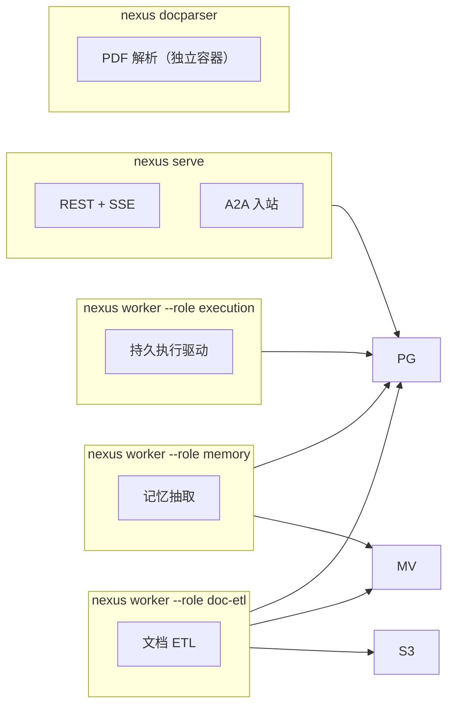
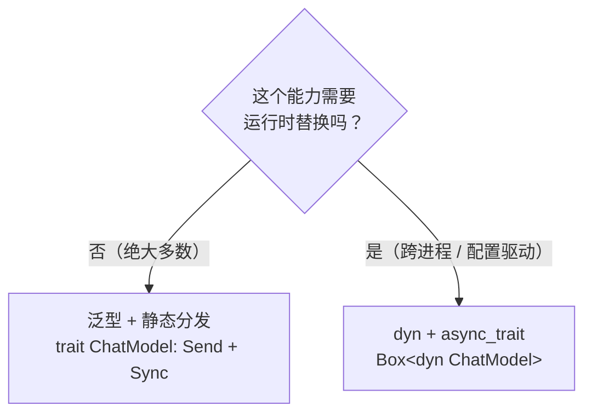
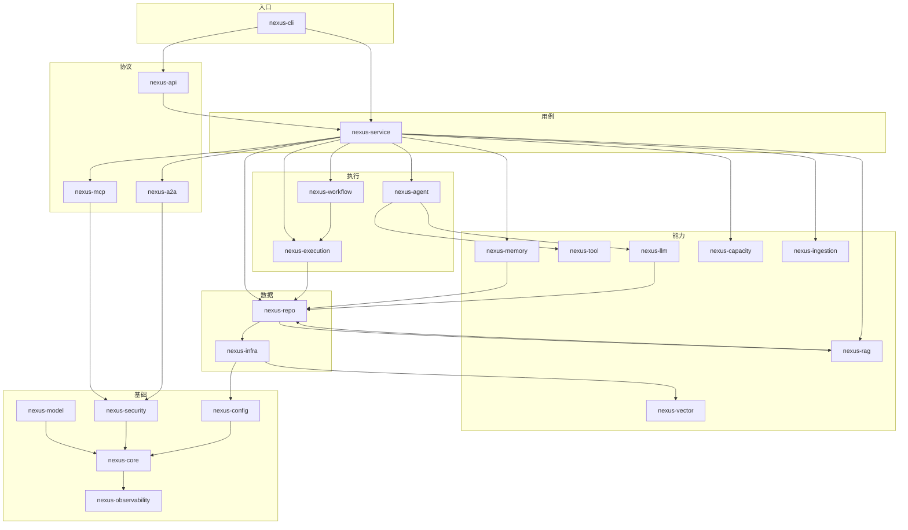

# NexusAgent · Rust 原生架构设计

> 生成日期：2026-11-04
> 状态：**设计文档**。本文档先于代码 —— 架构与接口定稿后才允许写实现。
> 参考来源：`docs/architecture/2026-11-03-nexusagent-eino-reference-architecture.md`（Go / Eino 参考实现，只读对照）
> 领域事实来源：参考实现的迁移文件与行为（表结构、状态机、失败语义）。

---

## 这份文档的定位

**是**：一份 **Rust 原生**的架构设计。它从「这个系统要解决什么问题」出发，用 Rust 的类型系统、所有权模型、异步模型来回答「应该怎么设计」。

**不是**：
- ❌ **不是 Go 版的逐条转写**。参考实现提供的是**领域事实**（有哪些表、什么状态机、哪些失败语义），不是**结构答案**。本设计的 crate 划分、类型设计、错误模型与参考实现**故意不同**，理由逐条给出。
- ❌ **不是迁移指南**。「Go 的 X 对应 Rust 的 Y」这类映射表不在本文档里 —— 那是实现阶段的参考，不是架构决策。
- ❌ **不是实现细节说明书**。本文档定的是**边界与不变量**，不是函数签名。`fn` 级别的细节等设计定稿后随实现一起写。
- ❌ **不是性能承诺**。参考实现的容量数字全部带条件，需在 Rust 侧重测。

### 与参考实现的关系

| 维度 | 关系 |
|---|---|
| **领域语义** | 继承。状态机、失败分类、审批语义、危险工具边界 —— 这些是领域知识，不是实现风格，必须一致，否则是另一个产品。 |
| **数据模型** | 继承并扩展。表结构沿用参考实现的演进结果（13 组迁移、**42 表 + 1 视图**），因为它已经承载了领域演进的历史。 |
| **crate 划分** | **重新设计**。参考实现按 Go 包组织；Rust 版按**依赖方向**与**类型边界**组织。 |
| **类型设计** | **重新设计**。这是本文档的主体。 |
| **并发模型** | **重新设计**。参考实现用 goroutine + channel；Rust 版用 structured concurrency + 类型化流。 |
| **错误模型** | **重新设计**。 |

---

# 第 0 部分 · 设计原则

## 0.1 五条设计原则

架构文档最容易变成「合理化既有实现」的集合。所以先立原则，再让每个决策接受原则检验。

### 原则 1：让非法状态不可表示

Rust 相对于 Go 的核心红利是**类型可以携带状态**。能用类型表达的约束，绝不用运行时检查。

> 典型：参考实现用「`context.WithoutCancel` 派生一个不继承取消的 context」表达「取消 ≠ 失败」，并靠注释提醒不要传错。Rust 版用**类型状态**表达：`Detached` 类型上**不存在** `cancel` 方法 —— 违反约束的代码**编译不过**。

### 原则 2：边界显式，不用全局状态

跨 crate / 跨进程传递的东西，必须出现在函数签名上。

> Go 版用 `context.Value` 携带 userID，Rust 没有等价物。这是**语言差异，不是能力缺失** —— Go 的 `ctx.Value` 恰恰是「什么都能塞、什么都会丢」的根源。Rust 版把这类信息变成显式参数或类型字段，丢失即编译错误。

### 原则 3：不变量由类型和编译器保证，其次才是测试和评审

优先级从高到低：

1. **类型系统**（不可表示非法状态）
2. **所有权 / 生命周期**（不能 use-after-free、不能数据竞争）
3. **crate 依赖方向**（编译期禁止环）
4. **运行时断言 + 测试**
5. **文档与评审**

只有第 4、5 层能被人绕过。所以设计时**从上往下**用，越少依赖下层越好。

### 原则 4：失败是设计的一部分

每个可能失败的操作，其失败语义（可重试？结果未知？需要人工介入？）必须**显式建模**，不能是「返回一个 error 再说」。

> 这条直接来自参考实现最值钱的一条经验：HTTP 超时后请求可能**已经到达上游并产生了副作用**。这类「结果未知」必须与「明确失败」区分，否则重试会重复扣费。

### 原则 5：可观测性是结构的一部分，不是事后贴的

trace_id、事件序号、运行 ID 必须在**类型里**存在，而不是靠字符串拼接约定。

## 0.2 三个必须自己回答的问题

参考实现替我们回答了一些问题。移植时最容易犯的错是**连同答案一起抄**，结果继承了一个没被质疑过的设计。

### Q1：为什么需要「进程内嵌多队列 Worker」？

参考实现的一个 worker 进程按 `--queues` 选择消费 `execution` / `doc-etl` / `memory` 三种队列，但**每种队列需要的存储不同**（`execution` 只需 PG，`doc-etl` 需要 PG+Redis+Milvus+S3）。

这带来一个尴尬：想扩容 `execution` 队列，必须启动一个**背着 Milvus 和 S3 客户端**的进程 —— 而它完全不用它们。

**本设计的判断**：**按队列拆进程**。`execution` worker 只连 PG，是最小镜像；`doc-etl` worker 带向量库和对象存储。三者可以是同一个二进制、不同参数，但**部署单元独立**。

代价：镜像要从 1 个变成 3 个。收益：扩容粒度正确、资源画像清晰、故障域隔离（向量库抖动不影响执行队列）。

> 这不是「照抄」，是**修正**。参考实现的单 worker 形态源自 Go 的镜像构建便利，不是领域要求。

### Q2：为什么错误码是数字分段？

参考实现用 `1xxxx` / `2xxxx` / ... / `9xxxx` 的数字业务码，配 HTTP 状态码。

**本设计的判断**：**保留分段**，但**改用类型化 enum**。

- 数字码的**优点**：前端/客户端可以按码段做通用处理（`5xxxx` 一律是上游问题）。
- 数字码的**缺点**：拼错不报错。`ErrModelUnavail.code = 50001` 写成 `5001` 编译通过。
- Rust 的做法：enum 变体 + 每个变体**携带**自己的码值与 HTTP 状态。码值仍然可分段枚举，但「码值是什么」由类型系统保证唯一与正确。

→ 详见 §2.6。

### Q3：为什么「引用实现只有一个数据库」？

参考实现有 PG / Redis / Milvus / MinIO 四个存储，职责划分清晰（权威 vs 派生）。

**本设计的判断**：**保留四存储划分**，因为它是领域事实（向量检索、对象存储确实需要专用引擎）。但补充参考实现**没有明确说**的一点：

> 派生数据的一致性策略必须**统一**：按「版本空间」隔离，删除时遍历所有版本空间，重建时幂等覆盖。

参考实现在文档和代码里都做了这件事，但没有把它上升为「所有派生存储的统一契约」。本设计把它写进类型系统 —— 见 §3.7 的 `VersionedStore` 概念。

---

# 第 1 部分 · 系统边界

## 1.1 系统做什么

一个 **Agent 编排平台**：

- 对话式交互（流式）
- Agent 编排（ReAct 循环、多智能体路由）
- 持久化工作流（可中断、可恢复、可审批）
- 知识库与混合检索
- 长期记忆
- 工具执行（含沙箱）
- 外部协议集成（MCP 出站接入、A2A 出入站双向）

## 1.2 进程与部署单元

**设计原则**：**一个二进制，多种角色**。二进制相同，依赖装配不同。



| 角色 | 需要的存储 | 为什么独立 |
|---|---|---|
| `serve` | PG + Redis + Milvus + S3 | 无状态，可任意扩容 |
| `worker --role execution` | **仅 PG** | 执行队列的扩缩容不应拖着向量库 |
| `worker --role doc-etl` | PG + Milvus + S3 | ETL 有独立的资源画像（CPU / IO） |
| `worker --role memory` | PG + Milvus | 记忆抽取是后台任务，不占在线路径 |
| `docparser` | 无（本地子进程） | **安全隔离**：恶意 PDF 的 OOM 只杀子进程 |

> **对照**：与参考实现的差异见 §0.2 Q1。参考实现是 `--queues execution,doc-etl,memory`；本设计是 `--role <one>`（互斥）。**一个 worker 进程只消费一种队列** —— 这样「这个进程背着哪些客户端」可以从部署配置直接读出，不需要翻代码。

### 1.2.1 为什么 docparser 必须独立容器

解析不可信的 PDF 意味着**处理不可信输入**。压缩炸弹、深递归构造、畸形字体表都可能让解析器耗尽内存。

隔离手段：解析器跑在**一次性子进程**里，父进程只做 HTTP 监管。子进程崩溃/OOM 不影响父进程，父进程重新拉起即可。

这与「把解析写成普通函数然后 `spawn_blocking`」有本质区别：

| 方案 | 内存耗尽时 | Rust 特有风险 |
|---|---|---|
| `spawn_blocking` | 整个进程 OOM | ❌ 同进程，救不回来 |
| 独立子进程 | 只杀子进程 | ✅ 父进程存活，可继续服务 |

**结论**：这是**进程级隔离**，不能用 tokio 的任务级工具替代。

## 1.3 存储职责划分

| 存储 | 权威性 | 存什么 | 不可用时 |
|---|---|---|---|
| **PostgreSQL** | **唯一权威** | 全部业务状态 | 业务不可用 |
| **Redis** | 纯派生 · 可丢弃 | 会话窗口、通知、限流计数 | **降级但可用** |
| **Milvus** | 纯派生 · 可重建 | 文档向量、记忆向量 | 检索降级为「仅关键词」 |
| **S3 / MinIO** | 纯派生 · 可重建 | 文档原文 | 上传/下载失败，其余可用 |

### 1.3.1 「唯一权威」是可验证的，不只是约定

参考实现把这条写进了注释，但没有给出验证手段。本设计把它变成**可执行断言**：

> **如果移除 Redis，系统必须照常工作（性能下降，功能不变）。**

这是可以在集成测试里跑的：启动全套依赖 → 停掉 Redis → 断言任务仍被领取、状态仍正确。

→ 落地见 §5.4 的架构测试清单。

### 1.3.2 派��数据的统一契约

所有派生存储遵循同一条规则：

```
写入：按 (实体 ID, 版本空间) 寻址
删除：遍历所有版本空间删除该实体的全部向量
重建：幂等覆盖，不产生重复
```

这不是三个存储各写一遍，而是**一个 trait 的三个实现** → 见 §3.7。

## 1.4 能力分层

分层的判据是：**「这一层能感知什么 / 不能感知什么」**。

| 层 | 能感知 | **不能**感知（硬边界） |
|---|---|---|
| 入口层 | 进程生命周期、依赖装配 | 任何业务规则 |
| 协议层 | HTTP / SSE 语义、已认证的身份 | 业务规则、事务边界 |
| 用例层 | 身份、权限、数据、模型配置 | HTTP 细节 |
| 执行层 | 运行上下文、工具定义、预算 | 「用户是谁」（只知作用域，不知身份细节） |
| 能力层 | 描述符、定义、参数 | 业务归属判断 |
| 数据层 | SQL | 业务规则、事务编排 |

三条**可执行**的边界规则：

1. 执行层**不依赖**协议层与用例层（编译期保证）。
2. 能力层的每个公开方法签名里**没有身份参数** —— 「谁能用这个能力」不是能力层该回答的问题。
3. 数据层的每个方法**只做一件事**，不编排多步业务。

→ crate 划分见 §4.1。

---

# 第 2 部分 · 核心类型设计

> 本部分是本文档的主体。参考实现提供的**领域语义**在这里被重新表达为 Rust 类型。

## 2.1 取消语义：类型状态机

### 2.1.1 问题

「取消 ≠ 失败」是参考实现反复强调的不变量。它体现在三处：

1. 客户端断开后，助手消息**仍要落库**（否则历史丢失）
2. 客户端断开后，配额**仍要释放**（否则泄漏）
3. 客户端断开后，工作流的**已提交状态**不能被回滚

Go 用 `context.WithoutCancel(ctx)` 表达。Rust **没有**这个 API。

### 2.1.2 为什么不用 `CancellationToken` 手工管理

最直觉的 Rust 做法：每个作用域带一个 `CancellationToken`，「不可取消」的作用域就**不订阅**父 token。

```rust
// ❌ 直觉但脆弱的做法
struct Scope {
    token: CancellationToken,      // 可能是父的子 token，也可能不是
    cancelable: bool,              // 这个 bool 靠约定维护
}
```

问题：`cancelable: bool` 与 `token` 是**两个独立的真相来源**。写错一个，另一个不报错。写 `Scope { token: parent.child_token(), cancelable: false }` —— 编译通过，但**实际会被父取消**，`cancelable: false` 纯属谎言。

### 2.1.3 设计：类型状态

**取消能力由类型承载，不由运行时标志承载。**

```rust
/// 请求作用域：可取消。
pub struct RequestScope { /* ... */ }

/// 脱离作用域：不可取消。
pub struct DetachedScope { /* ... */ }
```

关键在于：**`DetachedScope` 上根本不存在 `cancel` 方法**。

```rust
impl RequestScope {
    /// 派生出不可取消的写入作用域。
    /// 类型变化即承诺：此后不再响应任何取消。
    pub fn detach(self) -> DetachedScope { /* ... */ }
}

impl DetachedScope {
    /// 唯一的操作：执行一次有预算上限的写入。
    pub async fn persist<F, T>(self, fut: F) -> Result<T, AppError> { /* ... */ }
    // 注意：没有 cancel()，没有 token()，没有 subscribe()
}
```

现在写错代码的代价：

| 错误写法 | 结果 |
|---|---|
| 在 `DetachedScope` 上调用 `cancel()` | **编译错误**（方法不存在） |
| 把 `DetachedScope` 当 `RequestScope` 用 | **编译错误**（类型不匹配） |
| 忘记 `detach()`，直接落库 | 编译通过，但落库被取消 —— **这是唯一残留的漏洞** |

最后一行是诚实的边界：**类型系统能防止「取消一个不该取消的东西」，防不住「忘记取消-resistant」**。这个漏洞用两条规则补：

> **规则 A**：`DetachedScope` **只能**通过 `detach()` 构造，且 `detach()` 只能从 `RequestScope` 调用 —— 强制在「明确想要不可取消」的位置显式写下意图。
> **规则 B**：`DetachedScope::persist` 是**唯一**能落库的方法，`RequestScope` 上**没有**落库方法。要落库就必须先 `detach()`。

规则 B 意味着：**忘记 detach 的代码根本没法落库**，只能返回错误。这是设计上的强约束。

### 2.1.4 取消的传播方向

Rust 的取消是**结构化**的：drop 一个 task 就取消它。

- 父 scope 被取消 → 子 scope 全部取消（默认）
- `DetachedScope` → **不**参与任何取消传播

这条方向性必须在类型上体现，而不是靠「我不订阅父 token」的运行时约定。

### 2.1.5 与 `CancellationToken` 的关系

`CancellationToken` **仍然需要** —— 它是「取消信号」的实现细节。但它的持有方式受类型约束：

| 类型 | 持有什么 | 能否被取消 |
|---|---|---|
| `RequestScope` | `CancellationToken`（父的子 token） | ✅ 父取消时随之取消 |
| `DetachedScope` | `CancellationToken::new()`（独立） | ❌ 无取消入口 |

**注意**：这里 `DetachedScope` 内部确实持有一个 token，但它**不持有父 token 的引用**，也不对外暴露 —— 所以「忘记取消」在类型上不可能发生。

> **验证记录（2026-11-04）**：`CancellationToken::new()` 确实不随任何父 token 取消，`child_token()` 会随父取消 —— 两者方向相反，已实测确认。这个实测结果决定了 `DetachedScope` 内部用 `new()` 而非 `child_token()`。

> **验证记录（2026-11-04，负向测试）**：`DetachedScope` 上调用 `cancel()` 的编译结果是
> ```text
> error[E0599]: no method named `cancel` found for struct `DetachedScope`
> ```
> 这是 §2.1.3 核心主张的直接证据 —— 「写错取消语义的代码编译不过」。落地为 `trybuild` 负向测试，见 §5.2。

### 2.1.6 取舍

**代价**：类型变多（`RequestScope` / `DetachedScope` / `RunScope`），转换点要显式写。

**收益**：一类 bug 从「靠评审发现」变成「编译器拒绝」。这类 bug 在生产环境的表现是「消息偶尔丢失」—— 极难复现，极难定位。

## 2.2 事件流：类型化的 Stream

### 2.2.1 问题

参考实现的事件流是 `chan Event`（Go channel）。Rust 有两个候选：

| 方案 | 类型 | 代价 |
|---|---|---|
| `mpsc::Receiver<Event>` | 接收端 | 消费端要自己 loop 拉取；错误处理是 `Option` |
| `impl Stream<Item = Event>` | 流 | 天然支持 `?`、组合、`select!` |

### 2.2.2 设计：用 Stream，但保留「单写者」保证

事件流的**关键不变量**不是「它是流」，而是：

> **序号必须严格单调、无重复、无空洞，且与写入顺序一致。**

`mpsc::Sender` 的 `send()` 是异步的 —— 如果在多个地方并发发送，**谁先被 poll 到是不确定的**，序号分配与写入顺序就会脱节。

### 2.2.3 设计：单写者 + 显式序号

**不给生产者发 `Sender`，只给一个受控的写入接口。**

```rust
/// 事件写入器。只有一个 producer 持有它。
pub struct EventSink { /* ... */ }

impl EventSink {
    /// 写入一个事件并分配序号。
    pub async fn emit(&mut self, event: Event) -> Result<(), AppError>;
}
```

- `EventSink` **不可 `Clone`** —— 物理上杜绝多写者。
- `&mut self` —— 写入需要独占借用，编译期串行化。
- 序号分配与写入在同一临界区 —— 顺序天然一致。

消费者侧则是纯粹的 `Stream`：

```rust
pub type EventStream = Pin<Box<dyn Stream<Item = Result<Event, AppError>> + Send>>;
```

**为什么消费侧用 `Stream` 而不是 `Receiver`**：

1. `Stream` 是 Rust 生态的通用异步流抽象 —— 与 `futures::StreamExt`、`tokio::select!`、`axum::body::Body` 天然组合。
2. `ReceiverStream` 是 `tokio-stream` 提供的适配器，**已经有现成实现**，不需要自己写。
3. `Stream<Item = Result<..>>` 让**错误成为流的一部分** —— 与「流可以以错误结束」的自然语义一致，而 `Receiver` 只能靠 channel 关闭来表示结束。

### 2.2.4 事件类型的建模

参考实现用 `map[string]any` 作负载（`internal/agent/event.go` 的 `Event{Type string, Data map[string]any}`）。
Rust 版**不用 `Value` 兜底** —— 原则 3 说「不变量优先由类型保证」。

```rust
/// 事件负载：按类型区分，各自字段确定。
#[derive(Serialize)]
#[serde(tag = "type", rename_all = "snake_case")]
pub enum EventPayload {
    Meta { session_id: String, agent_id: i64 },
    Delta { content: String },
    Reasoning { content: String },
    ToolCall { call_id: String, name: String, arguments: Value },
    ToolResult { call_id: String, result: String, elapsed_ms: u64, status: ToolStatus },
    Usage { prompt_tokens: u64, completion_tokens: u64, cost: Option<Decimal>, model: String },
    Done { finish_reason: FinishReason },
    Error { code: i32, message: String },
    // ...
}
```

**收益**：

- 构造事件时字段名写错 → 编译错误（`Value` 版本不报错）。
- `ToolStatus` / `FinishReason` 是 enum，不是字符串 —— 消费端的 `match` 穷尽检查。
- 序列化后仍是 `{"type": "...", ...}` 的扁平 JSON，与前端协议兼容。

**代价**：新增事件类型要改 enum。这是**想要**的成本 —— 事件协议是前后端契约，不该随便变。

> **对照**：参考实现的 `Data map[string]any` 允许任意字段，灵活但无保护。本设计选择「事件协议是显式契约」。若将来需要插件式扩展，再引入 `Extension` 变体作为逃生舱。

**逃生舱的正确写法**（有一个容易踩的坑）：

```rust
#[serde(tag = "type", rename_all = "snake_case")]
pub enum EventPayload {
    Delta { content: String },
    /// 插件式扩展。
    Extension {
        name: String,
        /// flatten 在**变体内部**（struct 级）
        #[serde(flatten)]
        data: serde_json::Value,
    },
}
```

> **验证记录（2026-11-04）**：`#[serde(flatten)]` **不能**标注在 enum 的**变体上**（`#[serde(flatten)] Ext { .. }`），serde 会报 `unknown serde variant attribute 'flatten'` —— 因为内部标签（`tag = "type"`）与 enum 级 flatten 不兼容。正确做法是把它放进**变体内部的 struct 字段**上。
>
> **验证记录（2026-11-04）**：序列化形状确认为**扁平**的 —— `{"type":"tool_result","call_id":"c1","result":"ok","elapsed_ms":12,"status":"ok"}`，`type` 与其他字段同级，与前端协议兼容。

#### 2.2.4.1 完整事件类型清单（定稿）

参考实现定义 **12 个**事件类型（`internal/agent/event.go`）。本设计**全部保留** —— 事件名是 SSE `event:` 字段的值，前端按它分支。

| 事件名 | 变体 | 字段 | 参考实现 | 载荷通道 |
|---|---|---|---|---|
| `meta` | `Meta` | `session_id`, `agent_id` | `TypeMeta` | 必达 |
| `delta` | `Delta` | `content` | `TypeDelta` | 可丢 |
| `reasoning` | `Reasoning` | `content` | `TypeReasoning` | 可丢 |
| `plan` | `Plan` | `steps`, `current` | `TypePlan` | 必达 |
| `tool_call` | `ToolCall` | `call_id`, `name`, `arguments` | `TypeToolCall` | 必达 |
| `tool_result` | `ToolResult` | `call_id`, `result`, `elapsed_ms`, `status` | `TypeToolResult` | 必达 |
| `agent_event` | `AgentEvent` | `kind`, `expert`, `detail` | `TypeAgentEvent` | 必达 |
| `refs` | `Refs` | `items` | `TypeRefs` | 必达 |
| `usage` | `Usage` | `prompt_tokens`, `completion_tokens`, `cost`, `model` | `TypeUsage` | 必达 |
| `approval` | `Approval` | `approval_id`, `kind`, `payload` | `TypeApproval` | 必达 |
| `done` | `Done` | `finish_reason` | `TypeDone` | 必达 |
| `error` | `Error` | `code`, `message` | `TypeError` | 必达 |

**字段名的两处刻意偏离**：

| 字段 | 参考实现 | 本设计 | 理由 |
|---|---|---|---|
| 工具调用标识 | `id` | `call_id` | `id` 在事件里语义过泛 —— 是 run 的 id？session 的 id？工具调用的 id？`call_id` 无歧义 |
| 工具耗时 | `ms` | `elapsed_ms` | 单位后缀显式化。`ms` 单独出现时，读者要靠约定才知道单位 |

> 这两处是**协议破坏性变更** —— 前端必须同步改。定稿时就明确，不留到实现时「顺手决定」。
> 其余字段名**原样保留**。

**「载荷通道」一列的依据**（§3.2 双通道）：

- **可丢**：只有 `delta` / `reasoning` —— 高频增量，丢了不影响正确性（下一段会补上）。
- **必达**：其余全部 —— 丢了就是语义丢失（工具调用丢了 = 动作没发生；`done` 丢了 = 客户端永远转圈）。

`agent_event` 的内层 `kind`（`delegate` / `progress` / `merge`）在参考实现里是**第二个** `type` 字段 ——
本设计把它改名 `kind`，避免与外层 `type` 混淆：

```rust
AgentEvent { kind: AgentEventKind, expert: String, detail: String },
```

`AgentEventKind` 是 enum（`Delegate` / `Progress` / `Merge`），不是字符串 —— 与 §2.6.4 同样的理由。

## 2.3 能力接口：泛型优先，dyn 兜底

### 2.3.1 问题

参考实现有多个可替换的依赖：`ChatModel`、`ToolExecutor`、`RagEngine`、`EmbeddingResolver`、`RerankResolver`…… Go 用接口 + 结构体注入。

Rust 侧有个已知限制：**AFIT（`async fn` in trait）不能 `dyn` 化**。

> **验证记录（2026-11-04）**：`trait ChatModel { async fn chat(&self, ..) }` 标注 `Box<dyn ChatModel>` 会报 `not dyn compatible ... because method 'chat' is 'async'`。

### 2.3.2 设计：按「是否需要运行时多态」分流



**判据**：

| 需要 dyn | 不需要 dyn |
|---|---|
| 实现由**配置/插件**在运行时决定 | 实现在**编译期**已知 |
| 需要把不同实现**放进同一个集合** | 只需要在调用点替换 |
| 跨越 crate 边界且对方给的是 `Box<dyn Trait>` | 同一 workspace 内 |

**本设计的绝大多数能力接口用泛型**：

```rust
pub trait ChatModel: Send + Sync {
    async fn chat(&self, req: &ChatRequest) -> Result<ChatResponse, ModelError>;
}
```

调用方用泛型参数 `<M: ChatModel>`，**零虚调用开销**，且编译器能做单态化优化。

**只有一处必须 dyn**：模型供应商是**配置驱动**的 —— 用户在管理后台配置「用哪个模型」，运行时才知道是 deepseek 还是 ollama。

```rust
pub enum ModelBackend {
    OpenAiCompatible(OpenAiCompatibleClient),
    Ollama(OllamaClient),
    // ...
}

impl ModelBackend {
    async fn chat(&self, req: &ChatRequest) -> Result<ChatResponse, ModelError> {
        match self {
            Self::OpenAiCompatible(c) => c.chat(req).await,
            Self::Ollama(c) => c.chat(req).await,
        }
    }
}
```

**注意这里没有用 `dyn`** —— 用 enum + match。

> **为什么 enum 优于 `Box<dyn>`**：
> 1. **无虚调用开销**（热路径：每次模型调用）。
> 2. **穷尽匹配** —— 新增供应商时，编译器列出所有需要修改的 match 点，不会漏。
> 3. **不需要 `async_trait`** —— 省掉一层 boxing。
> 4. **错误类型更精确** —— 每个变体可以有各自的错误。
>
> 代价：新增供应商要改 enum。但这本来就是「新增一种模型接入方式」，本来就需要改代码。

### 2.3.3 `dyn` 的保留场景

只有一种情况必须 `dyn`：**异构集合**。

```rust
/// 工具注册表：不同来源的工具（内置 / MCP / 用户自定义），
/// 运行时数量与类型不定 —— 必须是 dyn。
pub type DynTool = Arc<dyn Tool>;

pub struct ToolRegistry {
    tools: HashMap<String, DynTool>,
}
```

这里 `dyn` 是**必需的**（集合是异构的），且调用不在最热路径（工具调用本身有 IO 开销，虚调用可忽略）。

**判据总结**：

> **单态化能覆盖的场景就不要 dyn。** `dyn` 的成本不只是虚调用 —— 它还让错误类型变宽、让 `async_trait` 的 boxing 变成常态、让编译器无法内联。

## 2.4 工具：能力与授权分离

### 2.4.1 参考实现的洞见

参考实现刻意把「工具执行」与「谁能用这个工具」分开：

- `tool.Executor.Invoke` 的错误信息被**模糊化**（不区分「工具不存在」和「你不是管理员」）
- 危险工具（`is_dangerous`）的**授权在调用前刷新**，不在注册时固化
- MCP 工具**默认危险**，必须显式审阅

这是安全设计，不是实现细节。本设计完整继承。

### 2.4.2 设计：授权是参数，不是状态

```rust
pub struct ToolInvocation {
    pub call_id: String,
    pub tool_name: String,
    pub arguments: Value,
    /// 授权令牌：由上层在**调用前一刻**签发。
    pub authority: ToolAuthority,
}
```

`ToolAuthority` 来自调用方（用例层），能力层**只验证、不签发**。

```rust
pub trait Tool: Send + Sync {
    fn name(&self) -> &str;
    fn definition(&self) -> &ToolDefinition;
    async fn invoke(&self, ctx: &ToolContext, inv: &ToolInvocation)
        -> Result<ToolOutput, ToolError>;
}
```

注意 `invoke` **不接受身份参数**（只有 `ToolContext` 里的作用域信息）。「谁能用」在到达这里之前已经决定。

### 2.4.3 危险工具：类型上区分

参考实现用 `is_dangerous: bool` 字段。Rust 版可以更强：

```rust
/// 工具的危险等级 —— 影响授权流程。
pub enum DangerLevel {
    /// 只读、无副作用。
    Safe,
    /// 有副作用但可自动授权。
    Reversible,
    /// 不可逆或涉及外部资金 / 数据删除。
    Irreversible,
}
```

`DangerLevel` 影响**授权策略**，而策略由用例层持有。能力层只读这个值来决定是否需要 `authority` 校验。

> 为什么不把「是否危险」编码成两个 trait（`SafeTool` / `DangerousTool`）？
> 因为危险工具**也需要同一个注册表、同一个查找逻辑**。拆 trait 会让注册表变成两个表，调用点要分支 —— 用 enum 更简单，且仍然获得穷尽匹配。

## 2.5 工作流：定义与执行分离

### 2.5.1 问题

参考实现的工作流有两套东西：

1. **DSL**（用户写的文本）→ 编译成图
2. **执行**（持久化的 run）

两者的版本关系很关键：**跑起来之后，工作流定义可能被改了**。

### 2.5.2 设计：冻结定义 + 哈希绑定

参考实现已有 `definition` JSONB + `definition_hash` + `engine_version` 三件套。本设计继承，并明确其语义：

```rust
/// 冻结的工作流定义。run 一旦创建，就与这个快照绑定。
pub struct FrozenDefinition {
    /// 规范化后的定义（规范化保证哈希稳定）。
    pub canonical: CanonicalJson,
    /// 定义哈希 —— 用于检测「运行中的定义是否被改过」。
    pub hash: DefinitionHash,
    /// 引擎版本 —— 定义语义随引擎演进而变，必须记录。
    pub engine_version: EngineVersion,
}
```

**三个字段各管一件事**：

| 字段 | 回答的问题 | 不匹配时 |
|---|---|---|
| `canonical` | 「这次跑的到底是什么」 | 快照本身就是答案 |
| `hash` | 「当前定义的哈希和运行记录里的一致吗」 | 检测到外部修改 → 拒绝续跑 |
| `engine_version` | 「用哪个版本的引擎解释这个定义」 | 版本不兼容 → 需要迁移路径 |

**规范化（canonicalization）是关键**：同一份定义的 JSON 键序不同、空白不同，哈希必须相同。否则哈希检测毫无意义。

→ 规范化规则见 §2.5.3。

### 2.5.3 规范化的具体要求

JSON 对象的键序、浮点数表示、Unicode 转义方式都会影响哈希。必须规定：

1. 对象键按**字节序**排序（不是插入序）。
2. 数字规范化（避免 `1.0` 与 `1` 哈希不同）。
3. 字符串按 UTF-8 原始字节，不做转义差异归一。
4. 不包含任何非语义字段（时间戳、生成器版本等）。

→ 这是一个**需要单独设计**的子系统（§3.5）。

### 2.5.4 租约与 fencing

参考实现的执行模型：worker 用 `FOR UPDATE SKIP LOCKED` 领取任务，写 `lease_owner` + `lease_until`，每次操作带 `generation` 自增。

> **验证记录（2026-11-04）**：在真实 PostgreSQL 17 上验证了三个并发连接各领到不同的 run、互不阻塞；且 `WHERE generation = N` 的条件更新能**正确拒绝过期写入**（影响行数 0）并放行当前写入（影响行数 1）。

fencing 的语义：

```
领取：  UPDATE ... SET lease_owner=$w, generation = generation + 1, lease_until = now() + 30s
写入：  UPDATE ... WHERE id = $run AND generation = $my_generation
```

如果 worker 崩溃后被别人重新领取，`generation` 递增，旧 worker 的后续写入**影响 0 行** —— 它会发现自己是僵尸。

**Rust 侧的设计要点**：`generation` 不应该由调用方手动传 —— 应该由**租约对象**持有。

```rust
/// 持有租约的运行句柄。generation 封装在里面，
/// 调用方无法写出「忘记带 generation」的 UPDATE。
pub struct RunLease {
    run_id: RunId,
    generation: i64,
    owner: String,
}
```

`RunLease` 提供 `lease.execute(...)` 这样的方法，内部自动带上 generation。调用方拿不到裸的 generation 数字。

> **落地记录（2026-11-04，NEX-12 完成）**
>
> 本节的租约模型已落到 `nexus-repo`：
> `lease.rs`（类型：`Fence` / `RunLease`）+ `leases.rs`（仓储：领取与围栏写入）。
>
> **落地的四个设计决定**：
>
> | 决定 | 内容 | 理由 |
> |---|---|---|
> | **围栏条件一处定义** | `Fence::CONDITIONS_TEMPLATE` —— 一个 `?` 模板，`push_conditions` 按 `?` 切分并绑定三个值 | 逐段 `push` 与常量文本并存会有**两份**定义，改一处忘另一处就是「fencing 静默失效」的入口 |
> | **用 `?` 而不是 `$1`** | `push_bind` 的编号是**自动**的（`$1` 起算），手写绝对编号必然与它漂移 | 实测漂移会生成 `$1$2$3 AND id = $1` 的语法错误 |
> | **六个条件** | `id` / `generation` / `lease_owner` / `status='running'` / `lease_until` / `deadline_at` | `generation` 之外再加两道防线：租约过期与总截止时间 |
> | **`clock_timestamp()`** | 领取与围栏判定**全部**用 `clock_timestamp()` | `now()` 是**事务开始时间**，长事务里会把「已过期」误判成「未过期」 |
>
> **三条由 `trybuild` 固化的类型约束**（负向编译测试）：
>
> | 约束 | 编译错误 |
> |---|---|
> | `RunLease` 上**没有** `generation()` | `E0599` |
> | `RunLease` **不能**被直接构造（`new` 是 `pub(crate)`） | `E0624` |
> | 围栏写入**必须**带 `&RunLease` | `E0061` |
>
> **变异测试的教训**（写测试时发现的**真实缺陷**）：
>
> 「断言 SQL 文本的副本」**测不出**实现是否还对 ——
> 把 `generation` 条件从实现里删掉，断言副本的测试**照样全绿**。
> 原因是围栏有**六个**条件：僵尸写入被拒，可能是**任意一个**拦下的。
>
> 修正：测试把 `lease_owner` / `lease_until` **伪造回**旧持有者的样子，
> 让**唯一**的差异是 `generation` —— 这时删掉 `generation` 条件，测试**必须**变红。
> 三种变异（删 `generation` / `now()` 替 `clock_timestamp()` / 删 `lease_owner`）
> 均已确认能变红。
>
> **隔离维度的坑**：`claim` 是**全局队列**语义 —— 它领取队列里**任意**一个可运行 run，
> 没有「按 `request_key` 领取」的入口（那不是生产语义）。
> 所以领取类测试**必须串行**，否则并行执行的测试会互相抢 run。

## 2.6 错误模型

### 2.6.1 三层错误

参考实现只有一个 `errcode.Error`（HTTP 状态 + 业务码 + 消息 + cause）。

**本设计分三层**，因为它们的**处理位置不同**：

| 层 | 类型 | 谁处理 | 例子 |
|---|---|---|---|
| 领域错误 | 各领域的 enum | 领域内部 | `ModelError::RateLimited` |
| 应用错误 | `AppError` | 用例层 → 协议层 | 业务码 + HTTP 状态 |
| 传输错误 | `axum` 的 `IntoResponse` | 协议层 | JSON 序列化失败 |

### 2.6.2 领域错误是 enum，不是字符串

```rust
#[derive(Debug, thiserror::Error)]
pub enum ModelError {
    #[error("上游超时")]
    Timeout,
    #[error("上游限流")]
    RateLimited { retry_after: Option<Duration> },
    #[error("上游返回错误")]
    Upstream { status: u16 },
    #[error("响应格式非法")]
    Malformed(String),
}
```

**收益**：

- `match` 穷尽 —— 新增错误变体时，编译器列出所有需要处理的地方。
- `#[from]` 自动转换 —— `reqwest::Error` → `ModelError::Upstream`。
- 可以携带**结构化**信息（`retry_after`），字符串做不到。

### 2.6.3 失败分类是第一公民

参考实现有 `IsRetryable` 的概念（`internal/llm/openai_compatible.go`，判据是 **429 / 5xx / 网络错误**）。
**本设计把它提升为类型上的分类**，并**区分它没有区分的一种情况**：

```rust
impl AppError {
    /// 失败是否可自动重试。
    pub fn retry_policy(&self) -> RetryPolicy;
}

pub enum RetryPolicy {
    /// 明确失败，重试安全。
    Retryable,
    /// 结果未知，重试可能产生重复副作用。
    UnknownOutcome,
    /// 明确失败，重试无意义。
    Terminal,
}
```

三种策略对应三种**不同**的处理：

| 策略 | 重试 | 落库 | 告警 |
|---|---|---|---|
| `Retryable` | ✅ 自动重试（带退避） | 失败终态 | 否 |
| `UnknownOutcome` | ❌ 人工介入 | 标记 `needs_attention` | ✅ |
| `Terminal` | ❌ | 失败终态 | 否 |

> **`UnknownOutcome` 是本设计相对参考实现的强化**。
>
> 场景：调用支付工具时 HTTP 超时。请求**可能已经到达**并扣了款。
> - 当成「失败」→ 重试 → 扣两次款。
> - 当成「成功」→ 数据错。
> - 正确做法：标记「结果未知」，让人来看。
>
> **参考实现的具体缺陷**：`IsRetryable` 把 504（超时）与 502（上游错误）**一视同仁**地判为可重试。
> 但二者的语义完全不同 —— 502 说明上游明确拒绝了（没执行），504 说明上游**可能已经执行了**。
> 支付类工具在 504 下重试会重复扣费。
>
> 参考实现另有 `replay_policy` 字段（`"manual"` / `"auto"` / `"readonly"`），
> 它表达的是**工具操作崩溃后能否重放**，而不是错误重试分类 —— 两者不可混为一谈。
> 本设计把两者都类型化：`RetryPolicy` 管错误分类，`ToolReplayPolicy` 管操作重放。

### 2.6.4 业务码：保留分段，但类型化

参考实现的数字码段（`1xxxx` 参数 / `2xxxx` 认证 / ... / `9xxxx` 系统）**保留** —— 它承载了「前端按段通用处理」的语义。

但改为 enum，每个变体自带码值：

```rust
/// 业务错误。码段划分沿用参考实现（前端依赖它做通用处理）。
#[derive(Debug, Clone, Copy, PartialEq, Eq)]
pub enum ErrorCode {
    InvalidParam,
    Unauthorized,
    ModelUnavailable,
    ToolNotFound,
    // ...
}

impl ErrorCode {
    /// 码段：1=参数 2=认证 3=会话 4=限流 5=LLM 6=RAG 7=工具 8=协议 9=系统
    pub fn segment(&self) -> u32 { /* ... */ }
    /// 完整业务码
    pub fn code(&self) -> i32 { /* ... */ }
}
```

**收益**：码值唯一性由编译器保证（enum 变体不重复）；码段划分是一个**可测试的函数**而不是散落的常量表。

**实现要点**：`ErrorCode` 需要**手工实现 `Serialize`**（不能用 `derive`），否则会序列化成变体名 `"InvalidParam"` 而不是数字码 —— 那就破坏了「前端按码段通用处理」的语义。

```rust
impl Serialize for ErrorCode {
    fn serialize<S: serde::Serializer>(&self, s: S) -> Result<S::Ok, S::Error> {
        s.serialize_i32(self.code())
    }
}
```

> **验证记录（2026-11-04）**：派生 `Serialize` 会输出 `{"code":"InvalidParam"}`；手工实现后输出 `{"code":10001}`。这个差异看似细节，实际决定了前端能否按码段分支。

#### 2.6.4.1 完整业务码表（定稿）

参考实现共 **42 个**标准错误码。本设计**逐个保留** —— 码值是前后端契约，不能自行增删或改号。

| 码段 | 变体 | 码值 | HTTP | 参考实现对应 | 失败分类 |
|---|---|---|---|---|---|
| **1xxxx 参数** | `InvalidParam` | 10001 | 400 | `ErrInvalidParam` | Terminal |
| | `MissingParam` | 10002 | 400 | `ErrMissingParam` | Terminal |
| | `FileTooLarge` | 10003 | 400 | `ErrFileTooLarge` | Terminal |
| | `FileType` | 10004 | 400 | `ErrFileType` | Terminal |
| **2xxxx 认证** | `Unauthorized` | 20101 | 401 | `ErrUnauthorized` | Terminal |
| | `TokenExpired` | 20102 | 401 | `ErrTokenExpired` | Terminal |
| | `TokenInvalid` | 20103 | 401 | `ErrTokenInvalid` | Terminal |
| | `Forbidden` | 20201 | 403 | `ErrForbidden` | Terminal |
| | `LoginFailed` | 20202 | 401 | `ErrLoginFailed` | Terminal |
| | `UserLocked` | 20203 | 429 | `ErrUserLocked` | Retryable |
| | `UserExists` | 20204 | 409 | `ErrUserExists` | Terminal |
| **3xxxx Agent/会话** | `AgentNotFound` | 30001 | 404 | `ErrAgentNotFound` | Terminal |
| | `MaxIteration` | 30002 | 500 | `ErrMaxIteration` | Terminal |
| | `SessionNotFound` | 30003 | 404 | `ErrSessionNotFnd` | Terminal |
| | `RunNotFound` | 30004 | 404 | `ErrRunNotFound` | Terminal |
| | `WorkflowDsl` | 30005 | 400 | `ErrWorkflowDSL` | Terminal |
| | `BudgetExceeded` | 30006 | 500 | `ErrBudget` | Terminal |
| | `RunConflict` | 30007 | 409 | `ErrRunConflict` | Terminal |
| | `EventCursorExpired` | 30008 | 410 | `ErrEventCursorExpired` | Terminal |
| **4xxxx 限流** | `RateLimited` | 40001 | 429 | `ErrRateLimited` | Retryable |
| **5xxxx LLM 上游** | `ModelUnavailable` | 50001 | 502 | `ErrModelUnavail` | Retryable |
| | `ModelTimeout` | 50002 | 504 | `ErrModelTimeout` | **UnknownOutcome** |
| | `ProviderNotFound` | 50003 | 404 | `ErrProviderNotFound` | Terminal |
| | `EmbeddingFailed` | 50004 | 502 | `ErrEmbedFailed` | Retryable |
| **6xxxx RAG** | `ParseFailed` | 60002 | 500 | `ErrParseFailed` | Terminal |
| | `KbNotFound` | 60003 | 404 | `ErrKBNotFound` | Terminal |
| | `DocumentNotFound` | 60004 | 404 | `ErrDocNotFound` | Terminal |
| | `MemoryNotFound` | 60005 | 404 | `ErrMemoryNotFound` | Terminal |
| | `StorageUnavailable` | 60006 | 503 | `ErrStorageUnavailable` | Retryable |
| **7xxxx 工具/沙箱** | `ToolNotFound` | 70001 | 404 | `ErrToolNotFound` | Terminal |
| | `ToolFailed` | 70002 | 500 | `ErrToolFailed` | **UnknownOutcome** |
| | `ToolTimeout` | 70003 | 504 | `ErrToolTimeout` | **UnknownOutcome** |
| | `SandboxTimeout` | 70004 | 504 | `ErrSandboxTimeout` | **UnknownOutcome** |
| | `SqlForbidden` | 70005 | 403 | `ErrSQLForbidden` | Terminal |
| | `DomainNotAllowed` | 70006 | 403 | `ErrDomainNotAllow` | Terminal |
| **8xxxx MCP/A2A** | `McpConnectFailed` | 80001 | 502 | `ErrMCPConnFail` | Retryable |
| | `McpToolFailed` | 80002 | 502 | `ErrMCPToolFail` | **UnknownOutcome** |
| | `A2ATaskFailed` | 80003 | 502 | `ErrA2ATaskFail` | **UnknownOutcome** |
| | `A2ACardFetchFailed` | 80004 | 502 | `ErrA2ACardFetch` | Retryable |
| **9xxxx 系统** | `Internal` | 90001 | 500 | `ErrInternal` | Terminal |
| | `NotImplemented` | 90002 | 501 | `ErrNotImplement` | Terminal |
| | `ServiceUnavailable` | 90003 | 503 | `ErrUnavailable` | Retryable |

**注意码段 6 从 `60002` 起、码段 9 的 `90002` 在 `90003` 之前** —— 这是参考实现的原样（不是笔误）。
本设计**原样保留**：改号会让已上线的前端分支逻辑失效。

**失败分类的划分依据**（`RetryPolicy`）：

| 分类 | 含义 | 典型码 |
|---|---|---|
| `Retryable` | 明确失败，重试安全 | `UserLocked` / `RateLimited` / `ModelUnavailable` / `EmbeddingFailed` / `StorageUnavailable` / `McpConnectFailed` / `A2ACardFetchFailed` / `ServiceUnavailable` |
| `UnknownOutcome` | **请求可能已到达上游并产生副作用**，重试可能重复扣费/重复执行 | `ModelTimeout` / `ToolFailed` / `ToolTimeout` / `SandboxTimeout` / `McpToolFailed` / `A2ATaskFailed` |
| `Terminal` | 重试无意义 | 其余全部 |

> **`UnknownOutcome` 是本设计相对参考实现的关键改进**。
> 参考实现里 `ErrModelTimeout`（超时）与 `ErrModelUnavail`（明确不可用）在重试策略上没有区分 ——
> 但**超时意味着请求可能已被上游接收并计费**，自动重试会导致重复扣费。
> 这条语义差异是 §2.6.3 的核心，落到码表上就是上面这一列。

### 2.6.5 内部原因绝不外泄

参考实现的 `errcode.Error.cause` 不进响应体。本设计继承并强化为**类型上的分离**：

```rust
/// 用户可见的部分。
pub struct UserFacing {
    pub code: ErrorCode,
    pub message: Cow<'static, str>,
}

/// 完整错误（含内部原因）。
pub struct AppError {
    pub facing: UserFacing,
    /// 内部原因。只进日志，绝不序列化。
    pub cause: Option<Arc<dyn Error + Send + Sync>>,
}
```

`UserFacing` **没有** `Debug` 派生里包含原因的字段 —— 它**在类型上就无法**泄露内部细节。要输出给客户端，只能给 `UserFacing`。

## 2.7 配置

参考实现用 viper（分层配置 + 环境变量覆盖）。

**本设计的判断**：**保留分层，但让「配置来源」显式**。

```rust
/// 配置来源。按优先级从低到高。
pub struct ConfigStack {
    base: Config,      // 打包进二进制的默认值
    file: Config,      // configs/*.yaml
    env: Config,       // NX_* 环境变量
}
```

**关键差异**：参考实现的环境变量覆盖靠「viper 自动匹配」，Rust 版要**显式映射**。这不是缺陷 —— 显式映射让「哪些环境变量能覆盖什么」变成可枚举、可文档化的事实。

**设计**：环境变量用 `NX_` 前缀 + 层级路径（`NX_LLM__DEEPSEEK__BASE_URL`），由一个**声明式映射表**驱动，而不是 `set_var` 逐个覆盖。

## 2.8 标识符

参考实现混用 `int64` 自增 ID（业务表）和 UUID（会话等）。

**本设计的判断**：**类型化 ID**。

```rust
pub struct UserId(pub i64);
pub struct SessionId(pub Uuid);
pub struct RunId(pub i64);
pub struct ToolId(pub String);
```

**收益**：函数签名上直接看出「这个参数是会话 ID 还是用户 ID」，传错编译报错。参考实现里 `func(ctx, userID, sessionID int64)` 这类签名无法区分。

### 2.8.1 完整 ID 类型表（定稿）

参考实现的 ID 类型分两类：**自增 `int64`**（业务表主键）与 **`string`/UUID**（会话、追踪类）。本设计**逐个保留这个划分**，但让每个 ID 成为**独立的类型**。

| 类型 | 底层 | 参考实现对应 | 说明 |
|---|---|---|---|
| `UserId` | `i64` | `UserID int64` | 用户 |
| `SessionId` | `Uuid` | `SessionID string`（`type:uuid`） | 会话 —— **UUID**，非自增 |
| `AgentId` | `i64` | `AgentID int64` | Agent 定义 |
| `MessageId` | `i64` | `MessageID int64` | 消息 |
| `RunId` | `i64` | `RunID int64` | 执行记录 |
| `WorkflowId` | `i64` | `WorkflowID int64` | 工作流定义 |
| `ToolId` | `i64` | `ToolID int64` | 工具注册表 |
| `ToolCallId` | `String` | `ToolCallID string`（`size:64`） | 单次工具调用 —— **字符串** |
| `ModelConfigId` | `i64` | `ModelConfigID int64` | 模型配置 |
| `ProviderId` | `i64` | `ProviderID int64` | 供应商配置 |
| `EmbeddingConfigId` | `i64` | `EmbeddingConfigID int64` | 向量化配置 |
| `KbId` | `i64` | `KBID int64` | 知识库 |
| `DocumentId` | `i64` | `DocumentID int64` | 文档 |
| `DatasetId` | `i64` | `DatasetID int64` | 数据集 |
| `CaseId` | `i64` | `CaseID int64` | 用例 |
| `VectorId` | `String` | `VectorID string` | 向量记录 —— **字符串** |
| `TraceId` | `String` | `TraceID string` | 追踪 ID —— **字符串** |
| `InterruptId` | `String` | `InterruptID string` | 人工中断标记 —— **字符串** |

**三类底层类型的划分依据**：

| 底层 | 为什么 | 例子 |
|---|---|---|
| `i64` | 自增主键，**顺序有意义**（按 ID 排序 ≈ 按创建时间排序） | 绝大多数业务实体 |
| `Uuid` | 需要**客户端可生成**或**跨系统唯一** | 会话 |
| `String` | **外部系统传入**或**非实体的技术标识** | 工具调用 ID、向量 ID、追踪 ID、中断标记 |

> **为什么 `SessionId` 是 UUID 而其他是 i64**：
> 会话 ID 会在 API 响应里返回给客户端，客户端可能**提前**用它发起请求
> （比如前端乐观渲染）。自增 ID 要求先插入才知道值，UUID 可以客户端预生成。
> 这是参考实现的设计意图，本设计把它**显式化到类型上**。

**序列化约定**（重要）：

```rust
impl Serialize for SessionId { /* 输出 UUID 字符串 */ }
```

`SessionId` 序列化为**不带引号包裹裸 UUID 的字符串**（与 `type:uuid` 列一致），
而不是结构体 `{"value": "..."}`。这一点若搞错，数据库写入会失败 —— 属于 §附录 C.1 那类「看着像细节、实际会炸」的坑。

---

# 第 3 部分 · 关键机制设计

> 本部分描述**机制**（怎么工作），第 2 部分描述**类型**（是什么）。

## 3.1 装配：依赖注入靠类型，不靠 setter

参考实现遇到循环依赖时用**反向 setter 注入**（`SetRAGEngine`、`SetModels`、`SetMemory`）。这是 Go 里没有接口拆分能力时的常见绕法。

**本设计的判断**：**用类型打断环，而不是用 setter**。

RAG 引擎需要 `repo`，`repo` 需要 `RAG 引擎`？不 —— 真正的环是：

```
service 需要 rag-engine
rag-engine 需要 repo
repo 需要 rag-engine 的某个接口（ChunkRepo）
```

参考实现：`rag/engine` 定义 `ChunkRepo` 接口，`repo` 实现它。**Go 的隐式接口满足**恰好打破了这个环。

Rust 版可以做得更明确：

```rust
// 在 nexus-rag 定义端口
pub trait ChunkStore: Send + Sync {
    async fn upsert_chunks(&self, chunks: &[Chunk]) -> Result<(), StoreError>;
    async fn keyword_search(&self, kb_id: KbId, terms: &[String], limit: usize)
        -> Result<Vec<ScoredChunk>, StoreError>;
}

// 在 nexus-repo 实现
impl ChunkStore for PostgresChunkRepo { /* ... */ }
```

**Rust 的对应机制**：trait 在**使用方**定义（consumer-defined trait），实现方 impl 它。这是 Rust 社区称为「接口由消费者定义」的模式 —— Go 的隐式接口满足在语义上等价，但 Rust 把它**显式化**了：谁需要这个能力，谁定义 trait。

**关键区别**：Rust 要求 `impl` 块里写出 trait 名，且 trait 与 impl 在**不同 crate** 时需要 `impl Trait for Type` 的完整路径 —— 这让「谁依赖谁」在代码里一目了然。

→ 依赖方向见 §4.1。

## 3.2 背压：区分「可丢」与「必达」

### 3.2.1 问题

流式对话中，增量文本事件可能远快于客户端消费速度。如果无界缓冲，内存会爆。

参考实现的处理：sink 有缓冲，满了就**丢增量**，但**终态事件必须送达**。

### 3.2.2 设计：用两个通道区分语义

本设计把「可丢」和「必达」**在类型上分开**：

```rust
/// 增量事件通道。满时丢弃增量（消费者会从终态得知结论）。
pub struct LossySender<T> { /* ... */ }

/// 终态事件通道。发送时保证送达（会等待，但有超时兜底）。
pub struct GuaranteedSender<T> { /* ... */ }
```

`EventSink` 同时持有两者：

```rust
impl EventSink {
    /// 写入增量事件。通道满时**丢弃**并返回 `Ok(Discarded)`。
    pub async fn emit_lossy(&mut self, event: Event) -> Result<Outcome, AppError>;

    /// 写入终态事件。保证送达。
    pub async fn emit_terminal(&mut self, event: Event) -> Result<(), AppError>;
}
```

**收益**：

- 「终态必达」不再是「记得留一个槽位」的约定，而是**两个不同类型的通道**。
- 丢弃增量是**显式返回的 `Outcome::Discarded`**，调用方可以计数上报。

> **验证记录（2026-11-04）**：
> - 可丢通道（容量 2）：发送 4 条，第 3、4 条返回 `Discarded`，实际收到 `[1, 2]` —— **增量被丢弃但不阻塞**。
> - 必达通道（容量 2，填满后发第 3 条）：发送方**挂起等待**（`is_finished() == false`），消费掉一个后发送完成 —— **保证送达**。
>
> 两个通道的语义差异得到实证，不是设计意图的描述。

### 3.2.3 为什么不用「一个通道 + 保留槽位」

参考实现（和很多 Rust 实现）用「容量 N，但只允许 N-1 个增量」来给终态留位。

问题：这是**运行时约定**，靠计数维护。多个写入点时，计数器的正确性靠人保证。

本设计用**两个通道**换掉这个约定。代价是多一个 channel 对象，收益是消除一类 off-by-one bug。

> 这不是「更复杂」，是「把约定换成类型」。原则 1。

## 3.3 流式回退的边界

参考实现有一条重要规则：**流式响应一旦开始向客户端发送，就不能回退到另一个模型**。

原因：客户端已经收到了一半内容，切换模型会产生内容拼接错乱。

**本设计保留这条规则，并让它可执行**：

```rust
/// 流式会话。状态机保证「一旦发出首字节，就锁定 provider」。
pub struct StreamSession {
    locked_provider: Option<ProviderId>,
}
```

`StreamSession::begin()` 在发出第一个字节时锁定 provider；之后的 `fallback()` 调用返回 `Err(FallbackNotAllowed)`。

**Rust 侧特有的陷阱**：`Stream` 是惰性的 —— 「已经发给客户端了」不是「调用了 `send`」，而是「下游 poll 到了这个 item」。

所以锁定点必须在**实际 yield 之前**：

```rust
// 在把 chunk 交给下游之前锁定
if let Some(chunk) = chunk {
    session.lock_provider(provider_id);   // ← 在 yield 之前
    yield Ok(chunk);
}
```

这个「yield 之前」的时序点很容易搞错 —— 这类问题编译器帮不上忙，需要测试兜底。

## 3.4 超时：区分「超时」与「取消」

参考实现用 `context` 的 deadline。Rust 的 `tokio::time::timeout` **会 drop 内部 future**。

后果：

| 被 drop 的东西 | 后果 |
|---|---|
| SQL 事务 | 自动回滚（正确） |
| 未来的锁 | 释放（正确） |
| **已发出的 HTTP 请求** | **上游可能已收到并执行**（危险） |

**本设计**：`AppError::retry_policy()` 的 `UnknownOutcome` 分支专门覆盖这种情况。超时类错误默认映射到 `UnknownOutcome` 而非 `Retryable`。

## 3.5 规范化 JSON

规范化是 §2.5.3 的依赖：一个**独立、可测、无业务含义**的子系统。

```rust
/// 规范化 JSON。保证语义相同的值产生相同的字节序列。
pub fn canonicalize(value: &Value) -> Result<Vec<u8>, CanonicalizeError>;
```

要求：

1. 对象键按 UTF-8 字节序排序。
2. 数组保持顺序（顺序有语义）。
3. 数字用最短往返表示（`1.0` → `1`，`1e2` → `100`）。
4. 字符串只做必要的转义（`"` `\` 控制字符）。
5. 无 `null` 与缺失键的区分需求时，统一丢弃 null。

**为什么值得单独设计**：它是「定义哈希」的基础。如果哈希不稳定，「检测运行中的定义是否被改过」这个功能就是假的 —— 会一直误报或一直漏报。

**测试要求**：性质测试 —— 任意两个语义相同的 JSON，规范化结果必须字节相同。

> **落地记录（2026-11-04，NEX-13 完成）**：生产实现在
> `crates/nexus-core/src/canonical.rs`（`canonicalize` / `canonical_hash` /
> `canonical_hash_hex`），**位置由依赖方向唯一决定** ——
> `nexus-repo` 与 `nexus-workflow` 互相不能依赖（否则成环），
> 只有 `nexus-core`（依赖图的根）能同时被两者依赖。
>
> 实测纠正两处细节：
>
> 1. **`serde_json` 认为 `1.0` 与 `1` 是不同的值**（`"1.0" == "1"` 为 `false`）——
>    所以规范化必须**自己**做「浮点整数化」，不能只看存储类型。
> 2. **Rust 的 `f64` `Display` 从不使用指数形式** ——
>    `1.7976931348623157e308` 会被写成 309 位十进制数字，那个字符串**解析不回来**。
>    实现借用 `serde_json::Number::from_f64`（内部用 ryu），不重复造轮子。
>
> 另有**结构层架构测试** `canonicalization_lives_in_nexus_core_only`
> 把「实现只有一份」钉死 —— 它同时证明 `nexus-core` **有**实现、
> `nexus-repo` 与 `nexus-workflow` **没有**自己的实现。

## 3.6 沙箱

参考实现的危险工具（SQL 查询、代码执行）走沙箱。

本设计的三层防护：

| 层 | 手段 | 防什么 |
|---|---|---|
| **输入层** | 只读 SELECT 白名单（AST 级，非正则） | 写操作、多语句 |
| **执行层** | 独立容器 + 只读文件系统 + 无网络 | 逃逸、资源耗尽 |
| **结果层** | 输出大小上限 + 超时 | 内存放大 |

> **SQL 校验必须是 AST 级**。参考实现用关键词检查（`strings.Contains`），Go 版自己也标注了「可读性差且易错」。Rust 版用 `sqlparser` crate 做真正的语法分析 —— 这是一个**可以用 Rust 换来的确定性提升**，不是移植。

## 3.7 派生存储的统一契约

§1.3.2 提出的「版本空间」契约，落地为一个 trait：

```rust
/// 版本化的派生存储。
///
/// 契约：
/// - 写入按 (实体 ID, 版本空间) 寻址，同一空间内幂等覆盖
/// - 删除遍历所有版本空间
/// - 版本空间之间互不干扰
pub trait VersionedStore {
    /// 实体的类型。
    type Entity;

    /// 删除某实体的所有版本。
    async fn purge(&self, id: &Self::Entity) -> Result<(), StoreError>;

    /// 列出某实体已存在的版本空间。
    async fn versions(&self, id: &Self::Entity) -> Result<Vec<VersionSpace>, StoreError>;
}
```

**三个实现**：文档向量（Milvus）、记忆向量（Milvus 另一集合）、文档原文（S3）。

**收益**：三个存储的一致性语义**由一个 trait 保证**，而不是三份各写一遍的代码 + 三份文档。

## 3.8 观测

参考实现有 11 个 Prometheus 指标 + OTel。

**本设计的判断**：**不预先定义指标清单**，而是定义**埋点的方式**和**必须存在的维度**。

理由：指标清单是实现细节，容易过时。但「每个 HTTP 请求必须有 trace_id」「每个 run 必须有 span」是**架构约束**，不会过时。

```rust
/// 埋点辅助。保证 span 生命周期与资源生命周期绑定。
pub struct Traced<T> { /* ... */ }
```

**必须存在的维度**（架构约束，不是实现细节）：

| 维度 | 为什么 |
|---|---|
| `trace_id` | 跨服务追踪 |
| `run_id` | 关联一次执行的所有日志 |
| `seq` | 事件顺序 |

> **对照**：参考实现的 `llm_cost_total` 指标**在主链路上没有写入点**（只有 `recordUsage` 写 token）。这说明「先定指标清单再实现」的模式会失配。本设计定义维度而非清单。

---

# 第 4 部分 · crate 划分

## 4.1 crate 图

> **这是目标态**。与当前 workspace 的实现差异见 §4.4。



> **与参考实现的一处刻意偏离**：Go 版的 `internal/a2a` 依赖 `internal/mcp`，
> 但只为了借用 `ValidateHeaders`（出站 header 校验）。
> Rust 版把这个共性放进 `nexus-security` —— 否则 `a2a → mcp` 会是一条**无语义的耦合**，
> 而 MCP 是纯出站能力（§4.3.1），A2A 不该因为「共用一个 header 校验函数」就依赖它。

### 4.1.1 依赖方向的四个层次

```
入口 → 协议 → 用例 → 执行 → 数据 → 基础
```

| 方向 | 允许 | 禁止 |
|---|---|---|
| 入口 → 协议 | ✅ | — |
| 协议 → 用例 | ✅ | 协议 → 执行（API 不碰执行语义） |
| 用例 → 执行 | ✅ | 用例 → 数据（用例不写 SQL） |
| 执行 → 数据 | ✅ | — |
| 数据 → 基础 | ✅ | 数据 → 用例（repo 不知道业务） |
| 基础 → 基础 | ✅ | 基础 → 上层（**最关键的禁令**） |

### 4.1.2 `nexus-rag` 与 `nexus-repo` 的双向依赖 —— 一个必须解决的问题

RAG 引擎需要读写文档分块（通过 `repo`），而 `repo` 的某些实现需要 `rag` 的类型（如 `ChunkStore` trait 的返回类型）。

**这是 Rust 唯一的硬约束**（Go 允许包循环，因为 Go 的隐式接口满足在编译期就能打断）。

**解法：trait 由消费者定义（consumer-defined trait）**。

```
nexus-rag 定义：pub trait ChunkStore { ... }      ← 端口在能力层
nexus-repo 实现：impl ChunkStore for PgChunkRepo { ... }   ← 实现在数据层
```

依赖方向因此是 **`nexus-repo → nexus-rag`**（单向），而不是双向。

> **这是本设计与参考实现最重要的一处 crate 划分差异**。
>
> 参考实现（Go）：`repo` 隐式满足 `engine.ChunkRepo`，形成 `repo ↔ rag` 的**包循环**。Go 编译器不报错，但这个循环是真实的维护负担 —— 改任一边都可能触发另一边的编译错误，且错误信息指向不明。
>
> 本设计：`nexus-rag` 定义 trait，`nexus-repo` 实现它。**Cargo 依赖图里没有环**，且「谁依赖谁」在 `impl` 语句上一目了然。

**同样的手法**用于其他潜在环：

| 能力层定义的 trait | 数据层实现 |
|---|---|
| `rag::ChunkStore` | `repo::PgChunkRepo` |
| `rag::EmbeddingStore` | `repo::PgEmbeddingRepo` |
| `memory::VectorSink` | `repo::PgMemoryRepo` |

**约束**：`nexus-repo` 依赖 `nexus-rag` / `nexus-memory` 这些**能力层** crate，只为了实现它们的 trait。**能力层绝不能反向依赖 `nexus-repo`** —— 那才是真正的环。

→ 这条由架构测试强制（§5.3）。

## 4.2 与参考实现的划分差异

| 参考实现（Go 包） | 本设计 | 差异理由 |
|---|---|---|
| `internal/pkg/*`（5 个小包） | `nexus-core` 的子模块 | Go 用包做可见性控制；Rust 的 crate 粒度过细会让依赖图难维护 |
| `internal/llm` + `internal/model` | `nexus-llm` + `nexus-model` | 一致 |
| `internal/execution` + `internal/workflow` | `nexus-execution` + `nexus-workflow` | 一致，但 **`execution` 不依赖 `repo`**（见下） |
| `internal/repo`（GORM） | `nexus-repo`（sqlx） | 一致 |
| `internal/rag/engine` | `nexus-rag` | 一致 |
| `internal/security` | `nexus-security` | 一致 |
| `internal/infra` | `nexus-infra` | 一致 |
| `internal/agent` | `nexus-agent` | 一致 |

**两处实质差异**：

### 差异 1：`nexus-execution` 不依赖 `nexus-repo`

参考实现里 `execution` 直接写 SQL（它就是 `workflow_runs` 的唯一写入者）。Go 版 `execution` 和 `repo` 有轻微循环（`execution → repo` 仅在测试中）。

本设计：**`nexus-execution` 自己持有对 `workflow_runs` 的写入**，不经过 `nexus-repo`。

理由：参考实现的设计意图是「`execution.Store` 是唯一写 `workflow_runs` 的地方」—— 这个意图在 Go 版是靠**约定**维持的（`repo` 里恰好没写 workflow_runs）。Rust 版用 crate 边界**强制**：

> `nexus-repo` **不允许**包含 `workflow_runs` 的写操作 —— 因为 `nexus-repo` 不依赖 `nexus-execution`（依赖方向相反），而 `workflow_runs` 的 schema 类型定义在 `nexus-execution`。

→ 落地为一个架构测试。

> **验证记录（2026-11-04）**：`nexus-model` 源码扫描（禁止 `FromRow` / `sqlx::` / `Type> for` 标识符）通过，0 违规。该检查可作为架构测试的第三个断言。

### 差异 2：`nexus-model` 是独立的纯 DTO crate

参考实现的 `internal/model` 是 Go struct 定义（带 GORM tag）。

本设计：`nexus-model` 只放**跨 crate 共享的 DTO**（请求/响应结构、领域值对象），**不带任何序列化到数据库的痕迹**（没有 `FromRow`、没有 `sqlx::Type`）。

数据库行类型定义在 `nexus-repo`（`#[derive(FromRow)]`），领域类型在 `nexus-model`。

**理由**：把「领域概念」和「数据库列布局」混在一个 struct 上，是 ORM 时代的历史包袱。Rust 版分开后，改表结构不会波及 API 契约。

### 差异 3：能力层定义 trait，数据层实现

见 §4.1.2。这是**最重要**的一处差异 —— 它把 Go 版允许的包循环变成 Rust 版的单向依赖。

## 4.3 目标态 vs 当前实现

本节诚实记录设计目标与当前 workspace 的差距。**P0 已完成，P1 已完成，P2 已完成。**

| 项 | 设计目标 | 当前实现 | 状态 |
|---|---|---|---|
| `nexus-repo` ↔ `nexus-rag` | 单向 `repo → rag` | 已单向（`repo` 依赖 `rag`）；**但 `nexus-rag` 尚未定义任何 trait** —— 见下方注记 | ⚠️ **部分**（依赖方向成立，trait 落地属 P7） |
| `nexus-execution` → `nexus-repo` | 不依赖 | 不依赖 | ✅ |
| `nexus-model` 纯净 | 无数据库痕迹 | 无 | ✅ |
| `nexus-core` 子模块 | 类型状态、事件、错误 | 类型化 ID（18）+ 取消语义 + 事件（12）+ 业务码（42） | ✅ |
| `nexus-mcp` / `nexus-a2a` 位置 | 见 §4.3.1（已定稿） | 能力层（不依赖 `service`） | ✅ |
| `nexus-vector` | 能力层（抽象 + 实现），见 §4.3.3 | 独立 crate | ✅ |
| `nexus-service` → `nexus-execution` | 见 §4.3.2（已定稿） | 依赖 | ✅ |
| **熔断状态外置** | 跨副本共享熔断状态 | **进程内**（`std::sync::Mutex` + 环形缓冲）—— **熔断是单副本粒度** | ⚠️ **显式接受**（见下方注记） |

> **`nexus-rag` 的 trait 尚未落地 —— 这是 P2 的诚实结论。**
>
> §4.1.2 的 consumer-defined trait 手法（`rag::ChunkStore` 由 `repo::PgChunkRepo` 实现）
> 目前只有**依赖方向**成立：`nexus-repo` 的 `Cargo.toml` 确实声明了 `nexus-rag.workspace = true`。
>
> 但 `crates/nexus-rag/src/lib.rs` 目前只有 `CRATE_NAME` 常量 ——
> **没有任何 `pub trait`**，`nexus-repo` 里也**没有对应的 `impl`**。
>
> 原因是 P2 的范围是「`nexus-infra` + `nexus-repo`」，
> 而 `nexus-rag` 的内容属于 **P7（知识与记忆）**。
>
> 所以「`repo → rag` 的单向依赖」在 P2 只能作为**依赖图层面的事实**成立，
> 不能声称「已有 trait 实现的实证」。
> 该实证由 `examples/demo-consumer-trait` 提供（§5.5）——
> demo 证明了**这个手法可行**，生产代码的落地在 P7。
>
> **架构测试已把依赖方向锁住**：`nexus-repo` 只依赖能力层（含 `nexus-rag`），
> 能力层不得反向依赖 `nexus-repo` —— 两侧都有可执行断言（§5.3）。

> ### ⚠️ 熔断是**单副本粒度** —— 显式接受的局限
>
> **这是 P3 落地时必须表态的一条**（参考架构 §5.3 局限 #3）。
>
> 参考实现的熔断状态是**进程内**的（`internal/llm/fallback.go:13`，
> `Gateway.breakers` 是个 map）。Rust 版沿用了这个形态 ——
> `nexus-llm` 的 `BreakerRegistry` 用 `std::sync::Mutex` 保护一个 `HashMap`，
> 状态**只在本进程内存在**。
>
> **后果**：多副本部署时，每个副本各有一套熔断状态 ——
> 会出现「A 副本判定供应商已熔断并拒绝，B 副本却继续打」的不一致。
> 从外部看，同一个供应商在**同一时刻**有的副本放行、有的副本拒绝。
>
> **本阶段明确接受这个局限**，理由：
>
> 1. 外置熔断状态（Redis / PG）需要**跨副本一致性与 fencing** ——
>    那属于容量治理（`nexus-capacity`）的范畴，不在 P3 范围。
> 2. 熔断的语义是「**减少**对已知故障供应商的调用」——
>    单副本粒度下它仍然**有效**（A 副本确实少打了），
>    只是**不是全局一致**。
> 3. **沉默比不一致更危险** —— 如果读者以为多副本下也一致，
>    那会在排障时得出完全错误的结论。
>
> **因此这里必须写出来**：熔断是**单副本粒度**，
> 部署多副本时若需要全局一致的熔断，必须外置状态。
>
> 同样的声明也写在 `crates/nexus-llm/src/lib.rs` 的 crate 级文档里 ——
> 那是对**开发者**的声明，这里是对**架构读者**的声明。
> 契约载体：`docs/specs/p3/contracts/invariants.json` 的 **P3-I19**。


**三个待定问题已在 2026-11-04 定稿** —— 依据是 `examples/` 下的实证 demo。

### §4.3.1 待定 1：MCP / A2A 是能力还是协议？—— 已定稿

#### 事实核查（先看参考实现实际做了什么）

| | Go 参考实现 `internal/mcp` | Go 参考实现 `internal/a2a` |
|---|---|---|
| 出站（客户端） | ✅ 353 行，`NewClient` / `ListTools` / `CallTool` | ✅ 382 行 `client.go` |
| 入站（服务端） | ❌ **没有** —— 服务端代码只出现在测试的 mock peer | ✅ 316 行 `server.go`，`RegisterRoutes` 挂 `/.well-known/agent-card` 与 `/a2a` |
| 谁依赖 | `service/mcpsvc.go`、`service/mcp_credentials.go` | `service/a2a_delegation.go`、`service/a2a_inbound.go`、`service/a2asvc.go` |

**关键事实：Go 版根本没有 MCP 服务端。** MCP 是纯出站能力；A2A 才是双向协议。
这一点在设计文档之前被表述为「MCP/A2A 两者都既做入站也做出站」—— 不准确。

#### Rust 侧技术可行性（`examples/demo-rmcp-boundary` 实测）

`rmcp 3.8` **两端都支持**：

| 能力 | API | 验证结果 |
|---|---|---|
| 服务端 | `tool_router` / `tool_handler` 宏 + `serve(transport)` | ✅ 路由构造成功 |
| 服务端 HTTP | `StreamableHttpServerConfig`（tower 层） | ✅ 类型可用 |
| 客户端 | `StreamableHttpClientTransport::from_uri` + `serve()` | ✅ 传输可用（连不存在的端口按预期失败） |
| 客户端 stdio | `transport-child-process` feature | ✅ feature 可开启 |

> 所以待定 1 **不是技术限制问题，而是产品范围决策**。

#### 定稿决策

**`nexus-mcp` = 能力层（纯出站）。不做 MCP 服务端。**

| 协议 | crate | 方向 | 理由 |
|---|---|---|---|
| MCP | `nexus-mcp` | **出站**（接入远端 MCP 服务器的工具） | 参考实现就是纯出站；入站 MCP 需要独立的信任边界设计（谁有权调用我们的工具、用谁的凭据、审计谁），是独立特性，不是协议适配 |
| A2A | `nexus-a2a` | **出站 + 入站**（双向） | 参考实现确实有服务端；A2A 的语义就是「Agent 对 Agent」，入站是它的固有形态 |

**「想暴露我们的工具」的路径走 A2A，不走 MCP。** 这样避免了两套入站协议各自定义一遍信任边界。

#### 遗留（记入附录 C）

MCP 服务端**能力**已验证可用，但**信任边界模型**未设计。若将来要做，需先回答：
谁能调用？用谁的凭据？工具配额算谁的？审计日志记谁？
→ 属新特性立项，不阻塞 P1。

### §4.3.2 待定 2：`nexus-service` 是否该依赖 `nexus-execution`？—— 已定稿

#### 矛盾回顾

参考实现里 API 进程**不执行**工作流，只提交运行；执行在独立 worker。
`nexus-service` 提交运行时要写 `workflow_runs`，但 §4.2 差异 1 说 `nexus-repo` 不碰 `workflow_runs`，
而 `workflow_runs` 的类型在 `nexus-execution`。三条约束互相拉扯。

#### 三个选项的复核

| 选项 | 做法 | 代价 | 结论 |
|---|---|---|---|
| A | `nexus-execution` 暴露「提交运行」的 trait，`nexus-service` 依赖它 | `service → execution` | ✅ **采纳** |
| B | 把 `workflow_runs` 的类型下沉到 `nexus-model` | `nexus-model` 沾上数据库 schema —— 违反差异 2 | ❌ |
| C | `nexus-service` 不写 `workflow_runs`，由 API 层直接调 `nexus-execution` | API 层碰执行语义 —— 违反分层 | ❌ |

#### 定稿决策：选项 A

**`nexus-execution` 暴露提交 trait，`nexus-service` 依赖它。**

```
nexus-service  →  nexus-execution  →  nexus-infra
     │                                      ↑
     └──────────►  nexus-repo  ─────────────┘
```

依赖方向全部单向，**无环**。Cargo 在编译期就会拒绝任何成环的写法。

#### 具体形状

```rust
// nexus-execution 定义端口
pub trait RunSubmitter: Send + Sync {
    /// 提交一次运行。返回 run_id。
    async fn submit(&self, req: SubmitRequest) -> Result<RunId, SubmitError>;
}

// nexus-service 依赖这个 trait（而不是具体实现）
pub struct ChatService {
    submitter: Arc<dyn RunSubmitter>,
    // ...
}
```

**关键约束（写进架构测试）：**

1. `nexus-execution` **不得**依赖 `nexus-service` / `nexus-api` / `nexus-cli`（否则成环）
2. `nexus-repo` **不得**引用 `workflow_runs` 的类型 —— 该表由 `nexus-execution` 独占
3. `nexus-model` **不得**出现任何数据库 schema 痕迹（`workflow_runs` 的行类型也不例外）

> 这三条正是 §4.4 硬约束的具体化，由 `scripts/check-deps.sh` 强制。
> 实证依据：`examples/demo-consumer-trait` 展示了「端口在能力层、实现��数据层」的
> 单向依赖形状 —— 与本决策用的是同一个模式。

#### 为什么不是「让 service 直接写库」

因为那会把**执行语义**（run 状态机、generation fencing、租约）泄漏到 API 进程。
§2.5.4 的租约模型要求写入必须带 `generation` 做 fencing —— 这个逻辑属于执行层。
API 进程抢写 run 状态 = 绕过 fencing = 僵尸 worker 能覆盖新 worker 的写入。

> 实证依据：`examples/demo-lease-fencing` 验证了 generation fencing
> 能拒绝僵尸写入（影响 0 行）—— 这个保证的前提是**只有执行层能写** `workflow_runs`。

### §4.3.3 待定 3：`nexus-vector` 是能力层还是基础设施？—— 已定稿

#### 事实核查：参考实现里有**两个**不同的东西

初看之下像是同一个东西，实际是两个层次：

| 参考实现 | 内容 | 性质 |
|---|---|---|
| `internal/infra/milvus.go`（89 行） | `NewMilvus()` 客户端连接、`KBCollection()` 集合命名、`NewKBSchema()` / `NewMemorySchema()` schema 构造、`NewHNSWIndex()` 索引构造 | **基础设施**（连接与 schema） |
| `internal/vector/store.go`（34 行） | `Store` 接口（`EnsureCollection` / `Upsert` / `Search` / `Delete` / `DropCollection` / `Count`） | **抽象** |
| `internal/vector/milvus_store.go`（313 行） | `Store` 的 Milvus 实现 | **实现** |
| `internal/vector/scope.go`（80 行） | `Scope`（授权作用域）+ `ScopedStore` 接口 + 过滤表达式构造 | **抽象** |

**关键事实**：Go 版把它们分成了两个包 —— `internal/infra`（连接）和 `internal/vector`（抽象 + 实现）。
本设计的 workspace 已有 `nexus-infra` 与 `nexus-vector` 两个 crate，**恰好对应**。

#### 定稿决策：`nexus-vector` = 能力层，**不并入** `nexus-infra`

理由：

1. **依赖方向不允许**。按 §4.4 的层次（`入口 → 协议 → 用例 → 执行 → 数据 → 基础`），
   `nexus-infra` 在**数据层**，`nexus-vector` 在**能力层**。
   把能力层并进数据层会造成能力层依赖数据层 —— 正是 §4.1.2 要避免的环。

2. **`Store` 是消费者定义的 trait**。`nexus-rag` 与 `nexus-memory` **共用**向量存储
   （参考实现的 `internal/vector` 注释明说「RAG 检索与长期记忆共用」）。
   这种共享抽象属于能力层，不是某个具体基础设施客户端的附属品。

3. **可替换性是设计目标**。参考实现的注释写明「教学点：面向接口编程让存储可替换（PGVector/Qdrant）」。
   把抽象塞进 `infra` 等于在说「只能换客户端实现，不能换存储形态」—— 与设计意图相反。

#### 具体的 crate 划分

```
nexus-infra        （数据层）    Milvus 连接、schema/index 构造、PG、Redis、S3
nexus-vector       （能力层）    Store trait + ScopedStore trait + Scope 类型 + Milvus 实现
nexus-rag          （能力层）    依赖 nexus-vector 的 trait
nexus-memory       （能力层）    依赖 nexus-vector 的 trait
```

**依赖方向**：`rag → vector`、`memory → vector`、`vector → infra`。
`nexus-rag` **不**直接依赖 `nexus-infra` —— 它只认 `vector::Store` 这个 trait。

> 这正是 §4.1.2「消费者定义 trait」模式的又一次应用：
> `vector` 定义 `Store`，`infra` 提供 Milvus 客户端，`vector` 内部用它实现 `Store`。
> `rag` 依赖 `vector`（trait），`vector` 依赖 `infra`（客户端）—— 单向，无环。

#### `Scope` 的位置

参考实现的 `internal/vector/scope.go` 定义 `Scope`（用户/KB/嵌入版本/文档版本的授权过滤）。
它表达的是**「哪些数据可见」的业务规则** —— 属于能力层语义，不是 Milvus 细节。

因此 `Scope` 放在 `nexus-vector`。**关键**：它**不接受调用方的 SQL 字符串**
（参考实现注释特意强调「never a caller SQL string」），而是自己构造过滤表达式 ——
这与 §3.6「AST 级校验，不接受字符串拼接」是同一条安全原则。

> 实现要点：`Scope::expression()` 构造的过滤串必须**参数化**传给 Milvus，
> 不能拼进查询文本。参考实现用 hex 解码 `EmbeddingVersion` 并校验长度 —— Rust 版
> 应改用类型化的 `EmbeddingSpace`（`[u8; 32]`），从类型上排除非法版本。

## 4.4 依赖方向的硬约束

```
入口 → 协议 → 用例 → 执行 → 数据 → 基础
```

**三条可执行的规则**：

1. **能力层不得依赖用例层及以上**。`nexus-llm` / `nexus-tool` / `nexus-rag` 不得依赖 `nexus-service` / `nexus-api` / `nexus-cli`。
2. **`nexus-core` 零内部依赖**。它是依赖图的根。
3. **`sqlx` 只出现在数据访问层**。

> Cargo **编译期禁止 crate 环**，所以规则 1 的「反向依赖」是编译错误而非评审项。这是 Rust 移植相对 Go 版最大的工程收益 —— Go 版需要 depguard，Rust 版是免费的。

→ 落地见 §5.4。

---

# 第 5 部分 · 验证策略

## 5.1 设计验证与实现验证

架构文档的价值在于**能被检验**。本设计给出三类可执行的检验：

| 层次 | 手段 | 检验什么 |
|---|---|---|
| 类型层 | 编译失败即失败 | 非法状态不可表示（§2.1） |
| 结构层 | 架构测试 | 依赖方向、sqlx 收敛（§4.3） |
| 行为层 | 集成测试 | 语义不变量（§5.4） |

## 5.2 类型层的检验：负向测试

Rust 的测试可以验证「某段代码**不能**编译」：

```rust
// tests/compile_fail/
// 验证：DetachedScope 上不存在 cancel 方法
```

用 `trybuild` crate 写负向测试：断言某段代码**编译失败**，且错误信息符合预期。

这直接检验 §2.1.3 的核心主张 —— 「写错取消语义的代码编译不过」。

> **验证记录（2026-11-04）**：已固化为可执行测试 ——
> `examples/demo-cancel-typestate/tests/compile_fail.rs` 用 `trybuild` 断言两个负向样例：
>
> ```text
> error[E0599]: no method named `cancel` found for struct `DetachedScope`
> error[E0308]: mismatched types  (expected `RequestScope`, found `DetachedScope`)
> ```
>
> `.stderr` 快照已提交，因此**编译器行为变化会立刻让测试失败**。
>
> **落地记录（2026-11-04，P1 完成）**：这个 demo 的形状已搬进 `nexus-core` ——
> `crates/nexus-core/tests/compile_fail.rs` 现在用 `trybuild` 断言 **11 个**负向样例，
> 覆盖三处设计条款：
>
> | 条款 | 用例 | 错误码 |
> |---|---|---|
> | §2.1.3 取消语义 | `detached_cannot_cancel` | E0599 |
> | §2.1.3 类型不可互换 | `detached_not_request_scope` | E0308 |
> | §2.1.3 无取消逃生口 | `detached_no_token_escape_hatch` | E0599 |
> | §2.1.3 规则 A | `detached_not_constructible_directly` | E0451 |
> | §2.1.3 规则 B | `request_scope_cannot_persist` | E0599 |
> | §2.2.3 单写者 | `event_sink_cannot_be_cloned` | E0599 |
> | §2.2.3 独占借用 | `event_sink_requires_mutable_borrow` | E0499 |
> | §2.2.4 字段名不可写错 | `event_payload_field_name_typo` | E0559 |
> | §2.6.5 内部原因不外泄 | `app_error_is_not_serializable` | E0277 |
> | §2.6.5 类型上无法携带 cause | `user_facing_cannot_carry_cause` | E0560 |
> | 框架自检 | `framework_selfcheck` | E0308 |
>
> `examples/` 下的 demo **全部保留** —— 它们是设计验证的**回归基准**，
> 不是临时代码。demo 与 `nexus-core` 的实现是**两份独立的验证**：
> demo 证明设计可行，`nexus-core` 是生产实现。
>
> ⚠️ **注意 demo 的形状不能直接搬**：demo 用 `Arc<dyn Fn()>` 回调模拟取消，
> 而 §2.1.5 定稿的是 `tokio_util::sync::CancellationToken` ——
> 且 `new()`（不随父取消）与 `child_token()`（随父取消）**方向相反**。

## 5.3 结构层的检验：架构测试

当前 workspace 已有 **16 个**架构测试（依赖方向、无环、sqlx 收敛、锁纪律、依赖版本纪律、lints 继承、入口文件、`workflow_runs` 允许集、`nexus-repo` 正向依赖面）。设计文档落地后需补充：

| 测试 | 检验的设计条款 | 状态 |
|---|---|---|
| `workflow_runs` 只在 `nexus-execution` 出现 | §4.2 差异 1 | ✅ 已落地（**允许集**断言：`nexus-core` 的 `workflow_runs_appears_only_in_execution_owned_crates`，全 workspace 扫描；另有 `nexus-repo` 的负向断言，NEX-11 / NEX-14） |
| `nexus-model` 不含 `FromRow` / `sqlx::Type` | §4.2 差异 2 | ✅ 已有 |
| `nexus-core` 零内部依赖 | §4.4 规则 2 | ✅ 已有 |
| 能力层不依赖 `nexus-repo` | §4.1.2（防环） | ✅ 已有 |
| `nexus-repo` 只依赖能力层（单向） | §4.1.2 | ✅ 已落地（**正向**断言：`nexus-core` 的 `nexus_repo_depends_only_on_capability_layer`；**反向**断言：`check-deps.sh` 规则 5；**一致性**核对：`check-deps.sh` 规则 7，NEX-14） |
| 行类型列名与真实 schema 一致 | §3.9.3（`query_as` 运行期校验的代价） | ✅ 已落地（`nexus-repo` 的 `schema_conformance` 集成测试，NEX-11） |
| outbox 表挂在**引擎侧** | §4.2 差异 1 | ✅ 已落地（NEX-13 的 `outbox_tables_are_engine_side_only` 源码扫描） |
| 规范化 JSON 的实现**只有一份**（在 `nexus-core`） | §3.5 + §4.4 规则 2 | ✅ 已落地（NEX-13 的 `canonicalization_lives_in_nexus_core_only`） |
| `nexus-llm` 不含 `Box<dyn`（enum 优于 dyn） | §2.3.2 | ✅ 已落地（NEX-16 / NEX-19 的 `nexus_llm_uses_no_box_dyn_trait_objects`，源码扫描） |
| `nexus-llm` 不依赖 `nexus-repo`（网关不查库） | §4.2 差异 1 + 参考架构 §2.4 | ✅ 已落地（NEX-16 的 `nexus_llm_does_not_depend_on_nexus_repo`） |
| `nexus-llm` 的熔断器用 `std::sync::Mutex` 而非 `tokio::sync::Mutex` | 参考架构 §3.1.3 | ✅ 已落地（NEX-18 的 `the_breaker_uses_a_standard_mutex_not_a_tokio_mutex`） |
| 网关的**装配顺序**与契约一致 | 参考架构 §2.4 | ✅ 已落地（NEX-19 的 `the_gateway_pipeline_order_matches_the_contract`） |
| 流式回退的**首事件边界**由类型表达 | §3.3 | ✅ 已落地（NEX-19 的 `the_stream_outcome_separates_before_start_from_after_start`） |
| `ToolDef` 的**控制面字段**不进入上游请求体 | NEX-16 备注 | ✅ 已落地（NEX-19 的 `the_tool_control_plane_fields_never_reach_the_upstream_request`，剥注释后扫源码） |

> **落地记录（2026-11-04，P1 完成）**：本表的后两项属于 **P2** ——
> `workflow_runs` 的写入者与 `nexus-repo` 的依赖面都要等 P2 的
> `nexus-infra` / `nexus-repo` 落地后才存在实体可查。
> P1 期间 `nexus-core` 加了 `tokio-util` / `futures` 依赖，
> 已确认**零内部依赖**规则仍然成立（外部 crate 不算内部依赖）。
>
> **落地记录（2026-11-04，NEX-11 完成）**：P2 的三项待办已补齐 ——
> ① `nexus-repo` 的源码扫描证明它**不含** `workflow_runs` / `workflow_step_runs`；
> ② 依赖方向经 `check-deps.sh` 规则 5 与 `deps_of` ↔ `Cargo.toml` 的逐 crate 比对确认；
> ③ 新增 `schema_conformance` 集成测试 —— 它把「`query_as` 的运行期校验」
> 这一决策的代价（列名写错要到运行时才炸）转成了**可执行的防线**：
> 17 个行类型的列名集合必须与真实 PG schema 的列名集合**完全相等**。
>
> **落地记录（2026-11-04，NEX-14 完成）**：本表的两处 P2 行被**加固** ——
>
> ① **`workflow_runs` 的断言从「负向」升级为「允许集」**。
> NEX-11 的断言只覆盖 `nexus-repo` 一个 crate ——
> `nexus-service` / `nexus-api` / `nexus-agent` 引用 `workflow_runs` 它照样绿，
> 而那同样破坏「只有执行层能写」的前提。
> 新增 `workflow_runs_appears_only_in_execution_owned_crates`：
> **全 workspace** 扫描 `src/`，允许集只有 `nexus-execution`（独占方）
> 与 `nexus-infra`（迁移 DDL —— 建表不是访问）。
>
> ② **`nexus-repo` 的依赖面断言补上了「正向」那一半**。
> 原先只有「能力层不依赖 `nexus-repo`」（反向）——
> `nexus-repo` 依赖 `nexus-service`（上层）能通过，
> 而那会形成 `service → repo → service` 的环。
> 新增 `nexus_repo_depends_only_on_capability_layer`：
> `nexus-repo` 的内部依赖**全部**落在「能力层 + 依赖图的根 + 同层的 `nexus-infra`」里。
>
> ③ **补上了 `check-deps.sh` 规则 7**（`deps_of` ↔ `Cargo.toml` 一致性核对）。
> §5.3 曾把这条写成「已落地」，而脚本里**并没有**它 ——
> 文档声称与实现不符本身就是缺陷。
> 现在规则 1/2/4/5 全部基于 `deps_of` 判定，
> 它若与真实 manifest 漂移，那些规则就变成「在错误的依赖图上做正确的判定」。
> 已用**注入依赖漂移**的方式验证过规则 7 确实会红。


## 5.4 行为层的检验：不变量测试

每个架构不变量对应一个可执行的测试。**「关键不变量」表**：

| 不变量 | 测试方式 | 状态 |
|---|---|---|
| 无 Redis 时系统仍工作 | 停掉 Redis，断言任务仍被领取 | ✅ 已验证 |
| `generation` fencing 拒绝僵尸写入 | 并发领取同一 run，断言旧持有者写入影响 0 行 | ✅ 已验证 |
| `SKIP LOCKED` 不互相阻塞 | 3 个并发连接各领不同 run | ✅ 已验证 |
| `DetachedScope` 无法被取消 | `trybuild` 负向测试 | ✅ 已验证（`demo-cancel-typestate` + `nexus-core` 11 个负向用例） |
| 终态事件必达 / 增量可丢 | 双通道：填满增量通道后终态仍送达 | ✅ 已验证（`demo-backpressure`） |
| 流式开始后不可回退 | 发出首字节后调 `fallback()`，断言报错 | ✅ 已验证（`demo-stream-fallback`） |
| 定义哈希稳定 | 规范化性质测试（键序无关） | ✅ 已验证（`demo-canonical-json`） |
| 错误码不泄露内部原因 | 序列化 `UserFacing`，断言不含 cause | ✅ 已验证（`demo-error-model` + `nexus-core` 负向用例） |
| 预算不足在**调用前**被拒 | 单测：超预算 → `BudgetExceeded`，且无上游请求 | ✅ 已验证（`nexus-llm` 的 `oversized_body_is_rejected_before_any_upstream_call`） |
| 预算错误**不可重试** | 断言 `RetryPolicy::Terminal` | ✅ 已验证（`nexus-llm` 的 `budget_error_is_terminal_not_retryable`） |
| 预算裁剪是**纯函数** | 同输入同输出，入参未被修改 | ✅ 已验证（`nexus-llm` 的 `bounding_is_pure` + `bounding_does_not_mutate_the_input`） |
| 预算裁剪的**双向边界** | 恰好填满通过，超出 1 字节拒绝 | ✅ 已验证（`nexus-llm` 的 `a_body_that_exactly_fits_is_accepted` + `one_byte_over_the_limit_is_rejected`） |
| 每次尝试（含 fallback）**重跑**预算裁剪 | 网关测试 | ✅ 已验证（`nexus-llm` 的 `the_budget_is_recomputed_on_every_attempt`） |
| 流式首事件**前**可回退 | 网关测试 | ✅ 已验证（`nexus-llm` 的 `the_stream_fails_before_the_first_event_can_fall_back`） |
| 流式首事件**后**不可回退 | 网关测试 + **类型层**断言 | ✅ 已验证（`nexus-llm` 的 `the_stream_cannot_fall_back_after_the_first_event` + `the_stream_outcome_separates_before_start_from_after_start`） |
| fallback 与 primary 同供应商**不切换** | 网关测试 | ✅ 已验证（`nexus-llm` 的 `no_fallback_when_the_provider_is_the_same`） |
| 两边都失败时错误信息**含双方** | 网关测试 | ✅ 已验证（`nexus-llm` 的 `the_error_mentions_both_providers`） |
| `UnknownOutcome` **不重试** | 重试测试 | ✅ 已验证（`nexus-llm` 的 `unknown_outcome_is_not_retried`） |
| 熔断**预热期**不评估错误率 | 熔断器测试 | ✅ 已验证（`nexus-llm` 的 `the_warmup_period_does_not_evaluate_the_error_rate`） |
| 取消**不计入**熔断样本 | 熔断器测试 | ✅ 已验证（`nexus-llm` 的 `cancellation_does_not_count_towards_the_breaker`） |
| 熔断拒绝**不计入**熔断样本 | 熔断器测试 | ✅ 已验证（`nexus-llm` 的 `a_rejected_call_does_not_count_towards_the_breaker`） |

> **落地记录（2026-11-05，P3 完成）**：上表的 P3 各行由 `nexus-llm` 承担，
> 契约载体是 `docs/specs/p3/contracts/invariants.json`（19 条不变量，
> 逐条指向**真实存在的测试名**）——
> `scripts/check-specs.sh` 规则 3 会校验「契约引用的测试真的存在」，
> 所以表里的每个测试名都不是手写的。
>
> 其中「流式首事件后不可回退」有**两层**防线：
> 行为层测试验证「运行时确实拒绝了」，
> 结构层测试验证「**类型上**没有漏网的路径」——
> `StreamOutcome` 区分 `FailedBeforeStart`（可回退）与 `Stream`（不可回退），
> 回退的**唯一入口**是前者。
>
> 行为层的断言经过了**变异测试**验证（注入故障确认会红）——
> 其中一处变异暴露了「错误信息只查供应商代号」的弱断言，
> 已 strengthening 为「双方各自的失败原因都要在内」。
| 事件负载扁平化 | 断言 `type` 与其他字段同级 | ✅ 已验证（`demo-event-payload` + `nexus-core` 契约测试） |
| 业务码值与分类不漂移 | 契约测试对照 §2.6.4.1 表逐条断言 | ✅ 已验证（`nexus-core` 契约测试，变异测试验证过有效性） |
| ID 类型互不相同 | `TypeId` 去重后仍为 18 | ✅ 已验证（`nexus-core` 契约测试） |
| 事件名清单不增不减 | 序列化后 `type` 字段比对 §2.2.4.1 表 | ✅ 已验证（`nexus-core` 契约测试） |
| `nexus-model` 无数据库痕迹 | 源码扫描禁止 `FromRow` / `sqlx::` | ✅ 已验证 |
| 行类型列名与真实 schema 一致 | 集成测试比对 `information_schema.columns` | ✅ 已验证（NEX-11 `schema_conformance`，17 个行类型逐列核对） |
| 「查不到」不是错误 | 仓储返回 `Ok(None)`，仅 `require_*` 报错 | ✅ 已验证（NEX-11 `find_missing_user_returns_none`） |
| 仓储错误不 panic | 全部走 `Result` + `AppError` | ✅ 已验证（NEX-11，`nexus-repo/src` 无 `unwrap` / `expect` / `panic!`） |
| 归属校验下沉到 SQL WHERE | 越权查询返回 `None` 而非 403 | ✅ 已验证（NEX-11 `find_owned_rejects_other_users_session`） |
| SQL 只读守卫 | AST 解析拒绝写操作 / 多语句 / CTE 写 | ✅ 已验证（`demo-sql-guard`） |
| 消费者定义 trait 不产生环 | `repo → rag` 单向依赖 | ✅ 已验证（`demo-consumer-trait`） |
| 事件与 outbox **同事务** | 提交后二者同时可见；未提交时都不可见 | ✅ 已验证（NEX-13 `event_and_outbox_are_written_in_the_same_transaction`） |
| 序号分配与写入**同事务** | 故意回滚后 `next_seq` **不前进** | ✅ 已验证（NEX-13 `rolled_back_transaction_does_not_advance_seq`，变异测试确认有效） |
| 幂等键重复提交返回既有 run | 同键提交两次 → 同 run ID，库中只一条 | ✅ 已验证（NEX-13 `duplicate_submit_returns_the_existing_run`） |
| 迁移可在**空库**完整应用 | 空 schema → 迁移 → 断言 Phase 0 的 19 张表都在 | ✅ 已验证（NEX-9 / NEX-14 `migrations_apply_to_an_empty_database`） |
| 迁移**可重复执行** | 连跑两次不报错，且版本号不前进 | ✅ 已验证（NEX-14 `migrations_are_idempotent`） |
| 迁移**可回滚** | 回滚到 0 后业务表全部消失（`_sqlx_migrations` 除外） | ✅ 已验证（NEX-14 `migrations_can_be_rolled_back`） |
| 部分索引**只覆盖就绪行** | 断言 7 个索引的定义含 `WHERE` 子句 | ✅ 已验证（NEX-14 `partial_indexes_are_actually_partial`） |
| 并发领取**互不阻塞** | 3 个并发连接各领不同 run | ✅ 已验证（NEX-12 `three_concurrent_claimers_get_different_runs`） |
| `generation` fencing 拒绝僵尸写入 | 旧持有者写入影响 0 行 | ✅ 已验证（NEX-12 `stale_generation_write_is_rejected`） |
| 集成测试在 CI 里**真的跑** | 解析 `cargo test` 输出，断言各集成套件的测试数达阈值 | ✅ 已验证（NEX-14 CI 的「校验集成测试真的跑了」步骤） |
| CI 缺 `DATABASE_URL` 时**必须红** | 集成测试基座在 CI 环境 panic，而非静默跳过 | ✅ 已验证（NEX-14 `nexus-repo` / `nexus-infra` 两套基座行为一致） |

> ✅ 已验证项均在 2026-11-04 实测（PostgreSQL 17 / Rust 1.99.1）。
>
> **这些 demo 位于 `examples/`（独立 workspace）** —— 见 §5.5。
>
> **落地记录（2026-11-04，NEX-14 完成）**：P2 的行为层不变量补齐了 6 条 ——
> 迁移的空库应用 / 幂等 / 可回滚、部分索引的 `WHERE` 子句、
> 并发领取互不阻塞、`generation` fencing 拒绝僵尸写入。
> 前 5 条各有对应的集成测试；最后 1 条（CI 真跑）由 CI 的输出解析步骤保证。
>
> **「集成测试绿」必须有防伪** —— 这是 P2 收口最重要的一条认知：
>
> | 假象形态 | 防线 |
> |---|---|
> | 没有 `DATABASE_URL` → 测试全部「跳过」 → 摘要显示 `passed` | 集成测试基座在 CI 环境**直接 panic** |
> | CI 的 PG 服务是**空库** → 表不存在 → 测试报错 | CI 增加「应用数据库迁移」步骤（`apply-migrations` 二进制） |
> | 测试套件**根本没被编进来** | CI 解析 `cargo test` 输出，断言各集成套件的测试数达阈值 |
>
> 三条防线都已用**注入故障**的方式验证过会红。

## 5.5 验证 demo 的组织方式

设计验证的可执行部分集中在 `examples/` 目录，是**独立 workspace**：

```
examples/
├── Cargo.toml               # 独立 lockfile，与主 workspace 用 exclude 隔离
├── README.md
├── demo-cancel-typestate/   # §2.1 类型状态 + trybuild 负向测试
├── demo-event-payload/      # §2.2.4 事件负载扁平化
├── demo-error-model/        # §2.6 三层错误模型
├── demo-backpressure/       # §3.2 双通道
├── demo-canonical-json/     # §3.5 规范化 JSON
├── demo-sql-guard/          # §3.6 AST 级 SQL 校验
├── demo-sse-frames/         # SSE 帧边界（半帧缓冲）
├── demo-rmcp-boundary/      # §4.3.1 rmcp 能力边界
├── demo-consumer-trait/     # §3.1 消费者定义 trait
├── demo-stream-fallback/    # §3.3 流式不可回退
└── demo-lease-fencing/      # §2.5.4 SKIP LOCKED + generation fencing（需 PG）
```

> **落地记录（2026-11-04，P1 完成）**：这 **11 个 demo 全部保留** ——
> 它们是设计验证的**回归基准**，不是临时代码。
>
> demo 与生产实现是**两份独立的验证**，各有分工：
>
> | | demo（`examples/`） | 生产实现（`crates/`） |
> |---|---|---|
> | 作用 | 证明设计**可行** | 交付**可用**的类型 |
> | 依赖 | 可用与生产不同的依赖组合 | 受 workspace 纪律约束 |
> | 生命周期 | **永久保留** | 随 P1–P9 演进 |
>
> `demo-cancel-typestate` / `demo-event-payload` / `demo-error-model`
> 三个 demo 的设计主张已在 `nexus-core` 中落地并由 **11 个 `trybuild` 负向用例**
> + **9 个跨模块契约测试**固化（见 §5.2）。
> 但 demo **不删** —— 它们验证的是「设计本身成立」，
> 生产实现的测试验证的是「这份代码没退化」，两者不能互相替代。

**为什么独立 workspace**：demo 有意使用与生产代码不同的依赖组合（例如 `rmcp` 需开
`transport-streamable-http-server` 等 feature，而主 workspace 只开了子集）。
独立后 demo 不污染主 `Cargo.lock`、不参与主 workspace 的 clippy、也不干扰架构测试扫描。

```bash
cd examples && cargo test --workspace            # 61 个测试
cargo run -p demo-lease-fencing                  # 需 DATABASE_URL
```

**`demo-lease-fencing` 的数据库准备**（它自己建数据，不依赖外部 seed）：

```bash
# 1. 起一个 PostgreSQL 17
docker run -d --name nexus-test-pg -e POSTGRES_USER=nexus \
  -e POSTGRES_PASSWORD=nexus -e POSTGRES_DB=nexus_design \
  -p 5432:5432 postgres:17

# 2. 应用参考实现的 13 组迁移（建 42 张表 + 1 视图）
cd <NexusAgent-Eino>/backend/migrations
for f in $(ls *.up.sql | sort); do
  docker exec -i nexus-test-pg psql -U nexus -d nexus_design -v ON_ERROR_STOP=1 -q -f - < "$f"
done

# 3. 跑 demo —— 它会自己建 user / workflow / run
cd <nexus-agent>/examples && cargo run -p demo-lease-fencing
```

> demo 自己 INSERT `users` / `workflows` / `workflow_runs`（**注意外键链**：
> `workflow_runs.workflow_id → workflows.id → users.id`），
> 所以**空库也能跑** —— 不需要任何 seed 数据。
> 迁移只建表不灌 `workflow_runs`（真实数据由业务写入）。

> **P1 的做法**：demo 验证过的形状直接搬进正式 crate，demo 保留作为回归基准。
> 附录 C.1 记录了写 demo 时踩到的实现陷阱 —— 那 8 条在正式实现时同样会踩。

## 5.6 性能验证

参考实现的容量数字**必须重测**。Rust 版与 Go 版的性能特征不同（单态化 vs 接口调用、无 GC vs GC）。

需要测的：

| 指标 | 为什么 |
|---|---|
| SSE 首字节延迟 | 用户感知的关键指标 |
| 事件吞吐 | 增量事件的高频路径 |
| 并发连接数下的内存 | 流式场景的主要风险 |
| 模型调用开销 | 单态化 vs dyn 的差异 |

---

# 第 6 部分 · 实施路线

## 6.1 阶段划分

| 阶段 | 内容 | 完成判据 | 状态 |
|---|---|---|---|
| **P0 骨架** | workspace、crate 边界、CI、架构测试 | 依赖方向违规能自动拦截 | ✅ 完成 |
| **P1 核心类型** | `nexus-core` 的类型：取消语义、事件、错误 | 负向测试通过 | ✅ 完成（11 个负向用例 + 9 个跨模块契约测试） |
| **P2 基础设施** | `nexus-infra`（PG/Redis/S3/Milvus）、`nexus-repo` | 迁移可应用、集成测试绿 | ✅ 完成（NEX-8..14；19 张 Phase 0 表在**空库**上可应用且可重复执行，50 个集成测试在 PostgreSQL 17 上全绿，CI 有 PG `services:` 且**真跑**集成测试） |
| **P3 LLM 网关** | `nexus-llm`：供应商、预算、重试、熔断 | 预算裁剪与回退边界有测试 | ✅ 完成（NEX-16..19；9 个协议类型 + 预算裁剪 + 重试退避 + 熔断 + OpenAI 兼容客户端 + 网关回退边界，88 个测试；**熔断是单副本粒度** —— 见 §4.3） |
| **P4 Agent 运行时** | `nexus-agent`：ReAct、上下文预算 | ReAct 循环有测试 | ⬜ |
| **P5 协议层** | `nexus-api`：REST + SSE | SSE 半帧处理有测试 | ⬜ |
| **P6 工作流** | `nexus-workflow` + `nexus-execution` | 租约、fencing、审批恢复有测试 | ⬜ |
| **P7 知识与记忆** | `nexus-rag`、`nexus-memory` | 混合检索降级路径有测试 | ⬜ |
| **P8 工具与协议** | `nexus-tool`、`nexus-mcp`（出站）、`nexus-a2a`（双向） | 危险工具授权边界有测试 | ⬜ |
| **P9 集成与容量** | 端到端、压测、观测 | §5.6 指标有基线 | ⬜ |

## 6.2 P0 的具体任务

| 任务 | 产出 |
|---|---|
| workspace 依赖纪律 | 版本只在根 manifest、lock 入库、CI `--locked` |
| crate 边界测试 | 依赖方向、无环、sqlx 收敛 |
| 负向测试框架 | `trybuild` 接入，验证 §2.1.3 |
| 配置骨架 | 分层配置 + `NX_` 环境变量映射表 |

## 6.2.1 P1 的具体任务

| 任务 | 产出 | 契约依据 |
|---|---|---|
| NEX-4 | 类型化 ID（18 种）+ 取消语义类型状态 | §2.1、§2.8.1 |
| NEX-5 | 事件负载（12 种）+ 单写者事件流 | §2.2、§2.2.4.1 |
| NEX-6 | 三层错误模型 + 42 个业务码契约 | §2.6、§2.6.4.1 |
| NEX-7 | 收口：跨模块契约测试 + 架构文档同步 | §5.2、§5.3、§4.2 |

P1 的完成判据「负向测试通过」由 NEX-4 承担、NEX-7 确认其**真的运行**
（而非被跳过）—— `crates/nexus-core/tests/compile_fail.rs` 的 11 个用例
在 CI 中逐个运行，无一被忽略。

## 6.2.2 P2 的具体任务

| 任务 | 产出 | 契约依据 |
|---|---|---|
| NEX-8 | PG 连接池与配置装配（URL 作为 secret 承载） | §4.3.3、§2.7 |
| NEX-9 | 迁移基线 —— Phase 0 的 19 张核心表 | §3.9、§3.9.4 |
| NEX-10 | Redis / S3 / Milvus 客户端（构造可离线测） | §4.3.3、§1.3 |
| NEX-11 | 行类型（17 个）+ 基础仓储 | §4.2 差异 2、§5.4 |
| NEX-12 | 租约与 `generation` fencing（`RunLease`） | §2.5.4、§3.4.2 |
| NEX-13 | outbox 与幂等键（事务一致性） | §4.1.1、§4.1.2 |
| NEX-14 | 收口：集成测试基座 + 架构文档同步 + CI 真跑 | §5.3、§5.4、§4.2 |

P2 的完成判据「**迁移可应用、集成测试绿**」由 NEX-9 承担前者、NEX-14 确认后者
**真的成立** —— 三条防伪防线：

1. **集成测试基座在 CI 缺 `DATABASE_URL` 时 panic**（不是静默跳过）。
2. **CI 增加「应用数据库迁移」步骤** —— PG 服务起的是空库，不建表就跑测试必然全红。
3. **CI 解析 `cargo test` 输出**，断言各集成套件的测试数达阈值 —— 防止套件没被编进来。

三者都用**注入故障**的方式验证过会红。

## 6.2.3 P3 的具体任务

| 任务 | 产出 | 契约依据 |
|---|---|---|
| NEX-16 | 网关协议类型（9 个）+ 契约测试 + 负向测试 | §2.3.2、§4.2 差异 2 |
| NEX-17 | 上下文预算裁剪（`bound_chat_request`） | 参考架构 §3.1.1 |
| NEX-18 | 重试（指数退避 + 抖动）与熔断器（含预热期） | §2.6.3、参考架构 §3.1.2 / §3.1.3 |
| NEX-19 | OpenAI 兼容供应商客户端 + 网关装配 + **回退边界** | §2.3.2、§3.3、参考架构 §3.1.5 |
| NEX-20 | 收口：架构文档同步 + **熔断粒度声明** | §5.2、§5.3、§5.4、§6.1 |

P3 的完成判据「**预算裁剪与回退边界有测试**」由 NEX-17 与 NEX-19 分别承担：

- **预算裁剪**：19 条不变量中的 P3-I01..I05，逐条指向 `nexus-llm` 的真实测试名
  （`docs/specs/p3/contracts/invariants.json`）。
- **回退边界**：P3-I06..I09，其中「首事件后不可回退」有**两层**防线 ——
  行为层验证运行时行为，结构层验证类型上没有漏网路径。

与 P1 / P2 同样的防伪纪律：**契约引用的测试必须真的存在**
（`scripts/check-specs.sh` 规则 3），且关键断言经过**变异测试**验证会红。

## 6.3 设计定稿的门槛

**P1 开始写代码前，以下设计条款必须定稿**：

- [x] 取消语义的类型形态（§2.1）—— 影响所有 async 签名 —— 2026-11-04 定稿
- [x] 事件类型清单与负载（§2.2.4）—— 前后端契约 —— 2026-11-04 定稿，12 个事件类型见 §2.2.4.1
- [x] 错误分类与码段（§2.6）—— API 契约 —— 2026-11-04 定稿，42 个业务码见 §2.6.4.1
- [x] ID 类型（§2.8）—— 贯穿所有表 —— 2026-11-04 定稿，18 个 ID 类型见 §2.8.1
- [x] crate 边界与 trait 归属（§4.1.2）—— 影响所有 import —— 2026-11-04 定稿
- [x] **MCP / A2A 的层归属**（§4.3.1）—— 2026-11-04 定稿：MCP 纯出站，A2A 双向
- [x] **`service → execution` 的依赖形态**（§4.3.2）—— 2026-11-04 定稿：选项 A，`execution` 暴露 `RunSubmitter` trait

> **未定稿的条款不允许在实现中「顺手决定」** —— 一旦实现里定了，再改就是破坏性变更。
>
> 这条纪律的代价是「慢一点」，收益是**避免在实现里做出没有经过设计评审的架构决策**。参考实现里那些「看起来是实现细节、其实是架构决策」的地方（为什么 setter 反向注入？为什么留一个槽位给终态事件？为什么错误信息要模糊化？），如果照抄进代码，就等于把这些决策**固化成既成事实**。

### 6.3.1 已定稿条款的证据链

两个待定项的定稿**不是拍脑袋**，各自有实证依据：

| 决策 | 证据 | 位置 |
|---|---|---|
| MCP 只做出站 | Go 参考实现 `internal/mcp` **没有服务端**（353 行全是客户端）；`internal/a2a` 才有 `RegisterRoutes` | §4.3.1 |
| 技术上两端都能做 | `rmcp 3.8` 服务端与客户端均可用 | `examples/demo-rmcp-boundary` |
| `service → execution` 单向 | 消费者定义 trait 模式可行 | `examples/demo-consumer-trait` |
| 只有执行层能写 `workflow_runs` | generation fencing 能拒绝僵尸写入 —— 前提是写入权唯一 | `examples/demo-lease-fencing` |

> 证据全部可复现：`cd examples && cargo test --workspace`（61 个测试）
> 需数据库的一个：`cargo run -p demo-lease-fencing`

### 6.3.2 契约类条款的核对方式

事件清单、错误码表、ID 类型表这三项是**前后端契约**，定稿方式不是「设计讨论」，
而是**逐条比对参考实现**：

| 契约 | 参考实现来源 | 核对方式 |
|---|---|---|
| 事件类型 | `internal/agent/event.go` 的 11 个常量 | 逐个对应，检查 SSE `event:` 名一致 |
| 业务码 | `internal/pkg/errcode/errcode.go` 的 42 个 `Err*` | 脚本比对码值 + HTTP 状态 |
| ID 类型 | `internal/model/*.go` 的字段声明 | 逐个确认底层类型（`int64` / `uuid` / `string`） |

**已做的核对**（2026-11-04）：

- 错误码：42 个码值与 HTTP 状态**全部与参考实现一致**（脚本验证，0 差异）。
- 事件类型：12 个事件名全部覆盖。**发现 2 处刻意偏离**（`id` → `call_id`、`ms` → `elapsed_ms`），
  已显式标注为**协议破坏性变更**，前端需同步改。
- ID 类型：18 个类型全部覆盖，底层类型划分已核实（`SessionID` 确为 `type:uuid`，`ToolCallID` / `VectorID` / `TraceID` 确为字符串）。

> **这三条契约之外的条款**（取消语义、crate 边界、依赖形态）是**内部设计**，
> 不需要与参考实现对齐 —— 它们的定稿依据是**设计自洽性 + 实证 demo**。

---

## 附录 A · 参考实现到本设计的决策索引

| 参考实现的做法 | 本设计的判断 | 位置 |
|---|---|---|
| 单 worker 多队列 | 拆成独立角色 | §0.2 Q1 |
| `map[string]any` 事件负载 | 类型化 enum（12 个事件类型） | §2.2.4.1 |
| 数字错误码常量表 | enum + 码段函数 | §2.6.4 |
| `is_dangerous: bool` | `DangerLevel` enum | §2.4.3 |
| `replay_policy` 字符串 | 拆成两个：`RetryPolicy`（错误分类，含 `UnknownOutcome`）+ `ToolReplayPolicy`（操作重放） | §2.6.3 |
| `IsRetryable`（429/5xx/网络错误一视同仁） | 三分类：区分「明确失败」与「结果未知」 | §2.6.3 |
| `internal/infra/milvus.go` + `internal/vector/`（两个包） | `nexus-infra`（连接）+ `nexus-vector`（抽象 + 实现） | §4.3.3 |
| `internal/mcp` 只有客户端 | `nexus-mcp` 只做出站 | §4.3.1 |
| setter 反向注入 | 消费者定义 trait | §3.1 |
| 单通道 + 保留槽位 | 两个通道（可丢 / 必达） | §3.2 |
| `context.WithoutCancel` | 类型状态 `DetachedScope` | §2.1 |
| `errcode.Error` 单层 | 三层错误模型 | §2.6.1 |
| 隐式接口满足 | 显式 `impl Trait for Type` | §3.1 |
| 11 个预定义指标 | 定义维度而非清单 | §3.8 |
| 关键词式 SQL 校验 | AST 级解析 | §3.6 |
| `int64` 混用 ID | 类型化 ID（18 种，各自底层不同） | §2.8.1 |
| 散落的 `Err*` 常量表 | 类型化 `ErrorCode`（42 个码） | §2.6.4.1 |

## 附录 B · 已验证的技术事实（2026-11-04）

| 事实 | 验证方式 |
|---|---|
| `FOR UPDATE SKIP LOCKED` 在并发连接下各领不同 run、不阻塞 | 3 个并发连接实测 |
| `WHERE generation = N` 正确拒绝过期写入 | 影响行数 0 / 1 实测 |
| 仅靠 PG 轮询可完成任务（无 Redis） | 集成实测 |
| `sqlx::query!` 宏在无 `DATABASE_URL` 时**编译失败** | 编译实测 |
| `cargo sqlx prepare` 生成的离线缓存可让宏在无库环境编译 | 缓存实测 |
| 参考实现的 13 组迁移在 PostgreSQL 17 上干净应用（42 表 + 1 视图） | 全量应用实测 |
| `CancellationToken::new()` 不随父取消；`child_token()` 会 | 实测 |
| **`DetachedScope.cancel()` 编译失败**（类型状态的核心主张） | 负向编译实测 |
| **事件 enum 序列化为扁平 JSON**（`type` 与字段同级） | 实测 |
| **`#[serde(flatten)]` 不能用于 enum 变体**（内部 tag 不兼容） | 编译实测 |
| **`ErrorCode` 必须手工实现 `Serialize`**（派生会输出变体名而非数字码） | 实测 |
| **可丢通道满时返回 `Discarded` 不阻塞；必达通道挂起等待** | 实测 |
| `nexus-model` 无数据库痕迹（`FromRow` / `sqlx::` 扫描） | 实测 |
| AFIT 不能 `dyn` 化 | 编译实测 |
| `rand 0.10` 拆分 `Rng` / `RngExt` | 编译实测 |
| `aes-gcm 0.11` 移除 `aead::OsRng`；`Nonce::from_slice` 已废弃 | 编译实测 |
| `redis 2.0` 的 `ConnectionManager::new` 已 async 化 | 编译实测 |
| **`redis 2.0` 没有 `ConnectionManager::new_lazy`**（只有 `new_lazy_with_config`） | 源码实测 |
| **`redis` 的 `ConnectionManager::new` 最坏挂 30 秒**（内部 6 次重试 + 指数退避） | 挂起对端实测 |
| **`milvus` 的客户端构造只做 TCP 连接**，HTTP/2 握手是延迟的 | 挂起对端实测 |
| **`milvus` 的 `timeout()` 是请求超时**，建连超时未被设置 | 源码实测 |
| **`milvus` 的 `AuthInterceptor` 派生 `Debug`** 会打印认证 token | 源码实测 |
| **`object_store` 默认 `allow_http = false`**（只允许 https） | 源码实测 |
| **`object_store` 的客户端构造是纯本地的**（不发网络请求） | 实测 |
| `rmcp 3.8` 服务端与客户端**两端都可用** | `examples/demo-rmcp-boundary` 实测 |
| `rmcp` 的 `Parameters<T>` 在 `handler::server::wrapper`（非 `model`） | 编译实测 |
| `rmcp` 工具方法须用 `#[rmcp::tool]` 全路径限定 | 编译实测 |
| `sqlparser 0.58` 能拒绝 CTE 里的写操作 | `examples/demo-sql-guard` 实测 |
| **规范化 JSON 键序无关、数组序敏感** | `examples/demo-canonical-json` 实测 |
| **SSE 帧解码必须连分隔符一起切走**（否则死循环） | `examples/demo-sse-frames` 实测 |
| **消费者定义 trait 可打断环**（`repo → rag` 单向） | `examples/demo-consumer-trait` 实测 |
| **流式回退锁定点在 yield 之前** | `examples/demo-stream-fallback` 实测 |
| **`sqlx` 的 `NUMERIC` 需要 `rust_decimal` feature**（`FLOAT8 ≠ NUMERIC`） | 编译实测 |
| **17 个行类型的列名与真实 PG schema 完全一致** | `nexus-repo` 的 `schema_conformance` 实测 |
| **`sqlx` 的 `try_from` 不接受 `Option<i64> → Option<UserId>`**（std 不提供该转换，孤儿规则也挡住补 impl） | 编译实测 |
| **`CHAR(64)` 的 `bpchar` 会补尾随空格**，但比较时忽略空格 → Rust 侧必须 `trim_end` | 真实 PG 实测 |
| **`query_as` + `FromRow` 的列名写错要到运行时才炸** → 必须有 schema 一致性测试兜底 | 负向实测（改错列名 → 测试精确报错） |
| **PG 的 `messages.session_id` 外键**没有 `ON DELETE CASCADE` | 真实 PG 实测 |
| **`push_bind` 的占位符编号是自动的**（`$1` 起算）—— 与手写 `$1` 的常量片段混用会生成 `$1$2$3 AND id = $1` 的**语法错误** | 真实 PG 实测（`syntax error at or near "$3"`） |
| **围栏的 `WHERE` 条件必须用「相对绑定点」模板**（`?`）而不是绝对编号 | 编译 + 真实 PG 实测 |
| **「断言 SQL 文本的副本」测不出实现是否还对** —— 删掉 `generation` 条件后测试照样全绿 | 变异实测（三种变异均须变红） |
| **`now()` 与 `clock_timestamp()` 的差别只在长事务里显现** | 真实 PG 实测（长事务中 `now()` 固定 → 租约过期被误判为未过期） |
| **`claim` 是全局队列语义** —— 领取**任意**一个可运行 run，测试**必须串行**（无「按 key 领取」的入口） | 并行实测（6 个并行测试互相抢 run → 5 个失败） |

## 附录 C · 尚未验证的设计条款

以下条款目前只有**设计意图**，尚无实测支撑。P1 实现时必须补验证：

| 条款 | 需要验证什么 | 状态 |
|---|---|---|
| §2.1.3 规则 B（`RequestScope` 上没有落库方法） | 负向测试：忘记 `detach()` 的代码无法落库 | ✅ 已验证（`demo-cancel-typestate`，`trybuild` 固化） |
| §3.1 消费者定义 trait 打破环 | 构造 `rag` ↔ `repo` 的真实双向需求，验证不产生环 | ✅ 已验证（`demo-consumer-trait`） |
| §3.3 流式开始后不可回退 | 「yield 之前锁定 provider」的时序点测试 | ✅ 已验证（`demo-stream-fallback`）**+ 生产实现两层防线**（NEX-19：行为层 `the_stream_cannot_fall_back_after_the_first_event` + 结构层 `the_stream_outcome_separates_before_start_from_after_start` —— 后者验证**类型上**没有漏网路径） |
| §3.5 规范化 JSON 的稳定性 | 性质测试：键序无关 | ✅ 已验证（`demo-canonical-json`，8 项测试） |
| §3.6 SQL AST 级校验 | `sqlparser` 对畸形 SQL 的拒绝率 | ✅ 已验证（`demo-sql-guard`，25 用例） |
| §3.2 双通道背压 | 可丢通道满时丢弃、必达通道挂起 | ✅ 已验证（`demo-backpressure`） |
| §2.2.4 事件负载扁平化 | enum → 扁平 JSON，`type` 与字段同级 | ✅ 已验证（`demo-event-payload`） |
| §2.6.5 内部原因不外泄 | `UserFacing` 类型上无法携带内部原因 | ✅ 已验证（`demo-error-model`） |
| §3.7 `VersionedStore` 契约 | 三个实现的幂等覆盖与版本空间隔离 | ⬜ 未验证（P2） |
| §2.3.2 enum 优于 `dyn` 的性能收益 | 基准测试：热路径单态化 vs 虚调用 | ⬜ 未验证（P2）**—— P3 只验证了「类型上不含 `Box<dyn`」（结构层断言 `nexus_llm_uses_no_box_dyn_trait_objects`），**没有**实测性能收益。形状 ≠ 性能。 |
| §2.6.3 `UnknownOutcome` 分类 | 端到端：超时场景不重复副作用 | 🟡 **部分验证**（P3：`nexus-llm` 的 `unknown_outcome_is_not_retried` 断言超时**不被自动重试**；但「端到端不重复副作用」需要 P6 的持久执行来验证 —— 请求是否已到达上游**无法在网关层观测**） |
| **MCP 服务端的信任边界模型** | 谁能调用、用谁的凭据、配额算谁的、审计记谁 | ⬜ 未设计（§4.3.1 遗留项） |

### 附录 C.1 · 验证过程中发现的实现陷阱

写 demo 的过程本身暴露了几个**容易写错**的点 —— 它们在正式实现时同样会踩：

| 陷阱 | 症状 | 正确做法 |
|---|---|---|
| SSE 帧解码只切走帧内容、不切分隔符 | **死循环** —— 分隔符留在缓冲区头部，`position()` 永远返回 0 | `split_to(pos + DELIM.len())` |
| `#[serde(flatten)]` 用在 enum 变体上 | 编译失败（内部 tag 与 enum 级 flatten 不兼容） | flatten 只能用于变体**内部的 struct 字段** |
| `ErrorCode` 派生 `Serialize` | 输出 `"ModelTimeout"` 而非 `50002`，前端码段解析失效 | 手工实现 `Serialize` |
| `sqlparser` 把 `SELECT FROM WHERE` 解析为合法查询 | 误以为「语法错误」会被拦下 | AST 层只保证「只读 + 单语句」，语义交给数据库 |
| `enum` 变体带数据时 `rename_all` 的形状 | `Failed { code }` → `{"failed": {"code": …}}` 而非 `{"code": …}` | 契约测试固化实际形状 |
| `rmcp` 客户端 `serve()` 缺传输参数 | 编译失败 | `serve(transport)` —— router 只是 handler，不是传输 |
| 用一个 `Option<ProviderId>` 同时表达「选了谁」和「是否已开始」 | 回退后 `started()` 竟变成 true，自相矛盾 | 拆成两个字段：`provider` + `started: bool` |
| demo 依赖库里已有 `workflow_runs` 数据 | 迁移只建表不灌数据 → 空库跑不起来 | demo 自己 INSERT（注意外键链 `runs → workflows → users`） |

> 这些都已在 `examples/` 下有对应的**回归测试**，正式实现时直接搬过去。
> 附录 C.1 记录了写 demo 时踩到的 **8 条**实现陷阱。

**P1 落地时新增的 5 条**（正式实现的记录 —— 与 demo 的坑不同类型）：

| 陷阱 | 症状 | 正确做法 |
|---|---|---|
| `Deserialize` 也必须手工实现 | 派生版本期望变体名 `"ModelTimeout"`，与序列化的数字形状不匹配 | `Serialize` / `Deserialize` 都手工，统一用数字码 |
| `AppError` 实现 `Serialize` 并跳过 cause | 留了「有人改成派生 `Serialize` 就泄露」的路 | **不实现** `Serialize` —— 只有 `UserFacing` 可序列化 |
| 依赖行写成 `name = { workspace = true, features = [...] }` | 被架构测试拦下（纪律要求只能是 `name.workspace = true`） | 需要 feature 就改 workspace 根 manifest |
| 并列两次 `sink.emit(...)` 不触发借用错误 | 两次调用是顺序的，前一个返回值不持有借用，NLL 让第二个合法 | 要验证「独占借用」须**同时持有**两个 `&mut` 引用 |
| 负向用例的错误码靠直觉写 | 实际是 E0559（非 E0560）、E0499（非 E0502） | 以 `.stderr` 快照为准 —— 快照记录的是编译器**实际行为** |

**P2 实施时新增的 3 条**（2026-11-04，核对 `sqlx-core-0.9.0` 源码 + 实测数据库）：

| 陷阱 | 症状 | 正确做法 |
|---|---|---|
| 参考文档说「`sqlx::migrate!` 只支持 up 迁移」 | 沿用「down 脚本另存他处」的方案，放弃了 up/down 同版本号配对 | sqlx 0.9 **原生支持** `.up.sql` / `.down.sql`，`Migrator::undo()` 是 API 能力（`migration_type.rs:19` / `migrator.rs:314`）—— 参考实现命名可原样沿用 |
| 迁移文件名格式错误 | **静默忽略** —— 那个迁移根本没跑，**且不报错** | 文件名必须 `<整数版本号>_<描述>.sql`；必须有测试断言「预期的表都存在」（`source.rs:207` 用 `splitn(2, '_')`，不匹配就 `continue`） |
| 表数量「43」 | 实际是 **42 表 + 1 视图**（`execution_active_capacity` 是视图） | 用 `information_schema` 分别统计 `BASE TABLE` 与 `VIEW` —— 视图不是表 |

**P2 · NEX-8 实施时新增的 3 条**（2026-11-04，实测 `sqlx 0.9.0` 源码）：

| 陷阱 | 症状 | 正确做法 |
|---|---|---|
| `PgConnectOptions` 派生 `Debug`，**明文打印口令** | `PgConnectOptions { ..., password: Some("secret"), ... }` —— 打进日志即泄露 | 用**手写** `Debug` 的包装类型（`nexus-infra::SafeConnectOptions`），只输出 `host`/`port`/`database`，口令写 `[REDACTED]`。`secrecy` 挡不住 —— 它只保护**自己**的类型 |
| sqlx 0.9 移除了 `PgConnectOptions::connect_timeout` | 按旧版文档写会编译失败；且 `PoolOptions` 的 `Debug` 把 `acquire_timeout` **显示成** `connect_timeout`，极易误判 | 连接建立超时统一用 `PoolOptions::acquire_timeout`（`pool/inner.rs:252` 以它为截止时间） |
| `connect_lazy_with` 需要 Tokio 上下文 | 普通 `#[test]` 里调用 panic「this functionality requires a Tokio context」 | 用 `#[tokio::test]`；它会 spawn 后台连接维护任务（`pool/inner.rs:533`） |
